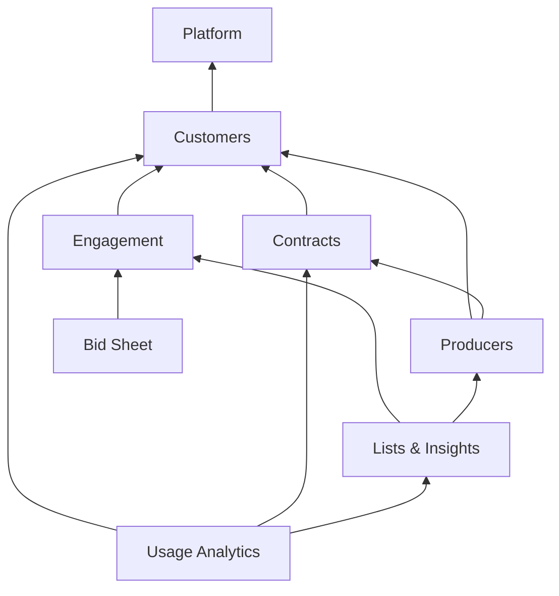

# Plan: Modular architecture and a Trader persona

*Created 2026-10-08. Refreshed against `main` on 2026-11-03, and the access design switched to the company permissions model the same day. On 2026-11-04 roles became persona roles plus add-on roles, with read-only the default. [Changes since the first draft](#changes-since-the-first-draft-2026-11-03) lists all three. Status: Phase 1 (access plumbing) is built on the integration branch, and Phase 2 (backend modules) is built on its phase branch, finished 2026-11-08 ([§8](#8-phased-rollout)). Phase 1b and Phases 3–6 haven't started, and nothing has reached `main`.*

---

## TL;DR

- **The request contains two separate problems. Treat them separately.**
  1. **Code modularity.** Where each module's code lives and what it may depend on. This is pure refactoring: it needs no business input and is worth doing even if traders never ship.
  2. **Trader data scope.** Today "customer" means *producer* and "contract" means *purchase*. That is hard-coded in the customer sync's filters and in the CTRM mappings. This is the critical path for traders, and it needs business answers. Since the customer sync moved to CTRM GraphQL (every environment, 2026-10-21), the producer filter is our own code rather than another team's ODS view, so the data change is mostly inside this repo.
- **Recommendation: a modular monolith inside the two projects we already have.**
  - Folders inside `Api` and `Infrastructure` are organized by module first, then by layer.
  - Keep one `ApplicationDbContext` and one database.
  - Boundaries are enforced by architecture tests on the backend and by ESLint on the frontend.
  - Not a project per module, and not microservices.
- **Access follows the company permissions style guide: roles grant `resource:action[:scope]` permissions.**
  - **Who has which role** lives in the shared entitlements app, and the roles arrive as claims in the API's access token. `Admin` becomes an ordinary role there instead of an Azure AD group. Likely roles: the persona roles `Originator` and `Trader`, IT's view-only `Support`, the add-on roles `Editor` and `Manager`, and the style guide's full-access `Admin`, which production gives only to a break-glass account.
  - **What each role may do** lives in our database: the permissions and the customer segments each role holds. IT edits it without a deploy for now, and business admins can take it over later. Grants are individual rows, denied by default, audited and kept in history.
  - **Resources are business-level** (planting intentions, notes, bid-sheet locations), 27 in all, and each belongs to one module.
  - **Every API endpoint requires a permission.**
  - **Read-only is the default.** A persona role (`Originator`, `Trader`) grants what you see. Add-on roles grant what you may do with it: `Editor` to edit, `Manager` its team powers. Roles only add, never take away, so a read-only trader holds `Trader` without `Editor`.
  - **IT sees everything in production but edits no business data.** Its `Support` role holds every read and IT's operational tools, and production never gives IT `Editor` or `Admin` (§7.3).
  - **Code never checks a role.** `/api/me/permissions`, routes, nav, preload, the customer screen's tabs and panels, and every add, edit and delete control check permissions.
- **Modules are the code boundary; permissions are what roles grant.** Giving a role one permission without its siblings is one row, not a code change or a deploy.
- **Traders get the same customer screen with fewer pieces, not a forked copy of the home page.** The shared customer profile becomes a shell, and producer tabs and panels plug into it through **extension slots**. Contracts and tickets plug in the same way.
- **What shows on the customer screen also depends on the customer.** Each contribution can name the customer segments it applies to, so a producer customer gets producer tabs and a commercial customer doesn't, whoever is looking.

---

## 1. Where we are today

**Backend: layered well, but flat.**
- The god-service is gone: every domain has a Repository, a Service and a Response DTO.
- The layers are still flat folders, though. `Api/Services/` holds 79 files and `Infrastructure/Repositories/` 25, so nothing says which ones are producer-only.
- `Program.cs` is 831 lines and registers every service in one list.
- `Infrastructure/Ctrm/` is no longer contracts-only. The GraphQL client there now also serves the customer master (`CtrmCustomerReader`) and the field plan's splits (`CtrmSplitReader`, `FieldTicketReader`).

**Producer and purchase assumptions are baked into "shared" code:**
- `Customer` carries `TotalAcres`, `FarmIds` and `LinkedProducerIds` (`Customer.cs:40-44`). `IndustryCode1` is commented "Used to filter producer customers (PR)" (`:71`).
- The customer sync admits only `IndustryCode1 = 'PR'`. **Non-producer customers never enter `dbo.Customer`.**
  - Every deployed environment has synced from CTRM GraphQL since 2026-10-20/21 (`CustomerSync:Source = ctrm`). There the filter is our own `CtrmCustomerFilters.IsInScope` (`CtrmCustomerFilters.cs:11`).
  - The add-a-customer search and onboarding-by-code pass the same code to the gateway's `industryCode1` filter (`CtrmCustomerQueries.cs:60`).
  - The ODS feeder, kept as the rollback, reads `originations.vw_CustomerTradeUnits`, which filters the same way.
- `CtrmMappings.PurchasePrefix = "P"` (`CtrmMappings.cs:20`) is applied to every contract read, and the prefix is also sent to the CTRM server. `VisibleTicketTypes = ["U","P"]` (`:366`).
- The ODS `ContractRepository` and `TicketRepository` hard-code `ContractPrefixType = 'P'` (`ContractRepository.cs:63, 101`) and `TicketType IN ('U','P')` (`TicketRepository.cs:238, 434` and others). Contracts and tickets have read from CTRM in every environment since 2026-10-06, so these ODS readers are now the rollback path.
- Customer search joins `dbo.ProducerDetails` and `dbo.ProducerContact` (`CustomerRepository.cs:147-160`).
- Several tests pin these assumptions, for example `CtrmMappingsTests.NonPurchaseContracts_AreDropped` and `PricingLines_FromNonPurchaseContracts_AreDropped`.

**Authorization:**
- There is one user-facing Azure AD app role, `Admin`, granted through the Super Users group. The synthetic `UsageDashboardViewAll` role was retired on 2026-10-09.
- **`Admin` covers two kinds of user.** The Super Users group holds managers and IT alike, and the code uses `Admin` for both: manager actions (the usage dashboard, team saved lists, deleting other people's bid-sheet locations) and IT actions (diagnostics, the customer sync, usage exclusions). §7.2 lists every check.
- A second app role, `Origination.Application`, is held by the BarChart ingestion pipeline's managed identity. It is a machine caller, not a persona: its `dbo.Roles` row is of kind `Machine` and grants only `bid-feed:manage` (§4.3).
- Everything else is trade-unit data scoping, which is a UX filter by design ([SECURITY-MODEL.md](docs/application-context/SECURITY-MODEL.md)).
- That doc says to revisit the model "if the role surface stops being near-binary." Adding Trader and read-only access is that moment.

**Frontend: one global everything.**
- `ApiService` is 1,272 lines and covers every domain.
- `AppStateService` is 639 lines and holds producer, shared and UI state together.
- `DataPreloadService` loads 14 streams for everyone, including planting, stored grain, DP, harvest windows, producer details and the dashboard summary.
- `home.component.ts` is 1,621 lines (2,579 at the first draft), and its `_loadAllData` (`:397`) still duplicates the preload.
- `customer-profile` has 47 inputs and outputs, a hardcoded tab list (`customer-profile.component.ts:495-505`) and a hardcoded `@switch` of tab content (`customer-profile.component.html:618`).
- The nav is hardcoded in `header.component.html`, and both menus say "Back to Producers".
- `core/` contains feature logic: `nlq-filter.service.ts` (3,443 lines), the Outlook and Teams services, and the field plan's `ctrm-split-api` and `fd-cic-api` services.
- `core` and `shared` import each other: the header and the help panel live in `shared` but inject `core` services.
- There is **no ESLint at all**, so nothing enforces boundaries. The `@core/*`, `@shared/*` and `@features/*` path aliases exist, but they are wildcards, so any deep import resolves.
- **The good news:** `contracts-table` and `tickets-table` are already presentational. Their only global state is `appState.commodityConversions` and its load-failed flag, so a trader view can reuse them as they are.
- **A precedent:** the field plan already composes its sustainability programs through a registry (`ProgramRegistry` over the `SUSTAINABILITY_PROGRAMS` injection token), the same shape §5.2 proposes for the customer screen.

---

## 2. Concepts: the style guide's words, plus three of ours

The permissions vocabulary comes from the company permissions style guide (`style-guides/permissions-model.md` in the scoular-skills plugin), used as written. Module, customer segment and data scope are this plan's additions.

```
User ──< Role ──< Permission = resource : action [: scope]      Resource >── Module
     (token,          (our DB)                                      (code)
  entitlements app)
```

| Term | Meaning | Where it lives |
|---|---|---|
| **Role** | A set of grants. **Persona roles** (`Originator`, `Trader`) decide what you see. **Add-on roles** decide what you may do with it: `Editor` adds editing, `Manager` team oversight. IT's `Support` role sees everything and edits no business data. `Admin` is the style guide's full-access base role, held in production only by a break-glass account. Roles only add (§7.3). `Admin` is an ordinary role, not an Azure AD group. | Assigned to users in the shared entitlements app; arrives as role claims in the API access token. Our `dbo.Roles` lists only the role names we grant to (§7.1). |
| **Permission** | What a role grants: `resource:action[:scope]`, e.g. `planting-intentions:write`, `saved-lists:read:team`. | The catalog is code (`AppPermissions`); grants are rows in `dbo.RolePermissions` (§4.3). |
| **Resource** | A business-level thing users work with, such as planting intentions, notes or bid-sheet locations. Each belongs to exactly one module. | `AppPermissions`, grouped by module. |
| **Action** | The guide's standard set: `read`, `create`, `update`, `delete`, `export`, `approve`, `assign`, `manage`. | Part of the permission string. |
| **Permission scope** | The guide's optional third part, about *ownership*: `own`, `team`, `global`. It replaces today's "Admin may also act on other people's records" checks. | Part of the permission string; services filter by it (§4.3). |
| **Module** | A cohesive slice of code with its own data access and UI, such as Producers or Contracts. The code boundary. A module is "on" for a user who holds any permission on its resources. | Module-first folders on both backend and frontend. |
| **Customer segment** | The kind of customer being viewed: `Producer` or `Commercial`. It decides which customer-screen contributions *apply*, independent of who is looking. | `Customer.Segment` (§6); the `segments` field on a contribution (§5.2). |
| **Data scope** | Which rows a user sees: trade units today, plus the customer segments and contract types a role may see. Not the same thing as permission scope. | Repository and service parameters; a role's segments are rows in `dbo.RoleSegments` (§4.3). It stays a UX filter, as today. |

**The one rule that keeps this clean:** code never asks "is this user a trader?" or "is this user an admin?"
- It asks "does the user hold permission X?"
- On the customer screen it also asks "does X apply to this customer's segment?"
- Roles are read in exactly one place, `PermissionService`, and translated through the grants in our database.

What that buys:
- Adding a role, such as a Merchandising Manager, is a role in the entitlements app plus its rows in our grants tables. No code, no deploy.
- Splitting today's `Admin` into `Manager`, `Support` and a break-glass `Admin` is the same.
- Read-only is the default. A persona role grants the reads and `Editor` adds the edits, so a read-only trader holds `Trader` alone (§7.3).
- Giving traders the Insights page later is one row.

**Keep resources coarse.** A resource is something the business would name, not a database table or an endpoint. There are 27 (catalog in §4.3).
- A screen declares every permission it needs. Growth Opportunity, for example, needs `producer-insights:read`, `planting-intentions:read` and `contracts:read`.
- So a panel can't be shown while the data it's built from is hidden. The first draft's "Growth Opportunity without the Planting tab" is no longer possible. If the business ever needs that, the panel gets a resource of its own then.

---

## 3. Module map

| Module | Default grants | What it owns | Depends on |
|---|---|---|---|
| **Platform** (core) | everyone | Auth, `/api/me`, permissions and the grant editor, user preferences, trade units and entitlements, telemetry (including the browser's App Insights config), What's New, Help, version, geocode, diagnostics, reference data (commodities, the curated planting crops, conversions, harvest windows, elevators/locations), the shared CTRM GraphQL client, the Doc Store client (documents filed by category; each feature names its own), middleware and filters, the layout shell | — |
| **Customers** | everyone | Customer master, the sync (both feeders, plus its admin diagnostics), search, the onboarding search, trade-unit assignments, customer list, profile **shell** with its extension slots | Platform |
| **Contracts** | everyone | Contracts, tickets, pricing lines, the CTRM/ODS readers and switches, contracts and tickets tables | Customers, Platform |
| **Engagement** | everyone *(confirm, Q6)* | Notes, reminders with the Outlook mirror, Teams mentions, daily digest | Customers, Platform |
| **Producers** | Originator | Planting intentions, producer details, contacts and grain on farm, stored grain, DP contracts, pacing, producer insights, growth opportunity, linked producers (`dbo.CustomerLink`) and the commodities a producer grows (`dbo.CustomerCommodity`), Planting Dashboard, the field plan (fields and CTRM splits, crop seasons, 45Z sustainability programs, the FD-CIC calculator) | Contracts, Customers, Platform |
| **Lists & Insights** | Originator *(for now)* | Build-a-List with its customer map, NLQ engine, saved lists, query library, Actionable Insights | Producers, Contracts, Engagement *(added 2026-11-10, for the NLQ engine's note and reminder filters; Phase 4, step 10d)*, Customers |
| **Bid Sheet** | Originator | Bid sheet, the BarChart bid feed (picker reads and pipeline ingestion) | Engagement (a sheet can be shared with a Daily Recap group; decided 2026-11-08), Platform |
| **Usage Analytics** | Manager, Support | Usage dashboard and its excluded users. It reads what Platform's usage tracking records, and names the customers, contracts and query-library prompts people used. | Lists, Contracts, Customers, Platform |
| **Calculators** | everyone | Frontend-only tools | Platform |



*Arrows mean "may depend on". The reverse is forbidden: Customers and Contracts must never reference Producers. That single rule is what lets a trader-only build of the screen exist.*

*"Default grants" are the rows the first seed migration writes (§7.1), not code. The role named reads the module; "everyone" means every persona role. `Support` reads every module, and `Admin` holds everything. Writes follow §7.3: edits go to `Editor`, personal writes stay with the persona role, manager powers go to `Manager`, and IT's operational powers to `Support`.*

---

## 4. Backend structure

### 4.1 Layout

Keep the style guide's two projects and its `Api → Infrastructure` reference rule. Inside each project, organize **by module first**:

```
api/GrainOriginatorPortal.Api/
├── Program.cs                        # ~260 lines (built in step 11): Key Vault bootstrap, AddPlatform() + AddXModule() calls, pipeline
├── Platform/                         # each area registers itself (AddSignIn, AddPreferences, AddCtrmClient, …); PlatformModule calls them
│   ├── Access/                       # PermissionService, RequirePermission, grant cache, grant editor API
│   ├── Identity/                     # MeController, RequestContextService, UserEntitlementService, DisplayNames; the Graph directory client and app access
│   ├── Preferences/                  # UserPreferences, UserTradeUnits, TradeUnits, Entitlements
│   ├── ReferenceData/                # Commodities (list, planting, conversions, harvest windows)
│   ├── Telemetry/                    # usage tracking + aggregation background services, ClientTelemetry, ClickEvents, TelemetrySanitizer
│   ├── Ctrm/                         # CtrmGraphQlClient: one client, used by Customers, Contracts and Producers
│   ├── DocStore/                     # IDocStoreClient and AddDocStore: Doc Store through APIM; each upload names its category
│   ├── Diagnostics/  WhatsNew/  Help/  Geocode/  Version/
│   ├── Middleware/  Filters/  Exceptions/   # Exceptions/ includes ApiErrorResponse, the error envelope
│   └── PlatformModule.cs             # AddPlatform(IConfiguration, IHostEnvironment); also the web-host plumbing: errors, JSON, CORS, rate limiting, compression, health checks
└── Modules/
    ├── Customers/
    │   ├── Controllers/  Services/  Mappings/
    │   ├── Models/Requests/  Models/Responses/
    │   └── CustomersModule.cs        # AddCustomersModule()
    ├── Contracts/                    # + SurfaceCtrmFailures, CtrmKeepWarmService
    ├── Engagement/
    ├── Producers/                    # + FieldPlan/ (field plan, CTRM splits, FD-CIC)
    ├── Lists/
    ├── BidSheet/                     # + BarChart read and ingest
    └── UsageAnalytics/

api/GrainOriginatorPortal.Infrastructure/
├── Platform/
│   ├── Access/                       # AppPermissions (the catalog; here so EF HasData can seed dbo.Permissions), Entities/, Configurations/.
│   │                                 #   Built in Phase 1: the first code in this layout, and the pattern Phase 2 follows
│   ├── Data/                         # all DbContexts, Migrations/, ApplicationDbContextFactory. Decided in step 11: this stays at Infrastructure/Data, which counts as Platform; moving it would rewrite 215 generated migrations for no runtime change. Platform's own entities stay in Data/Entities with it, configured in ApplicationDbContext
│   ├── Ctrm/                         # ICtrmGraphQlClient, CtrmConfig, throttle, retry, synthetic ids, provenance, CtrmPage
│   ├── Telemetry/  Preferences/  ReferenceData/  Identity/   # Platform's repositories (Interfaces/, Repositories/); Telemetry also has the usage projections and ScreenTimeCalculator
│   ├── Json/                         # the DateOnly, calendar-date and UTC DateTime converters
│   ├── Extensions/                   # what Platform or a module asks another module for (§4.4)
│   └── PlatformInfrastructure.cs     # AddPlatformInfrastructure(): DbContexts, CTRM provenance, Platform's repositories
└── Modules/
    ├── Customers/   Entities/  Configurations/  Interfaces/  Repositories/  Sync/  Ctrm/   # customer master + link discovery readers
    ├── Contracts/   Entities/  Configurations/  Interfaces/  Repositories/  Ctrm/          # contract/ticket readers, switches, CtrmMappings
    ├── Producers/   Entities/  Configurations/  Interfaces/  Repositories/  Ctrm/          # split readers, FieldTicketReader
    └── …
```

**Why module-first and not the style guide's layer-first?**
- The point of this work is "add or remove a feature in one place."
- With layer-first folders, a producer change touches six sibling directories that each mix producer and shared files.
- With module-first folders, `Modules/Producers` *is* the producer module, and a reviewer can see at a glance whether a PR crosses a boundary.
- **This is a deviation and should be recorded** in [STYLE-DEVIATIONS.md](docs/application-context/STYLE-DEVIATIONS.md). The guide's real constraints still hold: two projects, `Api → Infrastructure`, services do the mapping, entities in Infrastructure.

**Why not a project per module** (e.g. `GrainOriginatorPortal.Modules.Producers.csproj`)?
- It gives compiler-enforced boundaries.
- But it costs 10+ projects and buys little for a team this size when an architecture test gives the same guarantee.
- Keep it as the **graduation path**: if a module ever gets its own team or its own deployment, its folder lifts out cleanly because the boundary already holds.

### 4.2 Module registration

```csharp
// Program.cs
builder.Services
    .AddPlatform(builder.Configuration, builder.Environment)
    .AddCustomersModule()
    .AddContractsModule()   // CTRM/ODS repository switches live here; they read Ctrm:Source on every call
    .AddEngagementModule()
    .AddProducersModule(builder.Configuration)
    .AddListsModule()
    .AddBidSheetModule()
    .AddUsageAnalyticsModule();
```

```csharp
// Api/Modules/Producers/ProducersModule.cs
public static class ProducersModule
{
    public static IServiceCollection AddProducersModule(this IServiceCollection services)
    {
        services.AddProducersInfrastructure();   // repositories, from Infrastructure/Modules/Producers
        services.AddScoped<IPlantingIntentionService, PlantingIntentionService>();
        services.AddScoped<IProducerDetailsService, ProducerDetailsService>();
        services.AddScoped<IStoredGrainService, StoredGrainService>();
        // …
        return services;
    }
}
```

**One `ApplicationDbContext`, but entity configuration is owned per module.**
- Move the inline fluent configuration into `IEntityTypeConfiguration<T>` classes under each module's `Configurations/`.
- The context then calls `modelBuilder.ApplyConfigurationsFromAssembly(...)`.
- This must produce **an empty migration**; verify it with `dotnet ef migrations add VerifyNoModelChange` and then delete that migration.
- Do **not** split the database or the DbContext per module. There is one database with one migration history, and splitting it is all cost and no benefit here.

### 4.3 Permissions and policies

Three sources, each with one job:
- **The token** says who the user is and which roles they hold. The entitlements app assigns the roles (§7.1).
- **Our database** says what each role may do: `dbo.RolePermissions` and `dbo.RoleSegments`.
- **The code** says which permissions exist (`AppPermissions`), and every endpoint names the one it needs.

```csharp
// Api/Platform/Access/IUserRoleSource.cs: where a user's roles come from
public interface IUserRoleSource
{
    IReadOnlySet<string> GetRoles(ClaimsPrincipal user);
}
// ClaimsUserRoleSource: reads the role claims the entitlements app puts in the access token.
// Until that app issues persona roles (Roles.Kind = Persona), a token with none gets Access:DefaultRoles (§7.1).

// Infrastructure/Platform/Access/AppPermissions.cs: the catalog, grouped by module. The class a
// permission sits in is its module, and a test checks that every resource belongs to exactly one
// module. It lives in Infrastructure because dbo.Permissions is generated from it through EF HasData,
// and the DbContext can't reference Api.
public static class AppPermissions
{
    public static class Producers
    {
        public const string PlantingIntentionsRead  = "planting-intentions:read";
        public const string PlantingIntentionsWrite = "planting-intentions:write";   // create, update and delete
        public const string StoredGrainRead         = "stored-grain:read";
        // …
    }
    public static class Lists
    {
        public const string SavedListsReadTeam  = "saved-lists:read:team";     // today: Admin-only "team" endpoints
        public const string SavedListsWriteTeam = "saved-lists:write:team";
        // …
    }
    public static class Platform
    {
        public const string RolesManage     = "roles:manage";                  // the grant editor
        public const string DiagnosticsRead = "diagnostics:read";
        // …
    }
    // Customers, Contracts, Engagement, BidSheet, UsageAnalytics: same shape
}

// Api/Platform/Access/PermissionService.cs (scoped): the only code that reads roles
public sealed class PermissionService(IUserRoleSource roles, IRoleGrantCache grants, IHttpContextAccessor http, …)
    : IPermissionService
{
    // Everything the caller may do and see, worked out once per request:
    //   Roles        the token's roles found in dbo.Roles, plus the default roles if any apply
    //   Permissions  the union of those roles' grants (grants naming an unknown permission were dropped
    //                and logged when the cache loaded them)
    //   Segments     the union of their dbo.RoleSegments. Customer queries and ICommercialScopeProvider read this.
    //   Modules      the modules with at least one held permission: drives nav and preload on the client
    public Task<UserAccess> GetAccessAsync(CancellationToken cancellationToken) { … }
    public Task<bool> HasPermissionAsync(string permission, CancellationToken cancellationToken) { … }
}

// Authorization: the style guide's attribute + handler (§6.2 of the guide), never RequireRole
[AttributeUsage(AttributeTargets.Class | AttributeTargets.Method, AllowMultiple = true)]
public sealed class RequirePermissionAttribute(string permission) : AuthorizeAttribute($"Permission:{permission}")
{
    public string Permission { get; } = permission;
}
public sealed record PermissionRequirement(string Permission) : IAuthorizationRequirement;
public sealed class PermissionRequirementHandler(IPermissionService permissions, IHttpContextAccessor http)
    : AuthorizationHandler<PermissionRequirement> { … }

// AddAccess (AddPlatform in Phase 2): one policy per catalog permission.
// A named policy REPLACES the default policy rather than adding to it, so each one starts from
// the default policy's requirements (authenticated user, plus anything added there later) and
// adds the permission on top. eTMS missed this, and its permission policies skipped its
// active-user check. PostConfigure, so it copies the default policy as it finally stands.
services.AddOptions<AuthorizationOptions>().PostConfigure(options =>
{
    foreach (var permission in AppPermissions.All)
        options.AddPolicy($"Permission:{permission}", p => p
            .Combine(options.DefaultPolicy)
            .AddRequirements(new PermissionRequirement(permission)));
});
```

- **Test:** every `Permission:*` policy contains every requirement of the default policy, so a permission policy can never be weaker than the default (eTMS has the same test). The test changes the default policy after `AddAccess` to prove the copy happens last.
- **Test:** every `[RequirePermission]` names a catalog permission. One that doesn't has no policy, and its endpoint would fail with a 500 on first use.
- **The 403.** A missing permission gets the standard error envelope with code `AUTHZ_PERMISSION_DENIED` and each missing permission in `details`, never the permissions the caller holds (style guide §7.1). `AuthorizationAuditResultHandler`, which already logs every framework denial, writes it and logs `AUTHZ_PERMISSION_DENIED` with the permissions. Any other refusal gets the same envelope with `AUTH_REQUIRED` (401) or `ACCESS_DENIED` (403), which main added on 2026-11-05, and that code in the log.
- **Wrong person.** The handler refuses if it is asked about any principal other than the request's caller, because `IPermissionService` only answers for the caller.

```csharp
// A controller: the read permission at class level, a write permission on each write action.
// ASP.NET Core requires every policy that applies, so a write needs both.
[RequirePermission(AppPermissions.Producers.PlantingIntentionsRead)]
public sealed class PlantingIntentionsController : ControllerBase
{
    [HttpGet]  public Task<…> List(…)   { … }
    [HttpPost, RequirePermission(AppPermissions.Producers.PlantingIntentionsWrite)] public Task<…> Create(…) { … }
    [HttpDelete("{id}"), RequirePermission(AppPermissions.Producers.PlantingIntentionsWrite)] public Task<…> Delete(…) { … }
}
```

#### The grants tables

```
dbo.Permissions     (Id PK 'planting-intentions:write', Resource, Action, Scope, ModuleId, Description, CreatedAt, CreatedBy, ModifiedAt, ModifiedBy)
                    -- written only by migrations, from AppPermissions through EF HasData
dbo.Roles           (Id PK Guid, Name UNIQUE, Description, Kind (Persona | AddOn | Base | Machine), IsSystem, CreatedAt, CreatedBy, ModifiedAt, ModifiedBy)
                    -- data, like the grants: seeded by a migration, then the grant editor; names match the token's role values
dbo.RolePermissions (RoleId FK, PermissionId FK, CreatedBy, CreatedAt)   PK (RoleId, PermissionId)   -- temporal
dbo.RoleSegments    (RoleId FK, Segment, CreatedBy, CreatedAt)          PK (RoleId, Segment)        -- temporal
```

- **The style guide's tables (its §5.1), with these differences.** There is no `UserRoles` table, because assignments live in the entitlements app. A permission's key is its own string rather than a Guid: the catalog's strings are already unique, the `HasData` seed stays deterministic, and grant rows read plainly. `Roles` has no `ParentRoleId`, because grants never inherit. The audit columns follow `sql.md` rather than §5.1.1's `UpdatedAt`, and grant rows have no `Modified` columns because they are never edited. The `AddAccessAuditColumns` migration made those last two changes on top of `AddAccessGrants`, which was already applied to Dev and can't be backed out there.
- **Code owns the permissions; roles and grants are data.** Every permission is checked by an endpoint, so the catalog is code and `HasData` seeds `Permissions`. No code names a role: what kind a role is and whether it is the system role are columns, which the default-role rule and the `Admin` warning read (§7.1). The grant editor changes roles and grants at run time, so `HasData` must not own them, or a later migration could overwrite those edits. The first roles and grants are an `InsertData` in the `AddAccessGrants` migration. A test replays every migration and checks the result: the base role holds everything, add-on roles hold no segments, `Support` writes no business data, and `Originator` + `Editor` equals what a non-admin can do today.
- **Adding a role needs no code change.** It is a row plus its grants and segments: a grant migration until the grant editor can create roles (Phase 1b), and the same name in the entitlements app. **Never rename a role.** Everyone whose token carries the old name would lose its grants, so create the new role and retire the old one instead.
- **Deletes are restricted.** A migration that removes a permission or role must delete its grants first, deliberately (style guide §9.2).

#### Permission catalog

Settled against the endpoints in Phase 1 (2026-11-04): 42 permissions over 27 resources, in `AppPermissions`. "Personas" means `Originator` (and `Trader`, for the modules Q6 gives it) plus `Support`, which holds every read and every personal write. `Admin` holds everything, so it isn't listed.

**Three actions.** `read` to see a resource. `write` to create, change and delete it: whoever may change something may also add and remove it, so one permission covers all three and there are fewer grants to assign. `write` is a custom action, which the style guide allows when its standard set doesn't fit (its §4.2). `manage` is for IT's operational powers, never business data. The one other write is `bid-sheet-locations:delete:global`, a manager's power over other people's locations.

| Module | Permission | Guards | Seeded to |
|---|---|---|---|
| Platform | `preferences:read:own` | `UserPreferences` and `UserTradeUnits` GETs | personas |
| | `preferences:write:own` | `UserPreferences` PUT; the bid sheet's `PUT preference` | personas |
| | `reference-data:read` | `Commodities`, `TradeUnits`, the `Entitlements` catalog, `Geocode` (its two POSTs store nothing) | personas |
| | `diagnostics:read` | `Diagnostics` GETs; the access map | `Support` |
| | `diagnostics:manage` | `Diagnostics` POSTs: usage rollup backfill, commodity seed, elevator cache refresh and geocoding | `Support` |
| | `roles:manage` | the grant editor (Phase 1b) | `Support` |
| Customers | `customers:read` | `Customers` GETs, the onboarding search included | personas |
| | `customers:write` | assigning trade units (which also onboards a producer); removing a dormant trade unit | `Editor` |
| | `customer-sync:manage` | all of `CustomerSyncDiagnostics` | `Support` |
| Contracts | `contracts:read` | `Contracts` GETs except pacing | personas |
| | `tickets:read` | `Tickets` | personas |
| Engagement | `notes:read` | `Notes` GETs, the mention catalog included | personas |
| | `notes:write` | `Notes` POST, PUT, toggle-pin and DELETE, plus registering a Teams channel picked in the note composer. Anyone may edit any note, so no scope. | `Editor` |
| | `reminders:read:own`, `reminders:write:own` | all of `Reminders`. Every reminder endpoint touches only the caller's own. | personas |
| | `teams-channels:read` | `TeamsChannels` GETs | personas |
| | `recap-groups:read`, `recap-groups:write` | `DailyRecapGroups` GET; POST, PUT, enable and DELETE. Only a group's creator may delete it, as the service checks today. | read to personas, write to `Editor` |
| Producers | `planting-intentions:read`, `:write` | `PlantingIntentions` GETs; POST, PUT, retag and DELETE | read to personas, write to `Editor` |
| | `producer-details:read`, `:write` | `ProducerDetails` GETs and `customers/linked-to` (moved to Producers in Phase 2); PUT and DELETE | the same split |
| | `stored-grain:read`, `dp-contracts:read` | `StoredGrain`; `DpContracts` | personas |
| | `contract-pacing:read` | `GET contracts/pacing/{customerId}`, moved to Producers in Phase 2 (`ContractPacingController`, same route) | personas |
| | `planting-estimates:read`, `:write` | `DashboardPlantingEstimates` GETs; its three upserts and the actual-harvest DELETE | the same split |
| | `field-plans:read`, `:write` | `FieldPlan` GETs, `CtrmSplits` and `TDisc`; adding, editing and removing fields, seasons and records, and confirming or reopening a record | the same split |
| | `carbon-intensity:read` | `FdCic`, its scoring POST included, which stores nothing | personas |
| Lists | `saved-lists:read:own`, `:write:own` | `SavedLists` GET, POST, PUT and DELETE on your own lists | personas |
| | `saved-lists:read:team`, `:write:team` | `team` and `team-members`; `assign`, and PUT and DELETE on a teammate's list, checked in `SavedListService` | `Manager` |
| | `query-library:read` | `QueryLibrary`, its search-log POST included, which records only telemetry | personas |
| Bid Sheet | `bid-sheets:read`, `:write` | `BidSheet` GETs; every other `BidSheet` write (sheets, locations and their bids) and the BarChart `refresh-bids`. Deleting a location is limited to its creator. | read to personas, write to `Editor` |
| | `bid-sheet-locations:delete:global` | deleting someone else's location, checked in `BidSheetService` | `Manager` |
| | `bid-feed:read` | `Barchart` GETs: the picker | personas |
| | `bid-feed:manage` | `BarchartIngest`: the pipeline, and a person re-running the feed by hand | `Support`; the pipeline's `Machine` role |
| Usage Analytics | `usage-reports:read` | `UsageDashboard` GETs, `can-manage` included | `Manager`, `Support` |
| | `usage-exclusions:manage` | `access-users`; `excluded-users` GET, POST and DELETE | `Support` |

- **Changed from the first draft's catalog:**
  - **One `write` per resource** instead of separate `create`, `update` and `delete`, and `saved-lists:write:team` also covers sending lists to teammates (the draft's `assign:team`). Registering a Teams channel needs `notes:write`, since it only happens while writing a note.
  - **Dropped, because no endpoint needs them:** `daily-digests`, `producer-contacts`, `producer-insights` and `actionable-insights`. A screen built from other data declares the reads it uses (§2).
  - **Added:** `reference-data:read` for the shared lookups.
  - **Reminders are personal.** Every reminder endpoint reads and writes only the caller's own, so their permissions are scoped `:own` and seeded to the persona roles (Q9).
- **Mixed controllers that Phase 2 splits,** so each class-level permission belongs to its own module: `Contracts` (pacing goes to Producers) and `UsageDashboard` (the click event is exempt).
- **Every endpoint requires a permission.**
  - The read permission sits on the controller class and a write permission on each write action. That is 35 class attributes plus the write actions, covering all 181 endpoints, 76 of them writes.
  - A write action names a `write` or `manage` permission, or `bid-sheet-locations:delete:global`. Four POSTs store no business data: FD-CIC scoring, the two geocode lookups and the query-library search log. Those carry a read permission and are listed as non-mutating.
  - The first draft enforced per module because several screens read the same data. That stops mattering once a screen's access is the read permission on its data: each data endpoint needs one permission, and each screen declares all the reads it uses (§2).
- **Permission scope is applied in the service, as the style guide describes (§6.4 of the guide).** It replaces today's "Admin may also act on other people's records" checks:
  - `BidSheetService` lets the location's creator delete it, and anyone else only with `bid-sheet-locations:delete:global`.
  - `SavedListService` lets a holder of `saved-lists:write:team` change or delete another user's list when its trade units overlap the caller's. That is today's rule, minus the `IsAdmin()` check.
- **Extend `ControllerAuthorizationTests`** (reflection only, no new dependency):
  - Every action is covered by a `RequirePermission`.
  - Every controller carries a class-level permission from its own module, normally its read, so a write action always needs it too. The add-on roles rely on this (§7.3). The exempt list below is excluded.
  - Every non-GET action carries a write permission, unless it is on the non-mutating list.
  - Every permission is in `AppPermissions`, and every resource belongs to exactly one module.
  - **Exempt list:** `me` (including `/api/me/permissions`), `version`, `help`, `whats-new`, the client-telemetry config and the usage click event. Any signed-in user may call them. The click event is the one write among them: it records the caller's own clicks, so the test lists it separately (`OwnTelemetryPosts`) rather than letting the exempt list hold writes.
  - Every controller sits in `Api.Platform` or `Api.Modules`, so none escapes these checks (added in step 11, when the last controllers moved).
  - **Machine callers are roles too.** The pipeline's `Origination.Application` app role has a `dbo.Roles` row of kind `Machine` (migration `AddPipelineRole`) that grants `bid-feed:manage` and no segments. `BarchartIngest` is an ordinary `[RequirePermission(bid-feed:manage)]`, which a person re-running the feed by hand also passes, so no role name appears in code. The grant editor refuses to change `Machine` roles (Phase 1b).
- **Grants stay honest without a code map:**
  - `dbo.Permissions` is generated from `AppPermissions` through EF `HasData`. Adding a permission constant without a migration is a pending model change, and a test calling `HasPendingModelChanges()` fails on it. `RolePermission` has a foreign key to it.
  - **Deny by default.** A new permission reaches nobody until it is granted. Its PR includes a grant migration for the intended roles: the persona roles (`Support` included) for a `:read` or a personal write, `Editor` for an edit, `Manager` or `Support` for a manager or operational power, and always `Admin`. The first grant is therefore still code-reviewed; later changes are edits in the grant editor.
  - The deploy workflows run `dotnet ef database update` before new code goes out, so the grant exists when the code that checks it arrives.
  - `GET /api/diagnostics/access-map` (`diagnostics:read`) shows, per environment, each role's grants and segments, the default roles, any permission no role holds, and any permission only `Admin` holds. It reads the grant cache, so it shows what the instance enforces. That replaces the first draft's checked-in grant snapshot.
- **Generate the frontend's permission ids from `AppPermissions`.**
  - A backend test renders the catalog as a TypeScript union and fails if the checked-in `client/src/app/core/access/permission-ids.generated.ts` differs from it. A script regenerates the file.
  - A manifest or template that names a permission the server doesn't know won't compile (§5.2).
- **`GET /api/me/permissions`** follows the style guide (its §7.2): `{ userId, roles, permissions, modules, segments }`.
  - The SPA already reads roles from the API, because its ID token carries none, so it never cares where roles come from.
  - It also carries the `userId` the usage dashboard uses, so the SPA no longer calls `/api/me`. That endpoint is unchanged.
- **Caching and failure:**
  - Roles come from the token, so there is no lookup to cache and no outage to survive for them.
  - The grants (every role's permissions and segments) are small and the same for everyone. Each instance caches the whole map for about 5 minutes (`Access:GrantCacheDuration`), with a last-known-good copy.
  - A failed reload keeps serving that copy and retries after 30 seconds. While one request reloads, the others get the current copy rather than waiting on the database.
  - With no copy available, the request **fails closed** (503), as `UserEntitlementService` does today.
  - So a grant change takes effect within about 5 minutes. A role change waits for the user's next access token (§7.1).

### 4.4 Cross-module rules

- **Direction:** a module depends only on the modules it builds on, the "Depends on" column of the module map (§3), and on Platform. Never the other way: Customers, Contracts and Engagement never reference anything in `Modules.Producers`.
- **Allowed, in that direction:**
  - Another module's **service interfaces** and API models. Producers asks Customers through `ICustomerLookup` (trade-unit scoping, a customer's name, customers by id).
  - Another module's **entities**, for joins and foreign keys in the one shared DbContext. A producer table has a foreign key to `dbo.Customer` and joins it for names and trade units.
- **Not allowed, in any direction:** another module's repositories or their interfaces. A repository is where a module keeps its own rules (scoping, soft deletes, audit), so other modules go through its services.
- **Changed in Phase 2 (2026-11-07):** the first draft banned other modules' entities too. Producers joins the customer tables in about 25 queries across 7 repositories. Rewriting those as service calls would turn each join into two queries (or N+1) and make Phase 2 a rewrite rather than a move, so entities follow the direction rule instead.
- **When a shared module needs producer behaviour, invert the dependency:**
  - Customers defines an extension interface, e.g. `ICustomerSearchContributor`.
  - Producers implements it and registers it in `AddProducersModule()`.
  - **Registering a contributor doesn't limit who it runs for.**
    - There is one deployment, so every contributor is always registered, and it runs for traders too unless something stops it.
    - Each contributor therefore declares the permission it needs, e.g. `string Permission => AppPermissions.Producers.ProducerContactsRead`.
    - The Customers code that calls contributors asks `IPermissionService` first, and skips any contributor whose permission the user doesn't hold.
    - Where a contributor works on a single customer, it also skips customers outside its segments.
    - This is the same check the frontend registry applies to contributions (§5.2).
  - The first candidate is the `ProducerDetails`/`ProducerContact` join in customer search. Until it is replaced (Phase 5, before traders search customers; decided in Phase 4, step 9), that SQL is the one known Customers → Producers dependency, and the architecture tests can't see it because it's SQL text.
- **The same inversion works for any module a shared module needs, not only Producers.** The first one built (Phase 2, 2026-11-08) is Customers → Contracts:
  - Customers locks a trade-unit membership while the producer has an open contract or an unapplied ticket there. That is contract data.
  - Customers declares `ICustomerActivitySource`, and Contracts implements it from its contract and ticket repositories (`CustomerActivitySource`).
  - Extension interfaces sit in the declaring module's `Extensions` folder, not `Interfaces`. Rule 2 below bars other modules from `Interfaces`, which would stop them implementing it.
  - Customers has no fallback. A missing implementation fails when the customer repository is resolved, rather than treating every trade unit as dormant. `CustomersModuleTests` checks that the app registers one.
- **When neither module may depend on the other, Platform declares the extension.** No module pair needs it today. The first one built, in step 9 (2026-11-08), was for Bid Sheet asking which Daily Recap groups the caller is in, when Bid Sheet depended on no module.
  - **Changed in Phase 3 (2026-11-08):** Bid Sheet now builds on Engagement, on the backend and in the SPA, whose share dialog lists recap groups. `IRecapGroupMembership` moved from `Infrastructure/Platform/Extensions` to Engagement's root, beside `RecapGroupMembership`, outside `Repositories` and `Interfaces`, so Bid Sheet may use it. `BidSheetModuleTests` checks that Engagement registers it.
  - No fallback, as above. `PlatformExtensionsTests` checks that the app registers an implementation of every Platform extension.
- **Platform itself uses the same shape when it needs a module's answer** (step 11a, 2026-11-08):
  - `ICustomerTradeUnits` (Customers implements): a customer's trade units for the per-customer access check, and every customer's for the trade-unit catalog's fallback. It replaced `TradeUnitService's` use of `ICustomerRepository` and the entitlements repository's read of `dbo.CustomerTradeUnit`.
  - `IContractCommodities` (Contracts implements): the commodities on ODS purchase contracts, for the diagnostics page's commodity seed.
  - `ICtrmDiagnosticsService` stays in Platform's diagnostics services, where `DiagnosticsController` uses it, and Contracts implements it and registers it: the probes run its repositories and readers.
  - `ModuleBoundaryTests.Platform_DependsOnNoModule` now fails any Platform type that uses a module, except the DbContexts and their migrations in `Infrastructure.Data`, which map every module's tables.
- **Enforce these rules with architecture tests** in `Api.Tests/Architecture/`, using **ArchUnitNET** (Apache-2.0, actively maintained; NetArchTest has had no release since 2021). `ModuleBoundaryTests` has two rules, and a check that every catalog module declares what it builds on:
  1. `Modules.X.*` depends on no `Modules.Y.*` (Api or Infrastructure) unless X builds on Y.
  2. `Modules.X.*` doesn't depend on `Infrastructure.Modules.Y.Repositories` or `Interfaces` for any Y ≠ X. `Interfaces` is where the repository interfaces live, so leaving it out would let a module inject another module's repository.
- It is a new test dependency, so it needs an SBOM entry.

### 4.5 What moves where

| Module | Controllers | Notes |
|---|---|---|
| Platform | Me, UserPreferences, UserTradeUnits, TradeUnits, Entitlements, Version, WhatsNew, Help, ClientTelemetry, ClickEvents, Geocode, Diagnostics (with `DiagnosticsEnvironmentGate`); Commodities (`GET /`, `planting`, `conversions`, `harvest-windows`) | Done in step 11 (2026-11-08): 11a untangled Platform from the modules (§4.4); 11b moved every remaining file into `Api/Platform/<Area>` and `Infrastructure/Platform/<Area>` (the layout in §4.1) and put the catalog's permissions on UserPreferences and UserTradeUnits (`preferences:read:own`, the PUT `preferences:write:own`) and on TradeUnits, Entitlements, Commodities and Geocode (`reference-data:read`); 11c moved the registrations out of Program.cs into `AddPlatform`. `CtrmGraphQlClient` is in `Api/Platform/Ctrm`. |
| Customers | Customers, `search-ods` included; CustomerSyncDiagnostics (`customer-sync:manage`) | `CustomerSyncService`, its background service and the whole of `Infrastructure/Sync/` move here, with the customer readers from `Infrastructure/Ctrm/` (`CtrmCustomerReader`, `CtrmCustomerQueries`, `CtrmCustomerActivityReader`, `CtrmCustomerCandidateId` and their DTOs). `CtrmCustomerCodes` stays with the shared CTRM plumbing: it holds the gateway's `customerIds` filter limits, and only the contract and ticket readers use it. |
| Contracts | Contracts (minus `pacing`, `farm`), Tickets (minus `farm`) | The contract and ticket parts of `Infrastructure/Ctrm/` move here: readers, repositories, the two switches, `CtrmMappings`, `CtrmWarmRegistry`. The shared plumbing goes to Platform. Done in step 6b, with `SurfaceCtrmFailures` and the keep-warm service. `ContractStatusCalculator`, `TicketLocations` and `CustomerActivitySource` sit at the module root, outside `Repositories` and `Interfaces`, so Producers and Customers may use them. The shared plumbing moved to `Infrastructure/Platform/Ctrm/` in step 11. |
| Engagement | Notes, Reminders, TeamsChannels, DailyRecapGroups | Done in step 7, with the Outlook calendar and Teams directory services and the no-retry Graph client the calendar uses to create events. The shared `graph` client and `GraphDirectoryClient` stay with Platform: app access uses them, Engagement doesn't. |
| Producers | PlantingIntentions, ProducerDetails, StoredGrain, DpContracts, DashboardPlantingEstimates, FieldPlan, CtrmSplits, TDisc, FdCic; **gains** `contracts/pacing` (`ContractPacingController`) | Keep the **route templates unchanged**, so the SPA doesn't change. The split readers and `FieldTicketReader` come from `Infrastructure/Ctrm/`. Delete the `farm/{farmId}` endpoints on Contracts and Tickets and their `GetByFarmAsync` chain through services and repositories; the Farms controller itself is already gone. Done in step 6a: both always returned an empty list. |
| Lists | SavedLists, QueryLibrary | Done in step 8. Build-a-List, its customer map and Actionable Insights are browser-only, so the module's server side is saved lists and the query library. `ManagerDirectoryService` stays for Usage Analytics: only the usage dashboard uses it. |
| BidSheet | BidSheet, Barchart, BarchartIngest (`bid-feed:manage`, which the pipeline holds through its `Machine` role, §4.3) | Done in step 9, with the BarChart catalog and ingest and their result types (`Abstractions`). The entity `BidSheet` shares its name with the module's namespace, so module code names it as `Entities.BidSheet` (or fully qualified in the Api), as `BidSheetService` already did. Saving your bid-sheet preference needs `preferences:write:own` rather than `bid-sheets:write`. |
| UsageAnalytics | UsageDashboard (`usage-reports:read`; exclusions `usage-exclusions:manage`) | Done in step 10. The tracking writes (the request and click logging, sessions, rollups, the entitlements snapshot and retention) split off into Platform's `UsageTelemetryRepository`, used by the tracking and aggregation jobs and the rollup backfill; the dashboard keeps `UsageRepository` for its reads. The click-event POST moved to `ClickEventsController` (same route, any signed-in user), which went to Platform/Telemetry in step 11 with `ClientTelemetryController`. The usage projections and `ScreenTimeCalculator` stay with Platform: the rollup job uses them too. |

**Changed in Phase 2 (2026-11-07):** the first draft also moved `customers/search-ods`, `customers/linked-to`, `commodities/planting` and `commodities/harvest-windows` into Producers. The Phase 1 catalog had settled them otherwise, and Phase 2 follows it:
- **`commodities/planting` and `commodities/harvest-windows`** are reference data (`reference-data:read`, Platform). The curated crops feed Bid Sheet, Build-a-List and the calculators as well as planting intentions, and the harvest windows are preloaded for every user.
- **`customers/search-ods`**, the onboarding search, stays with Customers (`customers:read`). Phase 5 widens onboarding to commercial customers.
- **`customers/linked-to`** moved to Producers after all, in step 5 (`LinkedProducersController`, `producer-details:read`, same route). Its data is all producer data (`dbo.CustomerLink` and `ProducerDetails.TotalAcres`), so Producers finds who links to a producer, asks Customers for those customers through `ICustomerLookup`, and adds the acres and links on top. That removed the Customers repository's only compiled read of a Producers table.

**Found while moving Customers (2026-11-07), for the steps that follow:**
- **Contracts (done in step 6a):** `CtrmPage<T>` was declared in `CtrmContractDtos.cs`, and the Customers CTRM DTOs use it. It now sits with the shared CTRM plumbing in `CtrmPageDtos.cs`.
- **Engagement (done in step 7):** `NoteService` and `ReminderService` injected `ICustomerRepository`. They now use `ICustomerLookup`: a new note takes the first of the customer's ordered trade units, and a reminder takes the customer's name. That left `ICustomerRepository.GetFirstActiveTradeUnitAsync` unused, so it is gone.
- **Platform (done in step 11a):** `TradeUnitService` fell back to `ICustomerRepository.GetAllActiveTradeUnitCodesAsync` when the entitlements trade-unit list was unavailable. It now asks `ICustomerTradeUnits`, a Platform extension Customers implements (§4.4).

**Found while untangling Contracts (2026-11-08):**
- **Done in step 6a:**
  - Customers no longer reads the contract and ticket repositories; it asks `ICustomerActivitySource` (above).
  - Producers' field-ticket reader no longer borrows `TicketRepository` for ticket locations. The lookup is `TicketLocations` in Contracts, which both ticket repositories also use.
  - `CtrmQueries` is split by owner. `CtrmContractQueries` holds the contract and ticket documents, `CtrmSplitQueries` (Producers) the splits document, and `CtrmQueries` keeps what every document shares: the WAF rule and the 366-day ticket range. `CtrmQueryDocumentTests` now checks every module's query class, `CtrmCustomerQueries` included, which it never covered before.
- **Platform (done in step 11a):** the CTRM diagnostics service read the contract and ticket repositories, the contract switch and both CTRM readers for its probes. It moved into Contracts, behind Platform's `ICtrmDiagnosticsService` (§4.4). Also found then: the commodity seed read ODS contracts, now through `IContractCommodities`, and the shared `CtrmProducerCode` read the customer master, so it moved into Customers' `Ctrm` folder, where Contracts and Producers still reach it.

**Found while moving Lists (2026-11-08), for step 10:**
- **Usage Analytics (done in step 10, 2026-11-08):** the usage dashboard read the Lists module's `dbo.QueryLibrary`, and also the customer master and the ODS contracts, to name what people used. Decided: Usage Analytics depends on Lists, Contracts and Customers, as the module map now shows, and reads the names through `IQueryLibraryService`, `IContractLookup` (new, ODS-only: the ids are ODS ids) and `ICustomerLookup`.

**Found while moving Platform (2026-11-08, step 11b):**
- **Two Api responses belonged to one module each:** `CoordinatesResponse` (only `CustomerResponse` uses it) moved to Customers, and `ElevatorCacheResponse` (only the bid-sheet mappings) to Bid Sheet, rather than to Platform.
- **Program.cs comments that no longer matched the code,** fixed as the registrations moved: the rate limiter said 300 requests a minute where it allows 1000, and `IHttpContextAccessor` was said to be for `SqlDataService`, which is long gone. The nominatim client's per-attempt timeout carries a comment about CTRM contract pages, which it was evidently copied from; it moved unchanged.
- **A doc reference that pointed nowhere:** `CustomerIdMinting` linked to `Ctrm.CtrmSyntheticId`, which from inside Customers resolves to the module's own `Ctrm` folder, not the shared one. It now names `Platform.Ctrm.CtrmSyntheticId`.

**`CustomerResponse` sheds `TotalAcres`, `FarmIds`, `LinkedProducerIds` and `Farm`.** The Producers module serves them in a `ProducerProfileResponse` instead. This one *is* a wire change, so sequence it with the frontend in Phase 4.
- *Changed in Phase 4 (2026-11-10): no `ProducerProfileResponse`.* Customers never filled those four, so they always went out empty, and `/producer-details` (`ProducerDetailsResponse`) already serves the producer's acres, links, contacts, commodities, bin sites and grain on farm. Step 9b drops the four once the SPA reads none of them (§8).

---

## 5. Frontend structure

### 5.1 Layout

Keep the Angular style guide's `core / shared / features` split, and make each folder under `features/` a module with a **public API**.

*A note on naming:* the folder keeps the Angular style guide's name, `features/`, but each folder in it is a **module** (§2). That is why the manifest type is `ModuleManifest`. What roles grant are permissions, not features.

```
client/src/app/
├── app.modules.ts                  # the ONLY file that lists every module
├── app.routes.ts                   # built from app.modules.ts
├── core/                           # app-wide singletons; never imports features/*
│   ├── auth/                       # MSAL setup, authGuard
│   ├── access/                     # PermissionService (/api/me/permissions), permissionGuard, *appHasPermission, generated ids
│   ├── context/                    # TradeUnitContext (selection, groups), preload orchestrator
│   ├── modules/                    # ModuleManifest interface, ModuleRegistry, slot types
│   ├── layout/                     # header, nav, trade-unit-selector (moved from shared/)
│   ├── http/                       # dedupe helper, error interceptor (out of ApiService)
│   └── telemetry/  errors/  theme/  toast/  idle/
├── shared/                         # pure UI kit + pure utils; imports nothing from core or features
│   ├── ui/  pipes/  directives/  utils/
└── features/
    ├── customers/
    │   ├── index.ts                # public API: what other modules may import
    │   ├── customers.module.ts     # ModuleManifest
    │   ├── data-access/            # customers.api.ts, customer.store.ts
    │   ├── models/
    │   ├── components/             # customer-list, customer-profile (shell), edit dialog (core fields)
    │   └── pages/home/
    ├── contracts/                  # contracts-table, tickets-table, pricing; contract/ticket stores
    ├── engagement/                 # notes, reminders, Outlook, Teams, daily-digest
    ├── producers/                  # planting, storage, DP, insights, growth, pacing, dashboard page
    ├── lists/                      # build-list, NLQ engine, saved lists, insights, customer map
    ├── bid-sheet/  usage-analytics/  calculators/  whats-new/
```

*As built in Phase 3 (2026-11-09):*
- **`core/` is grouped by concern, as above, and keeps a `services/` folder** for what Phase 4 moves out: `ApiService`, `AppStateService`, `DataPreloadService`, the NLQ engine and the rest (§5.5). The help panel and its services are in `core/help`.
- **`shared/` kept its `components/` folder** rather than renaming it `ui/`.
- **A module folder has `index.ts`, `<module>.module.ts`, and whichever of `pages/`, `components/`, `data-access/`, `utils/` and `models/` it needs.** Most models are still in `src/app/models` (§5.5).
- **There is no `contracts/` folder yet.** Everything Contracts will own is a customer-screen component, and those move in Phase 4.
- **`help/` is a module**, holding the Help page.

### 5.2 The module manifest

Each module describes itself once in a manifest, and the app composes the result:

```ts
// core/modules/module-manifest.ts
export interface ModuleManifest {
  id: ModuleId;                              // matches /api/me/permissions modules[]
  routes?: Routes;                           // each route sets data: { requires: PermissionId[] }
  nav?: NavItem[];
  customerTabs?: CustomerTab[];
  customerPanels?: CustomerPanel[];
  customerEditSections?: CustomerSection[];
  customerPrintSections?: CustomerSection[];
  preload?: () => void;                      // runs in an injection context on trade-unit change
}

// PermissionId comes from core/access/permission-ids.generated.ts, generated from AppPermissions (§4.3):
//   export type PermissionId = 'planting-intentions:read' | 'planting-intentions:write' | …;
// A misspelled id such as 'planting-intentions:raed' is a compile error, not a tab that silently never shows.
export type CustomerSegment = 'Producer' | 'Commercial';

export interface NavItem {
  requires: PermissionId[];
  label: string;
  path: string;
  order: number;
  menu: 'main' | 'user';                     // header nav, or the user (profile) menu
}

// Every customer-screen contribution names the permissions it needs, and optionally the segments it applies to.
interface CustomerContribution {
  requires: PermissionId[];                  // shown only if the user holds all of them: every read it makes
  segments?: CustomerSegment[];              // shown only for these customers; omitted = every customer
  id: string;
  order: number;
  component: () => Promise<Type<unknown>>;   // lazy: users without the permissions never download it
}

export type CustomerSlot = 'badges' | 'actions' | 'details' | 'summary' | 'sidebar' | 'floating';

export interface CustomerPanel extends CustomerContribution {
  slot: CustomerSlot;
}

export interface CustomerTab extends CustomerContribution {
  label: string;
  shortLabel: string;                        // narrow layouts, e.g. "Cont", "Plan"
  badge?: () => Signal<number | null>;
}

export interface CustomerSection extends CustomerContribution {
  label: string;
}
```

#### Slot inventory

These are the slots the customer screen needs to host everything it shows today. Each one is owned by a host component, and modules fill it.

| Slot | Host and region | Type | Contributions |
|---|---|---|---|
| `nav` | Header (`core/layout`): main nav and user menu, desktop and mobile | `NavItem` | **Customers:** home (labelled "Producers" today; the label comes from the segment, §6). **Producers:** Planting Intentions Dashboard. **Lists:** Build a List, Actionable Insights. **Bid Sheet:** Bid Sheet. **Engagement:** Daily Digest *(user menu)*. **Usage Analytics:** Usage Dashboard *(user menu)*. The host's own items (Help, Manage Groups, Trade Unit Preferences) stay in the header. |
| `badges` | Profile header, beside the name | `CustomerPanel` | **Customers:** eSign status, ACH Payment. **Producers:** Organic Producer, with its certification detail and NOP ID. |
| `actions` | Profile header, button row | `CustomerPanel` | **Customers:** Print, Edit. **Lists:** Add to List. **Producers:** Producer Insights toggle. |
| `details` | Profile header, details row | `CustomerPanel` | **Customers:** Contact (ODS phone and email). **Producers:** user-entered contacts, Farm Details (acres, bins, grain on farm), Contract Pace YoY. |
| `summary` | Profile, between the header and the tabs | `CustomerPanel` | **Producers:** Producer Insights, Contract Pacing card and Growth Opportunity, all opened by the Insights toggle; Activity Summary, always visible. |
| tabs | Profile tab strip and tab content | `CustomerTab` | **Contracts:** Open Contracts; Unapplied Tickets *(producer customers only, §6.3)*. **Producers:** Planting (which hosts the field plan's crop-fields panel and program enrollment cards), Storage, DP Contracts. |
| `sidebar` | Home page, right column | `CustomerPanel` | **Engagement:** My follow-ups (reminders), Notes. |
| `floating` | Home page, floating launcher | `CustomerPanel` | **Calculators:** calculator launcher. |
| edit sections | Edit Customer dialog | `CustomerSection` | **Customers:** core fields. **Producers:** acres, bins, grain on farm. |
| print sections | Print report dialog | `CustomerSection` | **Customers:** header and contact. **Contracts:** contracts, pricing lines, tickets. **Producers:** planting, storage, yield estimates, linked producers. **Engagement:** notes. |

- **A contribution renders only when both checks pass:** the user holds everything in its `requires`, and the selected customer's segment is in its `segments` (or it lists none).
  - Producer contributions list `segments: ['Producer']`. An originator who opens a commercial customer sees no producer tabs, and no role check is involved.
  - Customers and Engagement contributions, and the Open Contracts tab, list no segments, so they apply to every customer.
  - The Unapplied Tickets tab lists `segments: ['Producer']`. Applied and unapplied are purchase-side rules (§6.3). Commercial customers get a sales-side tickets tab once Q3 defines one.
  - Commercial-only contributions, if traders get any, list `segments: ['Commercial']`.
- **Hosts own the layout; contributions own the content.**
  - The host decides where a slot sits and sorts its contributions by `order`.
  - A slot with no contributions renders nothing: no empty card, no heading.
  - The host's own items use fixed `order` values (for example Print 90, Edit 100), so module items interleave predictably.
- **Contributions get the customer from `SelectedCustomerContext` and their data from their own module's store,** never through inputs.
- **Contributions from the same module may share that module's state.** For example, the Insights toggle in `actions` opens the three panels in `summary` through a Producers-owned signal, and the host never knows they're related.
  - A contribution that controls others must degrade cleanly. The Insights toggle requires `producer-insights:read`, which every panel it opens also requires, so it never opens an empty area. A panel that needs more, such as Growth Opportunity, simply doesn't appear for a user who lacks the extra reads.
- **Edit controls check write permissions inside the contribution.** Add, edit and delete buttons use the `*appHasPermission` directive from the style guide (its §8.2), e.g. `*appHasPermission="'planting-intentions:write'"`. So a user without `Editor` sees the same tab with no way to change anything (§7.3). Edit-dialog sections list the write permission in `requires`.
- **A contribution may read the stores of modules it depends on,** in the direction of section 3, never the reverse. For example, the Contract Pacing card reads contracts through `@features/contracts`.
- **Several of these are inline markup today and become components when they move:** the eSign, ACH and Organic badges, the Insights toggle, the Contact card, Farm Details and Contract Pace all live directly in `customer-profile.component.html`.

**Placements to confirm:**
- **Activity Summary.** It is always visible today and mixes contracts, tickets, notes, planting and storage. As a Producers panel, traders lose it entirely. The alternative is a small host with its own slot, where each module contributes its own stats.
- **Contract Pace and the Contract Pacing card.** Both are computed from contract history, but they sit in Producers because §4.5 moves `contracts/pacing` there. If traders should see pace, they belong in Contracts.
- **User-entered contacts.** They come from `dbo.ProducerContact` through `ProducerDetailsController`, so §3 puts them in Producers. Traders will likely want contacts too, so contacts may need to move to Customers.

**Decided in Phase 4 (2026-11-10): no edit or print sections.**
- **The Edit Producer Details dialog and the Producer Summary Report each move whole into Producers,** rather than being put together from module sections. Both are producer screens today, and a trader customer's edit or report would likely ask for different things.
  - Each part inside shows only to a user with its permission. The report's sections and summary figures need their reads. Edit itself needs `producer-details:read` and `producer-details:write`, which Farm & Crops and Link Producers need, because its save always writes the producer's details; a user who could change only trade units would be refused on every save. Inside, Trade Units also needs `customers:write`, and moving planting intentions needs `planting-intentions:write`.
  - The dialog saves through `ProducerEditing` in `core/context`, which the home page provides, until the page's lists move into stores later in this phase.
  - Print and Edit are Producers panels in a new `toolbar` slot, the header's buttons. Add to List joined them there in step 8b as a Lists panel, first in the row, rather than going to `actions` as the slot inventory above has it. It applies to every customer, since a saved list is a list of customers, and reaches the home page's lists and save through `SavedListMembership` in `core/context`.
  - The manifest's `customerEditSections` and `customerPrintSections` are dropped.
- **Phase 5 gives trader customers their own edit dialog,** shown for the `Commercial` segment, and their own report if one is wanted.
- **Contacts are the overlap.** Both edit dialogs need them, and today they save with the producer's details under `producer-details:write`. In Phase 5 they get their own save and permission in Customers, and the contacts editor becomes one component both dialogs use. The Trade Units editor can be shared the same way if traders need it.

**Decided in Phase 4 (2026-11-10): the customer list gets two slots of its own.**
- **A filter slot,** `list-filter`, under the search box and above the rows. Lists fills it with the saved-list picker (step 10b), which runs the list's query through the NLQ engine, so the list itself no longer does; the list keeps who the panel says through the `CustomerListFilter` it provides (§8, step 10).
- **A row slot,** on each customer's row. Engagement fills it with the last-contacted and follow-up badges, and Producers with the acres, in step 10d.
- A trader's list then carries no producer pieces, and Customers reads no other module's data.

#### Example: the Producers manifest

One module contributes to many slots, and each contribution lists the permissions it needs. One permission can gate several contributions:
- `contract-pacing:read` gates both the Contract Pace figure in `details` and the Contract Pacing card in `summary`.
- `producer-details:read` gates both the Organic badge and the Farm Details card. The Farm section of the edit dialog needs `producer-details:write` instead.

Growth Opportunity lists every read it makes. Every producer contribution applies to producer customers only.

```ts
// features/producers/producers.module.ts
const producer: CustomerSegment[] = ['Producer'];

export const producersModule: ModuleManifest = {
  id: 'producers',
  routes: [{ path: 'dashboard', data: { requires: ['planting-estimates:read'] }, loadComponent: () => import('./pages/dashboard/dashboard.component').then(m => m.DashboardComponent) }],
  nav: [{ requires: ['planting-estimates:read'], label: 'Planting Intentions Dashboard', path: '/dashboard', order: 30, menu: 'main' }],

  customerPanels: [
    { slot: 'badges',  id: 'organic',            requires: ['producer-details:read'],   segments: producer, order: 20, component: () => import('./components/organic-badge/organic-badge.component').then(m => m.OrganicBadgeComponent) },
    { slot: 'actions', id: 'insights-toggle',    requires: ['producer-insights:read'],  segments: producer, order: 20, component: () => import('./components/insights-toggle/insights-toggle.component').then(m => m.InsightsToggleComponent) },
    { slot: 'details', id: 'contacts',           requires: ['producer-contacts:read'],  segments: producer, order: 20, component: () => import('./components/producer-contacts/producer-contacts.component').then(m => m.ProducerContactsComponent) },
    { slot: 'details', id: 'farm-details',       requires: ['producer-details:read'],   segments: producer, order: 30, component: () => import('./components/farm-details/farm-details.component').then(m => m.FarmDetailsComponent) },
    { slot: 'details', id: 'contract-pace',      requires: ['contract-pacing:read'],    segments: producer, order: 40, component: () => import('./components/contract-pace/contract-pace.component').then(m => m.ContractPaceComponent) },
    { slot: 'summary', id: 'producer-insights',  requires: ['producer-insights:read'],  segments: producer, order: 10, component: () => import('./components/producer-insights/producer-insights.component').then(m => m.ProducerInsightsComponent) },
    { slot: 'summary', id: 'contract-pacing',    requires: ['producer-insights:read', 'contract-pacing:read'],
                                                                                        segments: producer, order: 20, component: () => import('./components/contract-pacing-card/contract-pacing-card.component').then(m => m.ContractPacingCardComponent) },
    { slot: 'summary', id: 'growth-opportunity', requires: ['producer-insights:read', 'planting-intentions:read', 'contracts:read'],
                                                                                        segments: producer, order: 30, component: () => import('./components/growth-opportunity/growth-opportunity.component').then(m => m.GrowthOpportunityComponent) },
    { slot: 'summary', id: 'activity-summary',   requires: ['producer-insights:read'],  segments: producer, order: 40, component: () => import('./components/activity-summary/activity-summary.component').then(m => m.ActivitySummaryComponent) },
  ],

  customerTabs: [
    { id: 'planting', requires: ['planting-intentions:read'], segments: producer, label: 'Planting',     shortLabel: 'Plan', order: 30, badge: () => inject(ProducerStore).plantingCropCount, component: () => import('./components/planting-intentions-table/planting-intentions-table.component').then(m => m.PlantingIntentionsTableComponent) },
    { id: 'storage',  requires: ['stored-grain:read'],        segments: producer, label: 'Storage',      shortLabel: 'Stor', order: 40, badge: () => inject(ProducerStore).storageCropCount,  component: () => import('./components/stored-grain-table/stored-grain-table.component').then(m => m.StoredGrainTableComponent) },
    { id: 'dp',       requires: ['dp-contracts:read'],        segments: producer, label: 'DP Contracts', shortLabel: 'DP',   order: 50, badge: () => inject(ProducerStore).dpContractCount,   component: () => import('./components/dp-contracts-table/dp-contracts-table.component').then(m => m.DpContractsTableComponent) },
  ],

  customerEditSections:  [{ id: 'farm',     requires: ['producer-details:write'],   segments: producer, label: 'Farm',     order: 20, component: () => import('./components/edit-farm-section/edit-farm-section.component').then(m => m.EditFarmSectionComponent) }],
  customerPrintSections: [{ id: 'planting', requires: ['planting-intentions:read'], segments: producer, label: 'Planting', order: 30, component: () => import('./components/print-planting-section/print-planting-section.component').then(m => m.PrintPlantingSectionComponent) }],

  // Loads only the stores whose read permission the user holds, e.g. skips stored grain without stored-grain:read.
  preload: () => inject(ProducerStore).loadForSelectedTradeUnits(),
};
```

Inside the Planting tab, the add, edit and delete controls all check `planting-intentions:write`. The field plan's controls check `field-plans:write` the same way.

```ts
// app.modules.ts
export const APP_MODULES: ModuleManifest[] = [
  customersModule, contractsModule, engagementModule, producersModule,
  listsModule, bidSheetModule, usageAnalyticsModule, calculatorsModule, whatsNewModule,
];
```

**`ModuleRegistry`** (in core) collects every module's contributions and keeps the ones whose permissions the user holds, e.g. `customerTabs = computed(() => APP_MODULES.flatMap(m => m.customerTabs ?? []).filter(t => access.hasAll(t.requires)))`. Every extension point is derived from it:

- **Routes:** `app.routes.ts` maps every module's routes and adds `canMatch: [permissionGuard]`, which reads each route's `data.requires`. **The guard waits for the first `/api/me/permissions` load and denies if it fails;** it never allows a route on a default while permissions are still loading. eTMS's guard let a typed URL through in that window. This replaces today's per-route env ternaries; the build-time `environment.*Enabled` flags can feed `PermissionService` as an extra "module switched off in this environment" input. *(Phase 3 removed those flags instead; see "Built in Phase 3" below.)*
- **Nav:** the header renders `registry.navItems()`. Desktop and mobile menus come from the same list, so the duplicated markup at `header.component.html:72-107` and `:151-193` goes away. The user menu renders the items with `menu: 'user'`.
- **Customer screen slots:**
  - Each host renders its slots from the registry with `NgComponentOutlet`: `registry.customerTabs()`, `registry.customerPanels('summary')`, and so on.
  - The registry has already filtered by permission. The host also filters by the selected customer's segment, so the result changes as the user moves between customers.
  - The home page provides a `SelectedCustomerContext` in its own `providers`, which each contribution injects. It sits on the home page rather than the profile so the `sidebar` and `floating` slots, which are outside the profile, see the same customer.
  - Each contribution loads its own data from its module's store, which replaces the ~45 inputs and outputs threaded through home → profile today.
  - The contracts module contributes the Contracts and Tickets tabs the same way, so the shell knows about neither.
- **Preload:**
  - `DataPreloadService` becomes an orchestrator. On trade-unit change it runs `preload` only for the modules in `/api/me/permissions` `modules[]`, so traders never fetch planting, storage, DP or producer details.
  - Inside a module, `preload` skips stores whose read permission the user doesn't hold.
  - *Decided in Phase 3 (2026-11-09): the `modules[]` gate comes in Phase 4.* Phase 3 runs every module's `preload`, each checking its own permissions. The only one so far, Producers' dashboard-summary prefetch, already skips users without `planting-estimates:read`, so the gate would change nothing yet. Phase 4 adds the gate when Producers' store preloads arrive. That means `PermissionService` keeping `modules[]`, and a rule for Calculators, Help and What's New, which own no permissions and so never appear in it.

**Built in Phase 3 (2026-11-09).** The manifest has `id`, `routes`, `nav` and `preload`; the customer-screen slot types come with the slots in Phase 4. Where it differs from the design above:
- **Pages are typed rather than raw Angular `Routes`.**
  - A `ModuleRoute` is `{ path, requires, loadComponent }`, and `moduleRoutes()` in `core/modules` turns the pages into routes.
  - Every page gets `authGuard`. A page that names permissions also gets `permissionGuard`, with those permissions as its route data.
  - `requires` can't be left out, so a page open to anyone signed in says so with `[]`.
- **Each page requires what its screen reads:**
  - Dashboard: `planting-estimates:read`.
  - Build a List: `query-library:read` and `saved-lists:read:own`.
  - Actionable Insights: `customers:read`, `contracts:read` and `tickets:read`.
  - Bid Sheet: `bid-sheets:read`.
  - Manage Groups (`/daily-digest`): `recap-groups:read`.
  - Both Usage Dashboard pages: `usage-reports:read`.
  - Home, What's New and Help need sign-in only.

  A composition-root spec (`app.modules.spec.ts`) pins this list and checks that each link requires what its page does.
- **The route flags were removed** rather than fed to `PermissionService`.
  - `bidSheetEnabled`, `usageDashboardEnabled` and `dailyDigestEnabled` were on in every environment.
  - To switch a module off in one environment, remove its permissions from that environment's roles in the grant editor.
  - The remaining `environment.*Enabled` flags switch features inside a page, not whole pages, so they stay.
- **`NavItem` adds `shortLabel` and `icon`.**
  - The desktop bar shows the short label below its widest breakpoint.
  - The icon is SVG path data, so the header draws any module's link without importing anything from it.
- **The registry exposes `mainNav()` and `userNav()`.** The desktop bar and the mobile menu both render `mainNav()`. The mobile menu therefore now has the desktop order (Dashboard, Build a List, Insights, Bid Sheet), which swapped Insights and Build a List there.
- **The header keeps the home link** ("Producers", in the mobile menu only), along with Help, Trade Unit Preferences, the theme switch and sign-out. Customers takes the home link over when its label comes from the segment (§6).
- **The slot inventory's "Daily Digest *(user menu)*" is the Manage Groups link.** Engagement contributes it, and it opens `/daily-digest`. It isn't one of the header's own items.
- **`preload` takes the trade units and returns an Observable.** The orchestrator subscribes, so the next selection cancels it along with the rest of the load. Producers' preload is the dashboard-summary prefetch, which runs only for users holding `planting-estimates:read`.
- **`app.modules.ts` imports each manifest from its `<module>.module.ts`, not from `index.ts`.** An index also exports components that the build can't drop. Importing through the indexes put every module's screens in the initial bundle: 1.22 MB against 1.05 MB.

**Result:**
- A Trader-only user gets the same home page: customer list, profile shell, the Open Contracts tab (plus a sales-side tickets tab once Q3 defines one), and the notes/reminders sidebar.
- An originator who opens a commercial customer (if Q1 lets them see any) gets the same page without producer tabs and panels.
- A read-only user, holding a persona role without `Editor`, gets the same screens with every add, edit and delete control gone.
- No `if (isTrader)` or `isAdmin` appears anywhere, and a user without the permissions never downloads a contribution's JavaScript.

### 5.3 State and HTTP

- **`AppStateService` (639 lines) splits up:**
  - `core/context/TradeUnitContext` gets the user groups, trade-unit selection and in-scope codes.
  - Each module gets its own store, e.g. `CustomerStore`, `ContractStore`, `TicketStore`, `ProducerStore`, `NoteStore`.
  - Module UI state moves into its module: `buildListState`, the dashboard caches, `mapGeocodeCache`.
  - Signal stores in `providedIn: 'root'` services are only instantiated when injected, so a module the user can't open never builds its store.
- **`ApiService` (1,272 lines) splits** into per-module clients such as `features/contracts/data-access/contracts.api.ts`. The field plan's `ctrm-split-api` and `fd-cic-api` already follow that shape; they only need to move.
  - The `_dedupe` helper moves to `core/http`.
  - The 403 toast becomes an interceptor (`core/http/forbidden.interceptor.ts`), and it is the **only** place a 403 is shown: screens stop toasting their own 403s by checking `alreadyShown(err)` before their own failure message. eTMS showed two contradicting toasts per 403 (the global handler plus the screen). This has to be in place before Phase 2 enforces the first endpoint, so it is built in Phase 1.
- **The `Customer` model sheds** `farm`, `totalAcres`, `binCapacity`, `grainOnFarm` and `linkedProducerIds`. They move to a `ProducerProfile` in `features/producers/models`.
  - *Changed in Phase 4 (2026-11-10):* the producer profile is the existing `ProducerDetails` model, read through `ProducerProfiles` in `core/context`, which Producers' `ProducerProfileStore` implements (step 9a). `Customer` sheds ten fields in step 9b: `farm`, `totalAcres`, `linkedProducerIds`, `grainOnFarm`, `binSites`, `binSitesModifiedAt`, `contacts`, `primaryContact`, `primaryPhone` and `commodities` (`binCapacity` was already gone). The model stays in `src/app/models` with the other producer models that core's interfaces are written in (§5.5).

### 5.4 Boundary enforcement

Add ESLint, since none exists today. Use `@angular-eslint` plus `eslint-plugin-boundaries`; both are new devDependencies and need SBOM entries.

| From | May import |
|---|---|
| `shared` | `shared` only |
| `core` | `core`, `shared` |
| `features/X` | `core`, `shared`, its own internals, and **only the `index.ts`** of the modules it may depend on (section 3) |
| `app.*` | anything (composition root) |

- **Replace the wildcard `@features/*` alias with one alias per module**: `@features/customers` → `features/customers/index.ts`. Today `@features/*` lets any import reach any file.
- **Ban deep imports** with the plugin's entry-point rule.
- **Wire `ng lint` into CI.**

*Done in Phase 3 (2026-11-08):*
- **The packages** are `eslint`, `angular-eslint` (the single package that now replaces `@angular-eslint/*`), `typescript-eslint`, `eslint-plugin-boundaries` and `eslint-import-resolver-typescript`, all with SBOM rows.
- **Only the boundary rules are on.** Angular's recommended rule sets come with `angular-eslint` but aren't turned on; that is a separate decision.
- **`npm run lint` runs in the PR workflow** ahead of the client tests.
- **The module map in `eslint.config.js` mirrors the backend's, plus the SPA-only modules** (Calculators, Help, What's New). Customers could import Calculators until the home page's `floating` slot hosted the launcher; that exception went in Phase 4.
- **Shared and core may also import the plain models in `src/app/models` and the environment settings.**
- **The composition root isn't checked:** `main.ts`, `setup-tests.ts` and `app.*`. Specs may also import `src/testing`.

### 5.5 What moves where

| Today | Goes to |
|---|---|
| `core/services/api.service.ts` | per-module `data-access/*.api.ts`; dedupe → `core/http` |
| `core/services/app-state.service.ts` | `core/context/trade-unit-context` plus per-module stores |
| `core/services/data-preload.service.ts` | `core/context` orchestrator plus `preload` hooks in the manifests |
| `core/services/nlq-filter.service.ts` (3,443 lines) | `features/lists` |
| `core/services/outlook-calendar`, `teams-directory` | `features/engagement` |
| `core/services/ctrm-split-api`, `fd-cic-api` | `features/producers/data-access` |
| `shared/components/header`, `trade-unit-selector` | `core/layout` (they inject core state, so they aren't "shared") |
| `shared/components/help-panel` with `core/services/help*` | `core/help` (the panel injects core state; the Help *page* stays in `features/help`) |
| `shared/utils/planting-*`, `grain-on-farm`, `production-coverage`, `linked-producers`, `apply-producer-details`, `dp-aggregate`, `grain-bin-refine`, `organic-visibility`, `ci-copy-forward` | `features/producers/utils` *(changed in Phase 4: `linked-producers` and `producer-profile` stay, and `apply-producer-details` was deleted in step 9b; see below)* |
| `models/planting-intention`, `stored-grain`, `producer-details`, `harvest-window`, `dashboard-*`, `dp-contract`, `field-plan`, `fd-cic`, `carbon-intensity` | `features/producers/models` *(changed in Phase 4: only the ones nothing outside Producers uses; see below)* |
| `models/bid-sheet`, `barchart`, `usage-dashboard`, `whats-new`, `help`, `query-library`, `refine-filters` | their owning module (`help` to `core/help`; *changed in Phase 4:* `whats-new` stays, since What's New is Platform's) |
| `customers/components/contracts-table`, `tickets-table` | `features/contracts/components` |
| `customers/components/customer-notes`, `customer-reminders`; `features/daily-digest` | `features/engagement` |
| `customers/components/planting-intentions-table`, `stored-grain-table`, `dp-contracts-table`, `producer-insights`, `growth-opportunity`, `contract-pacing-card`, `activity-summary`, `field-plan` (about 3,300 lines with its store and programs); `features/dashboard` | `features/producers` |
| `customers/components/edit-customer-dialog` (1,369 lines plus a 747-line template) | Split in two: core fields stay in customers; acres, bins and grain on farm become a producers-contributed section. *Changed in Phase 4: moves whole to Producers, with each part gated by its write permission (§5.2).* |
| `features/build-list`, `customers/pages/insights`, `customers/components/map` (the customer map, used only by Build a List) | `features/lists` |
| **Delete (dead code):** `year-over-year-chart` (no remaining users), `AppState.currentView`/`ticketsLoading` (no readers outside the service) | — |

**Changed in Phase 3 (2026-11-08): a service, API call or piece of state moves with the components that use it.** Most of what the table above moves out of core (the NLQ engine, the Outlook and Teams services, the CTRM-split and FD-CIC clients, and most of `ApiService` and `AppStateService`) is used by customer-screen components that stay in `features/customers` until Phase 4 turns them into slot contributions. Moving the services first would make Customers import Lists, Engagement and Producers, which the module map forbids. So:
- **Phase 3** splits only what the owning module alone calls: the Bid Sheet and Usage Analytics clients, and Engagement's recap-group client (which the bid sheet may use, since Bid Sheet builds on Engagement). The shared error handler and request deduplication moved to `core/http`.
- **Phase 4** moves each customer-screen component together with its service, API calls and state.
- Platform's own calls (commodities, trade units, preferences, the entitlements catalog) stay in core for good.

**Phase 3 moved these rows of the table:**
- **To `core/layout`:** the header, the trade-unit selector and the toast container.
- **To `core/help`:** the help panel and its services.
- **To `core/auth`:** `authGuard`.
- **Pages, to their modules:**
  - The Planting Intentions Dashboard to Producers.
  - Build a List, Actionable Insights and the customer map to Lists.
  - The Daily Digest page to Engagement.
  - The usage dashboard to Usage Analytics.
- **State:**
  - The trade-unit selection and groups to `core/context/TradeUnitContext`.
  - Build a List's state and the map's geocode cache to Lists' stores.
  - The dashboard caches to Producers' `DashboardStore`.
- **Deleted:** the dead code in the last row.

**Left for Phase 4:**
- **The producer utils in `shared/utils` and the producer models,** by the rule above: customer-screen components use them.
- **The other module models in `src/app/models`:** `bid-sheet`, `barchart`, `usage-dashboard`, `whats-new`, `help`, `query-library` and `refine-filters`. Phase 3 didn't move them; Phase 4 moves them with each module's remaining files.
- **`DataPreloadService`.** It is the orchestrator now (§5.2), but it stays in `core/services`.

**Changed in Phase 4 (2026-11-10): some producer models and utils stay where they are.**
- **The producer models stay in `src/app/models`:** `planting-intention`, `stored-grain`, `producer-details`, `harvest-window`, `dp-contract` and those like them. The core interfaces the customer screen reads through (`ProducerProfiles`, `SelectedProducerProduction`, `SelectedProducerActivity`) are written in them, and core can't import a module. Only the models nothing outside Producers uses move there (`field-plan`, `fd-cic`, `carbon-intensity`, `tdisc`, and the `dashboard-*` models once the dashboard calls leave `ApiService`).
- **`linked-producers` and `producer-profile` stay in `shared/utils`,** because Customers uses them. The other producer utils move to Producers once nothing outside Lists and Producers uses them: some in step 10a, the rest in 10b when the NLQ engine leaves core. Those only Lists uses then (`grain-bin-refine`, `planting-chips`, `ticket-view-filters`) go to Lists instead.
- **`whats-new` stays in `src/app/models`.** What's New is Platform's (§3), and core's What's New service uses the model.
- Step 10 in §8 lists which step moves each of them.

---

## 6. Trader data scope (the critical path)

This is not a folder problem. The data simply isn't there yet.

1. **Customers.**
   - `dbo.Customer` holds only producers because every feeder admits only `IndustryCode1 = 'PR'`.
   - **Since 2026-10-21 that filter is our own code in every environment.** The CTRM feeder applies `CtrmCustomerFilters.IsInScope`, and the add-a-customer search and onboarding send `industryCode1: "PR"` to the gateway (`CtrmCustomerQueries`). The first draft's request for another team to broaden the ODS view is no longer on the critical path. The ODS view only matters if we roll back to `CustomerSync:Source = ods`.
   - **Widen the filter to a segment map.** Replace the single `ProducerIndustryCode` with a map from `IndustryCode1` values to segments, once Q1 says which codes are commercial. The name-quality filters (DUP, DO NOT USE, `*`/`$` placeholders) stay as they are.
   - **Backfill commercial trade-unit links.** The CTRM feeder re-asserts the links already in `dbo.CustomerTradeUnit` and discovers new ones only from a trailing window of contracts and tickets (`CustomerSync:DiscoveryWindowDays`, default 7). Commercial customers have no existing links, so on their own they would appear only as they trade. Seed them once with either:
     - an on-demand run with a wide `DiscoveryFrom` (the window allows up to 3,660 days), or
     - the customer↔trade-unit pairs query the API team has not yet delivered.
   - **Watch the nightly cost.** The sync looks up about 16.8k producers in about 840 requests a night. Adding commercial counterparties adds to that, so measure it with a dry run (`POST /api/diagnostics/customer-sync/run?dryRun=true`).
   - Then add a `Segment` column to `dbo.Customer` (`Producer` / `Commercial`, derived from `IndustryCode1` during sync).
   - Customer queries then filter by the caller's allowed segments, from `IPermissionService.GetAccessAsync().Segments` (§4.3).
2. **Contracts.**
   - Replace the hard-coded `'P'` with a scope value passed through the repositories:

     ```csharp
     public sealed record CommercialScope(
         IReadOnlySet<string> CustomerSegments,   // Producer today
         IReadOnlySet<string> ContractPrefixes,   // "P" today; Trader: TBD (Q2)
         IReadOnlySet<string> TicketTypes);       // "U","P" today; Trader: TBD (Q3)
     ```

   - A scoped `ICommercialScopeProvider` (in the Contracts module) builds it.
     - The customer segments come from the caller's roles through `dbo.RoleSegments` (§4.3). That is data scope: which customers they may see.
     - The contract prefixes and ticket types may follow **the customer's segment rather than the caller** (Q2). For example, a producer customer always shows purchase contracts and a commercial customer always shows sales contracts, whoever is looking.
     - If they do, the provider builds the scope per customer for profile reads and per segment set for list reads.
   - **CTRM work is the expensive part:**
     - `CtrmContractReader` sends the prefix to the server (`:527, 776, 1008, 1094, 1239`).
     - Its caches are keyed by producer set, so the scope must become part of the cache key.
     - `CtrmKeepWarmService` must warm the new scopes.
   - **The ODS readers are now the rollback path** (CTRM serves contracts and tickets everywhere since 2026-10-06). Decide whether they take the scope too, or stay producer-only and a rollback simply hides trader data until CTRM is back.
3. **Tickets: semantics, not just a filter.**
   - `IsApplied` (`Ticket.cs:64-76`) and the applied/unapplied UNION are purchase-side rules (U/L/C prefixes, storage gating).
   - Outbound tickets for sales almost certainly need different rules, so **ticket classification belongs behind the scope** rather than in a computed property on the entity.
4. **Tests.** The tests that pin `'P'` and `'PR'` become scope-parameterised: same assertions for the Producer scope, new cases for the Commercial scope.
5. **Wording.** "Producer", "Select a Producer" and "Back to Producers" come from the module or segment, not from the template.

---

## 7. Authorization changes

### 7.1 Roles and grants

- **Who has which role lives in the shared entitlements app, and arrives in the token.**
  - We keep no user-to-role table. The API reads the role claims on the access token (`ClaimsUserRoleSource`, §4.3).
  - **We define this app's roles.** The entitlements app lets each app choose its own roles, so the role list and names are our decision. Each name must match `dbo.Roles.Name`.
  - **Still to agree with the entitlements team:**
    - which claim carries the roles;
    - how the roles get into the token. If they are app roles on the API's app registration, assigned through Microsoft Graph, each role is also declared in that registration.
  - **A role change waits for the user's next access token,** roughly 60–90 minutes with Entra's defaults, not the ~10 minutes the first draft assumed. Removing someone's access is that slow unless their sessions are revoked.
  - A token role with no row in `dbo.Roles` grants nothing and is logged. A role in `dbo.Roles` that the entitlements app never issues is harmless.
- **`Admin` is an ordinary role.** It comes from the entitlements app like the others, and its permissions are rows like the others. Nothing in code gives it extra powers.
  - It is the style guide's required base role (§3.1 of the guide): every permission and every segment. It is a system role, so it can't be deleted and the grant editor can't change it.
  - **In production, only a named break-glass account holds it**, assigned when needed. IT has to be able to see everything in production without editing business data, so IT's everyday role is `Support` instead (§7.3). In Dev and QA, IT may hold `Admin` for testing.
  - `PermissionService` logs a security warning when a production request carries a system role (`IsSystem`, which only `Admin` is), once per user per hour. Break-glass use should be rare enough that every line deserves a look; until Phase 6 moves today's Super Users off `Admin`, a per-request line would bury the one that matters.
  - The switch-over can be invisible. Today's Super Users group already puts `Admin` in the `roles` claim. If we name the entitlements role `Admin` too and it arrives in the same claim, only who assigns it changes, and the group can then be retired.
  - That group holds managers and IT alike. Before production enforces permissions, they move to `Manager` and `Support`, and production `Admin` shrinks to the break-glass account (Phase 6).
  - New permissions reach `Admin` through their grant migration, like any role. A test fails if `Admin` lacks any permission in the catalog.
- **What each role may do lives in our database** (the §4.3 tables).
  - **Individual rows only.** No wildcards such as `*:read` or `contracts:*`. A persona role therefore holds one row per read permission of its modules, and a new read permission's grant migration includes it.
  - **Every change is audited and kept.** Each change writes a `role_modified` event, as the style guide's §10 requires: actor, role, permissions added and removed. `RolePermissions` and `RoleSegments` are SQL temporal tables, so "who held what, when" is a query. The repo has no temporal tables yet; these are the first.
  - **Who edits:** IT for now, through the grant editor, which requires `roles:manage`. `Support` holds it, in production too: changing grants is an operational action, not a business-data edit. Moving it to business admins later means granting `roles:manage` to their role: one row.
  - **Nobody can widen their own access.** The editor refuses changes to any role the person editing holds. Otherwise IT could add edit permissions to `Support` and give itself the edit rights production denies it.
  - **The editor can't lock everyone out.** It refuses to remove the last grant of `roles:manage` outside `Admin`. If that happens some other way, a migration restores it.
  - Until the editor ships (Phase 1b), grant changes go through migrations, reviewed like code. The style guide rules out hand-run SQL against an environment.
  - **Environments can differ.** Dev, QA and Prod each hold their own grants. A grant can be tried in QA first, but a passing QA no longer proves Prod has the same grants. The access-map endpoint (§4.3) lets you compare them.
- **Rollout without locking anyone out:**
  - The first seed migration grants today's behaviour, split as §7.3 describes:
    - `Originator` gets every read and personal write an originator uses now.
    - `Editor` gets the rest of their writes.
    - `Admin` gets everything.
    - `Manager` and `Support` get their §7.2 rows, and `Support` also gets every read.
    - Segments: `Originator`'s is `Producer`; `Support`'s and `Admin`'s are every segment; `Editor` and `Manager` hold none.
  - Until the entitlements app issues persona roles, a signed-in person whose token has no persona role (a `dbo.Roles` row whose `Kind` is `Persona`) gets `Access:DefaultRoles = ["Originator", "Editor"]`, and each person's use is logged once an hour. Today everyone can edit, so the default includes `Editor`. App-only tokens, such as the BarChart pipeline's, never get defaults: they carry no delegated scope.
    - `Support` counts as a persona role, so IT never picks up that default `Editor`.
    - Today's `Admin` tokens keep everything they have now, since `Admin` holds every permission.
  - **Remove that default before traders launch (Phase 6).** Otherwise a trader whose roles lag, or a token issued during an entitlements outage, would silently get producer access and edit rights.

### 7.2 Replacing today's Admin checks

| Today | Who it's really for | Becomes |
|---|---|---|
| `UsageDashboardViewer` policy; the SPA's `canViewUsageDashboard` | Managers and IT | `usage-reports:read` |
| Usage exclusions: `AdminOnly` plus the `ExclusionManagers` config list of four named people | IT | `usage-exclusions:manage`. The named-people list goes: the style guide grants only through roles. |
| Team saved lists: `SavedListsController` (`AdminOnly` ×3), `SavedListService.cs:194`, the SPA's `isManager = isAdmin` in Build a List and the home saved-lists store | Managers | `saved-lists:read:team`, `saved-lists:write:team` |
| Deleting a bid-sheet location someone else created (`BidSheetService.cs:117`) | Managers. It changes business data, so not IT (Q8). | `bid-sheet-locations:delete:global`; anyone with `bid-sheets:write` may still delete their own |
| `DiagnosticsController` (`AdminOnly` plus the environment gate) | IT | `diagnostics:read` / `diagnostics:manage`; the environment gate stays |
| `CustomerSyncDiagnosticsController` (`AdminOnly`) | IT | `customer-sync:manage` |
| `BarchartIngest` policy's "or Admin" | IT | `bid-feed:manage`, which the pipeline holds through its `Machine` role row |
| *(new)* the grant editor | IT now, business admins later | `roles:manage` |

- `AdminOnly`, `UsageDashboardViewer`, `RequestContextService.IsAdmin()` and the SPA's `isAdmin` and `canViewUsageDashboard` are deleted. The convention tests that pin those policies today pin the permissions instead.
- **The table shows two kinds of user, and they get separate roles** (§7.3). Managers get `Manager`, an add-on. IT gets `Support`, which holds the IT rows but no business-data edits. `Admin` keeps everything as the break-glass role (§7.1).

### 7.3 Persona roles and add-on roles

- **Roles only add.** A user's permissions are the union of their roles' grants (§4.3).
  - So a `Viewer` role can't make a `Trader` read-only: `Trader` + `Viewer` still edits everything `Trader` can.
  - A role that took permissions away would make the result depend on which mix of roles someone holds and which one wins. It would also fail unsafe: forget to assign it, and the user can edit.
  - So read-only isn't a role. It is the absence of `Editor`.
- **There are two kinds of role, plus `Admin`.** A **persona role** decides what you see. An **add-on role** decides what you may do with it. `Admin`, the style guide's base role, holds everything (§7.1).

  | Role | Kind | Holds | Segments |
  |---|---|---|---|
  | `Originator` | Persona | The `:read` permissions of the modules originators use, plus personal writes (Q9) | `Producer` |
  | `Trader` | Persona | The `:read` permissions of the modules traders use (Q6), plus personal writes | `Commercial` |
  | `Support` | Persona, for IT | Every `:read` permission and personal writes, plus IT's operational powers: `diagnostics:read` and `:manage`, `customer-sync:manage`, `usage-exclusions:manage`, `bid-feed:manage`, `roles:manage`, and the usage dashboard. **No business-data edits.** | every segment |
  | `Editor` | Add-on | Every shared-data write: the edits | none |
  | `Manager` | Add-on | The usage dashboard (`usage-reports:read`); team saved lists (`saved-lists:read:team`, `:write:team`); `bid-sheet-locations:delete:global` | none |
  | `Admin` | Base role | Every permission. Production: a break-glass account only (§7.1). | every segment |

  These are working names. We define the roles, so the final names are our call (§7.1).
- **Common combinations:**
  - An originator, which is everyone today: `Originator` + `Editor`.
  - A trader who edits: `Trader` + `Editor`. A read-only trader: `Trader`.
  - Reads everything, edits nothing: `Originator` + `Trader`. This replaces the `Viewer` role of the first permissions draft.
  - The originators' manager: `Originator` + `Editor` + `Manager`. A trading manager: `Trader` + `Editor` + `Manager`.
  - IT in production: `Support` alone. It sees everything and runs the operational tools, but edits no business data. In Dev and QA, IT may also hold `Editor` or `Admin` for testing.
- **IT's production rule is an assignment rule, so it has backstops.** Roles only add, so `Support` stays view-only only if production never also gives IT `Editor` or `Admin`.
  - The grant editor refuses changes to a role the editor holds, so IT can't add edits to `Support` (§7.1).
  - Production requests carrying `Admin` log a warning (§7.1).
  - The seed test fails if `Support`'s seeded grants include a business-data write. The access-map endpoint (§4.3) shows what `Support` holds in each environment.
  - These count as operational, not edits: diagnostics, re-running the customer sync or the BarChart feed, usage exclusions, and grants. Changing business data is an edit: customers, producer details, planting, notes, bid sheets and so on.
- **Add-ons act only where your persona lets you read.**
  - Every controller carries a permission from its own module at class level, normally its read, so every write also needs that permission (§4.3). The convention test enforces it.
  - For the modules personas use, only persona roles grant those reads. So `Editor` lets a trader edit only what `Trader` lets them read, and a trader holding `Editor` still can't use a producer write.
  - One `Manager` role serves both personas for the same reason. The team saved-list and bid-sheet powers work only for someone whose persona reads saved lists or the bid sheet.
  - The usage dashboard is the exception. `Manager` carries its read itself, because the originator and trader personas don't use that screen.
  - Add-ons hold no segments, so they never widen which customers anyone sees.
- **Mistakes fail safe.** Forgetting `Editor` leaves someone read-only. It never lets them edit something they shouldn't.
- **Known limit: someone with both personas edits both or neither.**
  - `Originator` + `Trader` + `Editor` edits producer and commercial data alike. "Edit producers, only read commercial" can't be expressed.
  - For area-specific data, per-persona editor roles (`Originator Editor`, `Trader Editor`) would fix that.
  - Shared resources still couldn't. Notes, customer edits and recap groups belong to shared modules, and permissions don't know which customer segment a write targets. That would also need shared-resource writes to check the customer's segment.
  - Not planned until someone needs it (Q7, Q9).
  - **Accepted for now.** Data scope gives users the data they want to see; it isn't a security boundary (`SECURITY-MODEL.md`, §7.4). Users rarely work on customers outside their own segment. This gets revisited if Q5 makes data scope a hard boundary.
- There are 76 write endpoints, and they aren't all alike:

  | Kind | Count | Examples | Held by |
  |---|---|---|---|
  | Shared business data | 47 | Bid sheet (16, the feed refresh included), field plan (10), planting, dashboard estimates, notes, producer details, customers, recap groups, Teams channel registration | `Editor` |
  | Personal | 10 | Preferences (2), your own saved lists (3), reminders (5) | The persona roles, so a read-only user keeps them |
  | Not real writes | 4 | FD-CIC scoring, the two geocode lookups, the query-library search log | The persona roles, as reads (the non-mutating list, §4.3) |
  | Manager power | 1 | Assigning a saved list. Team edits and deletes go through the personal endpoints, checked in the service. | `Manager` |
  | Operational or machine | 13 | Diagnostics (5), the customer sync run, BarChart ingest (5), usage exclusions (2) | `Support`, or the pipeline's machine role |
  | Exempt | 1 | The usage click event | Any signed-in user |

- **Personal writes are permissions too,** such as `preferences:write:own` and `saved-lists:write:own`, not exemptions. Which writes count as personal is a grant, not code. That is Q9.
- **Order matters.**
  - API enforcement (Phase 2) makes read-only safe: anything missed returns 403.
  - The UI pass (Phase 4) hides the controls, so a read-only user never meets that 403.
  - Until both are done, every persona role is assigned with `Editor`. A real user gets a persona role without `Editor` only after both.
  - IT's view-only production access depends on the same two steps. Until every write endpoint requires a permission, any signed-in user can still write.

### 7.4 Enforcement and data scope

- **The API checks a permission on every endpoint (403).** This is a deliberate step up from "UX only", and it is what the style guide requires. A trader without `planting-intentions:read` can't reach planting data by calling the API directly, whether or not the business strictly requires that (Q5).
- **Data scope** (trade units, and the customer segments a role may see) stays a UX filter, as `SECURITY-MODEL.md` describes, unless Q5 says otherwise.
- **Customer segment applicability is not access control.** Hiding producer tabs on a commercial customer is presentation: the tabs don't apply to that customer. Which customers a user may see at all is data scope, above.

### 7.5 Update `SECURITY-MODEL.md`

- Its "two Azure AD app roles plus data scoping" and "near-binary" rationale become: roles from the entitlements app, granted `resource:action[:scope]` permissions held in our database, checked on every endpoint.
- Its "no roles/permissions table" and "AAD group membership is where access is administered" lines reverse. Role assignments are administered in the entitlements app, and grants in our grant editor.
- Its "no in-app audit trail of role changes" consequence changes. Assignment history lives in the entitlements app; grant history lives in our temporal tables and `role_modified` events.
- It lists the exempt endpoints.

---

## 8. Phased rollout

Phases 1–4 deliver modularity and stand on their own even if traders slip. Phase 5 can run in parallel as soon as the open questions are answered.

| Phase | Size | What | User-visible change |
|---|---|---|---|
| **0. Decide** | — | Answer section 9 with the business; agree the module list and the draft resource catalog (§4.3); **define this app's roles in the entitlements app, and agree with that team which claim carries them and how** (§7.1); record an ADR; **ask the API team when the customer↔trade-unit pairs query will land**, which decides how commercial links are backfilled (§6.1) | none |
| **1. Access plumbing** | M | `AppPermissions` catalog and the generated TypeScript ids; the four grants tables, `HasData`, and the seed migration that reproduces today's access; `ClaimsUserRoleSource` with the temporary default role; grant cache; `PermissionService`; `RequirePermission` and its handler; `/api/me/permissions`; the access-map endpoint; frontend `PermissionService`, `permissionGuard` (waits for the first load) and `*appHasPermission`; the single 403 interceptor (screens stop showing their own 403s); the test that no permission policy is weaker than the default; **replace every Admin check in §7.2**; tests | none: everyone is `Originator` + `Editor`, and admins keep what they have |
| **1b. Grant editor** | S–M | An admin screen for each role's permissions and segments, and for creating and retiring roles (never renaming them), gated by `roles:manage`; `role_modified` audit; the last-grant guard, the no-editing-your-own-role guard, and no edits to `Machine` roles | IT changes roles and grants without a deploy |
| **2. Backend modules** | M, mostly `git mv` | One PR per module, **Producers first**: move files, fix namespaces, add `AddXModule()`, **put `RequirePermission` on every controller and write action and turn the convention test on for the module**, split mixed controllers (routes unchanged), per-module EF configurations as `IEntityTypeConfiguration` classes in each module's `Configurations/`, the pattern Phase 1 set in `Platform/Access` (empty migration), architecture tests, delete the `farm/{farmId}` endpoints. Program.cs shrinks to ~150 lines. | none. Read-only is now enforced by the API. |
| **3. Frontend foundations** | M | ESLint and boundaries; move header to `core/layout`; NLQ out of core; delete dead code; split `ApiService` and `AppStateService` per module; manifests and registry; data-driven routes and nav | none |
| **4. Profile extension slots** | L | Break up `home.component` (1,621 lines) and `customer-profile` into a shell plus slots; move producer components to `features/producers`; **`*appHasPermission` on every add, edit and delete control as its component moves**; per-module preload; `Customer` → `ProducerProfile` split (paired with the backend DTO change); segment filter in the hosts, treating every customer as `Producer` until Phase 5 adds the column | none for originators. **A Trader-role test user now gets a working contracts + tickets view, still over producer data, and a test user without `Editor` sees no control they can't use.** |
| **5. Trader data scope** | L | Customer `Segment`; widen the CTRM sync, search and onboarding from `PR` to the agreed industry codes; backfill commercial trade-unit links (§6.1); an edit dialog for trader customers, with contacts given their own save and permission in Customers (§5.2); `CommercialScope` through the contracts and tickets repositories and the CTRM readers and caches; outbound ticket semantics; tests; wording | traders see their own customers |
| **6. Trader launch** | S | In the entitlements app: assign `Trader`, plus `Editor` to traders who edit; confirm every originator holds `Originator` and `Editor` there; move today's Super Users onto `Manager` (with their persona role) or `Support`, and give production `Admin` only to the break-glass account; **remove the temporary default role**; QA with real traders; app-context doc for the trader view; `SECURITY-MODEL.md` update | traders onboarded |

**Phase 2 was done on 2026-11-08,** on `feature_ModularArchitecture-Phase2`, in twelve reviewed steps (fifteen commits) rather than a PR per module: the convention tests first, Producers in three steps, then Customers, Contracts (untangled first), Engagement, Lists, Bid Sheet, Usage Analytics, Platform, and a docs close-out. Where it differs from the row above:
- **Program.cs is ~260 lines, not ~150.** The Key Vault bootstrap, the dev warm-up and the commented pipeline stayed; every registration moved into `AddPlatform` and the modules.
- **`Infrastructure/Data` stayed where it was** (decided in step 11): the DbContexts, all 215 migrations, and Platform's own entities, whose configurations are still inline in `ApplicationDbContext`. Module entities have their own `IEntityTypeConfiguration` classes, and `Model_HasNoChangesWithoutAMigration` shows the moves changed nothing in the database.
- **Platform needs no module, and that is enforced too.** Where Platform needs a module's answer, it declares an extension the module implements (§4.4).
- **Not yet checked by running the app.** The tests are reflection- and unit-level; no test starts the app. Click through each module once the app is up on the integration branch.

**Phase 3 was done on 2026-11-09,** on `feature_ModularArchitecture-Phase3`, in eight reviewed steps (nine commits). Before the steps came one backend commit, letting Bid Sheet build on Engagement. The steps:
1. ESLint and the boundary rules.
2. The shell and help panel into `core`, and the dead code deleted.
3. Module folders with index files and one alias per module.
4. API clients for the modules that alone use them.
5. `TradeUnitContext` and module UI state.
6. Manifests, the registry and preload.
7. Routes and nav from the manifests.
8. This close-out.

Where it differs from the row above:
- **`ApiService` and `AppStateService` were split only part of the way, and NLQ stays in core.**
  - A service moves with the components that use it, and most of those are customer-screen components that move in Phase 4 (§5.5).
  - Bid Sheet, Usage Analytics and Engagement's recap groups have their own clients.
  - `ApiService` went from about 1,270 lines to about 840.
- **Bid Sheet builds on Engagement** (decided at the start of the phase), because a bid sheet can be shared with a recap group. Both the backend boundary tests and the SPA's lint rules allow it (§3, §4.4).
- **Pages now require the permissions their screens read,** and the three route flags are gone (§5.2). Nothing changes for current users, who all hold `Originator` and `Editor`.
- **One visible change:** the mobile menu now lists the module links in the desktop order.
- **Deferred to Phase 4:** the `modules[]` preload gate, the customer-screen slot types, and the remaining model and util moves (§5.2, §5.5).
- **Checked locally:** the app was run on 2026-11-09 and the header, mobile and profile menus work. The click through each module that the Phase 2 note asks for is still to do.

**Phase 4 is in progress** on `feature_ModularArchitecture-Phase4`, cut from `feature_ModularArchitecture`, in reviewed steps. Step 11 turns this list into the phase's record, like Phase 2's and Phase 3's above.

Done, in 23 commits (2026-11-09 to 2026-11-10):
1. The customer-screen slot types in the manifest (`2dbec000`).
2. Module stores cleared on sign-out and idle timeout again (`a31f1483`). Customers' own store, API client and preload (`e8c357f9`).
3. The selected producer's activity moved out of the home page (`dbca0d0f`) and read through `SelectedProducerActivity` (`437956e7`). The contracts and tickets tables became the Contracts module's profile tabs (`8e24bb19`).
4. The notes and follow-ups cards read `SelectedProducerEngagement` (`717d917c`) and became the Engagement module's sidebar panels (`1a2361d4`).
5. The planting, storage and DP tables read `SelectedProducerProduction` (`40fb13e6`) and became the Producers module's profile tabs (`11c2a8e8`). Planting's add and edit (`9ec0971c`) and the field plan (`b7598008`) are gated by permission.
6. The profile header's producer details (`42cfa900`) and the producer's performance panels (`9c316abc`) became Producers panels.
7. Print with the Producer Summary Report (`e2d2f5e9`), and Edit with the Edit Producer Details dialog (`c6fe0dcd`), moved whole into Producers. See "Decided in Phase 4" in §5.2.
8. The calculator launcher moved into the home page's `floating` slot (`2d69f12c`). Add to List became a Lists panel in the `toolbar` slot, before Print, needing `saved-lists:read:own` and `saved-lists:write:own`. It reads the lists, whether they failed to load, and the save from `SavedListMembership`, which the home page's `HomeSavedListsStore` implements, and the profile dropped the dropdown, its staging logic, three inputs and an output (`49f18332`). 8c is step 10b.
9. The `Customer` → producer profile split, in two parts.
   - Part a: every producer's details have one copy, Producers' `ProducerProfileStore`, which core declares as `ProducerProfiles` and the composition root provides. Producers' preload reads them, and the home page again on each visit, only for users with `producer-details:read`; `AppStateService` no longer holds them. Producers' panels and screens, Build a List with its filters, result rows and bin-site notes, and the NLQ engine (through its context) read a producer's details from it rather than off the customer (`76280638`).
   - Part b: a customer is just a customer, on both ends. The home page (the linked-producer walk and linked group, the commodity auto-saves, the edit save), the customer list, the profile and the Notes card read through `ProducerProfiles`, and nothing lays the details over a customer any more: `applyProducerDetails` and Build a List's copy of it are gone. `Customer` shed `totalAcres`, `linkedProducerIds`, `grainOnFarm`, `binSites`, `binSitesModifiedAt`, `contacts`, `primaryContact`, `primaryPhone`, `commodities` and `farm`; `CustomerResponse` and the entity `Farm`, `FarmIds`, `TotalAcres` and `LinkedProducerIds`; and `customers/linked-to` returns plain customers, so `GetLinkFieldsAsync` went too. `Model_HasNoChangesWithoutAMigration` shows the database didn't change. The NLQ engine's farm-name filter matches the customer's name, and the profile's dead farm line went, with the `header-panel` mark that only it read.
10. The clean-up, in four parts.
   - Part a: the preload gate, and the moves that fit now. `PermissionService` keeps the user's `modules`, and `ModuleRegistry` runs a module's `preload` only once the permissions have loaded, and only for a module the user holds or one its manifest marks `spaOnly` (Calculators, Help and What's New, which own no permissions). `app.modules.spec.ts` pins the module ids to the API's. `DataPreloadService` moved to `core/context`. The two customer searches moved to `CustomersApiService`, which core's new `CustomerSearch` declares for Help's troubleshooter. The `bid-sheet` and `barchart` models went to Bid Sheet, `usage-dashboard` to Usage Analytics, `help` with the help utils to `core/help`, and `field-plan`, `fd-cic`, `carbon-intensity`, `tdisc`, `organic-visibility` and `planting-trade-unit-filter` to Producers (`722d2830`).
   - Part b, first commit: saved lists into Lists. The saved lists, the team's lists and the query library moved from `AppStateService` and `ApiService` into Lists' `SavedListsStore` and `SavedListsApiService`, loaded by a Lists `preload` (which loads the store's code when it runs: imported with the manifest, it put the NLQ engine in the initial bundle, 1.16 MB against the 1.1 MB budget), with the `saved-list` and `query-library` models and the `saved-list-trade-units` util. One resolve works out who a list holds against the trade unit's data, for both its users:
     - the customer list's new `list-filter` slot, where the saved-list picker is now a Lists panel, narrowing the list through the `CustomerListFilter` the list provides; the picked list and its run (the data it needs read first, run again as more arrives, as the roster grows or as the list changes, kept or dropped across a trade-unit change) are `SavedListFilterStore`'s;
     - Add to List, which now reads the store itself, so `SavedListMembership` and the home page's `HomeSavedListsStore` are gone.
     The customer list and the home page hold no saved-list code; the customer list no longer reads the NLQ engine (`f973a9b3`).
   - Part b, second commit: the NLQ engine into Lists, in `features/lists/nlq/` with its ten specs, and the `refine-filters` model to Lists' models. `grain-bin-refine`, `ticket-view-filters` and `planting-chips` went to Lists' utils; `grain-on-farm`, `production-coverage`, `dp-aggregate` and `planting-category` to Producers' utils, which Producers' index now exports for Lists, its first public API. Nothing in core or `shared` runs the engine or reads the model, and the home page's specs no longer stub it.

Left:
- **Found and decided for step 9 (2026-11-10):**
  - **The server never sent the producer fields.** `CustomerResponse`'s `TotalAcres`, `FarmIds`, `LinkedProducerIds` and `Farm` come from entity properties EF ignores and nothing in Customers writes, so they always went out as `0`, `[]`, `[]` and `""`. Only Producers' `customers/linked-to` set acres and links on top. The SPA put the producer fields on its customers itself, from producer details: on the home page, in Build a List and in the customer list.
  - **`farm` is dead on both ends,** and the NLQ farm-name filter that reads it could only ever return no one.
  - **No `ProducerProfileResponse`.** `/producer-details` (`ProducerDetailsResponse`) already carries everything it would, so it is the producer profile, and the SPA's is the `ProducerDetails` model (§4.5, §5.3).
  - **The customer search's `ProducerDetails`/`ProducerContact` join waits for Phase 5** (§4.4). Search requires every word to match some field, and two of those fields are in Producers' tables, so a Producers contributor needs a design and a permission check of its own; traders don't search until Phase 5, when the search widens anyway.
  - **The customer list keeps showing acres** through `ProducerProfiles` until a Producers contribution to its rows, in step 10d's row slot.
  - **Two steps rather than five** (user 2026-11-10), each one reviewed commit.
- **10. Clean-up, the rest.** Each module takes its own data, and what is left in `ApiService` and `AppStateService` is Platform's.
  - **10c. Contracts' and Producers' data into their own stores.**
    - Contracts gets a store, an API client and a `preload` for contracts, tickets (today's, and the trade unit's on demand) and pricing lines.
    - Producers' store takes planting intentions, stored grain and DP contracts, with their API calls, and the home page's yield-estimate loading. The dashboard's calls move to Producers' API client, and the `dashboard-*` models with them.
    - The home page's selected-producer loads split between the two, and each implements its part of the core interfaces the screen reads (`SelectedProducerActivity`, `SelectedProducerProduction`).
    - Lists and the Planting Dashboard read the two stores rather than `AppStateService`.
  - **10d. Engagement's data into Engagement.**
    - Notes, the last-contact summary and the user's reminders move to Engagement's stores, with the home page's notes and reminders stores (and so `HomeEngagement`), `outlook-calendar.service.ts`, and the notes, reminders, Teams and mention API calls.
    - The customer list gets a row slot. The last-contacted and follow-up badges become Engagement contributions to it, and the acres a Producers one, so the list no longer reads `ProducerProfiles`.
    - Lists' note and reminder filters read Engagement's stores, so Lists depends on Engagement in both module maps (§3).
  - **Found and decided for step 10 (2026-11-10):**
    - **8c moves up from last to 10b** (user 2026-11-10). The customer list runs the NLQ engine only for its saved-list filter, and that filter is the main reason Customers reads the trade-unit pools; the selected producer's own loads and the list's badges, the others, move in 10c and 10d. Once 10b gives the engine and the filter to Lists, each pool can move into its module with only that module and Lists reading it. Done last, every pool move would first need a core interface just to keep feeding the customer list, deleted again by 8c. Done first, Lists reads the pools from `AppStateService` until they move.
    - **The producer models stay in `src/app/models`, and the `linked-producers` and `producer-profile` utils in `shared/utils`** (§5.5). The core interfaces from steps 3 to 9 (`ProducerProfiles`, `SelectedProducerProduction`, `SelectedProducerActivity`) are written in those models, and core can't import a module; Customers uses the two utils.
    - **Lists depends on Engagement** (§3). The NLQ engine filters on notes and reminders, which Engagement owns from 10d. Engagement depends only on Customers, so there is no cycle, and a core interface would only stand in for the same import.
    - **The customer list gets two slots, a filter slot and a row slot,** filled by Lists, Engagement and Producers, so a trader's list carries no producer pieces (§5.2).
    - **`outlook-calendar.service.ts` moves with the home page's reminders store** in 10d, since that store is its only user.
    - **Help's troubleshooter searches customers too** (found in 10a). It is in core, so it reads the searches through `CustomerSearch` in `core/context`, which Customers' `CustomersApiService` implements; the customer list and Build a List call `CustomersApiService` directly.
    - **`planting-category` moves in 10b, not 10a** (found in 10a). `shared/utils/production-coverage.ts`, which the NLQ engine in core uses, imports it, so it can't leave `shared` before `production-coverage` does.
    - **One resolve for saved lists, against the trade unit's data** (user 2026-11-10, in 10b). The home page and the customer list each worked lists out, against different data: the home page's own copies, whose tickets were only the selected producer's, and `AppStateService`. Now `SavedListsStore.resolve` does it for the picker and Add to List alike, against `AppStateService` and `CustomerStore`. So a ticket list's Add to List tick reads the trade unit's tickets, read once when the list needs them, rather than the producer's alone; the answer for the selected producer is the same. The resolve also tells the engine who the user is, which the picker's run didn't, so a list's "by me" filters work there too.
    - **10b in two commits** (user 2026-11-10): saved lists into Lists, then the NLQ engine and the utils, which only move.
    - **`SavedListMembership` went** (10b). It was in core only because the home page implemented it; Add to List is Lists', so it reads Lists' store.
    - **The customer list's filter is a context the list provides** (10b), as `SelectedCustomerContext` is the home page's: `CustomerListFilter` in `core/context`, which the panel in `list-filter` sets. The panel and its run live in Lists, which the list never names.
    - **Who a list holds is worked out only when read** (10b). It is a computed that Add to List reads, rather than an effect, so no other page works lists out as the trade unit's data changes. Add to List starts the extra reads a list needs.
    - **`grain-bin-refine`, `planting-chips` and `ticket-view-filters` go to Lists, not Producers** (found in 10b). The first and last read Lists' `RefinementFilters`, which Producers may not import, and only Lists uses `planting-chips` once the engine moves.
    - **The preload gate waits for the permissions before running any preload** (10a). Customers' preload used to mark the customers loading the moment a selection came in, before the permissions had answered; now it does once they have. Nothing that reads that flag opens sooner: the pages that read it wait for the permissions themselves, through `permissionGuard`.
- **11. Close-out.**
  - This list becomes the phase's record, and the docs follow.
  - The app is run and each module clicked through, as the Phase 2 and Phase 3 notes ask.
  - Phase 4 merges back into `feature_ModularArchitecture`, which goes to `main` once it has been tested.

Notes for whoever picks it up:
- **Each step runs these before it is staged:** `npx ng lint`, `npx tsc -p tsconfig.app.json --noEmit`, `npx ng build` and `npx vitest run`.
- **The spec type-check (`npx tsc -p tsconfig.spec.json --noEmit`) has 96 known errors.** A step must not add one.
- **Each new piece of wiring is checked by removing it** and confirming its spec fails.
- **`app.change-detection.spec.ts` renders the whole app and waits on timers.** It can fail under the full suite's load while passing on its own. A wait on something lazily loaded should poll for it, not sleep for a fixed time.
- **On Windows a watcher can briefly lock a source file.** A script that rewrites source files, such as a mutation check, must retry its writes and confirm the restore landed.

**This plan builds on `main` only.** It doesn't wait for or plan around other branches, the mobile app's included. That work gets redone on the new structure once this lands.

**Phases 1–4 reach `main` together** (decided 2026-11-07). Nothing can be tested before Phase 4 is done, so `feature_ModularArchitecture` is the integration branch. Each phase is built on its own branch cut from it, one phase at a time, and merged back. `main` is merged in at the start of each phase, and the integration branch goes to `main` once it has been tested.

**Rules that apply to every phase:**
- Each step is a reviewed commit that is independently shippable: the build and the tests pass after every one.
- Run `dotnet test` and `ng test` before every commit.
- Every phase updates the affected `docs/application-context/*` files.

---

## 9. Open questions for the business

1. **Who are a trader's customers?**
   - Which counterparties, i.e. which `IndustryCode1` values: end users, processors, other merchants?
   - Do traders ever need to see producers?
   - Do originators need to see commercial customers?
2. **Which contracts?**
   - Sales only, or both purchase and sales? What counts as "open" for a sales contract?
   - Do contract and ticket types follow the **customer** or the **user**? If a commercial customer always shows its sales contracts and a producer customer always shows its purchase contracts, whoever is looking, the scope follows the customer's segment (§6.2), and Q7 gets simpler.
3. **Which tickets?** Which ticket types are outbound (shipments, loadouts)? Is there an applied/unapplied concept on the sales side, and what replaces the "Unapplied Tickets" tab on a commercial customer? That tab is limited to producer customers until this is answered (§5.2).
4. **Trade units.** Do traders use the same trade units and TU groups (TradeUnitPreferences DB) as originators?
5. **Is hiding producer data from traders a requirement or a presentation choice?** Every endpoint now checks a permission, so a trader without `planting-intentions:read` can't call the planting API either way. The question is whether *data scope* inside a resource (trade units, customer segments) must also become a hard boundary, which would reopen H-034/H-036.
6. **Which shared tools do traders get?** Notes, reminders, Teams mentions, daily digest, calculators, Actionable Insights (unconfirmed contracts, spot loads), Build-a-List, Bid Sheet? Answer per resource and action, not per module. For example, traders could read notes without writing them.
7. **Users with both roles.** Segment applicability mostly answers this:
   - There's one combined customer list. Open a producer and you get producer tabs; open a commercial customer and you get commercial ones. No persona switch is needed.
   - **The remaining question:** should the list show both segments with a filter, or default to one?
8. **Confirm the `Manager` and `Support` split.** Today's Super Users group holds managers and IT alike (§7.2). `Admin` is now break-glass only in production, so each needs a role of its own (§7.3).
   - `Manager`: the usage dashboard, team saved lists, and deleting a bid-sheet location someone else created.
   - `Support`: every read, plus diagnostics, the customer sync, usage exclusions, the BarChart re-run, the grant editor and the usage dashboard. No business-data edits in production.
   - Is anyone besides managers allowed to delete someone else's bid-sheet location? It changes business data, so IT can't in production.
   - Who holds the production break-glass `Admin` account, and how is each use approved?
9. **Which writes are edits, and which are personal?** Edits go to `Editor`; personal writes stay with the persona role, so a read-only user keeps them (§7.3).
   - Preferences and your own saved lists are probably personal.
   - Reminders are seeded as personal: each one is visible only to its owner. Notes are the real question, because other users see and edit them.
   - Does anyone hold both personas but need to edit one area while only reading the other? One `Editor` can't express that (§7.3).

---

## 10. Explicitly not doing

- **No split of the database or `ApplicationDbContext` per module.**
- **No project or assembly per module** for now; section 4.1 describes the graduation path.
- **No role checks in code:** no `RequireRole`, `IsInRole`, `isAdmin` or `isTrader()`, and no role names in code at all: roles are rows (§4.3). Roles are read once, by `PermissionService`, and every check is a permission, including the pipeline's, through its `Machine` role row.
- **No user-to-role table in our database.** Assignments live in the entitlements app and arrive in the token.
- **No grants to named users,** such as today's `ExclusionManagers` list. Permissions flow only through roles.
- **No wildcard grants** such as `*:read` or `contracts:*`. Every grant is an individual row.
- **No per-table or per-endpoint resources.** Resources stay business-level: 27 today.
- **No persona checks in feature code**, such as `@if (isOriginator())`. Check permissions instead and, on the customer screen, the customer's segment.
- **No forked trader copy of the home page or the customer profile.**
- **No planning around other branches.** The plan builds on `main`; the mobile app and other branch work get redone on the new structure afterwards (§8).

## Decisions to record

- **ADR (via `/decision-log`):** modular monolith with module-first folders; the style guide's permission model with business-level resources; role assignments from the entitlements app via the token; grants (role → permission, role → segment) in our database, edited in-app and audited; `Admin` as an ordinary role with the style guide's full access, held in production only by a break-glass account; persona roles granting what you see and add-on roles (`Editor`, `Manager`) granting what you may do with it, so read-only is the default; IT's view-only `Support` role; a permission on every endpoint; extension slots for the customer screen; segment applicability.
- **[STYLE-DEVIATIONS.md](docs/application-context/STYLE-DEVIATIONS.md):**
  - Module-first folders inside the style-guide projects.
  - Role assignments come from the entitlements app through the token, not from a `UserRoles` table in our database.
  - Resources are business-level rather than one per entity.
  - Grants are individual rows with no role inheritance (no `ParentRoleId`).
  - Audit columns follow `sql.md`; grant rows have no `Modified` columns.
  - One custom `write` action per resource in place of `create`, `update` and `delete` (the guide allows a custom action when its standard set doesn't fit, §4.2).
  - A permission's key is its own string (`notes:write`), not a Guid; roles keep the guide's Guid ids.
- **SBOM** (README + CLAUDE.md): ArchUnitNET, ESLint, `@angular-eslint`, `eslint-plugin-boundaries` when they're added. *Done: ArchUnitNET with the boundary tests, and the ESLint packages in Phase 3.*
- **[STYLE-DEVIATIONS.md](docs/application-context/STYLE-DEVIATIONS.md), client:** core grouped by concern, and module folders with a public `index.ts` and `data-access/` (recorded in Phase 3).

---

## Changes since the first draft (2026-11-03)

### Access design: switched to the company permissions model

The first draft had roles grant coarse "features" from a map in code, with the API checking per module. A read-only role broke that: view vs edit is an *action*, and feature plus action is the style guide's `resource:action`. So:
- **The grant unit is now a permission** in the style guide's format, over 27 business-level resources (§2, §4.3).
- **Grants moved from code to our database.** That covers role → permission and role → segment. They are individual rows, denied by default, kept in temporal history and written to the `role_modified` audit. IT edits them in a grant editor (`roles:manage`) for now; business admins can take it over later (§7.1).
- **There is no role store of ours.** Who has which role lives in the entitlements app and arrives in the token, and `Admin` is an ordinary role there instead of the Super Users group (§7.1).
- **Every endpoint requires a permission,** where the first draft checked per module. Permission scope (`own` / `team` / `global`) replaces today's "Admin may also act on other people's records" checks, and §7.2 maps every current Admin check to a permission.
- **Roles are persona roles plus add-on roles, and read-only is the default** (revised 2026-11-04, §7.3).
  - Persona roles (`Originator`, `Trader`) grant reads, personal writes and a customer segment.
  - Add-on roles grant powers on top: `Editor` the edits, `Manager` its §7.2 powers.
  - `Admin` keeps full access, as the style guide's §3.1 requires, but production gives it only to a break-glass account. IT must see everything in production without editing business data, so its everyday role is a view-only `Support` persona with IT's operational tools. The grant editor refuses changes to a role the editor holds, so IT can't give itself edits.
  - The same day's first version had a `Viewer` role holding only reads. Because roles add up, `Trader` + `Viewer` would still have edited everything, so `Viewer` couldn't make anyone read-only except as their only role.
  - Someone who should read everything now holds both persona roles.
  - Add-ons work only where a persona grants the read, so one `Editor` and one `Manager` serve both personas. The convention test now checks the class-level permission that this relies on (§4.3).
- **Given up:**
  - Showing a computed panel while hiding the data behind it.
  - Module-wide grants that reached new features automatically.
  - The checked-in grant snapshot. Grant migrations and the access-map endpoint replace it.
- **Added:** Phase 1b (the grant editor), Q8 (confirm the `Manager` and `Support` split) and Q9 (which writes are edits and which are personal).

### Facts that moved on `main`

These moved between 2026-10-08 and 2026-11-03, and caused the following edits.

- **Customer sync moved to CTRM GraphQL** in Dev, QA and Production (2026-10-20/21). The producer filter is now our code, so §6.1 drops the ODS view request. It adds instead a segment map, a backfill of commercial trade-unit links and a check on nightly sync cost. Phase 0 and Phase 5 follow.
- **Contracts and tickets read from CTRM everywhere** (2026-10-06). The ODS readers are the rollback path; §6.2 asks whether they need the scope.
- **The CTRM client is shared.** It now serves the customer master and the field plan as well as contracts, so it moves to Platform and each module keeps its own readers (§4.1, §4.5).
- **New code placed in modules:**
  - Field plan, CTRM splits and the FD-CIC calculator go to Producers.
  - The BarChart read and ingest endpoints go to Bid Sheet.
  - Help and client telemetry go to Platform.
  - Customer sync diagnostics go to Customers.
  - The customer map goes to Lists.
- **Already done or gone since the first draft, so removed from the plan:**
  - `UsageDashboardViewAll` was retired.
  - The DbContext use in `EntitlementsController` and `NotesController` is gone.
  - The Farms controller is gone; only the `farm/{farmId}` endpoints remain to delete.
  - The Unshipped Bushels page was removed (#725).
  - `confirm-dialog` and `farm.model.ts` were deleted.
- **Sizes and line references refreshed throughout §1, §5 and §6.** `home.component.ts` shrank from 2,579 to 1,621 lines, while `ApiService`, `AppStateService` and `Program.cs` grew.
- **§8 builds on `main` only** (revised 2026-11-04). The first refresh sequenced the phases around four long-running branches, with Phase 1 waiting for the mobile branch's `Application` extraction. That is dropped: those branches, mobile included, get redone on the new structure afterwards.
