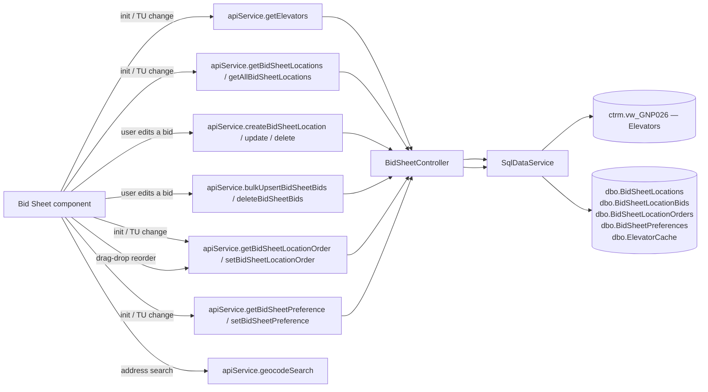

# Bid Sheet

## At a Glance

- **Route**: `/bid-sheet` (env-gated by `environment.bidSheetEnabled`)
- **Component**: [`client/src/app/features/bid-sheet/pages/bid-sheet/bid-sheet.component.ts`](../../client/src/app/features/bid-sheet/pages/bid-sheet/bid-sheet.component.ts)
- **Template**: [`bid-sheet.component.html`](../../client/src/app/features/bid-sheet/pages/bid-sheet/bid-sheet.component.html)
- **Access**: any authenticated Scoular user, **and** the env flag is enabled.
- **Primary user goal**: track competitor bids on a map, compare them against Scoular's reference location, and edit bids per location/commodity/month.

This is the merchandiser's competitive-pricing view. It overlays bid locations on a Leaflet map, color-coded by whether each location is matching, beating, or under reference.

## How users reach it

- "Bid Sheet" link in the sidebar (only present when `environment.bidSheetEnabled === true`).

## What it shows

| Section | Description |
| --- | --- |
| **Full-screen map** | Leaflet map with location markers. |
| **Floating filter bar** (top-left) | Trade Unit Selector, crop dropdown, year dropdown, month dropdown, status filter (Matching / Beating / All), text search, "Clear" button. |
| **Floating action buttons** (bottom-left) | "Add Location", "Refresh" (with time-since-refresh), "Bids" toggle to show/hide the side panel. |
| **Map legend** (bottom-right, collapsible) | "KEY" legend: blue = Reference, red = Beating, yellow = Matching. |
| **Slide-in bids panel** (right edge, ~420px) | Either a list of locations (drag-drop reorderable) or a detail view of a single location with editable name, action buttons ("Set as Reference", "Copy"…), and a bid grid (commodity × month). |

## Data flow



## Files

| Layer | Path |
| --- | --- |
| Component | `client/src/app/features/bid-sheet/pages/bid-sheet/bid-sheet.component.ts` |
| Template | `client/src/app/features/bid-sheet/pages/bid-sheet/bid-sheet.component.html` |
| Controller | `api/GrainOriginatorPortal.Api/Controllers/BidSheetController.cs` |
| Service methods (group: BidSheet) | `GetElevatorsAsync`, `GetBidSheetLocationsAsync`, `GetAllBidSheetLocationsAsync`, `CreateBidSheetLocationAsync`, `UpdateBidSheetLocationAsync`, `DeleteBidSheetLocationAsync`, `BulkUpsertBidSheetBidsAsync`, `DeleteBidSheetBidsAsync`, `GetBidCropYearsAsync`, `GetBidCommoditiesAsync`, `GetBidMonthsAsync`, `GetBidSheetLocationOrderAsync`, `SetBidSheetLocationOrderAsync`, `GetBidSheetPreferenceAsync`, `SetBidSheetPreferenceAsync` |
| ODS view | `ctrm.vw_GNP026` (elevators with lat/lon, address, TU code, group name, IsScoularFacility flag) |
| App tables | `dbo.BidSheetLocations`, `dbo.BidSheetLocationBids`, `dbo.BidSheetLocationOrders`, `dbo.BidSheetPreferences`, `dbo.ElevatorCache` |
| Geocode endpoint | `GET /api/geocode/search` (free-text search, returns lat/lon) |

### App-DB tables

**`BidSheetLocations`** — `Id`, `Name`, `Address`, `City`, `State`, `Latitude`, `Longitude`, `ElevatorCode`, `TradeUnitCode`, `GroupName`, `IsScoularFacility`, audit columns.

**`BidSheetLocationBids`** — `Id`, `LocationId`, `CommodityCode`, `CommodityName`, `CommodityCategory`, `CropYear`, `Month` (0 = yearly, 1–12 = monthly), `Bid` (string-formatted price), audit columns.

**`BidSheetLocationOrders`** — Per-user persisted drag-drop order, keyed by `(UserId, TradeUnitKey)`, stored as JSON.

**`BidSheetPreferences`** — Per-user, per-trade-unit:
`CropCode?`, `Month?` (`null` = no preference, `0` = yearly, `1–12` = monthly), `CropYear?`, `CropOrder` (JSON array), `HiddenCrops` (JSON array), `SelectedMonths` (JSON array).

## State and caching

- `allElevators` — fetched once per session via `getElevators` (deduped via `ApiService._dedupe`).
- Locations are scoped to the selected trade unit; switching TU triggers a re-fetch.
- `mapGeocodeCache` (a `Map` on `AppStateService`) caches geocoded address → lat/lon results, capped at 500 entries.

## Drag-drop reordering

CDK drag-drop (`@angular/cdk/drag-drop`). User reorders locations in the bids panel; the new order is persisted via `setBidSheetLocationOrder` (JSON-encoded array of location ids), and re-applied on next load via `getBidSheetLocationOrder`. State stored per trade unit.

## Map view

Leaflet is **type-only imported** (`import type * as Leaflet from 'leaflet'`) and the runtime module is dynamically imported to avoid pulling Leaflet into the initial bundle for users who never visit Bid Sheet.

- Map container: `#mapEl` viewchild.
- Markers colored by bid status (blue / red / yellow per the legend).
- Address-only locations get geocoded via `apiService.geocodeSearch` on first save; the result populates `Latitude` / `Longitude` and is cached.

## Bid entry workflow

- Single location create: `apiService.createBidSheetLocation(payload)` (POST). Payload accepts inline `bids` to seed the row.
- Batch upsert: `apiService.bulkUpsertBidSheetBids(requests, tradeUnitCode)` (POST `/api/bidsheet/bids/bulk`). Used by the per-location bid grid editor.

The upsert request shape:

```ts
Array<{
  name?: string;
  elevatorCode?: string;
  tradeUnitCode?: string;
  groupName?: string;
  latitude?: number;
  longitude?: number;
  commodityCode: string;
  commodityName?: string;
  commodityCategory?: string;
  cropYear: number;
  month: number;          // 0 yearly, 1–12 monthly
  bid: string;            // formatted price, e.g. "4.25"
}>
```

Server-side validation lives in `BidSheetController` (TU validation via `IUserEntitlementService.ValidateTradeUnitsOrThrowAsync`).

## Crop year + month preferences

`BidSheetPreferences` persists per-user, per-trade-unit selections so the screen opens with the user's last-used filters. Fields:

- `CropCode` — selected commodity (e.g., `CORN`).
- `Month` — `null` = no month preference, `0` = yearly view, `1–12` = a specific month.
- `CropYear`.
- `CropOrder` — JSON array of commodity codes for display ordering.
- `HiddenCrops` — JSON array of dehidden commodities.
- `SelectedMonths` — JSON array (e.g., `[3, 6, 9, 12]`).

Persisted via `setBidSheetPreference`.

## Auth and feature flags

- `authGuard` — required.
- **`environment.bidSheetEnabled`** — checked in [`client/src/app/app.routes.ts`](../../client/src/app/app.routes.ts) (around line 30). When false, the route isn't registered (deep links 404 / redirect home) and the sidebar doesn't show the link.
- `[Authorize]` on `BidSheetController`. TU validation per call via `IUserEntitlementService.ValidateTradeUnitsOrThrowAsync` (the only endpoint family in the app where TU access is enforced — bids are TU-scoped business data).

## External integrations

- **Leaflet** — map rendering and clustering.
- `@angular/cdk/drag-drop` — location reorder.
- Geocode endpoint at `/api/geocode/search` (free-text → lat/lon, used when adding a location by address).

## User actions

| Action | Trigger | Method |
| --- | --- | --- |
| Add a location | "Add Location" button | `apiService.createBidSheetLocation` |
| Edit a location's metadata | inline edit in detail view | `apiService.updateBidSheetLocation(id, payload)` |
| Delete a location | trash icon | `apiService.deleteBidSheetLocation(id)` |
| Save bids | bid grid → "Save" | `apiService.bulkUpsertBidSheetBids` |
| Delete a commodity's bids on a location | "Clear" in bid grid | `apiService.deleteBidSheetBids(locationId, commodityCode, month?)` |
| Reorder | drag-drop in panel | `apiService.setBidSheetLocationOrder` |
| Update filter prefs | filter bar interactions | `apiService.setBidSheetPreference` |

## Troubleshooting

| Symptom | Likely cause | First place to look |
| --- | --- | --- |
| Map blank, no markers | Locations didn't load (TU not selected, or `getBidSheetLocations` returned empty) | TU selector + Network tab |
| Markers all in the wrong location | Geocode result mis-cached. Each location's lat/lon is stored on the row; re-geocode by editing the address. | `BidSheetLocations.Latitude/Longitude` |
| Bid edits don't appear after save | `bulkUpsertBidSheetBids` succeeded but UI cache didn't refresh | Verify the post-save `getBidSheetLocations` re-fetch fires |
| Drag-drop order doesn't stick across sessions | `setBidSheetLocationOrder` failed silently | Network tab; check `BidSheetLocationOrders` row exists for `(UserId, TradeUnitKey)` |
| Sidebar link missing | `environment.bidSheetEnabled === false` for this build | `client/src/environments/environment.ts` |
| 403 on a `/api/bidsheet/...` call | User isn't entitled to the requested TU | `UserEntitlementService.ValidateTradeUnitsOrThrowAsync` — check the user's entitlement set |
| Leaflet warnings about non-ESM module | Pre-existing build warning; safe to ignore unless build actually fails | Build output: `Module 'leaflet' ... is not ESM` |

## References

- [`Shared Infrastructure.md`](./Shared%20Infrastructure.md) — `IUserEntitlementService`, `ApiService` deduplication.
- [`SECURITY-MODEL.md`](../SECURITY-MODEL.md) — note that bid endpoints are the exception that **does** enforce TU access via `ValidateTradeUnitsOrThrowAsync`.
- `client/src/environments/environment.ts` — feature flag.
