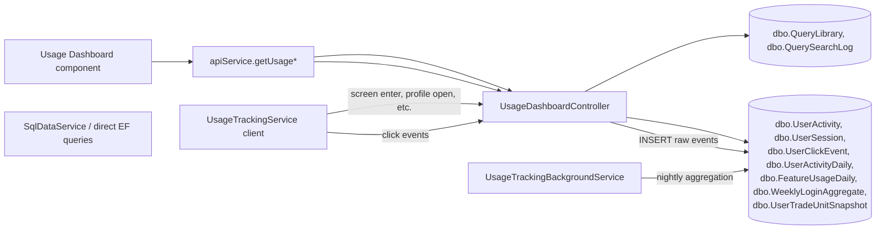

# Usage Dashboard

## At a Glance

- **Route**: `/usage-dashboard` (admin-only, env-gated by `environment.usageDashboardEnabled`)
- **Component**: [`client/src/app/features/usage-dashboard/pages/usage-dashboard/usage-dashboard.component.ts`](../../client/src/app/features/usage-dashboard/pages/usage-dashboard/usage-dashboard.component.ts)
- **Template**: [`usage-dashboard.component.html`](../../client/src/app/features/usage-dashboard/pages/usage-dashboard/usage-dashboard.component.html)
- **Access**: `authGuard` + `adminGuard` (must have `Admin` role claim).
- **Primary user goal**: monitor adoption, spot inactive originators, identify underused features, and find gaps in the query library — feed product / management decisions.

This is the only screen in the app that's gated by an actual role (vs. just "authenticated"). Backend reads are gated server-side too via the `AdminOnly` policy.

## How users reach it

- "Usage Dashboard" link in the sidebar — only rendered when (a) the user has the `Admin` role and (b) `environment.usageDashboardEnabled === true`.

## What it shows

| Section | Description |
| --- | --- |
| **Header** | "Usage Dashboard" title, Trade Unit Selector, date range buttons ("7 Days", "30 Days", "Custom"). |
| **Custom Date Picker** | Collapsible popup with "From" / "To" date inputs. |
| **4 KPI cards** | Adoption Rate (%), Avg Logins / Week (or / Month, dynamic), Avg Session Duration (min), Needs Attention (inactive + low-usage count). |
| **Tab pills** | `Who's Using It` · `What They're Doing` · `Who Isn't Using It` |

### `Who's Using It` tab

- User status donut (Active / Inactive / Never Logged In).
- Daily Active line chart (last 15 days).
- Originator table (sortable, filterable by status / name).

### `What They're Doing` tab

- Feature sessions bar chart (time spent per screen).
- Activity breakdown table (per user: profiles viewed, contracts viewed, notes, calls/emails, lists built, planting intentions, producer details).
- Weekly trend chart.

### `Who Isn't Using It` tab

- Inactive Originators list (threshold-configurable; default 30 days since last login).
- Low Usage Originators list (logged in but < 15 logins in the window).
- Underused Features bar chart.

## Data flow

## Files

| Layer | Path |
| --- | --- |
| Component | `client/src/app/features/usage-dashboard/pages/usage-dashboard/usage-dashboard.component.ts` |
| Template | `client/src/app/features/usage-dashboard/pages/usage-dashboard/usage-dashboard.component.html` |
| Frontend tracking service | `client/src/app/core/services/usage-tracking.service.ts` |
| Admin guard | `client/src/app/guards/admin.guard.ts` |
| Controller | `api/GrainOriginatorPortal.Api/Controllers/UsageDashboardController.cs` |
| Background aggregator | `api/GrainOriginatorPortal.Api/Services/UsageTrackingBackgroundService.cs` |
| App tables | `dbo.UserActivity`, `dbo.UserSession`, `dbo.UserClickEvent`, `dbo.UserActivityDaily`, `dbo.FeatureUsageDaily`, `dbo.WeeklyLoginAggregate`, `dbo.UserTradeUnitSnapshot`, `dbo.QueryLibrary`, `dbo.QuerySearchLog` |

### API service methods called

All from `loadData()`:

- `getUsageDashboardSummary(from, to, tradeUnitKey?)`
- `getUsageDashboardUsers(status?)`
- `getUsageDailyActive()`
- `getUsageFeatureSessions(screen?)`
- `getUsageWeeklyTrend()`
- `getUsageActivityBreakdown()`
- `getUsageDashboardInactive(daysThreshold)`
- `getUsageQueryLibraryUsage()`
- `getUsageQuerySearchGaps()`
- `getUsageUnderusedFeatures()`

### Controller endpoints

`UsageDashboardController.cs`. All read endpoints require `[Authorize(Policy = "AdminOnly")]`.

| Verb / route | Returns |
| --- | --- |
| `GET /api/usage-dashboard/summary` | adoption rate, active user count, avg logins/week, avg session duration |
| `GET /api/usage-dashboard/users` | list of users with status (Active / Inactive / Never Logged In), logins, last active, avg session, customers contacted, notes |
| `GET /api/usage-dashboard/daily-active` | daily unique-user counts |
| `GET /api/usage-dashboard/feature-sessions` | seconds per screen (or per sub-feature when `screen` param given) |
| `GET /api/usage-dashboard/weekly-trend` | logins + sessions per week (8-week window) |
| `GET /api/usage-dashboard/activity-breakdown` | per-user counts: profiles, contracts, notes, calls/emails, lists built, planting intentions, producer details |
| `GET /api/usage-dashboard/inactive` | users inactive ≥ threshold days |
| `GET /api/usage-dashboard/underused-features` | features sorted ascending by session count |
| `GET /api/usage-dashboard/query-library-usage` | most-clicked library queries with name resolved |
| `GET /api/usage-dashboard/query-search-gaps` | top 20 search terms that didn't match a library entry |
| `GET /api/usage-dashboard/users/{userId}/detail` | full per-user activity profile (sessions, per-feature counters, daily series, recent activity) — drives the per-user drill-down page |
| `POST /api/usage-dashboard/click-event` | telemetry endpoint — accepts events from any authenticated user (not admin-only) |

### App-DB tables

| Table | Purpose |
| --- | --- |
| `UserActivity` | One row per API call — `UserId`, `HttpMethod`, `Path`, `StatusCode`, `DurationMs`, `FeatureCode`, `SubFeatureCode`, `Timestamp`. Captured by middleware. |
| `UserSession` | One row per login session — `UserId`, `LoginTime`, `LastActivityTime`, `DurationMinutes`. |
| `UserClickEvent` | Frontend-emitted click telemetry — `UserId`, `EventType`, `FeatureCode`, `SubFeatureCode`, `TargetId`, `Timestamp`. Posted via `/api/usage-dashboard/click-event`. |
| `UserActivityDaily` | Nightly roll-up of `UserActivity`. |
| `FeatureUsageDaily` | Nightly roll-up of clicks per `(FeatureCode, SubFeatureCode)`; `SubFeatureCode = '__total__'` denotes the per-feature total. |
| `WeeklyLoginAggregate` | Weekly login counts (precomputed). |
| `UserTradeUnitSnapshot` | Cached user → trade-unit mapping (also used to filter user lists by TU). |
| `QueryLibrary`, `QuerySearchLog` | Library entries and search-gap log (consumed for the two query-library endpoints). |

## Per-user drill-down

Click any row on the Originator table → navigate to `/usage-dashboard/users/:userId?from=...&to=...&tradeUnitKey=...`. The detail page shows:

- Identity card (name, status, last active).
- Date range pills + Trade Unit Selector (inherited from the parent dashboard's URL but mutable independently here).
- 4 KPI cards: Logins · Total App Time · Avg Session · Customers Contacted.
- "Activity Over Time" daily-event chart (last 30 days of the selected window).
- Six per-feature engagement cards: Producer Page · Build a List (with top library prompts the user clicked) · Actionable Insights · Bid Sheet · Planting Dashboard · Time per Screen.
- "Recent Activity" table — top 50 click events for the user in the window with timestamp · feature · sub-feature · target id.

**Component:** [`client/src/app/features/usage-dashboard/pages/user-usage-detail/user-usage-detail.component.ts`](../../client/src/app/features/usage-dashboard/pages/user-usage-detail/user-usage-detail.component.ts) (and `.html`).
**Endpoint:** `GET /api/usage-dashboard/users/{userId}/detail` ([`UsageDashboardController.cs`](../../api/GrainOriginatorPortal.Api/Controllers/UsageDashboardController.cs) — `GetUserDetail`). Admin-only.
**Data sources:** existing `UserActivities`, `UserClickEvents`, `UserSessions`, `UserTradeUnitSnapshots`. **No schema changes; no new tracking calls.**

The endpoint loads all the user's `UserClickEvents` and `UserActivities` in the window once and pivots in C# for the various counters — keeps the query count low even though the response covers ~25 metrics.

**Edge cases / gotchas:**
- If a user has zero events in the window, the page still renders (everything is 0) — easier to see "user did nothing" than to surface an empty state.
- `userId` from the URL is validated against `GetFilteredUserIdsAsync` (TU-filtered if `tradeUnitKey` provided) — out-of-scope IDs return 404.
- Detail view's date range is independent of the parent dashboard. It's seeded from query params on entry, then user-mutable. Going back via the "← Usage Dashboard" link writes the latest detail-page range back to the parent's URL.

## Background aggregation

`UsageTrackingBackgroundService` ([`api/GrainOriginatorPortal.Api/Services/UsageTrackingBackgroundService.cs`](../../api/GrainOriginatorPortal.Api/Services/UsageTrackingBackgroundService.cs)):

- Listens on a `Channel<UserClickEventRecord>` written by the click-event endpoint.
- Aggregates and persists batches into `UserClickEvent`.
- Runs nightly aggregation jobs that populate `UserActivityDaily` and `FeatureUsageDaily` from the raw tables.

If counts on the dashboard look stale, the aggregation job is the most likely cause.

## Frontend `UsageTrackingService`

`client/src/app/core/services/usage-tracking.service.ts`. Public methods include `trackProfileOpened`, `trackCallClick`, `trackEmailClick`, `trackTicketDropdownOpen`, `trackContractExpand`, `trackStorageDropdownOpen`, `trackPlantingTabClick`, `trackProducerDetailsEdit`, `trackNoteCreated`, `trackDashboardTabClick`, generic `postClickEvent(eventType, feature, subFeature?, targetId?)`. Called from dozens of sites across the customer/dashboard/build-list/insights/bidsheet features. Route changes also fire `screen_enter`.

## Admin gating

- **Frontend**: `adminGuard` ([`client/src/app/guards/admin.guard.ts`](../../client/src/app/guards/admin.guard.ts)) reads roles from the `/api/me` endpoint and rejects unless `roles.includes('Admin')`. Route registration in [`app.routes.ts`](../../client/src/app/app.routes.ts) wires `canActivate: [authGuard, adminGuard]`.
- **Backend**: `[Authorize(Policy = "AdminOnly")]` on every read endpoint. The policy is configured in [`Program.cs`](../../api/GrainOriginatorPortal.Api/Program.cs) — requires the `Admin` role claim.
- **Click-event POST is *not* admin-gated** — every authenticated user posts telemetry there.

## Feature flag

`environment.usageDashboardEnabled` ([`client/src/environments/environment.ts`](../../client/src/environments/environment.ts)). Route registered conditionally; sidebar link conditionally rendered.

## Inactive users + Underused features

**Inactive Users** — `GetInactiveUsers`:

- Query `UserActivity` for `max(Timestamp)` per user.
- Filter to `(now - lastActive) >= daysThreshold` (default 30) OR no activity at all.
- Status: `"Inactive"` (had activity ≥ threshold ago) or `"Never Logged In"` (no rows).

**Underused Features** — `GetUnderusedFeatures`:

- Sum `FeatureUsageDaily.SessionCount` per `FeatureCode` where `SubFeatureCode = '__total__'`.
- Sort ascending (least-used first).
- Returns the canonical list of features (customer, dashboard, build-a-list, insights, bidsheet, position-report) with their totals — even if a feature has zero events, it still appears.

## Query Library usage / search gaps

- **`/query-library-usage`** — counts `UserClickEvent` rows where `FeatureCode = 'build-a-list'` AND `SubFeatureCode = 'library-query-selected'`, grouped by `TargetId` (the library item id). Resolves names from `dbo.QueryLibrary`. Sorted desc by count.
- **`/query-search-gaps`** — counts `UserClickEvent` rows where `FeatureCode = 'build-a-list'` AND `SubFeatureCode = 'library-search-no-match'`, grouped by `TargetId` (the literal search text). Returns top 20. **Use this to decide which prompts to add to the library.**

## State and caching

- The dashboard refetches all signals on date-range change, TU change, or tab switch (per-tab data load).
- No long-lived cache — the data is fast (admin-only, low concurrency) and the values change daily.

## Auth and feature flags

- `authGuard` + `adminGuard` (frontend).
- `[Authorize(Policy = "AdminOnly")]` (backend, except click-event POST).
- `environment.usageDashboardEnabled` — env-gated.

## Troubleshooting

| Symptom | Likely cause | First place to look |
| --- | --- | --- |
| Sidebar link missing for an admin user | `environment.usageDashboardEnabled === false`, or user's `roles` don't include `'Admin'` | `/api/me` response body; environment file |
| 403 on a `/api/usage-dashboard/...` GET | User lacks `Admin` role claim | AAD app role assignment for the user |
| Counts look stale (data from 2 days ago) | Nightly aggregation `UsageTrackingBackgroundService` didn't run, or `FeatureUsageDaily` rows missing for the relevant date | Check service logs; verify `dbo.FeatureUsageDaily` has rows for yesterday |
| `Underused Features` lists a feature with 0 sessions despite obvious use | Frontend `usageTracking` calls aren't firing for that feature, or `FeatureCode` is misnamed | `usage-tracking.service.ts` calls; spot-check `dbo.UserClickEvent` for the feature |
| `Query Search Gaps` empty | No one's searched the library, or `library-search-no-match` events aren't being posted | Build a List → search box → `_logSearchMiss` flow |
| Inactive users includes someone who logged in yesterday | `Timestamp` filtering / time zone bug; or threshold off-by-one | `GetInactiveUsers` query — confirm `daysThreshold` and `now()` source |
| Click-event POSTs returning 401 | User's bearer token expired | Standard MSAL silent refresh path |

## References

- [`Shared Infrastructure.md`](./Shared%20Infrastructure.md) — `Admin` policy registration in `Program.cs`, `adminGuard`, `UsageTrackingService`.
- `client/src/environments/environment.ts` — feature flag.
- `dbo.QueryLibrary` and `dbo.QuerySearchLog` are also referenced in the [`Build a List.md`](./Build%20a%20List.md) doc.
