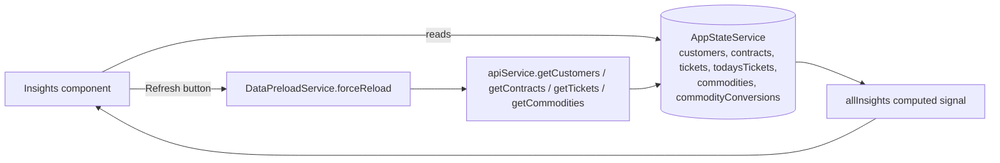

# Actionable Insights

## At a Glance

- **Route**: `/insights`
- **Component**: [`client/src/app/features/customers/pages/insights/insights.component.ts`](../../client/src/app/features/customers/pages/insights/insights.component.ts)
- **Template**: [`insights.component.html`](../../client/src/app/features/customers/pages/insights/insights.component.html)
- **Access**: any authenticated Scoular user (`authGuard`).
- **Primary user goal**: surface the three highest-priority work items per producer — unconfirmed contracts, spot loads, and unshipped bushels past delivery — and click straight through to the relevant section of the customer profile.

This is "what do I need to do today?" view. It's read-only, fast (no per-customer API calls), and deep-links into the Customer Home Page for action.

## How users reach it

- "Insights" link in the sidebar.
- The standalone `/unshipped-bushels` route (covered below) is reachable from the sidebar separately and provides a deeper drill-down of the same Unshipped Bushels data.

## What it shows

Three cards, each a category, in this order:

1. **Unconfirmed Contracts** (priority: Urgent)
2. **Spot Loads — Delivered, No Contract (Last 30 Days)** (priority: Urgent)
3. **Unshipped Bushels Past Delivery Date** (priority: Warning)

Each card has:

- A **header** with icon, title, producer count badge, and collapse/expand chevron.
- A **search** input (when expanded) — placeholder examples: `"Search by producer, contract, or commodity..."`, `"Search by producer, code, or ticket #..."`.
- A **list of producers**, grouped by customer with their matching insights nested below the producer row. Each producer row has its own collapse/expand to show/hide the inner insights.

A **global search** above the cards filters all categories at once: `"Filter all categories by producer..."`.

A **"Refresh" button** with a "Updated {time}" label triggers `DataPreloadService.forceReload()` to re-fetch the underlying customer/contract/ticket data.

### Category rules (from `insights.component.ts`)

| Category | Rule |
| --- | --- |
| **UnconfirmedContracts** | Contract where `customerConfirmStatus !== 'Confirmed'` AND `status NOT IN ('Fulfilled', 'Cancelled')`. |
| **SpotLoads** | Ticket where `isApplied === false` AND no active contract for the **same commodity** covers the ticket's delivery date within its window. Commodity match is essential — corn contracts don't cover wheat tickets. Sourced from `todaysTickets` — the last 30 days of unapplied tickets for every in-scope producer, read live from CTRM (see [CTRM GraphQL Data Source](./CTRM%20GraphQL%20Data%20Source.md)). Unapplied includes U/L/C contract prefixes; **customer-storage (C-prefix) tickets are gated by active storage** (priced-out storage drops off — see [`Shared Infrastructure.md`](./Shared%20Infrastructure.md#idataservice--sqldataservice) Ticket note). *In-flight change:* a pending update will exclude storage from Spot Loads entirely (it isn't a spot load) and stop that path scanning the storage view. |
| **UnshippedBushels** | Contract where `deliveryEnd < today` AND `status IN ('Active', 'Pending', 'Overdue')` AND remaining quantity > sub-0.1%-of-contract residue. Remaining comes from `getContractDeliveryStats(contract)` (shared util at `client/src/app/shared/utils/contract-delivery.ts`), which reads `contract.openBalanceQuantity` from CTRM (via the GraphQL API on the CTRM source, `vw_CurrentContracts` on ODS) — no ticket-math fallback. |

**Amounts (QTY pills) show 2 decimals.** Every insight amount is formatted via `formatInsightQty` (thousands separators + 2 decimals, e.g. `1,234.56 bu`), matching the rest of the app. This is deliberate — Spot Loads converts ticket pounds → bushels and a tiny load like `0.02 bu` must stay visible; rounding to whole bushels previously turned it into `0` and the pill disappeared. A spot load with **no commodity-conversion factor** still omits the amount (can't convert lb→bu).

**Loading.** All three cards render together — the screen gates on the single `dataLoading` flag (true until customers + contracts + today's tickets all arrive). `isCategoryLoading()` currently returns `false` (no per-category skeletons). *In-flight change:* a pending update introduces per-dataset flags so the contract cards render as soon as contracts land while Spot Loads keeps spinning for tickets.

## Data flow



The screen does **not** fetch its own data — it reads everything from `AppStateService` signals that other screens (or `DataPreloadService` on app boot / TU change) have already populated. The Refresh button is the only path that triggers HTTP traffic, and it goes through `DataPreloadService` so all dependent screens see the new data.

## Files

| Layer | Path |
| --- | --- |
| Component | `client/src/app/features/customers/pages/insights/insights.component.ts` |
| Template | `client/src/app/features/customers/pages/insights/insights.component.html` |
| Data preload | `client/src/app/core/services/data-preload.service.ts` |
| Standalone Unshipped Bushels view | `client/src/app/features/unshipped-bushels/pages/unshipped-bushels/unshipped-bushels.component.ts` |
| AppState signals consumed | `customers`, `contracts`, `todaysTickets`, `commodities`, `commodityConversions`, `dataLoading`, `ticketsLoading` |
| Underlying ODS views (via other screens / preload) | `base.vw_CurrentContracts`, `base.vw_CurrentTickets`, `ctrm.vw_GNP024` (commodity conversions). Customers come from app-DB `dbo.Customer`. |
| App tables (read indirectly via cached signals) | none directly |

### `allInsights` computed signal

`insights.component.ts:182–420`. Walks all customers, contracts, and `todaysTickets`, applies the three category rules, and emits a single `Insight[]` sorted across categories. Within `SpotLoads`, tickets are sorted newest-first by `sortDate`.

### Click-through navigation

`selectInsight(insight)` builds a query-param object and navigates to `/`:

```ts
const params: Record<string, string | number> = { customerId: insight.customer.id };
if (insight.contractId) params['contractId'] = insight.contractId;
if (insight.category === 'SpotLoads') {
  params['tab'] = 'tickets';
  if (insight.productCode) params['ticketCrop'] = insight.productCode;
}
this.router.navigate(['/'], { queryParams: params });
```

So an Unconfirmed Contract opens the **Contracts** tab and expands that contract row; a Spot Load opens the **Tickets** tab and filters to the ticket's commodity; an Unshipped Bushels row opens the contracts tab. The Customer Home Page processes these query params (see [`Customer Home Page.md`](./Customer%20Home%20Page.md#deep-link-query-params)).

## Refresh behavior

The "Refresh" button calls `dataPreloadService.forceReload()`. `isBackgroundRefreshing` is set true; the component subscribes to `dataLoading$` pairwise to detect the `true → false` transition and clears the spinner when core data arrives. This bypasses any client cache and re-issues bulk API fetches.

## Related: standalone `/unshipped-bushels` view

- **Route**: `/unshipped-bushels`
- **Component**: [`client/src/app/features/unshipped-bushels/pages/unshipped-bushels/unshipped-bushels.component.ts`](../../client/src/app/features/unshipped-bushels/pages/unshipped-bushels/unshipped-bushels.component.ts)

Shares the same data sources (customers + contracts) but presents a **broader inventory view** rather than just the past-due slice:

| Aspect | Insights inline category | Standalone screen |
| --- | --- | --- |
| Filter | Past delivery date AND open AND remaining > residue | All contracts where `getContractDeliveryStats(c).isEffectivelyComplete === false`, regardless of delivery date |
| Layout | Producer-grouped within a card | Per-contract table view, sortable, with name/commodity/contract# search |
| Use case | "What's overdue right now?" | "What's the total open inventory across all my producers?" |

## Auth and feature flags

- `authGuard` — required.
- No role gating, no feature flags.

## State and caching

- All read from `AppStateService`. The screen has no its own state besides UI flags (search terms, expanded category set, expanded customer set).
- Data freshness depends entirely on when the upstream signals were populated. Refresh button is the manual override.

## User actions

| Action | Trigger | Result |
| --- | --- | --- |
| Expand / collapse a category | Chevron in card header | Local UI state only (`expandedCategories` signal). |
| Expand / collapse a customer within a category | Chevron next to producer name | Local UI state (`expandedCustomers` signal). |
| Click an insight row | Anywhere on the row | Deep-link to Customer Home Page with `customerId` + tab/contractId/ticketCrop. |
| Refresh data | "Refresh" button | `DataPreloadService.forceReload()`. |
| Filter | Global search + per-category search | Filters in-memory. |

## External integrations

- **`UsageTrackingService`** — `selectInsight` also fires `usageTracking.postClickEvent('interaction', 'insights', subFeature, customerId)` where `subFeature` maps `UnconfirmedContracts → 'unconfirmed-contracts'`, `SpotLoads → 'spot-loads'`, `UnshippedBushels → 'unshipped-bushels'`. The Usage Dashboard's Activity Breakdown reads these events.

## Troubleshooting

| Symptom | Likely cause | First place to look |
| --- | --- | --- |
| All three categories empty | `selectedTradeUnits()` is empty, or `customers/contracts/tickets` haven't loaded yet | TU selector + `dataLoading()` flag; click Refresh |
| Spot Loads shows tickets that have a matching contract | The commodity match logic is wrong, or a contract is out of date in ODS | Re-check the per-ticket loop in `allInsights`; verify `contracts()` is current |
| Unshipped Bushels count includes contracts that look closed | Remaining now comes from `contract.openBalanceQuantity` (no ticket-math fallback). If the CTRM aggregate is stale, the count will be too. | Refresh; if still off, verify the CTRM read succeeded (`INFRASTRUCTURE_CTRM_UNAVAILABLE` in the API log means the pool is empty, not stale) |
| Click-through opens wrong tab | `selectInsight` query-param wiring | `selectInsight()` body and the home page's `pendingTab` handler |
| "Updated …" stuck on a stale time | `forceReload` failed silently | Network tab during Refresh |
| Standalone Unshipped Bushels and inline category disagree | Inline applies past-due filter, standalone doesn't | Confirm the rule difference matches expectation |

## References

- [`Customer Home Page.md`](./Customer%20Home%20Page.md) — destination of every click; documents the `tab` / `contractId` / `ticketCrop` query params.
- [`Shared Infrastructure.md`](./Shared%20Infrastructure.md) — `AppStateService`, `DataPreloadService`, `UsageTrackingService`.
