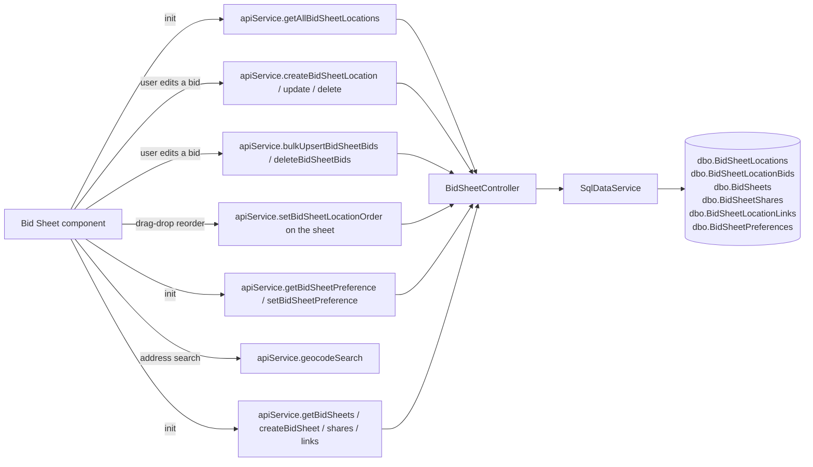

# Bid Sheet

## At a Glance

- **Route**: `/bid-sheet` (env-gated by `environment.bidSheetEnabled`)
- **Component**: [`client/src/app/features/bid-sheet/pages/bid-sheet/bid-sheet.component.ts`](../../client/src/app/features/bid-sheet/pages/bid-sheet/bid-sheet.component.ts)
- **Template**: [`bid-sheet.component.html`](../../client/src/app/features/bid-sheet/pages/bid-sheet/bid-sheet.component.html)
- **Access**: any authenticated Scoular user, **and** the env flag is enabled.
- **Primary user goal**: track competitor bids on a map, compare them against Scoular's reference location, and edit bids per location/commodity/month.

This is the merchandiser's competitive-pricing view. It overlays bid locations on a Leaflet map, color-coded by whether each location is matching, beating, or under reference.

## How users reach it

- "Bid Sheet" link in the sidebar (only present when `environment.bidSheetEnabled === true`).

## What it shows

| Section | Description |
| --- | --- |
| **Full-screen map** | Leaflet map with location markers. |
| **Floating filter bar** (top-left) | Trade Unit Selector, crop dropdown, year dropdown, month dropdown, status filter (Matching / Beating / All), text search, "Clear" button. |
| **Floating action buttons** (bottom-left) | "Add Location", "Refresh" (with time-since-refresh), "Bids" toggle to show/hide the side panel. |
| **Map legend** (bottom-right, collapsible) | "KEY" legend: blue = Reference, red = Beating, yellow = Matching. |
| **Slide-in bids panel** (right edge, ~420px) | Either a list of locations (drag-drop reorderable) or a detail view of a single location with editable name, action buttons ("Set as Reference", "Copy"…), and a bid grid (commodity × month). |

## Data flow



## Files

| Layer | Path |
| --- | --- |
| Component | `client/src/app/features/bid-sheet/pages/bid-sheet/bid-sheet.component.ts` |
| Template | `client/src/app/features/bid-sheet/pages/bid-sheet/bid-sheet.component.html` |
| Print layout util (+ spec) | `client/src/app/features/bid-sheet/utils/print-layout.ts` — builds the `PrintLayoutModel` both the preview and the printed sheet render |
| BarChart picker | `client/src/app/features/bid-sheet/components/barchart-picker/barchart-picker.component.ts` (+ `.html`, `.spec.ts`) |
| Sheet multi-select | `client/src/app/features/bid-sheet/components/sheet-multi-select/sheet-multi-select.component.ts` (+ `.html`) — the checkbox list shared by the map toolbar and the Edit Bids header |
| Controller | `api/GrainOriginatorPortal.Api/Controllers/BidSheetController.cs` |
| BarChart catalog controller | `api/GrainOriginatorPortal.Api/Controllers/BarchartController.cs` |
| Service methods (group: BidSheet) | `GetAllBidSheetLocationsAsync`, `CreateBidSheetLocationAsync`, `UpdateBidSheetLocationAsync`, `DeleteBidSheetLocationAsync`, `BulkUpsertBidSheetBidsAsync`, `DeleteBidSheetBidsAsync`, `GetBidSheetPreferenceAsync`, `SetBidSheetPreferenceAsync`, plus the sheet family (`GetSheetsAsync`, `CreateSheetAsync`, `RenameSheetAsync`, `SetSheetLayoutAsync`, `SetSheetSharesAsync`, `AddSheetLocationAsync`, `DeleteSheetAsync`) |
| App tables | `dbo.BidSheetLocations`, `dbo.BidSheetLocationBids`, `dbo.BidSheets`, `dbo.BidSheetShares`, `dbo.BidSheetLocationLinks`, `dbo.BidSheetPreferences` |
| Geocode endpoint | `GET /api/geocode/search` (free-text search, returns lat/lon) |

### App-DB tables

**`BidSheetLocations`** — `Id`, `Name`, `Address`, `City`, `State`, `Latitude`, `Longitude`, `ElevatorCode`, `BarchartLocationKey` (unique where set — one row per vendor listing, company-wide), `TradeUnitCode` (**provenance only**: which desk first added it, read by the picker to show where a listing is already in use; nothing filters on it), `GroupName`, `IsScoularFacility`, audit columns.

**`BidSheetLocationBids`** — `Id`, `LocationId`, `CommodityCode`, `CommodityName`, `CommodityCategory`, `CropYear`, `Month` (1–12; 0 was the retired Yearly period), `Bid` (string-formatted price), audit columns.

**`BidSheets` / `BidSheetShares` / `BidSheetLocationLinks`** — A sheet is a named, shareable working
set of locations: the sheet row, who it is shared with, and one link row per location on it. The link
carries `SortOrder` (the drag-drop order, shared with everyone on the sheet) and `DisplayName` (a
per-sheet rename). This replaced `dbo.BidSheetLocationOrders`, which held one private JSON blob of
location ids per user per trade unit and was dropped by `RetireBidSheetLocationOrders`.

**`BidSheetPreferences`** — Per-user, one row under the key `__global__`:
`CropCode?`, `Month?` (`null` = no preference, `1–12`; a stored `0` is a pre-retirement Yearly value, cleaned on load), `CropYear?`, `SelectedColumns` (JSON array of column picks — see [Choosing columns](#choosing-columns)), `PriceMode`, `SelectedBidSheetIds` (JSON array of sheet ids — see [Several sheets at once](#several-sheets-at-once)), `PrintLayout` (JSON — see [Print / export](#print--export)).
Plus four **superseded** columns kept for migration and rollback only, never written: `CropOrder`, `HiddenCrops`, `SelectedMonths`, `SelectedYears`.

## Several sheets at once

The screen shows the **union of any number of ticked sheets**, not one at a time. The control is a
checkbox list (`SheetMultiSelectComponent`) in both the map toolbar and the Edit Bids header; ticking a
row adds a sheet, clicking its name shows that sheet alone. The map keeps a separate "All locations"
entry, which is not a sheet but the unscoped catalog view.

What that costs, and how each part is settled:

| Question | Answer |
|---|---|
| A location on two ticked sheets | **One row.** Bids hang off the company-wide location, so two rows would be two grid rows editing one cell. First ticked sheet wins its position. |
| Its name, when the sheets disagree | The agreed per-sheet name if they agree, otherwise the **canonical** name. Picking one sheet's label would depend on tick order. |
| Rename / remove | Applies to **every ticked sheet holding that row** (`sheetIdsByLocationId`) — one request each. Leaving the others behind would put the row straight back the next time they were opened on their own. |
| Showing which sheet a row came from | **Nothing does.** A grid-row badge and a map-hover line were both built and both taken off — neither earned the room. The rows are just location names. |
| Reorder | **Disabled** unless exactly one sheet is ticked, with the reason on the handle. `SortOrder` is a column on the sheet, shared with everyone on it; there is no single list to write a union's order into. |
| Adding a location | **Asks which sheet**, once, and remembers the answer for the session. Adding to all of them would put a row on a colleague's shared list with no undo here. |
| Export | Named after every sheet it drew from — up to two joined with " + ", then "N bid sheets". |
| Nothing ticked | Shows "Choose a bid sheet" and an empty map, **not** the catalog. The catalog still shows for a user who has no sheets to tick. |

Persisted in `BidSheetPreferences.SelectedBidSheetIds` as a JSON array, read through
`BidSheetComponent.parseSheetIds`, which treats anything unreadable as no selection. Ids naming a sheet
that is gone are skipped rather than cleaned out, so a share that comes back comes back ticked.

### The three one-sheet actions

**Share, rename-sheet and delete-sheet cannot be done to a set** — sharing two sheets with someone
means two different things, and a delete confirmation naming several would be a trap. Each is raised
from a particular sheet's row (the icons on each row of the picker, and the same three in the panel's
sheet list) and carries that sheet in `sheetActionTargetId`; `sheetActionTarget` falls back to the
first ticked so the toolbar buttons keep working unchanged. The target is cleared when its sheet is
deleted.

They are buttons ON the row rather than behind a ⋯ menu: the picker's list scrolls (`max-h-64`) and a
popup anchored to a row inside a scrolling box is clipped by it — the menu opened below the visible
area and had to be scrolled to.

The toolbar entry points that CANNOT be made unambiguous are withheld once several sheets are ticked:
the Edit Bids header's Share button is hidden, and the delete dialog offers only "remove locations"
(which is union-wide and correct) without the "delete the sheet" half.

**Who can do what (changed 2026-09-16 at the user's request; all three were owner-only before):**

| Action | Who | Why |
|---|---|---|
| Rename the sheet | **Any member** | It is what everyone on the sheet reads it by. Uniqueness is checked against the **owner's** sheet list, not the caller's — see `RenameSheetAsync`. |
| Share / reshare | **Any member** | A shared sheet is a shared working list; the person who needs a colleague on it is usually not the one who created it. **This lets a member widen who sees the owner's sheet, and the owner finds out by looking** — `SharedBy` records who did it. |
| Delete the sheet | **Owner only** | Cannot be undone and takes the sheet from everyone on it. `RequireSheetOwnerAsync` is now delete's alone. |

## State and caching

- Every location is loaded once, unscoped: a location is one company-wide row, and a sheet decides which of them you work from.
- `mapGeocodeCache` (a `Map` on `AppStateService`) caches geocoded address → lat/lon results, capped at 500 entries.

## Drag-drop reordering

CDK drag-drop (`@angular/cdk/drag-drop`), and only with **one sheet ticked** (see [Several sheets at once](#several-sheets-at-once)). The user reorders locations in the bids panel and the new order is persisted on the sheet — `BidSheetLocationLinks.SortOrder`, saved through `PUT /bidsheet/sheets/{id}/location-order` — so it is shared with everyone the sheet is shared with rather than being one person's private arrangement. The order travels with the sheet, not with a desk.

## Map view

Leaflet is **type-only imported** (`import type * as Leaflet from 'leaflet'`) and the runtime module is dynamically imported to avoid pulling Leaflet into the initial bundle for users who never visit Bid Sheet.

- Map container: `#mapEl` viewchild.
- Markers colored by bid status (blue / red / yellow per the legend).
- Address-only locations get geocoded via `apiService.geocodeSearch` on first save; the result populates `Latitude` / `Longitude` and is cached.

## Bid entry workflow

- Single location create: `apiService.createBidSheetLocation(payload)` (POST). Payload accepts inline `bids` to seed the row.
- Batch upsert: `apiService.bulkUpsertBidSheetBids(requests, tradeUnitCode)` (POST `/api/bidsheet/bids/bulk`). Used by the per-location bid grid editor.

### Add-location form (map-pin flow)

Clicking the map drops a pin and opens the Add Location form. Per crop you add:

- **Only ONE bid is required** (not two). The form defaults to a single **Current Year** bid input. `canSaveLocation` enables Save once a crop has a commodity + at least one bid in any shown year; an empty crop (commodity, no bid) shows "Add at least one crop with a bid".
- A **"+ Add year"** inline picker optionally reveals **Prior Year** (current−1) and/or **Next Year** (current+1) bid inputs, each removable with ✕ (max 3 years: prior/current/next). It's inline (not a floating dropdown) so it never gets clipped by the form's scroll area.
- On save, **only the shown years that actually have a value** are persisted (no blank-bid rows). Each bid becomes a `BidSheetLocationBid` row keyed by `CropYear` + `Month`.

This replaced an earlier rule that forced both a prior-year and current-year bid before a location could be saved.

The upsert request shape:

```ts
Array<{
  name?: string;
  elevatorCode?: string;
  tradeUnitCode?: string;
  groupName?: string;
  latitude?: number;
  longitude?: number;
  commodityCode: string;
  commodityName?: string;
  commodityCategory?: string;
  cropYear: number;
  month: number;          // 0 yearly, 1–12 monthly
  bid: string;            // formatted price, e.g. "4.25"
}>
```

Server-side validation lives in `BidSheetController` (TU validation via `IUserEntitlementService.ValidateTradeUnitsOrThrowAsync`).

## Add from BarChart (fed bids)

Available from the **Add from BarChart** link under the Edit Bids grid's Add Location row, when
`environment.barchartBidsEnabled` is on. It opens a right-hand panel and hands the map to the picker.

**Discovery is map-first on purpose.** With text-only search, a user who finds nothing can't tell
whether BarChart doesn't list the location, lists it under a different company name, or we simply
don't pull that state — and would reasonably conclude the feed is broken. So the panel searches
around whatever the map is showing (pan to look elsewhere), text search is the secondary path, and
the panel states the catalog's real coverage ("3,446 locations across 30 states, refreshed …") rather
than leaving it to be inferred from an empty list. Manual entry stays available regardless.

That coverage line is read live from `/barchart/coverage`, which matters more than it looks: the vendor
sweep is sharded across 7 daily runs, so the catalog grows for about a week after the first load rather
than arriving complete. A count hard-coded anywhere would be wrong within a day.

Candidate pins are drawn on their own Leaflet layer, and our own clustered pins are hidden while the
picker is open. A **hollow** pin is already on some bid sheet; a filled one is new; a **blue** pin is the
listing currently open in the panel, so the name on screen is tied to a place on the map. Selecting from
the list highlights the same pin as clicking it, and the selected pin is raised above its neighbours.
Distance is used to sort nearest-first but isn't displayed.

**Escape backs out** of the picker, the source chooser, and the manual pin-drop flow. All three hide the
map's own controls while active, so without it the panel's small X is the only exit.

### Renaming a linked location

The name is display only. The feed link is `BarchartLocationKey`, and the bridge joins on that, so
renaming — in the picker before adding, or later from the panel — never affects whether bids arrive.
`UpdateLocationAsync` doesn't touch the key either. Reusing a name already in use comes back as a 400
naming the clash; that is a courtesy check in the repository rather than a database constraint, because
the old unique (Name, TradeUnitCode) index went when locations became company-wide.

**A rename is per sheet.** The name lives on the link between a sheet and a location
(`BidSheetLocationLinks.DisplayName`), so calling an elevator something of your own does not rename it
on anyone else's sheet. The location row keeps its own name as the default for sheets that have not
overridden it. With several sheets ticked a rename writes to every one of them that holds the row —
anything less and the union would see a disagreement and fall back to the canonical name, so the new
name would look ignored.

**Deleting, and the Scoular toggle, are company-wide** — there is one row per elevator now, so both
affect everyone. Delete is therefore restricted to whoever added the location, or an admin, and its
confirmation counts the sheets holding it. All mutation paths key off the location **id** rather than
its name: the name-based lookup they used to share could resolve to the wrong row once two desks had a
location of the same name, which the bulk add made routine.

**Listings are labelled "Company - Site" with the town underneath** — "Farmers Cooperative Dorchester -
HERKIMER" over "Marysville, KS" — and that label is also exactly what gets saved, so nothing is renamed
between picking a location and seeing it on the sheet.

Company leads deliberately, measured against the live catalog (2026-08-19): 2,079 of the 3,446 vendor
site names are just the town again, and some name a *different* company than the one publishing the bid
(a CHS - Illinois listing whose site name is "GPC Muscatine"), which would misattribute the price at a
glance.

**Redundant site names are dropped from the label.** Of those 2,079, 1,775 set the site name to the city
and 304 to the city *plus* the state — "Salina, KS", "FARNSWORTH TX". Comparison is on letters and digits
only (`_nameKey`), so every spelling collapses the same way; without that, the label read
"Scoular Company - Kansas - Salina, KS" directly above "Salina, KS". The vendor's own site name is
printed verbatim on the confirm step when it is something not already shown, so a listing stays
traceable to the feed.

These proportions held when the catalog nearly doubled (60% redundant at 2,894 listings, 60% at 3,446),
so the rule isn't fitted to one sample of the data.

**The saved name always keeps a site or town**, even where the label drops it — a bid sheet row has no
second line for the town, and a company with several town-named sites would otherwise want one row
name for all of them. It's an editable field on the confirm step, so
it is never a hidden rename.

**Scoular facilities are markable from the picker.** Scoular's own elevators come through the feed like
anyone else's — 45 listings in the catalog — so the confirm step has a "This is a Scoular facility"
checkbox, ticked automatically when the vendor's company name matches `/scoular/i` and editable either
way. It was hard-coded false until 2026-08-24, which put Salina and Pratt on the sheet as competitors.

**Search matches on any of the words you type.** Terms are split on spaces, commas and slashes, and each
one has to match something — the elevator, the site name, the town, a zip prefix or the state — so
"alliance belpre" (company plus town) and "belpre ks" (town plus state) both find the same listing. A
state can be named or abbreviated, and the ten two-word states stay together. See
`BarchartLocationSearch` in the Infrastructure project.

Confirming an add creates **one bid sheet location**, company-wide, keyed by `BarchartLocationKey`, and
puts it on the current sheet. The server prefills blank address and coordinate fields from the vendor
record and runs the feed bridge on create, so the bids are there when the panel closes instead of
appearing after the next pipeline run. Adding an elevator someone else already added is just a new link
row — its bids and its frozen past months are already there.

**Removing one** takes it off your sheet. Deleting the location itself is the company-wide act, and is
restricted accordingly; the catalog and price history persist either way, so re-adding refills instantly.

### Which month a fed bid lands on

The feed writes each bid at the **contract month** (1-12) and **crop year** read from the symbol, not
from the delivery window. A symbol is `{root}{P|B}{monthCode}{yy}[F|L]-{location}-{map}.CM`, and BarChart
publishes one symbol per contract month; the vendor's own name for it agrees -- `ZCPX26` is
"Corn #2 Yellow **Nov 26** Cash". Keying off the window start mis-filed those bids: Herkimer's `ZCPX26`
(November, delivering 1 Oct - 1 Dec) landed November's price in the October cell and left November blank.

**A bid also fills every other month its delivery window covers**, marked with the contract it came from
(`CoveredByCropYear` / `CoveredByMonth` on the cell). One instrument in five opens its window before its
contract month -- Cargill East St. Louis's "Nov 26" corn delivers from 1 October, Dorchester's from
1 September -- and the contract month alone left those months blank, reading as if the elevator would not
take the grain. It will, at that contract's price. The elevator's OWN bid for a month always wins the cell
over a covering one, and among covering bids the nearest contract wins. On Dev this turned 431 fed cells
into 551, 120 of them covering.

**A covered month reads as an ordinary bid** -- same type, same board-symbol chip as every other fed cell,
no scoring difference. It is not a substitute or an estimate. Cargill posts ONE bid of 5.38 for delivery
any time between 1 Oct and 30 Nov, which the vendor names after the November futures contract, so 5.38 is
genuinely the October price; there is no separate October bid to prefer. Marking it on the face of the grid
was tried twice (a month tag, then italics) and dropped both times for implying a substitution that is not
happening. Only the tooltip names the covering contract, for the one case it matters: the elevator posted
no separate price for this month.

The board symbol could not carry the distinction anyway -- a covering contract and the month it covers
trade against the same board, and all 120 covered cells on Dev match their covering month's symbol exactly.

**There is no Year period.** It was retired in September 2026: a fed Year cell held the nearest open
month's price while a hand-typed one meant the crop year, and the two sat side by side as if comparable.
Every cell now names its delivery month, the map and grid open on the current month, the API refuses
`Month = 0`, and multi-month / multi-year selection is unchanged. Hand-typed `Month = 0` rows in QA (98 of
them, six originators) are left in place, unshown, for the business to convert or drop.

### Past months stay on the sheet

A month's fed bids **freeze when its delivery window closes** and stay for good, so picking August next
year still shows what every elevator was bidding for August delivery. Pruning still applies to the
current month and later, which is what stops a rolled-off contract lingering as if it were live.

It did not always work this way. The bridge used to delete a feed-owned cell the day its window elapsed
-- the sheet was built as "today's bids" and tidied up behind itself -- so the record of a month vanished
exactly when somebody might want to look back at it. Growth from keeping them is negligible: roughly 500
rows a month, and `purge-history` can trim them if that ever changes.

Months lost before the change are recoverable from the daily price history, which keeps two years of
prices per symbol: `scripts/Restore-ElapsedBidMonths.sql` rebuilds each cell at the price its elevator
was showing on the last day the window was open. It defaults to a dry run, only ever INSERTs where no
cell exists (so a hand-typed bid always wins), and tags what it writes `CreatedBy =
'barchart-history-restore'` so a run is identifiable and reversible. Run on Dev 2026-09-10: 81 cells
across 33 locations, all August 2026. Each environment recovers as far back as its own history goes.
### What "moved in the last 24 hours" means

A fed cell is judged by `BasisChangedAt`, which the bridge sets only when the stored value really differs,
never on first insert. `QuoteAsOf` is the vendor's re-post stamp and refreshes most days whether or not the
number moved: on 2026-09-10, 410 of 431 fed cells carried a fresh stamp, 404 cash prices had moved (cash
follows the board daily) and only 64 basis values had. Basis is the elevator's own decision, so that is the
move worth a pulse. A manual cell still flags on its own edit (`ModifiedAt`, else `CreatedAt`).

Consequence worth knowing after a deploy: the change stamps start empty, so **nothing pulses until the
first real move** — one nightly run, at most.
### What the feed refuses to publish

The bridge publishes a price it would stand behind, and **shows an old one rather than hiding it**.

**Blocking is on the vendor's mode flag, not on age.** Measured across the live feed:

| | mode `i` (live) | mode `d` (dead) |
|---|---|---|
| 0–7 days | 27,628 | 0 |
| 8–90 days | 1,245 | 411 |
| over 90 days | **0** | **2,272** |

No live quote exceeds 90 days; every ancient one is `d`, as is every sentinel. This started as a 7-day
age cutoff, which was a **proxy for mode and a lossy one** — it hid ~1,245 real bids to block a
population that mode identifies exactly. An elevator that posts a new-crop bid and leaves it for weeks
is behaving normally, and the delivery month already tells the user which period a bid covers.

So, from `BarchartFeedDefaults`:

- **`mode = d` never publishes.** Dead records, not offers.
- **`MinPublishablePrice` (0.01)** for cash — excludes the `0.0025` no-bid placeholder. Basis is
  normally negative, so it gets a symmetric magnitude bound instead; both exclude the `214748.3647`
  sentinel (`int.MaxValue / 10000`).
- **`MaxQuoteAgeDays` (365)** is a far backstop only, in case mode stops being trustworthy.
  `apply-bids` can override it per call.

**Age is surfaced, not used to hide.** A fed cell whose quote hasn't moved in more than 7 days shows its
as-of date in amber with "the elevator has not changed this bid since then". That keeps the one real
hazard — a stale price *read as today's market* — without throwing away a bid the user asked to see. It
was that hazard, not age itself, that justified the original rule: an unmarked 262-day-old soybean quote
put **$3.51 for Sep 2026** between **$11.70** in August and October, which reads as a collapse.

### 
### Diagnosing a missing bid: `dbo.vw_BarchartPublishableBid`

The question that comes up every time the feed looks wrong is "why is there no bid here?", and answering
it from the tables means a five-way join plus knowing the bridge's rules. This view answers it directly.

One row per **candidate** — every cash instrument on a feed-linked location, *including the ones that get
rejected*, which is the point: an unmapped commodity or a stale quote is invisible in the published data.

| Column | Use |
|---|---|
| `BlockedReason` | `unmapped commodity`, `stale quote`, `implausible price`, `delivery window elapsed`, `no quote yet`, or null |
| `WouldPublishAtDefaults` | Named to be honest: `apply-bids` accepts a `maxQuoteAgeDays` override, so a caller can get a different answer |
| `WinnerRank` | 1 = the row the bridge would write for that cell. Blocked rows sort last, so rank 1 is always publishable |
| `QuoteAgeDays`, `QuoteMode` | Why something is stale. `mode = i` is fresh, `d` is the months-old population |
| `CurrentSheetBid`, `CurrentSheetSource` | What's on the sheet *now*. `Manual` here against a publishable candidate is a typed bid deliberately blocking the feed — the most confusing state to explain without seeing both sides |

```sql
-- Why is this location not showing what I expect?
SELECT CommodityCode, CropYear, BidMonth, LastPrice, QuoteAgeDays, BlockedReason,
       WinnerRank, CurrentSheetBid, CurrentSheetSource
FROM dbo.vw_BarchartPublishableBid
WHERE LocationName = 'Scoular Company - Kansas - Salina'
ORDER BY CropYear, BidMonth, CommodityCode;
```

**Cash bids only.** Basis instruments load alongside and are legitimately negative (-30, -116 observed),
so including them would flag every one as an implausible price and bury the real problems.

**It re-implements the bridge's rules, so it can drift and start lying.** `scripts/_VerifySchema.sql`
compares the view's winners against the published feed cells and warns on any mismatch, so a change made
to one and not the other is caught rather than discovered. The check skips itself when nothing has been
published yet.

### Cash and basis

The filter bar carries a **Cash / Basis** toggle (feed-enabled environments only). Both prices come from
the feed on the **same row** — `Bid` / `BarchartSymbol` / `QuoteAsOf` for cash, `BasisBid` /
`BasisSymbol` / `BasisQuoteAsOf` for basis — so switching is a pure display change with no refetch.

**Why one row rather than two.** The unique index is
`(LocationId, CommodityCode, CropYear, Month)`, and a great deal of code leans on "one row per cell":
the bulk upsert, delete-bids, the duplicate reconciler, the grid build, print, and the diagnostic view.
Adding a price type to that key would have broken all of them at once. Checked against the live feed
first — every publishable cell carries both a cash and a basis quote (67 of 67 at the time), so the
second row would have bought nothing.

**Basis is quoted in cents against the futures board and is normally negative**: `-30` reads as thirty
under. Two consequences:

- **It can't share the cash price bounds.** Cash has a 0.01 floor to screen out the vendor's `0.0025`
  no-bid placeholder; that floor would reject every basis quote. Basis gets a symmetric magnitude bound
  instead, which still excludes the `214748.3647` sentinel.
- **It's formatted `0.####` rather than `0.00##`**, so it renders `-30` and not `-30.00`. The minus is
  preserved either way — only trailing zeros are dropped.

**The grid is read-only in basis mode.** Every write path targets the cash column, so a bid typed while
basis is displayed would silently overwrite that cell's cash price with a basis number. Entering basis by
hand needs its own write path; until then the safe behaviour is to refuse.

**The choice persists** in `BidSheetPreferences.PriceMode`, alongside crop, month and year. An unrecognised stored value falls back to cash rather than leaving the sheet in a mode
nothing renders.

Only fed bids carry a basis, so a sheet of hand-typed bids goes largely blank in basis mode. That's the
data being honest rather than a fault.

### Fed vs manual bids


`dbo.BidSheetLocationBids.Source` is `Manual` or `Barchart`, and each side owns its own cells:

- Fed cells render with a dashed green tint, an "as of" line under the value, and are **read-only** —
  the input is `readonly`, `updateBid` refuses them, and `_buildDirtyBids` skips them. The server
  rejects writes to them independently, so all three layers agree.
- A feed-linked location can still carry **manual** bids for crops or months the vendor doesn't
  publish, and those behave exactly as they always have. The read-only rule is per cell, not per row.
- The feed never overwrites a manual cell. In the bridge's `MERGE`, a manual row matches but satisfies
  no clause, so it's left exactly as typed.
- A feed-owned crop can't be deleted from the panel — the delete button is replaced with a "Feed"
  label, because the server would ignore the request anyway.

## Crop year + month preferences


`BidSheetPreferences` persists per-user, per-trade-unit selections so the screen opens with the user's last-used filters. Fields:

- `CropCode` — the map panel's selected commodity (e.g., `CORN`).
- `Month` — `null` = no month preference, `1–12` = a specific delivery month. (`0` meant the retired Yearly view; the API rejects it and no row carries it.)
- `CropYear`.
- `SelectedColumns` — JSON array of Edit Bids column picks, in display order (below).
- `PriceMode` — `cash` | `basis` | `both`.
- `SelectedBidSheetIds` — JSON array of the sheet ids the user last had open.
- `PrintLayout` — JSON blob of the print dialog's options (below).

Superseded, read once and never written — see [Choosing columns](#choosing-columns):

- `CropOrder` — JSON array of commodity codes for display ordering.
- `HiddenCrops` — JSON array of hidden commodities.
- `SelectedMonths` — JSON array (e.g., `[3, 6, 9, 12]`).
- `SelectedYears` — JSON array (e.g., `[2026, 2027]`).

The panel triple (`CropCode`/`Month`/`CropYear`) is assigned **unconditionally** on every write,
because every caller re-sends it; every other field treats `null` as "leave alone" and `"[]"` as
"clear". `BidSheetPreferenceUpdate` (Infrastructure/Abstractions) carries that contract by name —
it used to be twelve positional parameters through three layers, where a field inserted in the wrong
slot compiled clean and wrote into the neighbouring column.

## Choosing columns

Edit Bids columns are an **explicit ordered list**, one pick per column: `+ Add column` sits in the
Locations header, each pick is one crop + crop year + delivery month, headers drag to reorder and
carry an `×` to remove. Capped at 24 added interactively.

They used to be the **cross product** of three toolbar dropdowns — crops × months × years, nested
crop → month → year, with months force-sorted into calendar order. That could not express a run of
months crossing a year boundary: *Dec 2026, Jan 2027, Feb 2027* had to be asked for as years
`{2026,2027}` × months `{12,1,2}`, which produced all six combinations led by Jan-26. The problem
was the shape of the selection, not its ordering, so no re-sort could fix it.

Consequences worth knowing:

- The **map panel and the grid are fully separate.** Stepping the panel to another year and
  reopening Edit Bids does not change the columns. Nothing pushes the panel into the grid at all --
  and there is no default: a grid with no columns opens EMPTY and waits to be told what to show,
  with a prompt in the first row. (The filter bar was already a separate source again, via `filterableCrops` /
  `filterableYears`, so that fixing the filter could not change what the grid saves.)
- **Migration is lazy, and it is the ONLY reason anything is seeded.** A row whose `SelectedColumns`
  is `NULL` *and* which carries at least one of the four superseded fields marks a user who predates
  the change; `_seedColumns` synthesises the old cross product from them, in the old nesting, so
  their first open looks identical to their last. Those four are written only by the Edit Bids grid
  (the panel writes `CropCode`/`Month`/`CropYear`), which is what makes their presence a reliable
  test for "used the old grid". With none of them present there is nothing to reconstruct and the
  grid stays empty. It is written back only when they
  next change a column, and the 24-column cap is NOT applied to it. `"[]"` is different from
  `NULL` — it means the user removed every column deliberately, and is left alone.
- **Duplicates are refused twice**, in the load sanitiser and again in the `editGridColumns`
  projection. The template tracks the header row and every body cell by the column key, so two picks
  agreeing on crop+year+month are an NG0955 that takes the screen down.
- The picker's crop list comes from `filteredCommodities`, which applies the user's group and
  trade-unit scope — not `allCommodities`, which would offer organics to originators outside that
  desk.
- **Reorder does not flush or rebuild**; add and remove do. An order change leaves the key set
  identical, so rebuilding would only serve to discard an edit typed but not blurred.

Persisted via `setBidSheetPreference`, under a single key per user — the constant `__global__`. There
used to be one row per trade unit (and one per combination of them), so each desk kept its own
arrangement; with the sheet no longer scoped by trade unit there is one arrangement per person. The
`RetireBidSheetLocationOrders` migration deleted the rows saved under the old keys, which nothing could
read any more.

> **Do not put column preferences on the sheet.** `BidSheets` carries `CropOrder`, `HiddenCrops`,
> `SelectedMonths` and `SelectedYears`, with a `PUT /bidsheet/sheets/{id}/layout` endpoint and an
> `ApiService.setBidSheetLayout` to write them. That whole path is **dead**: nothing on the client
> calls it and `_applySheet` ignores those four fields. It looks like the natural home for
> `SelectedColumns` and is not — a sheet is shared with its members, and which columns you are
> looking at is yours, the same reasoning that puts `SelectedBidSheetIds` on the per-user row.

## Print / export

Edit Bids → **Print** opens a dialog with a live preview (left) and options (right). Printing writes a
self-contained HTML document into `window.open('', '_blank')` and calls `print()`; the popup is
`about:blank`, so the logo must be an absolute `window.location.origin` URL (`printLogoUrl`).

Print takes a **subset of the grid's columns**, ticked in the dialog's Columns list. There is one
list where there were two (Crops and Months), which could describe the printed columns between them
only while columns were their cross product; and no drag handles, because the grid header is now the
single place columns are ordered. Print is multi-year — it used to build every column against the
first selected year, so a multi-year grid printed one year's numbers under every heading.

`printCropGroups` folds the ticked columns into **contiguous same-crop runs**, one `PrintCropGroup`
per run. The same crop in two non-adjacent runs therefore draws two bands, in grid order: merging
them would silently reorder the printed sheet away from the screen.

**One model, two renderers.** `utils/print-layout.ts` turns those groups and the locations
into a `PrintLayoutModel` — tables of styled cells with column widths in inches. The dialog preview
renders that model with a generic `@for` table (`[style]="printCellStyle(cell, isHeader)"`), and
`renderPrintDocument` serialises the same model and the same `cellStyleMap` into the popup HTML. Every
geometry, colour and highlight decision lives once in the util, so the preview cannot drift from the
printed sheet (the earlier dual-implementation approach is what produced squeezed, ellipsised columns).
The util is pure and covered by `print-layout.spec.ts`.

**Layouts** (`layoutStyle`, default `locationsDown`) — same data, different arrangement. Modelled on
the daily bid sheets originators already send (card #559):

| Style | Rows | Columns | Splitting |
| --- | --- | --- | --- |
| `locationsDown` ("Down") | One row per location (listed ONCE, edit-grid order) | A coloured band per crop, its period columns (`O/C 26`, `N/C 27`, `May 26`) beneath; heavy rule between crops | Fit-first: every column is measured (`textWidthIn`) to its longest header/value/name at each type size in `FONT_LADDER_PX` (12→9). `chooseFit` picks the size needing the fewest bands, then the fewest pages (`rowHeightIn` × rows vs `PAGE_HEIGHT_IN − PAGE_CHROME_IN`), then the largest — so 30 locations print smaller than 10. CROPS split into balanced bands only when the width forces it (5 crops → 3 + 2, never 4 + 1), every band at the same widths. Slack goes to bid columns (cap `MAX_VALUE_COL_IN`) then the Location column (cap `MAX_NAME_COL_IN`) |
| `locationsAcross` ("Across") | A tinted band row per crop, then one row per period (label carries the crop colour as a left rule) | Location names as column headers, wrapping onto as many lines as they need; bids beneath never wrap | Label column measured from the widest period label; each location column its OWN natural width — its name on one header line or its widest bid, whichever is wider (`wrappedHeaderWidthIn`) — then each row's columns grow just enough to close the gap at its right edge (capped at `MAX_COLUMN_STRETCH`, so a short tail row does not balloon). Names wrap (≤ `HEADER_MAX_LINES`) only when single-line names would leave fewer than `MIN_AVG_LOCATIONS_PER_BLOCK` per block. Type size is one ladder step below the Down fit for the same sheet (`fitLocationsDown`, floor 9px) so the transposed sheet reads denser; within that: fewest header lines, then fewest rows (`packBlocks`: greedy — as many locations per row as fit at natural width, ≤ `MAX_LOCATIONS_PER_BLOCK`; a short tail row is accepted), then fewest pages, then largest type. Each block repeats the crop bands |

Rules shared by both: bids and period labels never wrap (only Across location headers may) — the sheet is often screenshotted off the monitor and
sent round on Teams, so type is as large as the fit allows and cell padding is tight (`CELL_PAD_*`) to
get more locations on a page; only locations with at least one bid in a selected column print, and only
crop × period columns with at least one bid at any listed location print (`selectPrintColumns` — a
period nobody quotes yet drops off, and a crop with no populated periods drops entirely, so which
columns appear shifts with the season without configuration); empty cells are blank (never a dash); Scoular facilities are `#FFD400` with a bold name (row in *down*,
column in *across*) when the **Highlight** toggle is on; a partial last band/block is drawn narrower,
not stretched; each table is `page-break-inside: avoid`, and tables flow rather than one-per-page.
Landscape letter, `@page` margin = `PRINT_GEOMETRY.PAGE_MARGIN_IN` (one constant drives both the
CSS and the width maths).

**Persisted options** (`PrintLayout` JSON): `{ address, phone, highlightScoular, layoutStyle }`.
(`yearlyRows` belonged to the retired Yearly period and is ignored on read.) Which columns are
ticked is NOT persisted — it is a per-print choice, like the crop/month sets it replaced. `parsePrintLayoutStyle` maps the retired `sideBySide` /
`stacked` values (and anything malformed) to the default; the next save rewrites the blob.

## Auth and feature flags

- `authGuard` — required.
- **`environment.bidSheetEnabled`** — checked in [`client/src/app/app.routes.ts`](../../client/src/app/app.routes.ts) (around line 30). When false, the route isn't registered (deep links 404 / redirect home) and the sidebar doesn't show the link.
- `[Authorize]` on `BidSheetController`. Creating or updating a location still validates the trade unit it is attributed to via `IUserEntitlementService.ValidateTradeUnitsOrThrowAsync`; reads are unscoped by design, and the two destructive operations (deleting a location, deleting a commodity's bids) are restricted to the row's creator or an admin. See AR-05 in `SECURITY-REVIEWS/ACCEPTED-RISKS.md`.
- **`environment.barchartBidsEnabled`** — gates the "Add from BarChart" entry point and the fed-bid badges. Read directly by the component (not the router), so the screen still works normally when it's off. Currently **on for local and dev, off for QA and prod**, since the vendor feed is only loaded in dev.
- `[Authorize]` on `BarchartController` too, but catalog reads are deliberately **not** TU-scoped: the catalog is global vendor data with no Scoular customer information in it. TU entitlement is enforced on the write that creates a placement, and on `refresh-bids`, against the row's persisted trade unit.

## External integrations

- **Leaflet** — map rendering and clustering.
- `@angular/cdk/drag-drop` — location reorder.
- Geocode endpoint at `/api/geocode/search` (free-text → lat/lon, used when adding a location by address).

## User actions

| Action | Trigger | Method |
| --- | --- | --- |
| Add a location | "Add Location" button | `apiService.createBidSheetLocation` |
| Edit a location's metadata | inline edit in detail view | `apiService.updateBidSheetLocation(id, payload)` |
| Delete a location | trash icon | `apiService.deleteBidSheetLocation(id)` |
| Save bids | bid grid → "Save" | `apiService.bulkUpsertBidSheetBids` |
| Delete a commodity's bids on a location | "Clear" in bid grid | `apiService.deleteBidSheetBids(locationId, commodityCode, month?)` |
| Reorder | drag-drop in panel | `apiService.setBidSheetLocationOrder` |
| Update filter prefs | filter bar interactions | `apiService.setBidSheetPreference` |
| Print bids | Edit Bids → Print → Print | `confirmPrint` → `renderPrintDocument(printLayoutModel())` → `window.open` + `print()` |

## Troubleshooting

| Symptom | Likely cause | First place to look |
| --- | --- | --- |
| Map blank, no markers | Locations didn't load (TU not selected, or `getBidSheetLocations` returned empty) | TU selector + Network tab |
| Markers all in the wrong location | Geocode result mis-cached. Each location's lat/lon is stored on the row; re-geocode by editing the address. | `BidSheetLocations.Latitude/Longitude` |
| Bid edits don't appear after save | `bulkUpsertBidSheetBids` succeeded but UI cache didn't refresh | Verify the post-save `getAllBidSheetLocations` re-fetch fires |
| Drag-drop order doesn't stick across sessions | The sheet order save failed silently | Network tab for `PUT /bidsheet/sheets/{id}/location-order`; check `BidSheetLocationLinks.SortOrder` for that sheet |
| Sidebar link missing | `environment.bidSheetEnabled === false` for this build | `client/src/environments/environment.ts` |
| 403 on a `/api/bidsheet/...` call | User isn't entitled to the requested TU | `UserEntitlementService.ValidateTradeUnitsOrThrowAsync` — check the user's entitlement set |
| Printed sheet has no logo | Relative asset path inside the `about:blank` popup | `printLogoUrl` must be `window.location.origin` + path |
| Print columns squeezed / headers ellipsised, or preview ≠ print | Widths and band split no longer come from the same builder | `utils/print-layout.ts` — `buildLocationsDown` / `buildLocationsAcross` are the only source; run `print-layout.spec.ts` |
| A printed sheet splits into bands that plainly fit on one | `fitLocationsDown` bands by COLUMN budget; a run whose crop name is long forces every bid column wider | `fitLocationsDown` — `measureValueIn` divides the crop name across its run, so a one-column run of a long code widens the whole sheet |
| Edit Bids opens with no columns | The user removed them all (`SelectedColumns = "[]"`), which is respected rather than re-seeded | `+ Add column` in the Locations header; `_seedColumns` only runs when the list is empty AND the stored value was `NULL` |
| A column the user added is missing after a reload | The column save was fire-and-forget and failed | Network tab for `PUT /bidsheet/preference` carrying `selectedColumns`; check `BidSheetPreferences.SelectedColumns` |
| Print dialog opens on "Locations down" though the user picked something else before | Persisted `layoutStyle` was a retired value (`sideBySide` / `stacked`) | `parsePrintLayoutStyle` — expected migration; the next save rewrites it |
| Leaflet warnings about non-ESM module | Pre-existing build warning; safe to ignore unless build actually fails | Build output: `Module 'leaflet' ... is not ESM` |

## References

- [`Shared Infrastructure.md`](./Shared%20Infrastructure.md) — `IUserEntitlementService`, `ApiService` deduplication.
- [`SECURITY-MODEL.md`](./SECURITY-MODEL.md) — note that bid endpoints are the exception that **does** enforce TU access via `ValidateTradeUnitsOrThrowAsync`.
- `client/src/environments/environment.ts` — feature flag.
