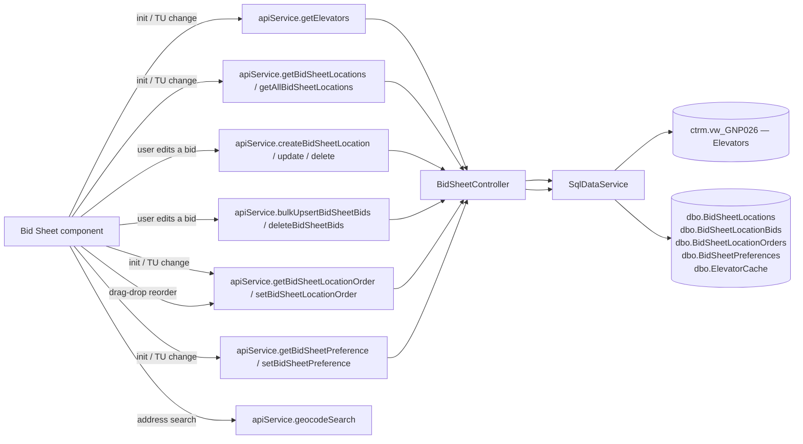

# Bid Sheet

## At a Glance

- **Route**: `/bid-sheet` (env-gated by `environment.bidSheetEnabled`)
- **Component**: [`client/src/app/features/bid-sheet/pages/bid-sheet/bid-sheet.component.ts`](../../client/src/app/features/bid-sheet/pages/bid-sheet/bid-sheet.component.ts)
- **Template**: [`bid-sheet.component.html`](../../client/src/app/features/bid-sheet/pages/bid-sheet/bid-sheet.component.html)
- **Access**: any authenticated Scoular user, **and** the env flag is enabled.
- **Primary user goal**: track competitor bids on a map, compare them against Scoular's reference location, and edit bids per location/commodity/month.

This is the merchandiser's competitive-pricing view. It overlays bid locations on a Leaflet map, color-coded by whether each location is matching, beating, or under reference.

## How users reach it

- "Bid Sheet" link in the sidebar (only present when `environment.bidSheetEnabled === true`).

## What it shows

| Section | Description |
| --- | --- |
| **Full-screen map** | Leaflet map with location markers. |
| **Floating filter bar** (top-left) | Trade Unit Selector, crop dropdown, year dropdown, month dropdown, status filter (Matching / Beating / All), text search, "Clear" button. |
| **Floating action buttons** (bottom-left) | "Add Location", "Refresh" (with time-since-refresh), "Bids" toggle to show/hide the side panel. |
| **Map legend** (bottom-right, collapsible) | "KEY" legend: blue = Reference, red = Beating, yellow = Matching. |
| **Slide-in bids panel** (right edge, ~420px) | Either a list of locations (drag-drop reorderable) or a detail view of a single location with editable name, action buttons ("Set as Reference", "Copy"…), and a bid grid (commodity × month). |

## Data flow



## Files

| Layer | Path |
| --- | --- |
| Component | `client/src/app/features/bid-sheet/pages/bid-sheet/bid-sheet.component.ts` |
| Template | `client/src/app/features/bid-sheet/pages/bid-sheet/bid-sheet.component.html` |
| BarChart picker | `client/src/app/features/bid-sheet/components/barchart-picker/barchart-picker.component.ts` (+ `.html`, `.spec.ts`) |
| Controller | `api/GrainOriginatorPortal.Api/Controllers/BidSheetController.cs` |
| BarChart catalog controller | `api/GrainOriginatorPortal.Api/Controllers/BarchartController.cs` |
| Service methods (group: BidSheet) | `GetElevatorsAsync`, `GetBidSheetLocationsAsync`, `GetAllBidSheetLocationsAsync`, `CreateBidSheetLocationAsync`, `UpdateBidSheetLocationAsync`, `DeleteBidSheetLocationAsync`, `BulkUpsertBidSheetBidsAsync`, `DeleteBidSheetBidsAsync`, `GetBidCropYearsAsync`, `GetBidCommoditiesAsync`, `GetBidMonthsAsync`, `GetBidSheetLocationOrderAsync`, `SetBidSheetLocationOrderAsync`, `GetBidSheetPreferenceAsync`, `SetBidSheetPreferenceAsync` |
| ODS view | `ctrm.vw_GNP026` (elevators with lat/lon, address, TU code, group name, IsScoularFacility flag) |
| App tables | `dbo.BidSheetLocations`, `dbo.BidSheetLocationBids`, `dbo.BidSheetLocationOrders`, `dbo.BidSheetPreferences`, `dbo.ElevatorCache` |
| Geocode endpoint | `GET /api/geocode/search` (free-text search, returns lat/lon) |

### App-DB tables

**`BidSheetLocations`** — `Id`, `Name`, `Address`, `City`, `State`, `Latitude`, `Longitude`, `ElevatorCode`, `TradeUnitCode`, `GroupName`, `IsScoularFacility`, audit columns.

**`BidSheetLocationBids`** — `Id`, `LocationId`, `CommodityCode`, `CommodityName`, `CommodityCategory`, `CropYear`, `Month` (0 = yearly, 1–12 = monthly), `Bid` (string-formatted price), audit columns.

**`BidSheetLocationOrders`** — Per-user persisted drag-drop order, keyed by `(UserId, TradeUnitKey)`, stored as JSON.

**`BidSheetPreferences`** — Per-user, per-trade-unit:
`CropCode?`, `Month?` (`null` = no preference, `0` = yearly, `1–12` = monthly), `CropYear?`, `CropOrder` (JSON array), `HiddenCrops` (JSON array), `SelectedMonths` (JSON array).

## State and caching

- `allElevators` — fetched once per session via `getElevators` (deduped via `ApiService._dedupe`).
- Locations are scoped to the selected trade unit; switching TU triggers a re-fetch.
- `mapGeocodeCache` (a `Map` on `AppStateService`) caches geocoded address → lat/lon results, capped at 500 entries.

## Drag-drop reordering

CDK drag-drop (`@angular/cdk/drag-drop`). User reorders locations in the bids panel; the new order is persisted via `setBidSheetLocationOrder` (JSON-encoded array of location ids), and re-applied on next load via `getBidSheetLocationOrder`. State stored per trade unit.

## Map view

Leaflet is **type-only imported** (`import type * as Leaflet from 'leaflet'`) and the runtime module is dynamically imported to avoid pulling Leaflet into the initial bundle for users who never visit Bid Sheet.

- Map container: `#mapEl` viewchild.
- Markers colored by bid status (blue / red / yellow per the legend).
- Address-only locations get geocoded via `apiService.geocodeSearch` on first save; the result populates `Latitude` / `Longitude` and is cached.

## Bid entry workflow

- Single location create: `apiService.createBidSheetLocation(payload)` (POST). Payload accepts inline `bids` to seed the row.
- Batch upsert: `apiService.bulkUpsertBidSheetBids(requests, tradeUnitCode)` (POST `/api/bidsheet/bids/bulk`). Used by the per-location bid grid editor.

### Add-location form (map-pin flow)

Clicking the map drops a pin and opens the Add Location form. Per crop you add:

- **Only ONE bid is required** (not two). The form defaults to a single **Current Year** bid input. `canSaveLocation` enables Save once a crop has a commodity + at least one bid in any shown year; an empty crop (commodity, no bid) shows "Add at least one crop with a bid".
- A **"+ Add year"** inline picker optionally reveals **Prior Year** (current−1) and/or **Next Year** (current+1) bid inputs, each removable with ✕ (max 3 years: prior/current/next). It's inline (not a floating dropdown) so it never gets clipped by the form's scroll area.
- On save, **only the shown years that actually have a value** are persisted (no blank-bid rows). Each bid becomes a `BidSheetLocationBid` row keyed by `CropYear` + `Month`.

This replaced an earlier rule that forced both a prior-year and current-year bid before a location could be saved.

The upsert request shape:

```ts
Array<{
  name?: string;
  elevatorCode?: string;
  tradeUnitCode?: string;
  groupName?: string;
  latitude?: number;
  longitude?: number;
  commodityCode: string;
  commodityName?: string;
  commodityCategory?: string;
  cropYear: number;
  month: number;          // 0 yearly, 1–12 monthly
  bid: string;            // formatted price, e.g. "4.25"
}>
```

Server-side validation lives in `BidSheetController` (TU validation via `IUserEntitlementService.ValidateTradeUnitsOrThrowAsync`).

## Add from BarChart (fed bids)

Available from the **Add from BarChart** link under the Edit Bids grid's Add Location row, when
`environment.barchartBidsEnabled` is on. It opens a right-hand panel and hands the map to the picker.

**Discovery is map-first on purpose.** With text-only search, a user who finds nothing can't tell
whether BarChart doesn't list the location, lists it under a different company name, or we simply
don't pull that state — and would reasonably conclude the feed is broken. So the panel searches
around whatever the map is showing (pan to look elsewhere), text search is the secondary path, and
the panel states the catalog's real coverage ("2,894 locations across 29 states, refreshed …") rather
than leaving it to be inferred from an empty list. Manual entry stays available regardless.

Candidate pins are drawn on their own Leaflet layer, and our own clustered pins are hidden while the
picker is open. A **hollow** pin is already on some bid sheet; a filled one is new. Distance is used to
sort nearest-first but isn't displayed.

**Listings are labelled "Company - Site" with the town underneath** — "Farmers Cooperative Dorchester -
HERKIMER" over "Marysville, KS" — and that label is also exactly what gets saved, so nothing is renamed
between picking a location and seeing it on the sheet.

Company leads deliberately, measured against the live catalog: 1,756 of the 2,894 vendor site names are
just the town again, and some name a *different* company than the one publishing the bid (a
CHS - Illinois listing whose site name is "GPC Muscatine"), which would misattribute the price at a
glance.

**Redundant site names are dropped from the label.** Of those 1,756, 1,483 set the site name to the city
and 273 to the city *plus* the state — "Salina, KS", "FARNSWORTH TX". Comparison is on letters and digits
only (`_nameKey`), so every spelling collapses the same way; without that, the label read
"Scoular Company - Kansas - Salina, KS" directly above "Salina, KS". The vendor's own site name is
printed verbatim on the confirm step when it is something not already shown, so a listing stays
traceable to the feed.

**The saved name always keeps a site or town**, even where the label drops it — a bid sheet row has no
second line for the town, and names are unique per trade unit, so a company with several town-named
sites would otherwise want one row name for all of them. It's an editable field on the confirm step, so
it is never a hidden rename.

**Trade units are chosen from a searchable multi-select.** The picker is normally opened from the map
with no trade unit selected, in which case every trade unit on the user's account is offered — which can
be a long list, so it searches by code *and* by location description ("pratt" finds 2190), shows chips
for multiple selections, and disables any desk the location is already on. Descriptions come from
`AppStateService.tradeUnitDescriptions`.

Confirming an add creates **one bid sheet location per chosen trade unit**, all sharing the same
`BarchartLocationKey` — that per-TU row *is* the placement record. The server prefills blank address
and coordinate fields from the vendor record and runs the feed bridge on each create, so the bids are
there when the panel closes instead of appearing after the next pipeline run.

**Removing one** needs no special path: deleting the bid sheet location removes that trade unit's
placement and its fed bids, while the catalog and price history persist — so re-adding it refills
instantly, and other trade units' placements are untouched.

### Fed vs manual bids

`dbo.BidSheetLocationBids.Source` is `Manual` or `Barchart`, and each side owns its own cells:

- Fed cells render with a dashed green tint, an "as of" line under the value, and are **read-only** —
  the input is `readonly`, `updateBid` refuses them, and `_buildDirtyBids` skips them. The server
  rejects writes to them independently, so all three layers agree.
- A feed-linked location can still carry **manual** bids for crops or months the vendor doesn't
  publish, and those behave exactly as they always have. The read-only rule is per cell, not per row.
- The feed never overwrites a manual cell. In the bridge's `MERGE`, a manual row matches but satisfies
  no clause, so it's left exactly as typed.
- A feed-owned crop can't be deleted from the panel — the delete button is replaced with a "Feed"
  label, because the server would ignore the request anyway.

## Crop year + month preferences


`BidSheetPreferences` persists per-user, per-trade-unit selections so the screen opens with the user's last-used filters. Fields:

- `CropCode` — selected commodity (e.g., `CORN`).
- `Month` — `null` = no month preference, `0` = yearly view, `1–12` = a specific month.
- `CropYear`.
- `CropOrder` — JSON array of commodity codes for display ordering.
- `HiddenCrops` — JSON array of dehidden commodities.
- `SelectedMonths` — JSON array (e.g., `[3, 6, 9, 12]`).

Persisted via `setBidSheetPreference`.

## Auth and feature flags

- `authGuard` — required.
- **`environment.bidSheetEnabled`** — checked in [`client/src/app/app.routes.ts`](../../client/src/app/app.routes.ts) (around line 30). When false, the route isn't registered (deep links 404 / redirect home) and the sidebar doesn't show the link.
- `[Authorize]` on `BidSheetController`. TU validation per call via `IUserEntitlementService.ValidateTradeUnitsOrThrowAsync` (the only endpoint family in the app where TU access is enforced — bids are TU-scoped business data).
- **`environment.barchartBidsEnabled`** — gates the "Add from BarChart" entry point and the fed-bid badges. Read directly by the component (not the router), so the screen still works normally when it's off. Currently **on for local and dev, off for QA and prod**, since the vendor feed is only loaded in dev.
- `[Authorize]` on `BarchartController` too, but catalog reads are deliberately **not** TU-scoped: the catalog is global vendor data with no Scoular customer information in it. TU entitlement is enforced on the write that creates a placement, and on `refresh-bids`, against the row's persisted trade unit.

## External integrations

- **Leaflet** — map rendering and clustering.
- `@angular/cdk/drag-drop` — location reorder.
- Geocode endpoint at `/api/geocode/search` (free-text → lat/lon, used when adding a location by address).

## User actions

| Action | Trigger | Method |
| --- | --- | --- |
| Add a location | "Add Location" button | `apiService.createBidSheetLocation` |
| Edit a location's metadata | inline edit in detail view | `apiService.updateBidSheetLocation(id, payload)` |
| Delete a location | trash icon | `apiService.deleteBidSheetLocation(id)` |
| Save bids | bid grid → "Save" | `apiService.bulkUpsertBidSheetBids` |
| Delete a commodity's bids on a location | "Clear" in bid grid | `apiService.deleteBidSheetBids(locationId, commodityCode, month?)` |
| Reorder | drag-drop in panel | `apiService.setBidSheetLocationOrder` |
| Update filter prefs | filter bar interactions | `apiService.setBidSheetPreference` |

## Troubleshooting

| Symptom | Likely cause | First place to look |
| --- | --- | --- |
| Map blank, no markers | Locations didn't load (TU not selected, or `getBidSheetLocations` returned empty) | TU selector + Network tab |
| Markers all in the wrong location | Geocode result mis-cached. Each location's lat/lon is stored on the row; re-geocode by editing the address. | `BidSheetLocations.Latitude/Longitude` |
| Bid edits don't appear after save | `bulkUpsertBidSheetBids` succeeded but UI cache didn't refresh | Verify the post-save `getBidSheetLocations` re-fetch fires |
| Drag-drop order doesn't stick across sessions | `setBidSheetLocationOrder` failed silently | Network tab; check `BidSheetLocationOrders` row exists for `(UserId, TradeUnitKey)` |
| Sidebar link missing | `environment.bidSheetEnabled === false` for this build | `client/src/environments/environment.ts` |
| 403 on a `/api/bidsheet/...` call | User isn't entitled to the requested TU | `UserEntitlementService.ValidateTradeUnitsOrThrowAsync` — check the user's entitlement set |
| Leaflet warnings about non-ESM module | Pre-existing build warning; safe to ignore unless build actually fails | Build output: `Module 'leaflet' ... is not ESM` |

## References

- [`Shared Infrastructure.md`](./Shared%20Infrastructure.md) — `IUserEntitlementService`, `ApiService` deduplication.
- [`SECURITY-MODEL.md`](./SECURITY-MODEL.md) — note that bid endpoints are the exception that **does** enforce TU access via `ValidateTradeUnitsOrThrowAsync`.
- `client/src/environments/environment.ts` — feature flag.
