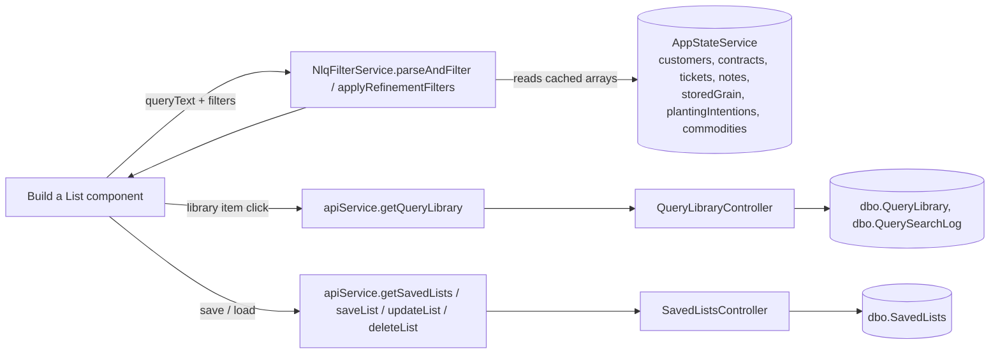

# Build a List

## At a Glance

- **Route**: `/build-list`
- **Component**: [`client/src/app/features/build-list/pages/build-list/build-list.component.ts`](../../client/src/app/features/build-list/pages/build-list/build-list.component.ts)
- **Template**: [`build-list.component.html`](../../client/src/app/features/build-list/pages/build-list/build-list.component.html)
- **Access**: any authenticated Scoular user (`authGuard`).
- **Primary user goal**: build a list of producers using **natural-language queries (NLQ)**, **library prompts**, and **refinement filters**, then save it for daily reuse.

This is where originators construct ad-hoc producer cohorts ("producers I haven't contacted in 30 days who have unpriced corn contracts"), apply structured refinements, and save the resulting list for re-running.

## How users reach it

- "Build a List" link in the sidebar.
- Saved lists also surface on the **Customer Home Page** customer-list filter dropdown — selecting one runs the same NLQ + filters and narrows the home-page customer list to the saved set.

## What it shows

| Section | Description |
| --- | --- |
| **Query input** | Free-text NLQ field. Example queries: `"producers with unconfirmed contracts"`, `"unpriced corn contracts"`, `"contacted by me in last 7 days"`. |
| **Query Library** (prompts) | Prebuilt prompt cards grouped by category (Contracts, Notes, Tickets, Storage, Planting, General). Click to populate the query and run. |
| **Refine filters** (collapsible panel) | Structured filters grouped: Contract Status, Contract Details, Contact History, Contact Frequency, Contact Author, Notes Content, Producer Size, Producer Info, Producer Activity, Tickets, Storage, Planting. |
| **Customer List Results** | Producer rows matching the query + filters. When a note filter is active, each row also renders an inline **notes column** (most recent matching note, paginated +5 reveal). |
| **Manage Members** | Search to add producers from outside the current results, or exclude producers from the current results. |
| **Saved Lists** | List of the user's saved queries that match the current trade-unit selection. Click to load. |

### Key UI strings (useful for grepping)

`"Build a List"`, `"Query Library"`, `"Request a Query"`, `"Refine"`, `"Save List"`, `"Manage Members"`, `"Saved Lists"`, `"Notes added in last"`, `"Not contacted in last"`, `"+N Linked Producers"`, `"+N earlier notes"`, `"Hide"`.

## Data flow



The screen does **not** make per-customer API calls — it operates entirely on the cached arrays in `AppStateService`. The library and saved-list endpoints are the only HTTP traffic during use.

## Files

| Layer | Path |
| --- | --- |
| Component | `client/src/app/features/build-list/pages/build-list/build-list.component.ts` |
| Template | `client/src/app/features/build-list/pages/build-list/build-list.component.html` |
| NLQ engine | `client/src/app/core/services/nlq-filter.service.ts` |
| Refine-filters model | `client/src/app/models/refine-filters.model.ts` |
| Saved-list model | `client/src/app/models/saved-list.model.ts` |
| Highlight pipe | `client/src/app/shared/pipes/highlight.pipe.ts` |
| Library controller | `api/GrainOriginatorPortal.Api/Controllers/QueryLibraryController.cs` |
| Saved-list controller | `api/GrainOriginatorPortal.Api/Controllers/SavedListsController.cs` |
| Service methods | `IDataService.GetQueryLibraryAsync`, `LogQuerySearchAsync`, `GetSavedListsAsync`, `SaveListAsync`, `UpdateListAsync`, `DeleteListAsync` |
| App tables | `dbo.QueryLibrary`, `dbo.QuerySearchLog`, `dbo.SavedLists` |

### API service methods called

- `apiService.getQueryLibrary()` — on init.
- `apiService.getSavedLists()` — on init.
- `apiService.searchCustomers(term, tradeUnits?)` — debounced from Manage Members search input.
- `apiService.saveList(payload)` / `updateList(id, payload)` / `deleteList(id)` — save dialog and saved-list actions.
- `apiService.logQuerySearch({ searchText, matchedQueryId? })` — fired when a library search produces no match (data feeds the Usage Dashboard "Query search gaps" panel).

### AppStateService signals it reads / writes

Reads (heavy): `customers`, `contracts`, `tickets`, `notes`, `storedGrain`, `plantingIntentions`, `commodities`, `commodityConversions`, `producerDetails`, `selectedTradeUnits`, `dataLoading`. Writes only when bulk-fetching is necessary; mostly read-only since DataPreloadService has already populated state.

## NLQ pipeline

`NlqFilterService.parseAndFilter(query, context)` returns `{ customers, matched: matchedPatterns }`. The build-list component then runs `applyRefinementFilters` to apply the structured `RefinementFilters` selected in the panel.

`resolveUserReferences(query, displayName, username)` rewrites first-person ("I", "me", "my") into the active user's name **before** parsing — this makes saved lists portable across users.

Helpers: `queryInvolvesTickets`, `queryInvolvesStorage`, `queryInvolvesContact`, `queryInvolvesPlanting`. The component uses these to decide which `tab` to pass when navigating to the Customer Home Page (see [Click target navigation](#click-target-navigation)).

## `RefinementFilters` model

Defined in [`client/src/app/models/refine-filters.model.ts`](../../client/src/app/models/refine-filters.model.ts). Grouped by domain:

- **Contract status** — `noActiveContracts`, `hasUnsignedContracts`, `downHarvestPace`, `hasUnpricedContracts`, `hasOverdueContracts`, `noContractsAtAll`.
- **Contract details** — `contractQuantityOver`, `contractsExpiringThisMonth`, `multipleCommoditiesContracted`.
- **Contact history** — `notContactedDays`, `notesInLastDays`, `neverContacted`.
- **Contact frequency** — `contactedOnlyOnce`, `contactedMoreThan5`.
- **Contact author** — `contactedByMeOnly`, `contactedBySomeoneElse`.
- **Notes content** — `hasPinnedNotes`, `noteKeyword`.
- **Producer size** — `acresOver`, `hasBinSites`, `noBinSites`. Free-text "with/without bin sites" (also "bin locations", "bin coordinates") and "more than N" / "at least N" / "N+" / "multiple" bin sites filter on the sites. The producer-level **bin capacity** filters (`hasBinCapacity` / `noBinCapacity`, "has bin capacity", "bin capacity over N") were removed 2026-10-09 with the field itself — capacity now lives on each bin site; a saved list still carrying those flags in its JSON just ignores them.
- **Producer info** — `hasPrimaryContact`, `noPrimaryContact`, `hasEmail`, `hasPhone`, `hasLinkedProducers`, `notEsignEnrolled`.
- **Producer activity** — `hasActiveContracts`, `hasDeliveriesThisYear`, `hasPlantingIntentions`, `hasGrainInStorage`.
- **Tickets** — `ticketQuantityOver`, `ticketsInLastDays`, `avgMoistureOver/Under`, `avgTestWeightOver/Under`, `avgProteinOver/Under`.
- **Storage** — `storageDaysOver`, `storageQuantityOver`, `storageReceivableOver`.
- **Planting** — `plantingYear`, `irrigatedOnly`, `drylandOnly`, `doubleCropOnly`, `plantingAcresOver`.
- **Dynamic (NLQ-derived)** — `crops` (commodity codes), `states` (state names).

### Filter behavior notes (worth knowing before changing)

- **`hasActiveContracts`** is strict: a contract must have `status === 'Active'` (case-sensitive) to count. `Pending`, `Overdue`, `Fulfilled`, `Cancelled` are all excluded. NLQ prompts like "producers with active contracts" parse to this filter, so the result set matches what users see when they sort the Contracts tab by status = Active.
- **Three different "not contracted" notions exist — don't mix them up:**
  | Where | Predicate | Means |
  |---|---|---|
  | NLQ `"no contracts"` (the **No contracts** prompt card) | no contract with `closedDate == null` | nothing currently **open** — a producer whose contracts all closed IS returned |
  | Refine `noActiveContracts` | no contract with status `Active`/`Pending`/`Overdue` | nothing live by **status** |
  | Refine `noContractsAtAll` | `getContracts(c).length === 0` | **zero** contracts of any status — the strictest |
  None of them see ancient history: `ContractRepository` only loads contracts that are open or from `CropYear >= Today.Year - 1`, so "never contracted" is not directly answerable from this screen.
- **"Contracted but no deliveries"** (NLQ-derived) checks delivery progress via `contract.openBalanceQuantity` (CTRM through the GraphQL API on the CTRM source; `vw_CurrentContracts` on ODS) — not by walking applied tickets. A customer matches when at least one open contract has `openBalanceQuantity === quantity` (nothing shipped yet). This is the same data source the shared delivery util uses (`client/src/app/shared/utils/contract-delivery.ts`), so the filter is consistent with the Contracts table, Actionable Insights, and the Unshipped Bushels view.

## Library / Prompts

- Stored in `dbo.QueryLibrary` (columns: `Id`, `Category`, `Name`, `Description`, `QueryText`, `SortOrder`, `IsActive`, `CreatedAt`).
- Endpoint: `GET /api/query-library` ([`QueryLibraryController.cs`](../../api/GrainOriginatorPortal.Api/Controllers/QueryLibraryController.cs)).
- Component fetches once on init into `queryLibrary` signal; renders cards grouped by `Category`.
- Click → `selectLibraryQuery(item)` → sets `queryText.set(item.queryText)` and runs `processQuery()`.
- Search miss → `apiService.logQuerySearch({ searchText, matchedQueryId: null })` writes to `dbo.QuerySearchLog`. The Usage Dashboard reads this to surface "Query search gaps" — searches users tried that didn't match a library entry. Use this to decide which prompts to add.

### Adding a prompt card

Cards are **data**, so a new one is a seed migration — no client change is needed when the NLQ engine
already understands the phrasing. Pattern (see `20260810164128_AddNoContractsQueryLibraryItem`):

- Insert guarded by `WHERE NOT EXISTS` keyed on **`QueryText`**, plus an `UPDATE` so re-wording the
  card later self-heals without a second migration. Note the guard means a QueryText collision is
  **silently skipped** — check the target DB if the card doesn't appear.
- `Category` must match an existing value **exactly** (`Contracts`, `Notes`, `Tickets`, `Storage`,
  `Planting`, `Grain on Farm & Bin Sites`, `General`, `Producers`) — it's compared case-sensitively and drives
  which refine panel renders (`showContractFilters` etc.). A new value creates a new tab.
- **`Grain on Farm & Bin Sites`** (2026-10-09, migration `CombineGrainOnFarmAndBinSitePrompts`) holds every
  grain-on-farm AND bin-site prompt in one column — grain on farm is stored at a bin site. It was
  `Grain on Farm`, and the bin-site cards sat under `Producers`. The client treats the old name the same
  (`isGrainAndBinSitesCategory`, `shared/utils/grain-on-farm.ts`) because a saved list keeps its prompt's
  category in `Filters._promptCategory`. Its refine panel adds Has/No bin sites to the grain filters, and
  each result row leads with a neutral "N bin sites" chip before the per-crop bushel chips.
  Each row can also open a **Bin sites & grain** breakdown (closed by default; "Expand all" above the list
  opens every row): a line per bin site — name · capacity · map pin — with the grain stored there under it
  (Crop | Total | Sold | Grade | Target | Last Bid), sites with no grain marked "No grain on farm recorded",
  and any rows not tied to a site last. Built by `binSiteGrainBreakdown` (`shared/utils/grain-on-farm.ts`).
  **Notes that mention a bin site** (2026-10-09): the row's middle column shows the producer's notes that name
  one of their saved bin sites — whole name, any case, not inside a longer word or number ("Bin 1" ≠ "bin 10")
  — in the same note stack note prompts use (newest/pinned first, "+N earlier", See more), the site names
  highlighted and a "Mentions North Bins" label. Notes are added as usual. A small batch loader fetches, per
  render batch, those producers' notes containing any site name (`contentAny` + `customerIds`, a superset the
  client re-matches with `notesMentioningBinSites`, `shared/utils/bin-site-mentions.ts`). When a notes filter
  is active its matches own the middle column instead.
- Derive `SortOrder` from `MAX(SortOrder) + 10` within the category rather than hardcoding: the
  original cards were inserted straight into each database, so numbering differs per environment.
- **Check the QueryText against the parser before choosing it.** Words like `planting` or `deliver`
  route to cross-entity rules and will hijack the query; conversely the text must contain the
  keyword that trips the matching `queryInvolves*` gate (e.g. `contract`), or the relevant data may
  not be loaded and an absence filter will match every producer.
- Add a case to the matching `nlq-filter.*.spec.ts` pinning the **literal** card text — that's what
  catches a future parser change silently turning the card into "select all".

## Saved-list lifecycle

`SavedList` shape ([`saved-list.model.ts`](../../client/src/app/models/saved-list.model.ts)):

```ts
interface SavedList {
  id: number;
  name: string;
  query: string;
  tradeUnits?: string;            // CSV of TU codes
  filters?: RefinementFilters;    // Persisted as JSON
  includedCustomerIds?: number[]; // Manually added
  excludedCustomerIds?: number[]; // Manually removed
  customerIds?: number[];         // Computed client-side, NOT in DB
  createdAt: string;
}
```

**Save** — `saveList()` builds the payload from current state and calls `apiService.saveList` (or `updateList` if `activeSavedList` is set).

**Load** — `loadSavedList(list)` sets `queryText`, `pendingRefinements`/`appliedRefinements`, restores `manuallyExcludedCustomerIds`, and queues `_pendingIncludedIds` to be resolved into Customer objects when data loads.

**`customerIds` is recomputed at load time**, not stored. In Build a List, the dedup pass ([Linked-producer entity view](#linked-producer-entity-view)) runs and the visible list is the deduped set. On the **home page customer list**, `_executeNlq` runs the same NLQ + filters but **without dedup**, so both A and B (linked) appear as separate rows.

**Trade-unit visibility** — the dropdown's `visibleSavedLists` computed only shows lists whose `tradeUnits` CSV exactly matches the currently selected TUs. Saving a new list captures the current TU set into `tradeUnits`.

## Manage Members

Two-pane search:

- **In-results matches** — filters `displayedCustomers()` by name/code/farm. Excludes already-excluded ids. Cap of 5 shown.
- **Add candidates** — debounced 300 ms call to `apiService.searchCustomers`. Filters out anyone already in the results or already manually included.

A `logicallyInResultsIds` computed considers a producer "in results" if they're either a deduped peer row or a linked producer reachable through a parent's expand panel. This makes Manage Members search labels match the user's mental model when the linked-producer entity view is on.

`addCustomerToList(customer)` adds to `manuallyIncludedCustomers`; `excludeCustomerFromList(id)` adds to `manuallyExcludedCustomerIds` (or, if it was a manual add, just removes the add).

## Linked-producer entity view

Gated on `linkedFeatureActive` = `noteFilterActive()` || queryText matches `/linked\s+(?:producer|record)/`. When active:

- **Dedup pass** at the end of `displayedCustomers`: if customer X has `linkedProducerIds` that include another visible customer Y, Y is hidden. Mutual links tie-break on lower id. Manual include doesn't override dedup — adding A and B (linked) still shows them as one entity.
- A **"+N Linked Producers"** chip renders under the parent's location/acres line. Click expands a detail panel.
- The detail panel shows each linked producer in the same compact identity layout (avatar, name, farm, location, acres). When notes are also active, each linked sub-row gets its own notes column with independent pagination.

## Inline notes display

Active when `noteFilterActive()` is true (a `notesInLastDays` filter, `noteKeyword`, `hasPinnedNotes`, or NLQ note pattern is on).

- `_matchedNotesByCode` indexes notes by source `customerCode` after applying the active note predicate. Each note is tagged `viaName: "{Name} ({Code})"`.
- `matchingNotesByCustomer` aggregates per-customer (own + linked + bidirectional incoming), pinned-first then newest-first.
- The customer-list sort flips to **newest matching note time first** while a note filter is on.
- Default view shows the most recent matching note. **"+N earlier notes"** reveals 5 more per click (`NOTE_PAGE_SIZE = 5`); a **"Hide"** link collapses back.
- The `Name (Code)` origin label is shown only when the linked panel is collapsed (origin is unambiguous when expanded).
- Keyword highlighting goes through `HighlightPipe` ([`highlight.pipe.ts`](../../client/src/app/shared/pipes/highlight.pipe.ts)) — escape-then-`<mark>` to prevent XSS.

## Click-target navigation

`selectCustomer(customer)` → `_detectFocusTab()` → router navigation to `/`:

| Active context | Tab passed in URL |
| --- | --- |
| Note filter active | _(no tab — notes live in the home page sidebar)_ |
| Storage filter / "storage" / "stored grain" in query | `tab=storage` |
| Ticket filter / "ticket" / "unapplied" in query | `tab=tickets` |
| Planting filter / "planting" / "intention" in query | `tab=planting` |
| Contract filter / "contract", "unsigned", "expiring", "unpriced", "overdue" in query | `tab=contracts` |
| Otherwise | _(no tab)_ |

When `linkedFeatureActive` is on, only the producer **name** is the click target; the rest of the row is reserved so the linked-expand chip works without hijacking navigation. When `linkedFeatureActive` is off, the **whole row** is clickable.

## Auth and feature flags

- `authGuard` — required.
- No role gating.
- No feature flags.

## Troubleshooting

| Symptom | Likely cause | First place to look |
| --- | --- | --- |
| Library prompts don't appear | `getQueryLibrary` failed or returned empty | Network tab; verify `dbo.QueryLibrary` has `IsActive = 1` rows |
| Saved list doesn't show in dropdown | TU mismatch — saved list's `tradeUnits` doesn't equal current selection | `visibleSavedLists` computed |
| Saved list re-runs and now has different rows | Underlying contract/ticket data (CTRM, or ODS on that source) has changed since save (a contract closed, a customer was deactivated). `customerIds` is recomputed every load. | Expected behavior; tell the user "saved lists are dynamic, not snapshots." |
| Linked producer shows as a separate row even though it should be inside the panel | `linkedFeatureActive` is off (no note filter, no "linked" in query) | Check active filter / queryText |
| Manage Members says "Add" for a producer who's clearly visible | The producer is shown via a parent's expand panel; the search uses `logicallyInResultsIds` which requires the parent to be in the dedup output | Verify the parent passes the active filters |
| Notes column missing for a customer who matches the filter | Customer matched only via bidirectional linked notes (their own notes don't pass) — when the linked panel is expanded the parent column is own-only and may be empty | Documented edge case; close the linked panel to see aggregated notes |
| Wrong tab opens after clicking a producer | `_detectFocusTab` heuristic missed your context | Update `_detectFocusTab` regex / refinements check |

## References

- PR `feature_DisplayNotes` — inline notes display, linked-producer entity view, contextual `tab` navigation.
- [`SECURITY-MODEL.md`](./SECURITY-MODEL.md) — saved-list customer reads aren't TU-restricted by design.
- [`Shared Infrastructure.md`](./Shared%20Infrastructure.md) — `AppStateService`, `NlqFilterService`, `ApiService`.
- [`Customer Home Page.md`](./Customer%20Home%20Page.md) — destination of producer clicks; documents the `tab` query param it consumes.
