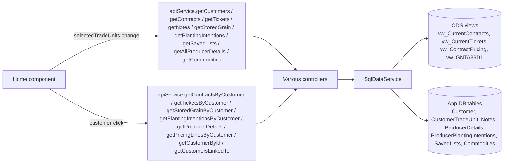

# Customer Home Page

## At a Glance

- **Route**: `/`
- **Component**: [`client/src/app/features/customers/pages/home/home.component.ts`](../../client/src/app/features/customers/pages/home/home.component.ts)
- **Template**: [`home.component.html`](../../client/src/app/features/customers/pages/home/home.component.html)
- **Access**: any authenticated Scoular user (`authGuard`).
- **Primary user goal**: browse producers in the selected trade units, drill into a producer's full profile (contracts, tickets, planting, storage, notes, producer details), and create or edit notes / planting intentions / producer details.

This is the most heavily used screen and the navigation hub for the rest of the app — Insights, Build a List, Bid Sheet, and Usage Dashboard all open producer profiles by deep-linking back here.

## How users reach it

- Default landing page after login.
- "Producers" link in the sidebar/topbar.
- Deep links from other screens — see [Deep-link query params](#deep-link-query-params) below.

## What it shows

The page is a 3-column responsive grid at large screens, single-column at mobile.

| Section | Description |
| --- | --- |
| **Customer List** (left column) | Sortable, searchable list of producers in the selected trade units. Renders the `CustomerListComponent`. |
| **Producer Profile** (center / right column) | Right pane showing the selected producer's name, code, contact info, badges, and the **tabbed body**: `Contracts \| Tickets \| Planting \| Storage`. Renders `CustomerProfileComponent`. |
| **Notes** (right sidebar on `xl` screens, below profile otherwise) | Sticky `app-card` titled **"Notes"** with **"Last contacted: {date}"** subtitle. Renders `CustomerNotesComponent`. |
| **Trade Unit Selector** | Top-of-page selector that drives `selectedTradeUnits()` for the entire app. |
| **Empty state** | When no producer is selected and viewport is `lg+`, shows "Select a Producer" placeholder. |
| **"Back to Producers"** | Mobile-only button (`lg:hidden`) that returns to the list view from a profile view. |
| **Producer Insights** (collapsible, inside the profile) | Hidden by default; opened by the "Producer Insights" button or the Harvest Contract Pace box. Contains the three analysis panels below. |

The `CustomerProfileComponent` ([`client/src/app/features/customers/components/customer-profile/customer-profile.component.ts`](../../client/src/app/features/customers/components/customer-profile/customer-profile.component.ts)) renders four tabs identified by the literal strings `'contracts'`, `'tickets'`, `'planting'`, `'storage'` (default `'contracts'`).

### Producer Insights panels

Stacked in this order inside `@if (showProducerInsights())`:

| Panel | Shows |
| --- | --- |
| **Producer Insights** (`producer-insights/`) | Green hero with three stat cards summarising the relationship. |
| **Harvest Contract Pace** (`contract-pacing-card/`) | Year-over-year contracting pace per harvest window, with a per-commodity table. Fetches its own historical contracts. |
| **Growth Opportunity** (`growth-opportunity/`) | Projected production (planting acres × yield estimate) vs. bushels contracted, per commodity, plus bushels still available and concrete action items. |

**Planting tab — Trade Unit field.** Each planting intention belongs to one trade unit, because a
producer on several trade units plants different acres for each and the Planting Intentions
dashboard sums acres by that field. The Add and Edit dialogs
(`planting-intentions-table/`) offer the *producer's own* active trade units (fetched on open from
`GET /api/customers/{id}/trade-units`, with descriptions from `appState.tradeUnitDescriptions`).
One trade unit → shown read-only; several → the originator must pick, preselected when exactly one
of them is selected in the header. Same crop, year and type for two trade units are two rows, not
one accumulated row. The API rejects a trade unit the producer is not active in (400). A producer
with no membership rows yet falls back to the user's in-scope trade units. The profile itself always
lists every row regardless of trade unit, and the Planting table's fourth column shows each row's
trade unit (it replaced Created On, which the table no longer displays). Full rationale:
[`Planting Intentions Dashboard.md`](./Planting%20Intentions%20Dashboard.md#trade-unit-attribution-of-planting-acres).

**Removing a trade unit moves the acres.** In the Edit Producer Details dialog, removing a trade
unit chip that has planting intentions against it opens a prompt showing how many rows, how many
acres and which crop years, and offers the producer's remaining trade units. Confirming with a
destination calls `POST /api/plantingintentions/retag` on Save. Declining leaves the rows on the
trade unit the producer has left, where no trade-unit dashboard counts them until someone re-tags
them, which the prompt says plainly. The producer's intentions are fetched once, on the first
removal, so a dialog that never removes a trade unit costs nothing extra. Nothing is blocked: a
trade unit with planting intentions is still removable, because the nightly sync can drop a
membership with no user present anyway.

**Growth Opportunity** was called "AI Growth Forecast" until 2026-08-12. Nothing about it was AI — it
rendered a hardcoded sentence and two branches gated behind `const totalProjected = 0` that could
never execute. It now shows the real coverage breakdown, which previously lived above the table on
the Planting tab.

Its arithmetic is [`client/src/app/shared/utils/production-coverage.ts`](../../client/src/app/shared/utils/production-coverage.ts) —
a pure function, so it can be unit-tested and reused. Three things worth knowing about the numbers:

- **Yield is not per producer.** It comes from `dbo.DashboardPlantingEstimates`, keyed
  (trade unit, crop, planting year) and typed by hand under *Set Season Targets* on the Planting
  Intentions dashboard. Every producer in a trade unit growing the same crop shares one bu/ac figure.
  When no estimate exists the panel shows `—`, never `0%`.
- **Season matching uses `Contract.CropYear`**, which is CTRM's own statement of the season. Harvest-
  window delivery-date overlap is only a fallback for contracts with no crop year. (Overlap used to
  be primary, which let a contract spanning a year boundary count in two seasons and made this screen
  disagree with the dashboard.)
- **Everything is expressed in bushels.** Contract quantities are stored in their native
  `QuantityUom` (bu / ST / MT / LB / CW / GL …), so `sumInBushels` converts the mass units via
  pounds-per-bushel from `ctrm.vw_GNP024` before totalling.

  The load-bearing part is the **plausibility guard**: `Pounds_To_Commodity_Unit` is pounds per the
  commodity's *own* standard unit (verified against its `Commodity_Std_Unit_Measure` column), so a
  bushel crop carries a real lb/bu figure — canola 50, millet 50, corn 56, sorghum 56, wheat 60,
  soybeans 60 — while a ton-based commodity carries 2000 and a tonne 2204.62. Factors outside
  25–80 lb/bu are refused and the contract is excluded and reported instead.

  That matters because a grain commodity *group* contains products that aren't the grain: soybean
  meal (`480M`, `SBMO`, `SBMB`) and oil (`BOIL`) in short tons, popcorn (`POP`) by the pound, cracked
  corn (`CKYC`). Before this, 318 short tons of meal were summed into a producer's soybean coverage
  as if they were bushels. On current data no conversion actually fires — every non-bushel grain
  contract is one of those products and is excluded — but the path is kept and tested for the
  legitimate case of a bushel crop contracted by weight.

  **Every screen that totals contracted volume uses this same helper** — the Growth Opportunity
  panel, the Producer Insights "bushels contracted" card, the print report KPI, the dashboard's
  Contract Coverage card, and Build a List's coverage prompts — so they agree on one number.

## Data flow



When the trade-unit selector changes, the home component fires a parallel batch of bulk fetches for the new TU set. When a customer is selected, it fires per-customer fetches to enrich the profile.

## Files

| Layer | Path |
| --- | --- |
| Component | `client/src/app/features/customers/pages/home/home.component.ts` |
| Template | `client/src/app/features/customers/pages/home/home.component.html` |
| Customer profile sub-component | `client/src/app/features/customers/components/customer-profile/customer-profile.component.ts` |
| Customer list sub-component | `client/src/app/features/customers/components/customer-list/customer-list.component.ts` |
| Notes sidebar sub-component | `client/src/app/features/customers/components/notes/customer-notes.component.ts` |
| Per-tab tables | `customer-profile/contracts-table/`, `tickets-table/`, `planting-intentions-table/`, `stored-grain-table/` |
| Producer Insights panels | `client/src/app/features/customers/components/producer-insights/`, `contract-pacing-card/`, `growth-opportunity/` |
| Production coverage math | `client/src/app/shared/utils/production-coverage.ts` (+ `.spec.ts`) |
| Customer map (in profile) | `client/src/app/features/customers/components/map/customer-map.component.ts` |
| Controllers | `CustomersController`, `ContractsController`, `TicketsController`, `NotesController`, `PlantingIntentionsController`, `StoredGrainController`, `ProducerDetailsController`, `SavedListsController`, `CommoditiesController` |
| Service methods | See `IDataService` — Customer / Contract / Ticket / Note / PlantingIntention / StoredGrain / ProducerDetails groups |
| ODS views read | `base.vw_CurrentContracts`, `base.vw_CurrentTickets`, `base.vw_ContractPricing`, `ctrm.vw_GNTA39D1` |
| App tables read/written | `dbo.Customer`, `dbo.CustomerTradeUnit`, `dbo.Notes`, `dbo.ProducerDetails`, `dbo.ProducerPlantingIntentions`, `dbo.SavedLists`, `dbo.Commodities` |

Customers used to be read directly from `originations.vw_CurrentCustomers` via a `CustomerSnapshot` cache table. As of migration `20260513185441_DropCustomerSnapshot`, the snapshot was replaced by app-owned `dbo.Customer` + `dbo.CustomerTradeUnit` tables, populated by `CustomerSyncBackgroundService` (daily 07:00 UTC + on startup). `GetCustomersAsync` now reads those tables directly — one row per customer, no in-memory dedup. See [`Shared Infrastructure.md`](./Shared%20Infrastructure.md#backend-services-and-contexts).

### API service methods called

Bulk on init / TU change:

- `getCustomers(tradeUnits?)`
- `getContracts(tradeUnits?)`
- `getTickets(tradeUnits?)`
- `getNotes(tradeUnits?)`
- `getStoredGrain(tradeUnits?)`
- `getPlantingIntentions(tradeUnits?)`
- `getSavedLists()`
- `getAllProducerDetails()`
- `getCommodities()`
- `getDashboardPlantingEstimates(tu, year)` — per-TU yield estimates used by the Planting tab to show projected production; one call per year (`forkJoin`) covering planting intentions + contract crop years.

Per-customer on selection:

- `getContractsByCustomer(customerId, scoularId?)`
- `getTicketsByCustomer(customerId, scoularId?)`
- `getStoredGrainByCustomer(customerId)`
- `getPlantingIntentionsByCustomer(customerId)`
- `getProducerDetails(customerId)`
- `getPricingLinesByCustomer(scoularId)` (only if `scoularId` exists)
- `getCustomerById(customerId)` (when navigating to a linked producer in a different TU)
- `getCustomerBySourceId(sourceId)` (for missing linked producers)
- `getCustomersLinkedTo(scoularId)` (reverse-linked producers)

Mutations:

- `createPlantingIntention`, `updatePlantingIntention`, `deletePlantingIntention`
- `saveProducerDetails`
- `createNote`, `updateNote`, `toggleNotePin`, `deleteNote`

## Deep-link query params

Parsed in `home.component.ts` (around line 158) from `ActivatedRoute.queryParams`:

| Param | Effect |
| --- | --- |
| `customerId` | Selects that customer (`_selectCustomerById`). |
| `contractId` | Switches profile to the **Contracts** tab and scrolls/expands that contract row in the contracts table. |
| `tab` | Selects a profile tab. Valid values: `contracts`, `tickets`, `planting`, `storage`. |
| `ticketCrop` | When on the `tickets` tab, filters the tickets table to a specific crop / product code. |
| `year` | When on the `planting` tab, selects a planting year. |

These are the contract that **Insights**, **Build a List**, and other screens use when they navigate to a producer. A typical Insights → Home navigation looks like:

```
/?customerId=12345&contractId=999&tab=tickets&ticketCrop=CORN
```

The pending values are stored in component signals (`pendingContractId`, `pendingTab`, `pendingTicketCrop`, `pendingPlantingYear`) and passed as inputs to `<app-customer-profile>`. The customer-profile component uses effects to apply the tab change, scroll to the contract row, etc.

## State and caching

- The home component reads heavily from `AppStateService`: `customers`, `contracts`, `tickets`, `notes`, `storedGrain`, `plantingIntentions`, `savedLists`, `producerDetails`, `pricingLines`, `selectedCustomer`, `selectedTradeUnits`. It also writes (`setCustomers`, `setContracts`, ...) after each successful fetch so other screens get the same cached data.
- `DataPreloadService` may have already populated some of this on app load.
- **Request deduplication** within the component: a `_customerRequestId` counter is incremented on every TU change. Stale responses with an outdated id are dropped to prevent the list from flipping back to the old TU's data when responses arrive out-of-order.

### StoredGrain merge race (important)

`home.component.ts:335-352`

The TU-level `getStoredGrain` fetch and the per-customer `getStoredGrainByCustomer` fetch both write to the same `storedGrain` signal. If they ran in the wrong order, the TU fetch would overwrite the per-customer merge and the customer's storage tab would go blank.

The fix is to **merge by record id**, not overwrite:

```ts
const incoming = data ?? [];
const existing = this.storedGrain();
const seen = new Set(incoming.map(s => s.id));
const merged = [...incoming, ...existing.filter(s => !seen.has(s.id))];
this.storedGrain.set(merged);
this.appState.setStoredGrain(merged);
```

Per-customer fetch keeps existing records that aren't this customer's, then appends new ones for the customer:

```ts
const merged = [...existing.filter(s => s.customerId !== customerId), ...grain];
```

If you're touching this code, preserve the merge semantics. The same shape is used for tickets at `home.component.ts:778-784`. Background: PR #239 (`fix_StorageLoadAndEntitlementsErrors`).

## Contracts table — delivery math and loading states

The Contracts tab inside `CustomerProfileComponent` is the most logic-heavy panel on this screen. Two things to know:

**Delivery math comes from one shared util.** `getContractDeliveryStats(contract)` in [`client/src/app/shared/utils/contract-delivery.ts`](../../client/src/app/shared/utils/contract-delivery.ts) is the single source of truth for `delivered`, `remaining`, `progressPercent`, and `isEffectivelyComplete`. It reads `contract.openBalanceQuantity` (CTRM's own aggregate, read live through the GraphQL API — see [CTRM GraphQL Data Source](./CTRM%20GraphQL%20Data%20Source.md)) — **not** a sum of applied tickets. A sub-0.1%-of-contract residue is treated as complete, so a 99.97%-delivered contract reports as filled. The same util is used by the Contracts table, Actionable Insights' Unshipped Bushels, the standalone `/unshipped-bushels` view, the customer-print report, and the Activity Summary — they no longer drift apart.

**Applied Tickets shows the live count and list.** Tickets load per producer from CTRM (`GET /tickets/customer/{id}`): applied tickets are matched by the producer's open contract numbers, unapplied by customer code, three years back. The header shows "(Loading…)" until that fetch lands, then the count. See [CTRM GraphQL Data Source](./CTRM%20GraphQL%20Data%20Source.md).

Ticket-to-contract matching is **by `ContractNumber` only** (not `ContractNumber + CustomerCode`). Customer-code-coupled matching missed applied tickets where the ticket carried a different customer code than the contract. This affects the Contracts table here, Actionable Insights' Spot Loads, and Build a List's NLQ ticket filters.

**Delivery Period sort is cross-commodity.** The Contracts table is normally grouped by commodity (the Crop column header flips the group order). The one exception: clicking the **Delivery Period** header drops the commodity grouping and shows one flat list ordered by delivery date across all commodities — so a merchandiser can see "what's next up to deliver" regardless of crop. Toggling that sort off restores the grouped view. Lives in `groupedContracts` in [`contracts-table.component.ts`](../../client/src/app/features/customers/components/contracts-table/contracts-table.component.ts).

**Contract dates are calendar dates, fixed for timezone.** Delivery start/end, contract date, and closed date come from ODS `date` columns (no time/zone). They serialize via `DateOnlyJsonConverter` (no UTC `Z`) so they render the correct calendar day in any timezone — previously they showed a day early for users west of UTC. See the date-only note in [`Shared Infrastructure.md`](./Shared%20Infrastructure.md#key-conventions).

**Unapplied tickets — C-prefix gated by active storage.** The "Unapplied" tab classifies a ticket as unapplied when `ContractNumber` starts with `U` (Unload), `L` (Loadout), or `C` (Customer Storage). C-prefix (storage) tickets are further **gated against active storage**: a storage ticket only shows while the producer still holds that commodity in `ctrm.vw_GNTA39D1` — once the grain is priced out, the lingering unload tickets drop off (otherwise they'd show as unapplied forever). U/L tickets are unaffected.

**Test Weight is lb/bu, not %.** In the tickets table the Test Weight column reads `lb/bu` (e.g. `58.0 lb/bu`). The underlying ODS column is named `GradeFactorTestWeightPercent`, but test weight is a pounds-per-bushel measure — only the label was wrong. Moisture and protein are genuinely `%`.

## Planting tab — curated crop dropdown

The Planting Intentions tab's **crop dropdown is curated**. Instead of all ~250 commodities, the Add/Edit crop search suggests only the approved short list (e.g. Yellow Corn, Yellow Corn Non-GMO, the wheats, soybeans, sorghum, white milo). Source: `apiService.getPlantingCommodities()` → `GET /commodities/planting` → commodities where `ShowInPlantingIntentions = 1`. Lives in `planting-intentions-table.component.ts` — only the dropdown *suggestions* (`_rankedCropMatches`) use the curated list; display/resolution of an existing intention's crop still uses the **full** commodity list, so older intentions with a non-curated crop still render their name/category. To change the list, flip the flag for a code (a small data migration); see [`Shared Infrastructure.md`](./Shared%20Infrastructure.md).

## Onboarding producers & trade-unit management

**"All Producers" mode** (in the trade-unit selector): selecting it clears the TU scope and lets the customer list search **every** producer — including ODS producers with no contract/ticket yet. This is how a producer who isn't in any trade unit gets found so they can be onboarded. Single-group users (who previously never saw the group dropdown) now get it too. The mode is session-only (`appState.allProducersMode`) and never persisted — a reload returns the user to their real trade group.

**Edit Producer dialog — trade units** ([`edit-customer-dialog.component.ts`](../../client/src/app/features/customers/components/edit-customer-dialog/edit-customer-dialog.component.ts)): a producer's trade-unit memberships are shown and managed here. Sync-sourced TUs (from a contract/ticket) are **locked** (not removable); manually-added TUs (`IsManual`) are **removable**. Assigning a TU to an onboard candidate (a producer not yet in our tables) inserts them into `dbo.Customer`/`dbo.CustomerTradeUnit` with `IsManual = 1`, so the nightly sync's soft-delete pass won't deactivate them. The assign dropdown lists **all** trade units (`GET /trade-units`), not just the user's entitled set (a product decision).

**Edit Producer dialog — Grain on Farm** ([`grain-on-farm.ts`](../../client/src/app/shared/utils/grain-on-farm.ts)): grain on farm is recorded per commodity **code** (`dbo.ProducerGrainOnFarm.CommodityCode`), the same values as the Commodities chips beside it, so HRWW and SRWW are separate rows with their own bushels, grade and target. The add dropdown is a single list of exactly the Planting Intentions commodities, scoped to the user's trade units and labelled and sorted the same way ("YELLOW CORN (YC)"). It is a custom list rather than a native select so it always opens downward. Producer codes outside that list (e.g. a ticket-only BLY) are not offered. Adding a row for a commodity the producer does not list also adds it to their Commodities chips as a user-added chip; removing that row in the same session takes the chip back off. **Legacy rows:** before 2026-09-23 the column was `CommodityGroup` and held a crop group ("Corn", "Wheat"). The rename migration kept those values because a group cannot be mapped to one code without guessing. They still display, colour and filter correctly, and the dialog tags them "Group" so a user can swap one for a code. Profile and Build-A-List chips show the code, coloured by its crop group, with the commodity name on hover. The API accepts the old `commodityGroup` request field for one release so a stale browser tab cannot wipe grain rows mid-deploy.

**Grain on Farm belongs to a bin site** (2026-10-09, migration `LinkGrainOnFarmToBinSites`): each bin site row in the Edit Producer dialog has **+ Add grain on farm**, which opens a "Grain on Farm — *site name*" block right under that site with a commodity picker; the usual Commodity | Total | Sold | Grade | Target | Last bid rows follow. The picker is on screen only while adding: adding a crop (or **Cancel**) puts it away and "+ Add grain on farm" comes back for the next one. Every site's grain starts **collapsed** when the dialog opens — one line, "▸ Grain on Farm — North Bins (2) · 42,500 bu" — and expands on click, so several sites don't become a wall of inputs. A row is one commodity **at one site** (`dbo.ProducerGrainOnFarm.BinSiteId`, unique on customer + site + code), so the same crop can be at two sites. New grain on farm can only be added under a site. A site with grain needs a name before Save. Removing a site removes its grain rows (and any chip only they added). Rows saved before then have no site: they show in a "Grain on Farm — not tied to a bin site" block with a **Move to a bin site** picker (named sites that don't already hold that crop) and no Add. **Identity:** each site has a stable `SiteKey` (GUID; the dialog makes one for a new site), and grain rows name their site by it on the wire (`binSiteKey`), so a save that leaves sites out (a linked-producer re-save) keeps the links, and a new site can be linked in the same save. The server updates sites in place by key, regenerates a key another producer already uses, and saves a row whose key matches no site without a site rather than dropping its bushels. **Profile:** the first column is headed **Contact and Locations** (2026-10-09). From a 768px-wide profile (`@3xl/profile`) the columns are Contact and Locations 1 : Farm Details 1.6 : Harvest Contract Pace at its own width, and the "N bu on farm" line in Farm Details opens the breakdown **right under it** (`#grain-on-farm-inline`). Below 768px (a ~600px laptop column) no split leaves room for six columns — measured in headless Edge — so the old 1.4 : 1 : 1 split stays and the breakdown opens as a **full-width row under the three columns** (`#grain-on-farm-table`). Both places render one shared `#grainOnFarmTable` template. Rows are grouped by site — the site name is a line of its own above its crops (a Site column left no room, so names stacked and were cut off) — in site order, with "Not tied to a bin site" last (no heading when that is all there is). Values are centered under their headers; Grade is capped at 12rem. The headline total still adds every row. Build a List sums a crop across sites into one chip; its filters already summed rows.

**Bin sites** ([`coordinates.ts`](../../client/src/app/shared/utils/coordinates.ts)): as many per producer as needed (`dbo.ProducerBinSite`; the only cap is a 100-site sanity ceiling, not a product limit), each an optional name plus a latitude/longitude pair. They are entered in the Edit Producer dialog under Contacts, in one field shaped like Google Maps' copied coordinates (`39.115876, -95.143955`). The field also takes free-hand entry: spaces or semicolons as separators, `°`, N/S/E/W letters before or after (which also fix the axis, so `95.01 W, 41.39 N` reads correctly), degrees-minutes-seconds as Google's side panel shows it (`41°23'25.2"N 95°00'27.1"W`), `Lat:`/`Long:` labels, and typographic minus signs. On blur a valid entry is rewritten as `lat, lng` so the user sees how it was read. Each row is **Name | Capacity | Lat/Long**, one line at the dialog's normal width. **Only the Name is required** (2026-10-09): a row with anything in it needs a name, and everything else — coordinates included — is optional. Capacity (bushels) is optional, digits only, grouped as typed, with a "BU" placeholder; it is typed by hand, not derived. (Marketed/Unmarketed bushels and a per-site Commodity were added and then dropped the same day, 2026-10-09 — migrations `DropBinSiteMarketing` and `DropBinSiteCommodity`; the dialog went back from `size="xl"` to its normal width.) Nothing rolls up: site capacities are **not** summed into Bin Capacity, and sites don't feed Grain on Farm (both deferred by the user, 2026-10-08/09). Every input has an inline × to clear it. On the profile, "▸ Bin Sites (N)" is the last line of the Contact column (after the phone and email), always collapsed at first and closed again when another producer is opened. That toggle is the only control: opening it shows a compact table **right under the toggle, inside the Contact column** — **Name | Cap | 📍**. (It briefly ran as a full-width row under the three columns while it also had Mkt/Unmkt columns; with those gone it fits back in Contact, user 2026-10-09.) The table hugs its content and stops at the Contact column edge, never scrolling — a name is the only thing that gives way, wrapping to two lines then "…" on a narrow card; values centered under their headers, empty ones "—"; the 📍 opens that exact point in Google Maps in a new tab (tracked as the `interaction` event, subfeature `bin-site-map-click`), "—" when a site has no coordinates. The pin's "Open in Google Maps" is the only tooltip on the rows (a row-wide details tooltip was removed at the user's request, 2026-10-09). Text steps up a size with the Contact column on the wide layout (`@4xl/profile`). Checked in headless Edge in a replica of the profile grid at 560, 760, 1,000 and 1,400px. The coordinates are not a column: the 📍 carries them at full precision.

The rules are North American: latitude 7 to 84 (north is positive) and longitude −180 to −52 (west is negative). The purpose is that a site can't land in another country by mistake; China, Europe, Australia and South America are all rejected as "outside North America". The box is a box, not a border, so a few edges still pass (the Caribbean coasts of Colombia and Venezuela, western Greenland, the Russian tip of the Bering Strait). The dialog says specifically what is wrong when values are swapped or the minus sign is missing. **Users never round by hand:** a Google Maps paste (`41.39034548435109, -95.00754031349179`) is stored exactly as entered (`decimal(18,15)`), reopens unshortened in the dialog, and drives the map link. Only the profile label is shortened, to six places; it truncates if the column is narrow, and the hover text shows the full value. The API enforces the same rules on the request (`BinSiteRules`), returning 400 when a value is out of range or a request carries more than 100 sites; it rounds only past the column's fifteen places. Saves that omit `binSites` (for example the linked-producer re-saves) leave the existing rows untouched.

## User actions

| Action | Trigger | Method | Toasts |
| --- | --- | --- | --- |
| Add note | "Add Note" in `<app-customer-notes>` | `apiService.createNote(customerId, content, tradeUnit?)` | Success / failure |
| Edit note | inline edit | `apiService.updateNote(noteId, content)` | Success / failure |
| Pin note | pin icon | `apiService.toggleNotePin(noteId)` | (silent on success) |
| Delete note | delete icon | `apiService.deleteNote(noteId)` | Success / failure |
| Add planting intention | "Add" in planting tab | `apiService.createPlantingIntention(payload)` | Success / failure |
| Edit / Delete planting intention | inline / delete icon | `apiService.updatePlantingIntention`, `deletePlantingIntention` | Success / failure |
| Save producer details | "Save" in producer-details panel | `apiService.saveProducerDetails(customerId, data)` | Success / failure |

All mutations refresh the relevant `appState` signal on success so other screens see the change immediately.

## Auth and feature flags

- `authGuard` (MSAL) — required.
- No role gating on this screen.
- No feature flags.

## External integrations

- **MSAL** for AAD auth and the active-account lookup (used to resolve "I", "me", "my" in saved-list NLQ).
- **Leaflet** is used by the customer map sub-component (lazy-loaded via dynamic import; see `customer-map.component.ts`). Geocoding goes through `apiService.geocodeSearch`.
- **`UsageTrackingService`** logs profile-open, note-add, planting-intention-add, etc.
- **`NlqFilterService`** is referenced when running a saved list against the cached customer set.

## Troubleshooting

| Symptom | Likely cause | First place to look |
| --- | --- | --- |
| Customer list is empty | TU selector empty or user has no entitled TUs | TU selector → `appState.selectedTradeUnits()`; check Network tab for `getCustomers` 200/empty vs 403 |
| Selected producer's storage tab is empty even though storage exists in DB | StoredGrain merge race; or TU-fetch stale response wiping per-customer fetch | `home.component.ts:335-352` — confirm merge logic still in place |
| Profile won't open from a deep link | `customerId` query param malformed, or producer not in any of the user's entitled TUs | Devtools console + `_selectCustomerById` flow; `getCustomerById` may return 404 |
| Notes don't show "Last contacted" | The `lastContactedDate` computed reads `note.createdAt`, not `modifiedAt` (modify reflects pin/edits, not actual contact). See comments around `home.component.ts:91-95` |
| Customer list flipped to wrong TU after fast TU change | `_customerRequestId` deduplication didn't match — verify the response handler is still gated on `requestId === this._customerRequestId` |
| Linked producer click goes to a 404 | Linked producer's customer record isn't in `customers()` for the current TU; the component falls back to `getCustomerById` — check that endpoint's response |

## Related screens

- **Insights** (`/insights`) — clicking an insight deep-links here with `customerId`, `tab`, optionally `contractId` and `ticketCrop`.
- **Build a List** (`/build-list`) — clicking a producer in a result list deep-links here with `customerId` and (when the active prompt warrants it) a `tab`.
- **Dashboard** (`/dashboard`) — clicking a producer name in the per-producer table deep-links here.

## References

- PR #239 (`fix_StorageLoadAndEntitlementsErrors`) — StoredGrain merge fix and removal of `ValidateCustomerAccessAsync` from mutation paths.
- [`SECURITY-MODEL.md`](./SECURITY-MODEL.md) — why customer reads/writes don't enforce per-user customer scoping.
- [`Shared Infrastructure.md`](./Shared%20Infrastructure.md) — `AppStateService`, `ApiService`, `IDataService`, route guards, MSAL config.
