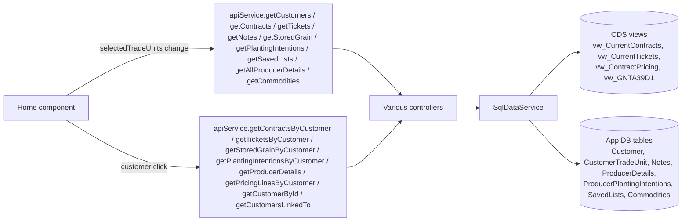

# Customer Home Page

## At a Glance

- **Route**: `/`
- **Component**: [`client/src/app/features/customers/pages/home/home.component.ts`](../../client/src/app/features/customers/pages/home/home.component.ts)
- **Template**: [`home.component.html`](../../client/src/app/features/customers/pages/home/home.component.html)
- **Access**: any authenticated Scoular user (`authGuard`).
- **Primary user goal**: browse producers in the selected trade units, drill into a producer's full profile (contracts, tickets, planting, storage, notes, producer details), and create or edit notes / planting intentions / producer details.

This is the most heavily used screen and the navigation hub for the rest of the app — Insights, Build a List, Bid Sheet, and Usage Dashboard all open producer profiles by deep-linking back here.

## How users reach it

- Default landing page after login.
- "Producers" link in the sidebar/topbar.
- Deep links from other screens — see [Deep-link query params](#deep-link-query-params) below.

## What it shows

The page is a 3-column responsive grid at large screens, single-column at mobile.

| Section | Description |
| --- | --- |
| **Customer List** (left column) | Sortable, searchable list of producers in the selected trade units. Renders the `CustomerListComponent`. |
| **Producer Profile** (center / right column) | Right pane showing the selected producer's name, code, contact info, badges, and the **tabbed body**: `Contracts \| Tickets \| Planting \| Storage`. Renders `CustomerProfileComponent`. |
| **Notes** (right sidebar on `xl` screens, below profile otherwise) | Sticky `app-card` titled **"Notes"** with **"Last contacted: {date}"** subtitle. Renders `CustomerNotesComponent`. |
| **Trade Unit Selector** | Top-of-page selector that drives `selectedTradeUnits()` for the entire app. |
| **Empty state** | When no producer is selected and viewport is `lg+`, shows "Select a Producer" placeholder. |
| **"Back to Producers"** | Mobile-only button (`lg:hidden`) that returns to the list view from a profile view. |

The `CustomerProfileComponent` ([`client/src/app/features/customers/components/customer-profile/customer-profile.component.ts`](../../client/src/app/features/customers/components/customer-profile/customer-profile.component.ts)) renders four tabs identified by the literal strings `'contracts'`, `'tickets'`, `'planting'`, `'storage'` (default `'contracts'`).

## Data flow



When the trade-unit selector changes, the home component fires a parallel batch of bulk fetches for the new TU set. When a customer is selected, it fires per-customer fetches to enrich the profile.

## Files

| Layer | Path |
| --- | --- |
| Component | `client/src/app/features/customers/pages/home/home.component.ts` |
| Template | `client/src/app/features/customers/pages/home/home.component.html` |
| Customer profile sub-component | `client/src/app/features/customers/components/customer-profile/customer-profile.component.ts` |
| Customer list sub-component | `client/src/app/features/customers/components/customer-list/customer-list.component.ts` |
| Notes sidebar sub-component | `client/src/app/features/customers/components/notes/customer-notes.component.ts` |
| Per-tab tables | `customer-profile/contracts-table/`, `tickets-table/`, `planting-intentions-table/`, `stored-grain-table/` |
| Customer map (in profile) | `client/src/app/features/customers/components/map/customer-map.component.ts` |
| Controllers | `CustomersController`, `ContractsController`, `TicketsController`, `NotesController`, `PlantingIntentionsController`, `StoredGrainController`, `ProducerDetailsController`, `SavedListsController`, `CommoditiesController` |
| Service methods | See `IDataService` — Customer / Contract / Ticket / Note / PlantingIntention / StoredGrain / ProducerDetails groups |
| ODS views read | `base.vw_CurrentContracts`, `base.vw_CurrentTickets`, `base.vw_ContractPricing`, `ctrm.vw_GNTA39D1` |
| App tables read/written | `dbo.Customer`, `dbo.CustomerTradeUnit`, `dbo.Notes`, `dbo.ProducerDetails`, `dbo.ProducerPlantingIntentions`, `dbo.SavedLists`, `dbo.Commodities` |

Customers used to be read directly from `originations.vw_CurrentCustomers` via a `CustomerSnapshot` cache table. As of migration `20260513185441_DropCustomerSnapshot`, the snapshot was replaced by app-owned `dbo.Customer` + `dbo.CustomerTradeUnit` tables, populated by `CustomerSyncBackgroundService` (daily 07:00 UTC + on startup). `GetCustomersAsync` now reads those tables directly — one row per customer, no in-memory dedup. See [`Shared Infrastructure.md`](./Shared%20Infrastructure.md#backend-services-and-contexts).

### API service methods called

Bulk on init / TU change:

- `getCustomers(tradeUnits?)`
- `getContracts(tradeUnits?)`
- `getTickets(tradeUnits?)`
- `getNotes(tradeUnits?)`
- `getStoredGrain(tradeUnits?)`
- `getPlantingIntentions(tradeUnits?)`
- `getSavedLists()`
- `getAllProducerDetails()`
- `getCommodities()`
- `getDashboardPlantingEstimates(tu, year)` — per-TU yield estimates used by the Planting tab to show projected production; one call per year (`forkJoin`) covering planting intentions + contract crop years.

Per-customer on selection:

- `getContractsByCustomer(customerId, scoularId?)`
- `getTicketsByCustomer(customerId, scoularId?)`
- `getStoredGrainByCustomer(customerId)`
- `getPlantingIntentionsByCustomer(customerId)`
- `getProducerDetails(customerId)`
- `getPricingLinesByCustomer(scoularId)` (only if `scoularId` exists)
- `getCustomerById(customerId)` (when navigating to a linked producer in a different TU)
- `getCustomerBySourceId(sourceId)` (for missing linked producers)
- `getCustomersLinkedTo(scoularId)` (reverse-linked producers)

Mutations:

- `createPlantingIntention`, `updatePlantingIntention`, `deletePlantingIntention`
- `saveProducerDetails`
- `createNote`, `updateNote`, `toggleNotePin`, `deleteNote`

## Deep-link query params

Parsed in `home.component.ts` (around line 158) from `ActivatedRoute.queryParams`:

| Param | Effect |
| --- | --- |
| `customerId` | Selects that customer (`_selectCustomerById`). |
| `contractId` | Switches profile to the **Contracts** tab and scrolls/expands that contract row in the contracts table. |
| `tab` | Selects a profile tab. Valid values: `contracts`, `tickets`, `planting`, `storage`. |
| `ticketCrop` | When on the `tickets` tab, filters the tickets table to a specific crop / product code. |
| `year` | When on the `planting` tab, selects a planting year. |

These are the contract that **Insights**, **Build a List**, and other screens use when they navigate to a producer. A typical Insights → Home navigation looks like:

```
/?customerId=12345&contractId=999&tab=tickets&ticketCrop=CORN
```

The pending values are stored in component signals (`pendingContractId`, `pendingTab`, `pendingTicketCrop`, `pendingPlantingYear`) and passed as inputs to `<app-customer-profile>`. The customer-profile component uses effects to apply the tab change, scroll to the contract row, etc.

## State and caching

- The home component reads heavily from `AppStateService`: `customers`, `contracts`, `tickets`, `notes`, `storedGrain`, `plantingIntentions`, `savedLists`, `producerDetails`, `pricingLines`, `selectedCustomer`, `selectedTradeUnits`. It also writes (`setCustomers`, `setContracts`, ...) after each successful fetch so other screens get the same cached data.
- `DataPreloadService` may have already populated some of this on app load.
- **Request deduplication** within the component: a `_customerRequestId` counter is incremented on every TU change. Stale responses with an outdated id are dropped to prevent the list from flipping back to the old TU's data when responses arrive out-of-order.

### StoredGrain merge race (important)

`home.component.ts:335-352`

The TU-level `getStoredGrain` fetch and the per-customer `getStoredGrainByCustomer` fetch both write to the same `storedGrain` signal. If they ran in the wrong order, the TU fetch would overwrite the per-customer merge and the customer's storage tab would go blank.

The fix is to **merge by record id**, not overwrite:

```ts
const incoming = data ?? [];
const existing = this.storedGrain();
const seen = new Set(incoming.map(s => s.id));
const merged = [...incoming, ...existing.filter(s => !seen.has(s.id))];
this.storedGrain.set(merged);
this.appState.setStoredGrain(merged);
```

Per-customer fetch keeps existing records that aren't this customer's, then appends new ones for the customer:

```ts
const merged = [...existing.filter(s => s.customerId !== customerId), ...grain];
```

If you're touching this code, preserve the merge semantics. The same shape is used for tickets at `home.component.ts:778-784`. Background: PR #239 (`fix_StorageLoadAndEntitlementsErrors`).

## Contracts table — delivery math and loading states

The Contracts tab inside `CustomerProfileComponent` is the most logic-heavy panel on this screen. Two things to know:

**Delivery math comes from one shared util.** `getContractDeliveryStats(contract)` in [`client/src/app/shared/utils/contract-delivery.ts`](../../client/src/app/shared/utils/contract-delivery.ts) is the single source of truth for `delivered`, `remaining`, `progressPercent`, and `isEffectivelyComplete`. It reads `contract.openBalanceQuantity` (the CTRM aggregate from `vw_CurrentContracts`) — **not** a sum of applied tickets. A sub-0.1%-of-contract residue is treated as complete, so a 99.97%-delivered contract reports as filled. The same util is used by the Contracts table, Actionable Insights' Unshipped Bushels, the standalone `/unshipped-bushels` view, the customer-print report, and the Activity Summary — they no longer drift apart.

**Applied Tickets has a three-state header.** On first customer click, the bulk `getTickets` fetch may still be in flight (the underlying `vw_CurrentTickets` query is the longest pole on home-page cold start). Per-customer ticket fetches (`getTicketsByCustomer`) run in the background to backfill — they merge by ticket id, never overwrite. The Applied Tickets section header reflects:

| State | Header | Body |
| --- | --- | --- |
| Bulk load still pending | "Loading…" | Skeleton rows; "no tickets" message suppressed |
| Bulk done, per-customer backfill running | "Loading…" if applied-ticket pounds don't yet cover `contract.delivered` | Same suppression |
| Done | Tickets list or "No tickets applied to this contract yet" | Real data |

The backfill-coverage heuristic (`appliedTicketsCoverDelivered` in `contracts-table.component.ts`) compares the sum of currently-loaded applied-ticket pounds against `contract.delivered`. If they line up, the table shows what it has rather than waiting on a backfill that won't add anything visible.

Ticket-to-contract matching is **by `ContractNumber` only** (not `ContractNumber + CustomerCode`). Customer-code-coupled matching missed applied tickets where the ticket carried a different customer code than the contract. This affects the Contracts table here, Actionable Insights' Spot Loads, and Build a List's NLQ ticket filters.

**Delivery Period sort is cross-commodity.** The Contracts table is normally grouped by commodity (the Crop column header flips the group order). The one exception: clicking the **Delivery Period** header drops the commodity grouping and shows one flat list ordered by delivery date across all commodities — so a merchandiser can see "what's next up to deliver" regardless of crop. Toggling that sort off restores the grouped view. Lives in `groupedContracts` in [`contracts-table.component.ts`](../../client/src/app/features/customers/components/contracts-table/contracts-table.component.ts).

**Contract dates are calendar dates, fixed for timezone.** Delivery start/end, contract date, and closed date come from ODS `date` columns (no time/zone). They serialize via `DateOnlyJsonConverter` (no UTC `Z`) so they render the correct calendar day in any timezone — previously they showed a day early for users west of UTC. See the date-only note in [`Shared Infrastructure.md`](./Shared%20Infrastructure.md#key-conventions).

**Unapplied tickets — C-prefix gated by active storage.** The "Unapplied" tab classifies a ticket as unapplied when `ContractNumber` starts with `U` (Unload), `L` (Loadout), or `C` (Customer Storage). C-prefix (storage) tickets are further **gated against active storage**: a storage ticket only shows while the producer still holds that commodity in `ctrm.vw_GNTA39D1` — once the grain is priced out, the lingering unload tickets drop off (otherwise they'd show as unapplied forever). U/L tickets are unaffected.

**Test Weight is lb/bu, not %.** In the tickets table the Test Weight column reads `lb/bu` (e.g. `58.0 lb/bu`). The underlying ODS column is named `GradeFactorTestWeightPercent`, but test weight is a pounds-per-bushel measure — only the label was wrong. Moisture and protein are genuinely `%`.

## Planting tab — curated crop dropdown

The Planting Intentions tab's **crop dropdown is curated**. Instead of all ~250 commodities, the Add/Edit crop search suggests only the approved short list (e.g. Yellow Corn, Yellow Corn Non-GMO, the wheats, soybeans, sorghum, white milo). Source: `apiService.getPlantingCommodities()` → `GET /commodities/planting` → commodities where `ShowInPlantingIntentions = 1`. Lives in `planting-intentions-table.component.ts` — only the dropdown *suggestions* (`_rankedCropMatches`) use the curated list; display/resolution of an existing intention's crop still uses the **full** commodity list, so older intentions with a non-curated crop still render their name/category. To change the list, flip the flag for a code (a small data migration); see [`Shared Infrastructure.md`](./Shared%20Infrastructure.md).

## Onboarding producers & trade-unit management

**"All Producers" mode** (in the trade-unit selector): selecting it clears the TU scope and lets the customer list search **every** producer — including ODS producers with no contract/ticket yet. This is how a producer who isn't in any trade unit gets found so they can be onboarded. Single-group users (who previously never saw the group dropdown) now get it too. The mode is session-only (`appState.allProducersMode`) and never persisted — a reload returns the user to their real trade group.

**Edit Producer dialog — trade units** ([`edit-customer-dialog.component.ts`](../../client/src/app/features/customers/components/edit-customer-dialog/edit-customer-dialog.component.ts)): a producer's trade-unit memberships are shown and managed here. Sync-sourced TUs (from a contract/ticket) are **locked** (not removable); manually-added TUs (`IsManual`) are **removable**. Assigning a TU to an onboard candidate (a producer not yet in our tables) inserts them into `dbo.Customer`/`dbo.CustomerTradeUnit` with `IsManual = 1`, so the nightly sync's soft-delete pass won't deactivate them. The assign dropdown lists **all** trade units (`GET /trade-units`), not just the user's entitled set (a product decision).

## User actions

| Action | Trigger | Method | Toasts |
| --- | --- | --- | --- |
| Add note | "Add Note" in `<app-customer-notes>` | `apiService.createNote(customerId, content, tradeUnit?)` | Success / failure |
| Edit note | inline edit | `apiService.updateNote(noteId, content)` | Success / failure |
| Pin note | pin icon | `apiService.toggleNotePin(noteId)` | (silent on success) |
| Delete note | delete icon | `apiService.deleteNote(noteId)` | Success / failure |
| Add planting intention | "Add" in planting tab | `apiService.createPlantingIntention(payload)` | Success / failure |
| Edit / Delete planting intention | inline / delete icon | `apiService.updatePlantingIntention`, `deletePlantingIntention` | Success / failure |
| Save producer details | "Save" in producer-details panel | `apiService.saveProducerDetails(customerId, data)` | Success / failure |

All mutations refresh the relevant `appState` signal on success so other screens see the change immediately.

## Auth and feature flags

- `authGuard` (MSAL) — required.
- No role gating on this screen.
- No feature flags.

## External integrations

- **MSAL** for AAD auth and the active-account lookup (used to resolve "I", "me", "my" in saved-list NLQ).
- **Leaflet** is used by the customer map sub-component (lazy-loaded via dynamic import; see `customer-map.component.ts`). Geocoding goes through `apiService.geocodeSearch`.
- **`UsageTrackingService`** logs profile-open, note-add, planting-intention-add, etc.
- **`NlqFilterService`** is referenced when running a saved list against the cached customer set.

## Troubleshooting

| Symptom | Likely cause | First place to look |
| --- | --- | --- |
| Customer list is empty | TU selector empty or user has no entitled TUs | TU selector → `appState.selectedTradeUnits()`; check Network tab for `getCustomers` 200/empty vs 403 |
| Selected producer's storage tab is empty even though storage exists in DB | StoredGrain merge race; or TU-fetch stale response wiping per-customer fetch | `home.component.ts:335-352` — confirm merge logic still in place |
| Profile won't open from a deep link | `customerId` query param malformed, or producer not in any of the user's entitled TUs | Devtools console + `_selectCustomerById` flow; `getCustomerById` may return 404 |
| Notes don't show "Last contacted" | The `lastContactedDate` computed reads `note.createdAt`, not `modifiedAt` (modify reflects pin/edits, not actual contact). See comments around `home.component.ts:91-95` |
| Customer list flipped to wrong TU after fast TU change | `_customerRequestId` deduplication didn't match — verify the response handler is still gated on `requestId === this._customerRequestId` |
| Linked producer click goes to a 404 | Linked producer's customer record isn't in `customers()` for the current TU; the component falls back to `getCustomerById` — check that endpoint's response |

## Related screens

- **Insights** (`/insights`) — clicking an insight deep-links here with `customerId`, `tab`, optionally `contractId` and `ticketCrop`.
- **Build a List** (`/build-list`) — clicking a producer in a result list deep-links here with `customerId` and (when the active prompt warrants it) a `tab`.
- **Dashboard** (`/dashboard`) — clicking a producer name in the per-producer table deep-links here.

## References

- PR #239 (`fix_StorageLoadAndEntitlementsErrors`) — StoredGrain merge fix and removal of `ValidateCustomerAccessAsync` from mutation paths.
- [`SECURITY-MODEL.md`](./SECURITY-MODEL.md) — why customer reads/writes don't enforce per-user customer scoping.
- [`Shared Infrastructure.md`](./Shared%20Infrastructure.md) — `AppStateService`, `ApiService`, `IDataService`, route guards, MSAL config.
