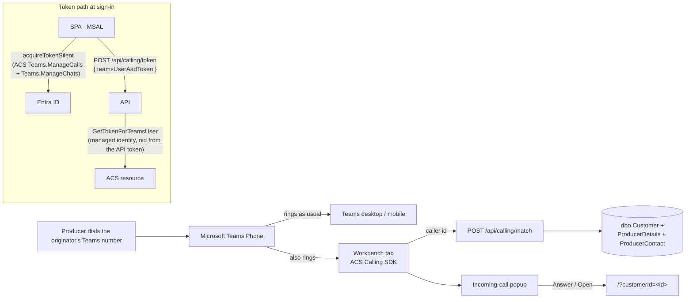

# Incoming Calls (call popup)

**What it is:** when a producer calls an originator's Microsoft Teams phone number, a popup appears
anywhere in the Workbench showing **who is calling** — producer name, customer code and location, or
the name of a contact the originator added on the producer details card, or a chooser when several
producers share the number, or "unknown caller". From the popup the originator can **Answer** (audio
in the browser, and the producer's page opens), **Decline**, and once connected **Hold / Resume** and
**Hang up**. If they pick up on the Teams app instead, the popup shrinks to a one-line banner — "On a
call with Smith Farms (SMIFAR), answered in Teams" — that keeps the link to the producer.

**Status (2026-10-28): Dev proof of concept, branch `spike_IncomingCallAcs`.** Infrastructure
provisioned the Azure side on 2026-10-27 (Dev only) and wrote
[TEAMS-CALLING-GUIDE.md](./TEAMS-CALLING-GUIDE.md); the code follows it, with the differences listed in
[Incoming Calls - Notes for Infrastructure.md](./Incoming%20Calls%20-%20Notes%20for%20Infrastructure.md).
The popup can also be exercised without a call via **Simulate incoming call** in the profile menu
(local and Dev only — `environment.incomingCallSimulatorEnabled`). QA is provisioned and on from
2026-10-29 (`acs-origination-qa-eus`, `appsettings.QA.json` → `Acs`); Production is not provisioned
and the flag is off there.

**Who gets it in QA (decision 2026-10-29):** everyone signed into the QA Workbench. Each signed-in
QA tab becomes one more endpoint of that person's Teams phone, so their real producer calls ring and
pop there too (Teams desktop and mobile still ring as normal). Accepted because only testers use QA;
no per-user switch was built.

## How it works

The browser becomes **one more of the user's Teams Phone endpoints**, exactly like the Teams desktop
and mobile apps. This uses Azure Communication Services (ACS) "Communication as a Microsoft 365 user":
the ACS Calling SDK runs in the tab, signed in as the user's own Teams identity, so Teams rings it
along with everything else and tells it the caller's number at ring time.

**Why this design:**

- **No phone numbers move.** Originators keep their personal Teams numbers; nothing is re-homed to
  resource accounts.
- **Nothing of ours sits in the call path.** If the tab is closed, the SDK fails, or Azure is down,
  the call rings in Teams exactly as it does today. The failure mode is "no popup", never "no call".
  ACS never calls back into the API; the browser receives the incoming-call event directly.
- **Answer / Decline / Hold are real**, not cosmetic — they act on the actual Teams call.
- **No secrets.** The ACS resource has local authentication disabled; the API reaches it as the App
  Service managed identity, and locally as the developer's own `az login`.

### Token path

1. After sign-in, `IncomingCallService` asks MSAL for an Entra token for the two ACS scopes
   (`environment.acs.teamsScopes`). Admin consent for them lives on the **SPA** registration
   (`Origination - Dev`), so nobody sees a prompt. The scopes are deliberately NOT in the MSAL
   protected-resource map or the login request.
2. The browser POSTs that token to `POST /api/calling/token` (authenticated with the normal API token).
3. `CallingTokenService` calls the ACS Identity SDK `GetTokenForTeamsUser(entraToken, Acs:TeamsClientId,
   callerOid)`. **`callerOid` comes from the validated API token, never from the body**, and ACS
   refuses the exchange unless the Entra token was issued to that same user and to the configured SPA
   client id — so nobody can mint a calling token for anyone but themselves. Tokens are not cached
   server-side and never logged.
4. **204 = calling is off here** (`Acs:Endpoint` / `Acs:TeamsClientId` empty). **502** = ACS refused
   (wrong client id, token for another user, identity lacks the role, no Teams licence; the status and
   error code are logged). Either way the client settles in `unavailable` and **never downloads the SDK**.
5. Otherwise the SDK chunk is lazy-loaded (~1.2 MB compressed, never in the initial bundle),
   `createTeamsCallAgent` registers the endpoint, and `AzureCommunicationTokenCredential` re-runs both
   hops before the token expires. **The microphone is not opened at registration**: the SDK's
   `askDevicePermission` opens a real capture stream and holds it for ~5 s even when permission is
   already granted (it kept the mic-in-use light on during the Dev POC).
6. **Microphone pre-approval ("ask once, release immediately").** Once the agent has registered, the
   elected tab's `CallAudioPermissionService` checks `navigator.permissions.query({ name: 'microphone' })`,
   which never opens the device (a browser where the query is missing or throws is treated as `prompt`):

   | Permission | What the user sees |
   |------------|--------------------|
   | `granted` | Nothing. No device access. |
   | `prompt` | A one-line banner under the header: *"Enable call audio so you can answer Teams calls here"* with **Enable** / **Not now**. Enable calls `getUserMedia({ audio: true })` from the click and stops every track at once (the grant is what is wanted, not the stream). Not now hides it for the browser session (`sessionStorage` `origination.callAudio.notNow`). |
   | `denied` | A dismissible amber hint that the microphone is blocked for this site and how to allow it (site icon → Microphone → Allow, reload). Dismissed per session (`origination.callAudio.blockedHintDismissed`). |

   The `PermissionStatus` `change` event is followed, so changing the permission in site settings updates
   the banner/hint live. Nothing shows in non-leader tabs, when calling is off (204), or after the
   agent gives up. `answer()` still asks through the SDK as the fallback (`client/src/app/shared/components/call-audio-banner/`,
   `client/src/app/core/services/call-audio-permission.service.ts`).

### One endpoint per browser, kept alive

- **Only one tab registers.** Every tab with a call agent is a separate Teams endpoint that rings and
  can answer, so the service takes a Web Lock (`origination.incomingCall.agent`); the tab that holds
  it is the endpoint, other tabs of the same browser wait, and when it closes the next one takes over.
- **Reconnect.** If the SDK reports `connectionStateChanged → Disconnected` (any reason, including
  `invalidToken`: the rebuild fetches a fresh token) or agent creation fails, the agent and its
  credential are disposed and re-created on the same `CallClient` (one per tab, disposed on sign-out).
  Back-off is exponential with ±20 % jitter: 5 s, 10 s, 20 s, 40 s, 80 s (cap 5 min), and never
  shorter than a throttle's `retryAfter` (Teams registrar `429` / `42901`; 2 min if the value is
  unreadable). The back-off only resets after a registration has stayed up for 60 s. After **6
  consecutive failures** the tab gives up (`unavailable`, console
  `[incoming-call] giving up after 6 failed registrations …`) until the next page load. A drop during
  a call waits for the call to end. Each retry logs `[incoming-call] … re-registering in N s`.
  *Why:* the first Dev build re-registered every ~3 s, which got the user throttled by the Teams
  registrar (`retryAfter` ~2 min) and, by retrying inside the window, kept the throttle from clearing.
- **A blip the SDK recovers from is not a failure.** The rebuild is only scheduled: if the SDK
  reports `Connected` again before it is due, the rebuild is cancelled and the working agent kept
  (console `[incoming-call] connection restored by the SDK; rebuild cancelled`). *Why:* on Dev
  (2026-10-29) the SDK reported `Disconnected (connectionIssue)` about 0.5 s after nearly every
  registration and then reconnected by itself — a call rang and was answered on an agent already
  marked lost. Rebuilding it anyway only started a new agent that blipped the same way, so calls got
  through only during the long back-off waits.
- **Sign-out** disposes the agent (header `signOut()` → `IncomingCallService.stop()`).
- A sleeping laptop drops the connection; a background tab is throttled but keeps working.

### Phone matching

`CustomerRepository.FindByPhoneAsync` contains-matches the caller's digits against four places, all
punctuation-stripped (same `StripPhone` idiom as producer search):

| Source | Column |
| --- | --- |
| ODS merchandising phone | `dbo.Customer.MerchandisingPhone` |
| ODS extended phone | `dbo.Customer.ExtendedPrimaryPhone` |
| User-entered primary phone | `dbo.ProducerDetails.PrimaryPhone` |
| Any producer contact | `dbo.ProducerContact.Phone` |

**Contacts added on the producer details card** (`dbo.ProducerContact`: Dad, the farm manager, the
insurance office) are checked too, and when the number is one of theirs the popup names the **person**
first and the producer under it ("Jane Smith" / "Smith Farms"); the answered-in-Teams banner reads
"Jane Smith, Smith Farms (SMIFAR)". The legacy `ProducerDetails.PrimaryContact` / `PrimaryPhone` pair
is read the same way for producers whose primary contact predates the contacts table. If several
contacts share the number, the primary one is shown.

`PhoneDigits.Normalize` turns the SDK's E.164 caller id into digits (`+14025554914` → `4025554914`)
and refuses anything under 7 digits (withheld / garbage → "unknown caller", no DB hit). Active
producers only. Measured on Dev 2026-10-07: ~300–400 ms per lookup (a table scan; fine for one lookup
per call). The number is never logged — count-only logging.

Matches outside the user's selected trade units still open: the home page's deep link falls back to
fetching the producer by id when the list does not contain them (AR-02 already covers this read).

### Popup states

| State | When | What the user sees |
| --- | --- | --- |
| `ringing` | A call is coming in | Number (or the caller's display name when it is not a phone number, e.g. a call queue), producer card / chooser / unknown, **Answer**, **Decline** |
| `connecting` | Answer pressed | Mic permission prompt, then accept |
| `connected` / `held` | In the call | Timer, **Hold / Resume**, **Hang up**, producer card |
| `answeredElsewhere` | Picked up in Teams (end reason 487 / 10003) | One-line banner with **Open** + dismiss; clears itself after 15 min |
| `ended` | The **caller** hung up | "Call ended — the caller hung up", closes itself after 2.5 s (no button). When the **user** hangs up the popup closes immediately and never shows this |
| `idle` / `unavailable` | Nothing ringing / calling off here | Nothing |

Other ring endings clear the popup: caller hung up (487/0), rang out to voicemail (487/10004),
declined on every endpoint (487/10024). Teams-to-Teams calls from colleagues are ignored (they still
ring this endpoint silently and are answered in Teams). A second call while one is in progress is
left to Teams.

**Position:** every call opens in the top-right corner. The user can drag it by the grab bar (or the
icon / status line) anywhere on screen for the rest of that call; double-clicking the grab bar puts it
back. The next call starts in the corner again — nothing is remembered between calls.

**Answer also opens the producer's page** when the producer is known (single match, or the one picked
from the chooser). Clicking a producer card opens the page without touching the call.

## Configuration

| Setting | Where | Meaning |
| --- | --- | --- |
| `incomingCallEnabled` | `client/src/environments/environment*.ts` | Local/Dev **true**, QA/Prod **false**. Compiled in — changing it needs a client redeploy |
| `acs.teamsScopes` | `client/src/environments/environment*.ts` | The two ACS scopes the browser asks Entra for (`Teams.ManageCalls`, `Teams.ManageChats`) |
| `Acs:Endpoint` | `appsettings.{Env}.json` | ACS resource endpoint. **Empty = off** (token endpoint answers 204). Dev and local Development point at `acs-origination-dev-eus` |
| `Acs:TeamsClientId` | `appsettings.{Env}.json` | The **SPA** registration's client id (the Entra token's `appid`), not the API's |
| `SecurityHeaders:SpaCallingConnectSrcHosts` | `appsettings.{Env}.json` | SDK origins added to the SPA `connect-src`, **only when `Acs:Endpoint` is set**. Dev and Development list them |
| `SecurityHeaders:SpaCallingMediaSrc` / `SpaCallingWorkerSrc` | `appsettings.{Env}.json` | Optional extra `media-src` / `worker-src` (e.g. `blob:`). Add only if the browser console reports a violation |

The CSP widening is recorded as **AR-11** in `SECURITY-REVIEWS/ACCEPTED-RISKS.md`.

## What Infrastructure provisioned (Dev, 2026-10-27)

| Item | Value |
| --- | --- |
| ACS resource | `acs-origination-dev-eus` in `rg-origination-dev-eus` (`scoular-apps-nonprod`), data location United States, **local auth disabled** |
| Endpoint | `https://acs-origination-dev-eus.unitedstates.communication.azure.com` |
| Role | `Communication and Email Service Owner` for the `app-origination-dev-eus` system-assigned identity (principal `7ff98598-…`) and for `Azure - Origination App - Developer Admins`. **Direct assignments only:** ACS ignores roles that reach an identity through group membership (Infrastructure, 2026-10-28), so the group grant does not let a developer run the exchange locally — each developer must be added individually on the resource |
| Consent | Tenant-wide admin consent on the SPA registration `Origination - Dev` for ACS `Teams.ManageCalls` + `Teams.ManageChats` |
| Egress | FortiGate rule for the App Service → ACS endpoint, **staged** — confirm the push before testing from the deployed API |

Nothing is provisioned for QA or Production; Infrastructure builds those only if the POC succeeds.

**Licensing / cost:** any Teams licence plus the Teams Phone number the originator already has. ACS
meters $0.004/min only for minutes connected **through the browser**; ringing and calls answered in
the Teams app cost nothing extra.

## What the POC must prove (Infrastructure's test plan)

| # | Scenario | Question |
| --- | --- | --- |
| 1 | A producer dials the originator's **own** Teams number | Does the tab ring, and does `callerInfo` carry the caller's phone number? Expected to work. |
| 2 | A producer dials a **site** number (auto attendant → call queue, conference mode on) | Does the tab ring for an agent on that queue, and does `callerInfo` carry the **original caller** or the queue? **The deciding test.** |
| 3 | Scenario 2, answered in **Teams desktop** with the tab open | Does the tab still pop the producer (banner)? |

For every test call the tester records: scenario, queue name, time, the console line
`[incoming-call] callerInfo {...} transferorInfo {...}` (local and Dev builds log both as JSON —
`environment.logCallerInfo`, off in QA and Production because the number is PII),
whether the tab and Teams desktop rang together, who could answer, and audio quality on the office
network and over VPN. Results go to Infrastructure; if scenario 2 fails their fallback is Teams Phone
Extensibility (server-side routing for site numbers).

## ⚠ Microsoft's 2028 ACS retirement

In September 2026 Microsoft announced that **ACS as a standalone offering retires on 30 September 2028**.
The Calling SDK is a *breaking change*, not a retirement: it stays available (on a new major SDK
version) but is supported only "when used with a supported Teams-aligned service". **Whether this
scenario qualifies is genuinely uncertain:**

- *For:* the guide's "Services not impacted" lists "Teams Interop" broadly, and the Teams
  interoperability page puts the "Teams user" model (ours) under Teams interop, with "make and receive
  calls as Teams users: Yes" and PSTN via Teams Phone.
- *Against:* the same guide says supported applications must use one of exactly three services —
  Teams Phone Extensibility, **Teams Meeting** Interoperability, Click-2-Call for Teams voice apps —
  maps the Calling SDK to "Teams Meeting interoperability", and describes that path as "Calling SDK
  participation in Teams meetings". A 1:1 PSTN call received as a Teams user is none of the three.

The guide says to open a support ticket when a configuration isn't spelled out
(`https://aka.ms/acs-retirement-support`). **Ask: "Is the Calling SDK's 'Communication as a Microsoft
365 user' receiving PSTN calls a supported Teams-aligned scenario after 30 Sept 2028?"** Keep the
feature out of QA/PROD until that is answered; the Dev POC does not depend on it.

**Fallback if the answer is no:** Teams Phone Extensibility (numbers on Teams resource accounts, ACS
Call Automation routes the call to the originator) — explicitly "not impacted". Everything here
except the browser SDK layer (matching, popup, deep link, config shape) carries over.

**Rejected alternatives (verified 2026-10-07):** Microsoft Graph has no real-time incoming-call event
for a user's own number (`callRecords` arrive after the call ends); a compliance-recording bot is
heavy and has compliance implications; third-party CTI products carry a licence cost.

## Testing

**Without a real call (local, Dev):** profile menu → **Simulate incoming call** → type a number.
Use a number on file for a producer to see the card (or one shared by several for the chooser), a
made-up number for "unknown caller". In the ringing state a small **Simulate: answered in Teams** link
exercises the banner; once connected, **Simulate: caller hangs up** exercises the auto-close.

**Real call from a laptop (local):** `az login` first — the exchange runs as you, and
`Azure - Origination App - Developer Admins` holds the ACS role. Start the API with the `http`
profile and `ng serve`; `appsettings.Development.json` points at the Dev ACS resource. Sign in,
click **Enable** on the call-audio banner (or allow the microphone when you click Answer), and call your
own Teams number from a phone that is on file for a producer.

**Real call (deployed Dev):**

1. `POST /api/calling/token` returns 200 (a 204 means the config is missing; a 502 means ACS refused —
   App Insights has the status/error code); the SDK chunk loads; no CSP violations in the console.
2. Call the tester's Teams number from a phone on file → popup within ~2 s, Teams desktop rings too.
3. Answer in the browser → mic prompt, two-way audio, timer; Hold/Resume audible; Hang up ends it.
4. Call again, answer in Teams desktop → banner, no error.
5. Unknown number → "Unknown caller"; Decline works. Ring out / caller hangs up → popup clears.
6. Open a second Workbench tab: only one tab rings (the other shows nothing); close the ringing tab and
   the second one takes over within a few seconds of the next call.
7. Leave the tab open > 1 h → a later call still pops (token refreshed without reload).
8. App Insights: no caller numbers or tokens in any log line.
9. Tell Infrastructure the time of the first exchange so they can confirm it in the sign-in logs and
   the FortiGate logs.

## Troubleshooting

- **No popup on a real call, `POST /api/calling/token` answers 204** — `Acs:Endpoint` or
  `Acs:TeamsClientId` is empty in that environment's appsettings.
- **…answers 502** — App Insights has "Calling token exchange failed: ACS answered {status} {code}:
  {detail}", where the detail is ACS's own error text. `401 Denied — "Denied by the resource
  provider"` = the identity has no role assignment **directly** on the ACS resource. ACS ignores
  roles granted through group membership (Infrastructure, 2026-10-28), so locally it means you have
  not been added individually — the Developer Admins group grant is not enough. The App Service
  identity is assigned directly, so deployed environments are unaffected. Other 401/403 texts: `Acs:TeamsClientId` is not the SPA that acquired the token
  (passing the API's client id is the classic mistake), or the token was issued to another user. A
  timeout from the deployed API that works locally = the FortiGate rule has not been pushed.
- **MSAL `AADSTS65001` (consent required) for the ACS scopes** — consent is only on the Dev SPA
  registration; you are in another environment, or signed in with another registration.
- **Token is 200 but nothing rings** — browser console: a CSP `connect-src` violation names the host
  to add to `SpaCallingConnectSrcHosts` (config only, no code change). "Incoming-call popup unavailable"
  warnings mean the SDK failed to start. Also check it is the **leader** tab: another open Workbench tab
  may hold the endpoint.
- **Rings in Teams desktop but not in the tab** — no connected agent (tab closed, laptop slept and the
  reconnect has not run yet), or the scenario is unsupported (channel-based call queue). Record it as a
  POC result if it is a queue scenario.
- **Call connects, no audio** — the user's network blocks `20.202.0.0/16` UDP 3478–3481, or a VPN
  hairpin. A network question, not a code change; try off-VPN to confirm.
- **Answer shows "Could not answer here — pick up in Teams instead"** — microphone permission denied or
  no input device. The call is still ringing in Teams.
- **Popup says unknown caller for a producer you know** — the producer's stored number differs from the
  caller id, or the producer is inactive. Matching is contains-on-digits, so formatting is not the cause.
- **Producer opens but isn't highlighted in the list** — expected when they are outside the selected
  trade units.

## Known limitations (from the guide)

- Mobile browsers are not a realistic softphone; desktop Chrome / Edge / Safari are.
- Teams dial plans and caller-ID policies are not applied to calls placed from this endpoint (we place none).
- Channel-based call queues are unsupported (2 of the 52 site queues today).
- Emergency (911) calls from a browser endpoint may not convey a dispatchable location — never promote
  browser calling as the place to dial 911.

## Files

| Layer | File | Role |
| --- | --- | --- |
| API | `api/GrainOriginatorPortal.Api/Controllers/CallingController.cs` | `POST /api/calling/token` (200/204/400/502), `POST /api/calling/match` (number in the body) |
| API | `api/GrainOriginatorPortal.Api/Services/CallingTokenService.cs` | Entra-for-ACS token → ACS `GetTokenForTeamsUser`, oid from the API token; never throws, never caches |
| API | `api/GrainOriginatorPortal.Api/Services/CommunicationIdentityClientFactory.cs` | ACS Identity client with managed identity (developer `az login` locally) |
| API | `api/GrainOriginatorPortal.Api/Services/CallingMatchService.cs`, `PhoneDigits.cs` | Caller id → producers (+ added-contact names) |
| API | `api/GrainOriginatorPortal.Api/Models/Requests/ExchangeCallingTokenRequest.cs` | The exchange body |
| API | `api/GrainOriginatorPortal.Api/Services/RequestContextService.cs` | `GetCurrentUserObjectId()` |
| API | `api/GrainOriginatorPortal.Api/Middleware/SecurityHeadersMiddleware.cs` | Config-gated calling origins in the SPA CSP |
| Repo | `api/GrainOriginatorPortal.Infrastructure/Repositories/CustomerRepository.cs` | `FindByPhoneAsync`, shared `StripPhone`, contact-name lookup |
| Client | `client/src/app/core/services/incoming-call.service.ts` | Token path, leader lock, SDK registration, reconnect, state machine, simulate |
| Client | `client/src/app/core/services/call-audio-permission.service.ts` + `shared/components/call-audio-banner/` | Microphone pre-approval: permission query, Enable (getUserMedia, tracks stopped at once), Not now, blocked hint |
| Client | `client/src/app/core/services/calling-sdk-loader.service.ts` | Lazy import of the SDK |
| Client | `client/src/app/shared/components/incoming-call-popup/incoming-call-popup.component.ts` | The popup and banner (draggable) |
| Client | `client/src/app/app.component.ts/.html` | Starts the service; defers the popup |
| Client | `client/src/app/shared/components/header/header.component.*` | "Simulate incoming call" (local and Dev only); `stop()` on sign-out |
| Client | `client/src/app/features/customers/pages/home/home.component.ts` | Out-of-trade-unit deep-link fallback |
| Config | `appsettings.json`, `appsettings.Dev.json`, `appsettings.Development.json`, `environment*.ts` | See *Configuration* |
| Docs | `TEAMS-CALLING-GUIDE.md`, `Incoming Calls - Notes for Infrastructure.md` | Infrastructure's guide, and where we differ from it |

**History:** a July 2026 attempt (`feature_IncomingCallPopup`, never pushed) built a polling popup on a
`dbo.IncomingCallEvents` table and stalled on how to detect the ringing call; an earlier
`feature_PhoneUpdate` tried SignalR plus a bot scaffold. The 2026-10-07 design replaced both — no
table, no polling, no bot — using an on-behalf-of exchange on the API registration. On 2026-10-27
Infrastructure provisioned the Azure side with consent on the **SPA** registration instead, and the
token path was reworked to match (browser acquires the ACS-scoped token, API exchanges it).
