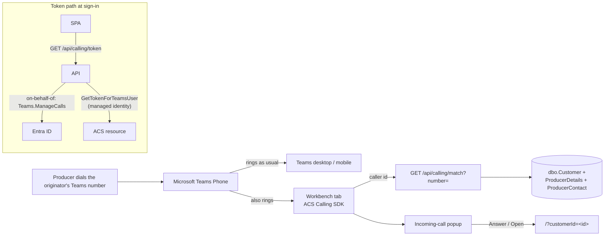

# Incoming Calls (call popup)

**What it is:** when a producer calls an originator's Microsoft Teams phone number, a popup appears
anywhere in the Workbench showing **who is calling** — producer name and customer code, or a chooser
when several producers share the number, or "unknown caller". From the popup the originator can
**Answer** (audio in the browser, and the producer's page opens), **Decline**, and once connected
**Hold / Resume** and **Hang up**. If they pick up on the Teams desktop or mobile app instead, the
popup shrinks to a one-line banner — "On a call with Smith Farms (SMIFAR) — answered in Teams" — that
keeps the link to the producer.

**Status (2026-10-07): Dev spike, branch `spike_IncomingCallAcs`.** All code and tests are in place;
the real-call path is dormant until IT completes the three items under *What IT needs to do*. The
popup itself can be exercised today with **Simulate incoming call** in the profile menu (non-production
builds only).

## How it works

The browser becomes **one more of the user's Teams Phone endpoints**, exactly like the Teams desktop
and mobile apps. This uses Azure Communication Services (ACS) "Communication as a Microsoft 365 user":
the ACS Calling SDK runs in the tab, signed in as the user's own Teams identity, so Teams rings it
along with everything else and tells it the caller's number at ring time.

**Why this design:**

- **No phone numbers move.** Originators keep their personal Teams numbers; nothing is re-homed to
  resource accounts.
- **Nothing of ours sits in the call path.** If the tab is closed, the SDK fails, or Azure is down,
  the call rings in Teams exactly as it does today. The failure mode is "no popup", never "no call".
- **Answer / Decline / Hold are real**, not cosmetic — they act on the actual Teams call.
- **No secrets.** The API reaches Entra through the same federated-credential + managed-identity
  on-behalf-of setup as the Teams channel lookup and Outlook reminders, and reaches ACS as the App
  Service managed identity.

### Token path

1. After sign-in, `IncomingCallService` calls `GET /api/calling/token`.
2. `CallingTokenService` exchanges the caller's API token on-behalf-of them for the ACS scope
   `https://auth.msft.communication.azure.com/Teams.ManageCalls`, then calls the ACS Identity SDK
   `GetTokenForTeamsUser(entraToken, apiClientId, callerOid)` as the App Service managed identity.
3. The token is cached per user object id until 5 minutes before it expires and is never logged.
4. **204 = calling is off here** (no `Acs:Endpoint`, no consent, or the exchange failed). The client
   settles in `unavailable` and **never downloads the SDK**.
5. Otherwise the SDK chunk is lazy-loaded (it is ~1.2 MB compressed and never in the initial bundle),
   `createTeamsCallAgent` registers the endpoint, and `AzureCommunicationTokenCredential` refreshes
   the token proactively through the same endpoint.

### Phone matching

`CustomerRepository.FindByPhoneAsync` contains-matches the caller's digits against four places, all
punctuation-stripped (same `StripPhone` idiom as producer search):

| Source | Column |
| --- | --- |
| ODS merchandising phone | `dbo.Customer.MerchandisingPhone` |
| ODS extended phone | `dbo.Customer.ExtendedPrimaryPhone` |
| User-entered primary phone | `dbo.ProducerDetails.PrimaryPhone` |
| Any producer contact | `dbo.ProducerContact.Phone` |

**Contacts added on the producer details card** (`dbo.ProducerContact`: Dad, the farm manager, the
insurance office) are checked too, and when the number is one of theirs the popup names the **person**
first and the producer under it ("Jane Smith" / "Smith Farms"); the answered-in-Teams banner reads
"Jane Smith, Smith Farms (SMIFAR)". The legacy `ProducerDetails.PrimaryContact` / `PrimaryPhone` pair
is read the same way for producers whose primary contact predates the contacts table. If several
contacts share the number, the primary one is shown.

`PhoneDigits.Normalize` turns the SDK's E.164 caller id into digits (`+14025554914` → `4025554914`)
and refuses anything under 7 digits (withheld / garbage → "unknown caller", no DB hit). Active
producers only. Measured on Dev 2026-10-07: ~300–400 ms per lookup (a table scan; fine for one lookup
per call). The number is never logged — count-only logging.

Matches outside the user's selected trade units still open: the home page's deep link falls back to
fetching the producer by id when the list does not contain them (AR-02 already covers this read).

### Popup states

| State | When | What the user sees |
| --- | --- | --- |
| `ringing` | A **phone number** is calling | Number, producer card / chooser / unknown, **Answer**, **Decline** |
| `connecting` | Answer pressed | Mic permission prompt, then accept |
| `connected` / `held` | In the call | Timer, **Hold / Resume**, **Hang up**, producer card |
| `answeredElsewhere` | Picked up in Teams (end reason 487 / 10003) | One-line banner with **Open** + dismiss; clears itself after 15 min |
| `ended` | The **caller** hung up | "Call ended — the caller hung up", closes itself after 2.5 s (no button). When the **user** hangs up the popup closes immediately and never shows this |
| `idle` / `unavailable` | Nothing ringing / calling off here | Nothing |

Other ring endings clear the popup: caller hung up (487/0), rang out to voicemail (487/10004),
declined on every endpoint (487/10024). Teams-to-Teams calls from colleagues are ignored (they still
ring this endpoint silently and are answered in Teams). A second call while one is in progress is
left to Teams.

**Position:** every call opens in the top-right corner. The user can drag it by the grab bar (or the
icon / status line) anywhere on screen for the rest of that call; double-clicking the grab bar puts it
back. The next call starts in the corner again — nothing is remembered between calls.

**Answer also opens the producer's page** when the producer is known (single match, or the one picked
from the chooser). Clicking a producer card opens the page without touching the call.

## Configuration

| Setting | Where | Meaning |
| --- | --- | --- |
| `incomingCallEnabled` | `client/src/environments/environment*.ts` | Local/Dev **true**, QA/Prod **false**. Compiled in — changing it needs a client redeploy |
| `Acs:Endpoint` | `appsettings.{Env}.json` | ACS resource endpoint URL. **Empty = off** (token endpoint answers 204). Never set locally |
| `SecurityHeaders:SpaCallingConnectSrcHosts` | `appsettings.{Env}.json` | SDK origins added to the SPA `connect-src`, **only when `Acs:Endpoint` is set**. Dev lists them |
| `SecurityHeaders:SpaCallingMediaSrc` / `SpaCallingWorkerSrc` | `appsettings.{Env}.json` | Optional extra `media-src` / `worker-src` (e.g. `blob:`). Add only if the browser console reports a violation |

The CSP widening is recorded as **AR-10** in `SECURITY-REVIEWS/ACCEPTED-RISKS.md`.

## What IT needs to do (blocks only the real-call test)

1. **Create an ACS resource** for Origination in `scoular-apps-nonprod` (data location United States).
   We only need its endpoint URL — no key, no connection string. Scoular already has ACS in the
   tenant (the Scout project), so the ACS first-party service principal exists.
2. **Grant `app-origination-dev-eus`'s system-assigned managed identity `Contributor`** on that resource.
3. **Add delegated permission "Azure Communication Services → `Teams.ManageCalls`"** on the
   *Origination API - Dev* registration (`00078a10-3f3f-4d17-9350-fe90401125ae`) and grant admin consent.
   Same registration and process as `Team.ReadBasic.All` / `Calendars.ReadWrite` in September.

Then: put the endpoint in `appsettings.Dev.json` (`Acs:Endpoint`), deploy to Dev, and tell IT when
the first exchange happens so they can confirm it in the sign-in logs.

**Licensing / cost:** any Teams licence plus the Teams Phone number the originator already has. ACS
meters $0.004/min only for minutes connected **through the browser**; ringing and calls answered in
the Teams app cost nothing extra.

## ⚠ Microsoft's 2028 ACS retirement

In September 2026 Microsoft announced that **ACS as a standalone offering retires on 30 September 2028**.
The Calling SDK is a *breaking change*, not a retirement: it stays available but is supported only
"when used with a supported Teams-aligned service". **Whether this scenario qualifies is genuinely
uncertain:**

- *For:* the guide's "Services not impacted" lists "Teams Interop" broadly, and the Teams
  interoperability page puts the "Teams user" model (ours) under Teams interop, with "make and receive
  calls as Teams users: Yes" and PSTN via Teams Phone.
- *Against:* the same guide says supported applications must use one of exactly three services —
  Teams Phone Extensibility, **Teams Meeting** Interoperability, Click-2-Call for Teams voice apps —
  maps the Calling SDK to "Teams Meeting interoperability", and describes that path as "Calling SDK
  participation in Teams meetings". A 1:1 PSTN call received as a Teams user is none of the three.

The guide says to open a support ticket when a configuration isn't spelled out. **Ask: "Is the Calling SDK's 'Communication as a Microsoft 365
user' receiving PSTN calls a supported Teams-aligned scenario after 30 Sept 2028?"** Keep the feature
out of QA/PROD until that is answered.

**Fallback if the answer is no:** Teams Phone Extensibility (numbers on Teams resource accounts, ACS
Call Automation routes the call to the originator) — explicitly "not impacted". Everything here
except the browser SDK layer (matching, popup, deep link, config shape) carries over.

**Rejected alternatives (verified 2026-10-07):** Microsoft Graph has no real-time incoming-call event
for a user's own number (`callRecords` arrive after the call ends); a compliance-recording bot is
heavy and has compliance implications; third-party CTI products carry a licence cost.

## Testing

**Without a real call (local, Dev):** profile menu → **Simulate incoming call** → type a number.
Use a number on file for a producer to see the card (or one shared by several for the chooser), a
made-up number for "unknown caller". In the ringing state a small **Simulate: answered in Teams** link
exercises the banner. Answer / Hold / Hang up run the state machine without audio.

**Locally the real-call path is always off**: `/api/calling/token` answers 204 because a laptop has no
managed identity for the on-behalf-of exchange. That is by design, not a fault.

**Real call (Dev, after IT):**

1. `/api/calling/token` returns 200; the SDK chunk loads; no CSP violations in the console.
2. Call the tester's Teams number from a phone on file → popup within ~2 s, Teams desktop rings too.
3. Answer in the browser → mic prompt, two-way audio, timer; Hold/Resume audible; Hang up ends it.
4. Call again, answer in Teams desktop → banner, no error.
5. Unknown number → "Unknown caller"; Decline works. Ring out / caller hangs up → popup clears.
6. Leave the tab open > 1 h → a later call still pops (token refreshed without reload).
7. App Insights: no caller numbers or tokens in any log line.

## Troubleshooting

- **No popup on a real call, `/api/calling/token` answers 204** — App Insights has the reason:
  "consent not granted for …Teams.ManageCalls" (IT step 3), "ACS token exchange failed with 401/403"
  (IT step 2, or the user has no Teams licence), or no log at all (`Acs:Endpoint` empty).
- **Token is 200 but nothing rings** — browser console: a CSP `connect-src` violation names the host
  to add to `SpaCallingConnectSrcHosts` (config only, no code change). "Incoming-call popup unavailable"
  warnings mean the SDK failed to start.
- **Answer shows "Could not answer here — pick up in Teams instead"** — microphone permission denied or
  no input device. The call is still ringing in Teams.
- **Popup says unknown caller for a producer you know** — the producer's stored number differs from the
  caller id, or the producer is inactive. Matching is contains-on-digits, so formatting is not the cause.
- **Producer opens but isn't highlighted in the list** — expected when they are outside the selected
  trade units.

## Files

| Layer | File | Role |
| --- | --- | --- |
| API | `api/GrainOriginatorPortal.Api/Controllers/CallingController.cs` | `GET /api/calling/token` (200/204), `GET /api/calling/match` |
| API | `api/GrainOriginatorPortal.Api/Services/CallingTokenService.cs` | OBO for `Teams.ManageCalls` → ACS `GetTokenForTeamsUser`; per-user cache; never throws |
| API | `api/GrainOriginatorPortal.Api/Services/CommunicationIdentityClientFactory.cs` | ACS Identity client with managed identity (developer credential locally) |
| API | `api/GrainOriginatorPortal.Api/Services/CallingMatchService.cs`, `PhoneDigits.cs` | Caller id → producers |
| API | `api/GrainOriginatorPortal.Api/Services/RequestContextService.cs` | `GetCurrentUserObjectId()` |
| API | `api/GrainOriginatorPortal.Api/Middleware/SecurityHeadersMiddleware.cs` | Config-gated calling origins in the SPA CSP |
| Repo | `api/GrainOriginatorPortal.Infrastructure/Repositories/CustomerRepository.cs` | `FindByPhoneAsync`, shared `StripPhone` |
| Client | `client/src/app/core/services/incoming-call.service.ts` | SDK registration, state machine, simulate |
| Client | `client/src/app/core/services/calling-sdk-loader.service.ts` | Lazy import of the SDK |
| Client | `client/src/app/shared/components/incoming-call-popup/incoming-call-popup.component.ts` | The popup and banner |
| Client | `client/src/app/app.component.ts/.html` | Starts the service; defers the popup |
| Client | `client/src/app/shared/components/header/header.component.*` | "Simulate incoming call" (non-production) |
| Client | `client/src/app/features/customers/pages/home/home.component.ts` | Out-of-trade-unit deep-link fallback |
| Config | `appsettings.json`, `appsettings.Dev.json`, `environment*.ts` | See *Configuration* |

**History:** a July 2026 attempt (`feature_IncomingCallPopup`, never pushed) built a polling popup on a
`dbo.IncomingCallEvents` table and stalled on how to detect the ringing call; an earlier
`feature_PhoneUpdate` tried SignalR plus a bot scaffold. This design replaces both — no table, no
polling, no bot. Pieces were ported by hand (phone matching, popup layout, deep-link fallback); neither
branch was merged.
