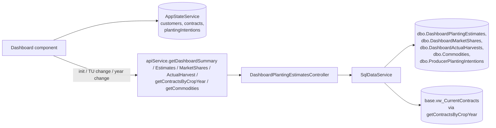

# Planting Intentions Dashboard

## At a Glance

- **Route**: `/dashboard`
- **Component**: [`client/src/app/features/dashboard/pages/dashboard/dashboard.component.ts`](../../client/src/app/features/dashboard/pages/dashboard/dashboard.component.ts)
- **Template**: [`dashboard.component.html`](../../client/src/app/features/dashboard/pages/dashboard/dashboard.component.html)
- **Access**: any authenticated Scoular user (`authGuard`).
- **Primary user goal**: plan and track planting for the upcoming season — yield estimates, market share targets, actual harvest results, and the per-producer roll-up of intentions and contracts for that crop year.

This is the merchandiser's planning view. It reads producer planting intentions and contracts, then layers in app-owned tables for territory-level estimates, market share, and historical harvest.

## How users reach it

- "Dashboard" link in the sidebar.
- Producer rows on this screen deep-link to the Customer Home Page producer profile (with `tab=planting`).

## What it shows

| Section | Description |
| --- | --- |
| **Header row** | "Planting Intentions Dashboard" title, Trade Unit Selector, **"Set Season Targets"** button (opens the targets dialog). |
| **Year + crop filter bar** | Previous / next year buttons (`selectedPlantingYear`), "Growing Season" label, **crop filter dropdown** (`selectedCropFilter`). |
| **4 Stat cards** | "Total Acres", "Projected Production", "Average Yield", "Active Growers". |
| **3 Tabs** | `By Crop`, `Producers & Planting Intentions`, `Harvest & Contracts`. |
| **By Crop tab** | "Acres by Crop" bar chart, "Production by Crop" chart, crop breakdown grid. |
| **Producers & Planting Intentions tab** | Producer list (search + sort) with expandable per-producer planting intention rows. |
| **Harvest & Contracts tab** | Harvest entry table with edit mode + a contract list for the selected crop year. |

### Crop title-casing

Contract values come from ODS in **all caps** (`WHEAT`, `HARD RED WINTER WHEAT`). The component runs `_toTitleCase(s)` on category strings before merging them with the (already title-cased) planting-intention categories so the dropdown shows `Wheat` instead of duplicate `WHEAT` and `Wheat` entries:

```ts
private _toTitleCase(s: string): string {
  if (!s) return s;
  return s.toLowerCase().replace(/\b\w/g, ch => ch.toUpperCase());
}
```

A recent normalization pass also cleaned up plural/singular inconsistencies in the app-owned tables (`Commodities`, `ProducerPlantingIntentions`, `DashboardActualHarvests`, `DashboardMarketShares`, `DashboardPlantingEstimates`). Singular is the canonical form, except for these intentional plurals: `Soybeans`, `Brewers Grains`, `Pulses`, `Rice Hulls`, `Finished Goods`, `Miscellaneous`, `Feed & Fert Ingredients`. Dev and QA have been migrated; Prod still pending. The cleanup script lives outside this repo (SSMS scripts, autocommit) — search this folder's git history for "plural" if you need the SQL.

## Data flow



### Trade-unit attribution of planting acres

Every row in `dbo.ProducerPlantingIntentions` carries the trade unit it was recorded **for**. A producer on two trade units (say Pratt and Tribune) plants different acres for each, so:

- **Saving.** The Planting tab's Add/Edit dialogs offer the *producer's own* active trade units (`GET /api/customers/{id}/trade-units`), not the header filter. One option → filled in read-only; several → the originator picks, preselected when exactly one of them is selected in the header. The API (`PlantingIntentionService.ResolveTradeUnitAsync`) keeps the choice only if it is one of the producer's active `CustomerTradeUnit` rows (400 otherwise); with no choice it defaults to the producer's first trade unit by code. This is a data-integrity rule, not an access check (AR-01/AR-02). An existing row's trade unit can be changed in the Edit dialog.
- **Counting here.** Every acre figure on this page (`filteredIntentionsForYear`, `acresTrend`, `availableCrops`, `producersWithoutIntentionsRows`, `_calculateYieldRows`) keeps the producer-membership check **and** requires the row's trade unit to be in scope (`shared/utils/planting-trade-unit-filter.ts`). Tribune therefore shows only Tribune acres; Pratt + Tribune together counts each row once. The Producers tab row shows the trade units of the rows it is summing.
- **Not counting here.** The producer profile, Build-A-List / prompts, print report and growth-opportunity card still show the producer's whole farm; they use the same `GET /api/plantingintentions?tradeUnits=` endpoint, whose "customers in the trade unit → all their rows" semantics are unchanged.
- **Losing a trade unit.** Removing a trade unit does not unplant the acres, so the producer-details dialog asks where they should count instead. When the removed trade unit has intentions against it, the dialog shows the count, acres and crop years and offers the producer's remaining trade units; choosing one calls `POST /api/plantingintentions/retag` on Save, which moves every row in one statement. Declining leaves them where they are. Only trade units that are *already* active memberships are offered as destinations, so a move can never race an assignment made in the same dialog. **This cannot cover every case**: the nightly `CustomerSyncService` deactivates a sync-sourced membership as soon as it leaves `originations.vw_CustomerTradeUnits`, with no user present to ask. We deliberately do **not** lock a trade unit that has planting intentions — membership reflects whether the producer trades there (a CTRM fact), our intentions are a forward-looking note, and historical rows would otherwise lock a trade unit permanently.
- **Legacy and stranded rows.** Before this rule the API stamped whichever membership SQL returned first, so rows of multi-trade-unit producers may be tagged arbitrarily. A blank-tagged row still counts under membership (pre-fix behaviour). A row tagged to a trade unit the producer has since left counts on no single-territory view until re-tagged; it stays on the profile, and the Edit dialog lists that tag as "(no longer assigned)" so it can be corrected. Whether such rows should instead fall back to the producer's remaining trade unit is an open business question — the switch point is the one helper in `shared/utils/planting-trade-unit-filter.ts`. `scripts/planting-intentions-trade-unit-audit.sql` (read-only) lists ambiguous, orphaned and blank rows for the business to review.

## Files

| Layer | Path |
| --- | --- |
| Component | `client/src/app/features/dashboard/pages/dashboard/dashboard.component.ts` |
| Template | `client/src/app/features/dashboard/pages/dashboard/dashboard.component.html` |
| Controller | `api/GrainOriginatorPortal.Api/Controllers/DashboardPlantingEstimatesController.cs` |
| Service methods (group: Dashboard) | `GetDashboardSummaryAsync`, `GetDashboardPlantingEstimatesAsync`, `UpsertDashboardPlantingEstimatesAsync`, `GetDashboardMarketSharesAsync`, `UpsertDashboardMarketSharesAsync`, `GetDashboardActualHarvestAsync`, `UpsertDashboardActualHarvestAsync`, `DeleteDashboardActualHarvestAsync` |
| App tables | `dbo.DashboardPlantingEstimates`, `dbo.DashboardMarketShares`, `dbo.DashboardActualHarvests`, `dbo.ProducerPlantingIntentions`, `dbo.Commodities` |
| ODS views (via `getContractsByCropYear`) | `base.vw_CurrentContracts` |

### API service methods called

- `getDashboardSummary(tradeUnitKey, plantingYear)` — bundled fetch of estimates + market shares + actual harvest, used to render the dashboard quickly on entry.
- `getDashboardPlantingEstimates(tradeUnitKey, plantingYear)` — refresh after edits.
- `upsertDashboardPlantingEstimates(estimates)` — save yield estimates.
- `getDashboardMarketShares` / `upsertDashboardMarketShares`.
- `getDashboardActualHarvest` / `upsertDashboardActualHarvest` / `deleteDashboardActualHarvest`.
- `getContractsByCropYear(cropYear, tradeUnits?)` — historical contracts for the selected planting year.
- `getCommodities()` — crop catalog.
- Plus the cached signals from `AppStateService` for `customers`, `contracts`, `plantingIntentions`.

### Controller endpoints

`DashboardPlantingEstimatesController.cs`. All gated by `[Authorize]` + `[EnforceTradeUnitAccess]`.

| Verb / route | Purpose |
| --- | --- |
| `GET /api/dashboardplantingestimates/summary` | Combined `DashboardSummaryResponse` (estimates + market shares + actual harvest). |
| `GET /api/dashboardplantingestimates` | List of `DashboardPlantingEstimate`. |
| `POST /api/dashboardplantingestimates/upsert` | Bulk upsert of estimates. |
| `GET /api/dashboardplantingestimates/marketshares` | List of `DashboardMarketShare`. |
| `POST /api/dashboardplantingestimates/marketshares/upsert` | Bulk upsert. |
| `GET /api/dashboardplantingestimates/actualharvest` | List of `DashboardActualHarvest`. |
| `POST /api/dashboardplantingestimates/actualharvest/upsert` | Bulk upsert. |
| `DELETE /api/dashboardplantingestimates/actualharvest/{id}` | Single-row delete. |

### App-DB tables

| Table | Key columns |
| --- | --- |
| `DashboardPlantingEstimates` | `Id`, `TradeUnitKey`, `Crop`, `PlantingYear`, `YieldEstimate?`, `Created/ModifiedBy/At` |
| `DashboardMarketShares` | `Id`, `TradeUnitKey`, `CropCategory`, `PlantingYear`, `MarketSharePct?`, `Created/ModifiedBy/At` |
| `DashboardActualHarvests` | `Id`, `TradeUnitKey`, `CropCategory`, `PlantingYear`, `Bushels`, `Created/ModifiedBy/At` |

Unique-ish constraints exist on `(TradeUnitKey, PlantingYear, Crop|CropCategory)` for the upsert paths — collisions surfaced during the recent normalization pass and were resolved manually before the rename UPDATEs.

## State and caching

- `appState.dashboardCache` (`DashboardCacheEntry`) caches the last summary keyed by trade unit so re-entering the screen renders instantly.
- `appState.preloadedDashboardSummary` is set by `DataPreloadService` so the dashboard doesn't have to wait on its own fetch on cold load.
- `clearDashboardCache()` fires when trade units change.

## User actions

| Action | Trigger | Payload | Method |
| --- | --- | --- | --- |
| Save yield estimates | Edit mode in By Crop tab → "Save" | `Array<{ tradeUnitKey, crop, plantingYear, yieldEstimate? }>` | `apiService.upsertDashboardPlantingEstimates` |
| Save market share | "Set Season Targets" dialog → save | `Array<{ tradeUnitKey, cropCategory, plantingYear, marketSharePct? }>` | `apiService.upsertDashboardMarketShares` |
| Save actual harvest row | Harvest tab edit → save | `Array<{ tradeUnitKey, cropCategory, plantingYear, bushels }>` | `apiService.upsertDashboardActualHarvest` |
| Delete actual harvest row | Trash icon | `id` | `apiService.deleteDashboardActualHarvest` |
| Switch year | Prev / Next buttons | n/a | re-fetches contracts + summary for new year |
| Switch tab | tab pill | n/a | `usageTracking.trackDashboardTabClick(tabKey)` |
| Open producer profile | producer row | n/a | navigate to `/?customerId=...&tab=planting&year=...` |

**Clearing a target.** The "Set Season Targets" dialog's yield and market-share inputs each have a clear **✕** and can be emptied. The input binds via `yieldInputValue()` / `marketShareInputValue()`, which distinguish "no edit" (key absent → show saved value) from "explicitly cleared" (key present, `null` → show empty) — a plain `?? saved` would snap a cleared field back to its old number. Saving an empty value sends `null`, and the backend upsert removes that row (so the target is genuinely cleared, not stored as 0).

The "system" username has historically been used for `Created/ModifiedBy` on dashboard upserts (see project memory note about M1). Wire this through `IHttpContextAccessor` if/when actual user attribution becomes a requirement.

## Auth and feature flags

- `authGuard` — required.
- `[EnforceTradeUnitAccess]` on all backend endpoints (UX filter only — see [`SECURITY-MODEL.md`](./SECURITY-MODEL.md)).
- No feature flag.

## External integrations

- `UsageTrackingService` — tab clicks, "Set Season Targets" usage.
- No charting library; charts are simple SVG / canvas in template.

## Troubleshooting

| Symptom | Likely cause | First place to look |
| --- | --- | --- |
| Stat cards say 0 acres / 0 producers | `selectedTradeUnits()` empty or `plantingIntentions` not yet loaded | TU selector + `dataLoading()` |
| Filter by Crop dropdown shows duplicate `WHEAT` and `Wheat` | A contract row in ODS still uses ALL CAPS that the title-case helper isn't catching, or a stale entry in the App DB. Remember Prod hasn't run the cleanup yet. | `availableCrops` computed; the SQL audit query under "Crop title-casing" |
| Saved estimate disappears after refresh | Upsert hit a unique constraint and one row was overwritten. | Check `Created/ModifiedAt` columns; verify only one `(TradeUnitKey, Crop, PlantingYear)` row per crop |
| "By Crop" tab shows different totals than "Producers" tab | Categorization mismatch (planting intentions use `category`, contracts use `commodityGroup` / `commodityDescription`). The `_toTitleCase` helper merges them, but only if both side's strings normalize to the same thing. | `availableCrops` computed; check both signal sources |
| Dashboard slow on first open | `preloadedDashboardSummary` not populated yet (TU just changed) | `DataPreloadService` flow; the bundled `getDashboardSummary` fetch |
| A producer's acres are missing or lower than their profile shows | Rows are tagged to another of the producer's trade units (or to one they have left). Only rows tagged to a trade unit in scope count here. | Profile → Planting tab: each row's "Trade Unit" line; move it via Edit. `scripts/planting-intentions-trade-unit-audit.sql` for the full list |

## References

- Project memory note: dashboard normalization pass in `dbo.Commodities`, `dbo.ProducerPlantingIntentions`, `dbo.DashboardActualHarvests`, `dbo.DashboardMarketShares`, `dbo.DashboardPlantingEstimates`. Dev and QA migrated; Prod pending.
- PR with the title-case helper change in `dashboard.component.ts`.
- [`Shared Infrastructure.md`](./Shared%20Infrastructure.md) — `AppStateService`, `IDataService` Dashboard methods, `EnforceTradeUnitAccess` filter.
- [`Customer Home Page.md`](./Customer%20Home%20Page.md) — destination of producer-row clicks; documents the `tab=planting&year=...` deep-link contract.
