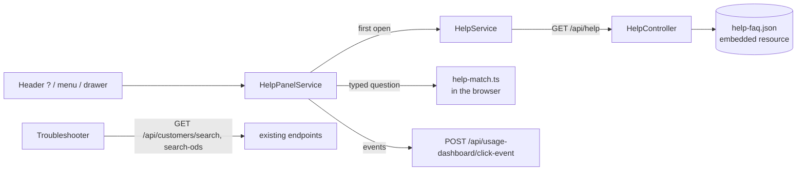

# Self Help

## At a Glance

| | |
| --- | --- |
| **Route** | `/help` (full page), plus the Help panel, which opens over any page |
| **Entry points** | The "?" button in the header (left of the avatar), **Help** in the profile menu, **Help** in the mobile drawer |
| **Who sees it** | Every authenticated user. No role gating, no environment flag. |
| **Content source** | `api/GrainOriginatorPortal.Api/Content/help-faq.json`, hand-curated |
| **API** | `GET /api/help` — `[Authorize]`, embedded resource, same delivery as What's New |
| **Answer engine** | Keyword matching in the browser (`shared/utils/help-match.ts`). No AI in this release. |
| **Ticket** | 578 — design approved by the project team 2026-10-13 (Claude Design "Help States" mockup) |

## How users reach it

- **"?" in the header**: opens and closes the panel. Pressed while open.
- **Profile menu → Help** and **mobile drawer → Help**: open the panel.
- **Panel → book icon / "Browse all help topics"**: the `/help` page.
- **Deep link**: `/help#<faq-id>` opens the page on one question, e.g. `/help#missing-producer`. Handy to paste into a Teams reply.

On desktop the panel is a 400px column below the header and the page **makes room for it** (`app.component.html` pads `<main>`; the Calculators button steps left). On a phone it is full-screen and traps focus. Escape closes it.

## What an answer can contain

Each question in `help-faq.json` has a quick answer and, optionally, any of these blocks. They render in this order:

| Block | JSON | What it does |
| --- | --- | --- |
| Quick answer | `answer` | Always shown. `**double asterisks**` mark bold on-screen labels — the only formatting. |
| Buttons | `actions` | `route` (go to a page), `spotlight` (outline a control on screen), `tup` (open Trade Unit Preferences), `producer-tab` (open a tab on the selected producer), `help` (the Help page). First button is filled. |
| Steps | `steps`, `stepsOpen` | Numbered steps behind "Show steps". |
| Link | `link` | One in-app link under the steps, same kinds as `actions`. |
| Examples | `examples` | Build a List queries **by Query Library name**. Opens `/build-list?query=<name>`, which runs it. A renamed query falls back to pre-filling the library search. |
| Troubleshoot | `troubleshoot` | Another question (`faqId`) or an interactive troubleshooter (`tree`). |
| Still need help? | `escalate` | Opens the support-details card. |
| Related | `related` | Chips under the card. |

**There are no URLs and no HTML in the content.** Text is split into plain/bold spans and bound as text; links are always `actions`. The API tests reject `<`, `http`, and markdown links in any text field.

### Interactive troubleshooter

`missing-producer` (the only one so far, `help-troubleshooter.component.ts`):

1. **Answered by the app**: none assigned / All Producers mode / which trade units are selected.
2. The user types a name (3+ letters).
3. It searches our producer table across **every** trade unit (`GET /api/customers/search` with no scope), then the customer master (`search-ods`), and reports one of: *in your selection*, *in another trade unit* (**Switch to …**, then **Open producer**), *exists but not added* (**Open and add** puts the page in All Producers mode and spotlights the search box), or *not found*.

Trade units are a UX filter, not an access boundary ([SECURITY-MODEL.md](./SECURITY-MODEL.md)), so searching outside the selection reveals nothing the search box wouldn't. The producer name is shown to the user only; telemetry records the outcome code.

### Still need help?

`help-escalation.component.ts` shows the details support asks for, captured from the app: release/build, environment, page, trade units, the last error toast, browser, and help topics viewed. **The selected producer's Scoular ID is included only if the user ticks the box**; the producer's name never is. Nothing from storage or tokens.

**Copy details** puts them on the clipboard. The **Open a help desk ticket** link appears only when `environment.helpDeskUrl` is set, and it is a plain link — the details travel by clipboard, never in the URL. Until it is set the card says "Send these details to the Origination team."

> **Open item:** the help desk URL. ServiceNow is being replaced by SIMS (go-live end of November 2026) and an Origination support group has to be set up first. When the URL is known, set `helpDeskUrl` in `client/src/environments/environment.{dev,qa,prod}.ts` (and `environment.ts` for local). Nothing else changes.

## Editing the help

1. Edit `api/GrainOriginatorPortal.Api/Content/help-faq.json`. It ships with the next deploy; there is no admin screen.
2. For a new question: add it to `faqs`, put its id in at least one `categories[].faqIds`, and fill `uiLabels` with every on-screen label the answer names, exactly as written in the app.
3. Set `lastVerified` to today whenever you check an answer against the app.
4. Run the two test suites below. They tell you exactly what's wrong.

**Content owners.** Draft answers need sign-off from whoever owns the area. Organic content goes to Kate Hoegermeyer (Organics trading lead).

## How the help stays current

This is the part that matters most. The content is a JSON file the compiler never sees, so two tests read it and fail the build when it drifts from the app:

| Test | Fails when |
| --- | --- |
| `client/src/app/features/help/help-faq.drift.spec.ts` | a route it names is gone; a screen users work in has no `suggestions` entry; a `uiLabels` label no longer appears in any template; a `spotlight` target has no `data-help-anchor` in the app (or no tooltip); a troubleshooter it names doesn't exist |
| `api/.../Controllers/HelpControllerTests.cs` | ids aren't unique slugs; a category, suggestion, related or troubleshoot id points at nothing; a question is in no category; an action kind or target is invalid (route targets must be in-app paths); bold markers are unbalanced; text contains markup or a URL |
| `client/src/app/shared/utils/help-match.spec.ts` (last block) | a question users really ask — "customer not showing", "report a bug", … — stops finding its answer |

So **renaming a button that the help mentions breaks the build until the help is updated in the same PR.** The drift test also prints a warning (not a failure) for answers not re-checked in six months.

> **Waiting on other work.** Bid Sheet questions beyond the overview wait until the Bid Sheet changes on the Dev/QA release branch (named bid sheets, Cash/Basis, Feed/Manual, Export to Excel) reach `main`. Organic certification questions (statuses, amber/red badge, Insights categories) wait for the certification feed to go live. Only the badge and NOP ID questions exist for organics today.

**Release habit**: when you write a [What's New](./Whats%20New.md) entry for a feature, re-read that feature's help entries in the same PR.

### Spotlight anchors

"Show me on screen" outlines the live control carrying `data-help-anchor="<name>"`. Current anchors:

| Anchor | Where |
| --- | --- |
| `trade-unit-selector` | `TradeUnitSelectorComponent` host — every page that has the selector |
| `producer-search` | the Search producers input, `customer-list.component.html` |
| `query-library` | the Query Library header, `build-list.component.html` |
| `set-season-targets` | the Set Season Targets button, `dashboard.component.html` |

To add one: put the attribute on the element, add a tooltip to `HELP_ANCHOR_TIPS` (`help-spotlight.component.ts`), and, if it lives on one screen, its route to `ANCHOR_HOME` (`help-panel.service.ts`) so the spotlight can navigate there first.

## Usage events and learning from unanswered questions

All events go through the existing `POST /api/usage-dashboard/click-event` under feature `system` (like What's New), so the Usage Dashboard needed no changes:

| Sub-feature | Target | Notes |
| --- | --- | --- |
| `help-opened` | `header` / `menu` / `drawer` / `page` | |
| `help-answer` | FAQ id | typed, chip, or expanded on the page |
| `help-helpful` / `help-not-helpful` | FAQ id | thumbs up / down |
| `help-troubleshoot` | outcome code | `in-selection`, `other-trade-unit`, `not-added`, `not-found`, `error` — never the name |
| `help-no-match` | **the question typed** (≤200 chars) | registered as free text in `TelemetrySanitizer`, so emails, phone numbers and long digit runs are redacted before storage. Raw click events are kept 90 days. |

`help-no-match` is the input for growing the FAQ. Until there is a dashboard panel for it, review it each release with:

```sql
SELECT TOP 30 TargetId AS Question, COUNT(*) AS TimesAsked
FROM dbo.UserClickEvent
WHERE FeatureCode = 'system' AND SubFeatureCode = 'help-no-match'
  AND Timestamp >= DATEADD(DAY, -30, SYSUTCDATETIME())
GROUP BY TargetId
ORDER BY COUNT(*) DESC;
```

Pair it with `help-not-helpful` counts per FAQ id to find answers that need rewriting.

## Data flow



## Files

| File | Role |
| --- | --- |
| `api/GrainOriginatorPortal.Api/Content/help-faq.json` | All help content |
| `api/GrainOriginatorPortal.Api/Controllers/HelpController.cs` | `GET /api/help` |
| `api/GrainOriginatorPortal.Api/Models/Responses/HelpContentResponse.cs` | Content schema, with the authoring rules |
| `client/src/app/core/services/help.service.ts` | Loads the content once |
| `client/src/app/core/services/help-panel.service.ts` | Panel state, conversation, button behaviour |
| `client/src/app/shared/utils/help-match.ts` | Question matching |
| `client/src/app/shared/utils/help-text.ts` | Bold-marker splitting |
| `client/src/app/shared/components/help-panel/` | Panel, answer card, troubleshooter, support card, spotlight |
| `client/src/app/shared/components/help-icon/` | Icons (Lucide, as data) |
| `client/src/app/features/help/pages/help/` | The `/help` page |

Hooks in existing code (each exists only for help): the header button and menu/drawer items; `<main>` padding in `app.component.html`; the Calculators button's offset; four `data-help-anchor` attributes; Build a List's `?query=` example link.

## Not in this release

- **Live AI answers ("Option B").** Decided 2026-10-14 (Hope Collins): not now. The FAQ is kept current by AI-*drafted* updates that a person reviews and approves ("Option A"), driven by what users ask. Option B is revisited only if that proves to be more maintenance than wanted. If it is, the panel's answers come from `HelpPanelService.ask`, so an AI engine can be added behind it without changing the UI; doing so needs Scoular's AI governance (CMDB entry, security assessment and approval to operate, IT Security review) plus IT Infrastructure changes.
- **Guide Me walkthroughs.** They would reuse the `data-help-anchor` attributes.
- **A Usage Dashboard panel** for unanswered questions (see the SQL above).

## Troubleshooting

| Symptom | Likely cause | Where to look |
| --- | --- | --- |
| Panel says "Help didn't load" | `GET /api/help` failed — usually a deploy where the JSON didn't embed | Confirm `<EmbeddedResource Include="Content\help-faq.json" />` in the .csproj; `HelpControllerTests.LoadContent_ThrowsWhenTheResourceIsMissing` |
| CI fails in `help-faq.drift.spec.ts` | Someone renamed a label, route or anchor the help mentions | The failure message lists the exact question and label — update `help-faq.json` |
| "Show me on screen" does nothing | The anchor isn't on screen (feature flag off, nothing selected); it gives up after 4 seconds | `HELP_ANCHOR_TIPS`, `ANCHOR_HOME`, and that the element has the attribute |
| "Try an example" opens Build a List without running a query | The Query Library entry was renamed or removed; the page pre-fills the library search instead | Update `examples` to the current Query Library name |
| No help desk button on the support card | `environment.helpDeskUrl` is empty — expected until the help desk group exists | See the open item above |
