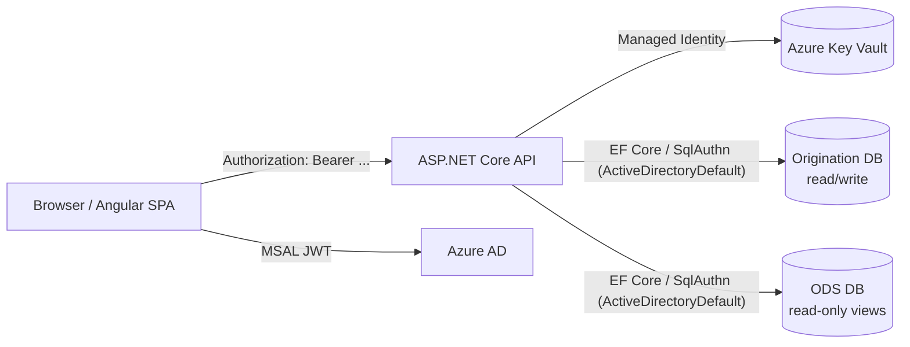

# Shared Infrastructure

> **Read this first.** Every screen-level doc in `Application Context/` references services, DbContexts, route guards, and auth setup defined here. Skim it once and use it as a reference when reading the screen docs.

## TL;DR

- Angular 21 SPA + ASP.NET Core (.NET 10) Web API.
- **Two databases**: `OriginationDbContext` reads ODS views (read-only), `ApplicationDbContext` owns the application's tables (read/write).
- **Auth**: Azure AD via MSAL (frontend) and Microsoft.Identity.Web (backend). Tokens are JWT bearer; cache is `sessionStorage` per security review.
- **State**: Angular signals. No NgRx. `AppStateService` holds the shared data caches, `TradeUnitContext` the trade-unit scope, and each module keeps its own screen state in its stores.
- **Authorization model**: trade-unit entitlements are a *UX filter*, not an access boundary. See [SECURITY-MODEL.md](./SECURITY-MODEL.md).

## Architecture at a glance

## Frontend services

### `ApiService` and the module API clients

`client/src/app/core/services/api.service.ts`, and each module's `data-access/*-api.service.ts`

- **Module clients:** a module whose screens are the only callers has its own client: `BidSheetApiService` (locations, bids, sheets, the preference and the BarChart catalog), `UsageDashboardApiService`, Engagement's `RecapGroupsApiService` (exported from `@features/engagement` for the bid sheet's share dialog), and `CustomersApiService` (the trade units' customers, one customer by id or source id, linked producers, and a producer's trade-unit memberships; exported from `@features/customers` for Build a List). The two customer searches stay in `ApiService` because Help's troubleshooter, in core, runs them too. The other calls the customer screen uses stay in `ApiService` until those components move into their modules, along with Platform's own (commodities, trade units, preferences, the entitlements catalog, telemetry config).
- **Base URL** comes from `environment.apiBaseUrl` (`client/src/environments/environment.ts`).
- **Request deduplication** for expensive endpoints — `dedupeRequests()` in `core/http/dedupe-requests.ts`, one in-flight map per client. Used by `getCustomers`, `getContracts`, `getTickets`, `getNotes`, `getStoredGrain`, `getAllProducerDetails`, `getSavedLists`, the bid sheet's locations and preference, and BarChart coverage, among others. If two callers ask for the same key in flight, they share one HTTP request.
- **Error handling** is shared by every client: `injectApiErrorHandler()` in `core/http/api-error-handler.ts`. A 401 toasts a session-expired message; every failure is logged in dev mode and re-thrown as an `ApiError`. A 403 is shown by `forbiddenInterceptor` instead (see below).

### `forbiddenInterceptor` and `alreadyShown`

`client/src/app/core/http/` — the one place a 403 from the API is shown, for every API client, not just `ApiService`. A missing permission (`AUTHZ_PERMISSION_DENIED`) gets a plain-language message; any other 403 is a rule about a particular record, so its own message is shown. Identical messages don't stack. The error is marked as shown and passed on, and every screen checks `alreadyShown(err)` before showing its own "Failed to …" toast, so a 403 is one toast, not two. `GlobalErrorHandler` skips its toast for a marked error too.

### `AppStateService`

`client/src/app/core/services/app-state.service.ts`

The shared data caches, built on Angular signals: the trade-unit-wide data the customer screen, Build a List, Actionable Insights and the Planting Dashboard read. Customer-screen data moves into its modules' stores as those components move.

**Signals exposed (commonly read across screens):**

| Signal | Type | Notes |
| --- | --- | --- |
| `contracts` | `Contract[]` | Open-or-recent purchase contracts for the selected trade units. From CTRM via GraphQL when `Ctrm:Source` is `ctrm` (a cached date-window snapshot), else `vw_CurrentContracts`. See [CTRM GraphQL Data Source](./CTRM%20GraphQL%20Data%20Source.md). |
| `tickets` | `Ticket[]` | Settled tickets (last N days, depends on screen) |
| `todaysTickets` | `Ticket[]` | Last 30 days specifically — used by Insights |
| `notes` | `Note[]` | All notes for selected TUs |
| `plantingIntentions` | `PlantingIntention[]` | App-DB rows |
| `storedGrain` | `StoredGrain[]` | Computed in service from `ctrm.vw_GNTA39D1` |
| `savedLists` | `SavedList[]` | User's saved Build-a-List queries |
| `commodities`, `commodityConversions`, `harvestWindows` | reference | Crop catalog and lb-per-bushel conversions |
| `producerDetails` | `ProducerDetails[]` | App-DB enrichment (acres, bin sites, grain on farm, etc.) |
| `pricingLines` | `ContractPricingLine[]` | Pricing lines for the selected producer — CTRM (live, inline on the contract) or ODS `vw_ContractPricing` per `Ctrm:Source` |
| `allProducersMode` | `boolean` | Session-only "All Producers" selector mode — clears TU scope so the customer list searches every producer (incl. ODS producers with no contract/ticket) for onboarding. Never persisted. |
| `selectedCustomer` | `Customer \| null` | Driven by Home page navigation. App-wide rather than the home page's: Help, Build a List, Insights and the Bid Sheet read or set it too. |
| `contractsLoading`, `todaysTicketsLoading` | `boolean` | True while that core read is in flight. There is no combined flag: a screen that needs the whole core group also reads `CustomerStore.customersLoading`. |

**Setters** mirror the signals (`setContracts`, `setTickets`, ...). There is also `clearSelection`, and `clearAll` for sign-out and the idle timeout. `clearAll` also clears `TradeUnitContext` and every module store registered with `SessionReset`.

### `SessionReset`

`client/src/app/core/auth/session-reset.service.ts`

Clears the module stores when the session ends. Core can't reach a module's stores, so each root store registers its own clearing in its constructor (`inject(SessionReset).onReset(...)`), and `AppStateService.clearAll()` runs them all. A store that was never created holds nothing, so it needs no clearing. Registered so far: the trade units' customers (`CustomerStore`), Build a List's state (`BuildListStore`), the customer list's scroll position (`CustomerListScrollStore`) and the Planting Dashboard's caches (`DashboardStore`). Before 2026-11-09 those three weren't cleared at sign-out: they had left `AppStateService` and nothing cleared them. A new module store that holds the user's data must register too.

### `TradeUnitContext`

`client/src/app/core/context/trade-unit-context.service.ts`

The trade units the app is working in, which every module scopes its reads to: `userGroups` (with `tradeUnitDescriptions`, code → location), the selector's `selectedTradeUnits` and `selectedGroupNames`, and the `inScopeGroupNames` / `inScopeTradeUnitCodes` that selection puts in play (an empty selection means all of the user's units).

**localStorage persistence:** key `origination_user_prefs` stores `{ groups?, units? }` — the trade-unit selection. Restored on construction.

### Module stores

**`CustomerStore`** (`features/customers/data-access`, exported from `@features/customers`) holds the selected trade units' customers for every screen: `customers`, `customersLoading` (a screen waits rather than showing "no producers") and `customersLoadFailed` (the read failed, so the empty list isn't "no producers in these trade units"). Customers' `preload` fills it on each trade-unit change, for a user holding `customers:read`; the home page and Build a List write back customers they onboard, edit or reload.

Screen state a module keeps for the session lives in that module: Build a List's query and results (`BuildListStore`) and the customer map's geocode cache (`MapGeocodeCacheStore`, capped at 500 entries) in `features/lists/data-access`, and the customer list's scroll position (`CustomerListScrollStore`) in `features/customers/data-access`.

### `UserTradeUnitsService`

`client/src/app/core/services/user-trade-units.service.ts`

Owns the user's trade-unit groups and the hand-off to the **Trade Unit Preferences** app, where assignments are actually managed (this app only reads `vw_UserTradeUnitPreferences`).

- `load()` — `GET /usertradeunits` → `setUserGroups`, then prunes `selectedGroupNames` / `selectedTradeUnits` to what still exists. The TU selector delegates here and only owns its loading/error UI.
- **Empty 200 = "no assignments", 503 = outage.** `UserTradeUnitService` (API) throws `InfrastructureException` (503, `ENTITLEMENTS_DB_UNAVAILABLE`) on a TradeUnitPreferences DB outage instead of returning `[]`, so the client can tell the two apart. On an empty 200 the client sets `AppStateService.noTradeUnitAssignments`, empties `userGroups`, and **clears the selection** (localStorage/server-restored). Without that clear the preload kept requesting trade units the user no longer had; `[EnforceTradeUnitAccess]` strips those to an empty list, the customers endpoint treats empty as *unfiltered*, and a user with zero assignments saw every producer plus a never-ending spinner (observed 2026-08-27). `userGroupsLoaded` stays false so a retry is natural.
- `UserPreferencesService` races `/usertradeunits` on startup. Its restore now skips when `noTradeUnitAssignments` is set and prunes against `userGroups` when they already landed, so a saved selection can't resurrect trade units the user lost.
- `openPreferences()` — the profile-menu entry **Trade Unit Preferences** (below Manage Groups), also offered by the TU selector's *No trade units assigned* state. Opens `environment.tradeUnitPreferencesUrl` (`tradeunitprefs{-dev|-qa|}.scoular.com/my-preferences`) in a **named popup window** (falls back to a new tab), then polls `closed`.
- **On popup close** the app refreshes itself without a page reload: `load()` re-fetches groups and prunes stale selections; if the selection changed, the normal TU-change pipeline in `DataPreloadService` reloads the data; if it's unchanged, `DataPreloadService.forceReload()` is called; if the user had **nothing selected** (a new user who just got assignments) they're scoped to their first group so producers appear immediately. All Producers mode is left alone.
- The TU selector distinguishes a **failed** groups request (*Trade units unavailable · Retry*) from an **empty** one (*No trade units assigned* + *Set up in Trade Unit Preferences* button); the empty callout disappears on its own once groups land.
- **Trade unit labels come from TUP.** `GET /usertradeunits` resolves each code's display name from `vw_UserTradeUnitPreferences.Description` first, falling back to `dbo.MbpLocationSynonym.DisplayName` only when TUP has none, then to the bare code. MBP is a **static 2026-07-30 MBPLOCSYN export that nothing refreshes**, so it must stay a gap-filler: until 2026-09-22 it *overrode* TUP, which is how renames made in Trade Unit Preferences kept showing their old names in the selector. The other TU surfaces (`/trade-units`, `/notes/mention-catalog`, `/entitlements/catalog`) read the TUP `Description` only, so this ordering is what keeps all four agreeing on a label.
- **Why not a dialog/iframe:** the TU Prefs app sends `X-Frame-Options: DENY` + `frame-ancestors 'none'` in every environment (checked 2026-08-27). Don't re-attempt embedding without their team relaxing that policy. `noopener` is deliberately not used (it nulls the `window.open` return and breaks the close-watch); the service sets `win.opener = null` itself.

### `DataPreloadService`

`client/src/app/core/services/data-preload.service.ts` (search by name if path moves).

Coordinates the bulk fetch of customer/contract/ticket/note data when trade units change. Screens like Insights call `forceReload()` on it to reset and re-fetch from scratch. Without this service, every screen would have to manage its own cache invalidation on TU change.

**Loading model (important for "why is this screen slow").** On a TU change the service fires several requests and streams each into AppState as it lands:

- **Core group** = the customers (Customers' preload) + `getContracts` + `getTodaysTickets`. Each has its own loading flag, which drops as its data lands (`CustomerStore.customersLoading`, `contractsLoading`, `todaysTicketsLoading`). **Actionable Insights** clears its Refresh spinner, and the **Planting Intentions Dashboard** its data-ready guard, only once all three have dropped, so a slow ODS query (contracts, or today's tickets) holds both. Until 2026-11-09 that was one combined `dataLoading` flag.
- **Background group** (non-blocking, streamed via `merge`): bulk `getTickets`, notes, planting intentions, stored grain, saved lists, commodities, harvest windows, producer details.
- **Module preloads**, merged into the same load so the next trade-unit change cancels them too: each module's manifest may declare a `preload` (see Module manifests below). Today those are Customers', which loads the trade units' customers into `CustomerStore`, and Producers', which pre-fetches the Planting Dashboard's summary. Each runs only for users who may read what it loads. A preload that fails ends quietly without stopping the rest.

### Module manifests and `ModuleRegistry`

`client/src/app/core/modules/` and `client/src/app/app.modules.ts`

Each module (a folder under `features/`) declares a `ModuleManifest` in its `<module>.module.ts` (`producersModule` in `producers.module.ts`, …). `app.modules.ts` is the only file that lists them all, and imports each manifest from that file rather than the module's `index.ts`, so a module's components stay out of the initial bundle; `main.ts` provides that list as `APP_MODULES`, and core reads it through `ModuleRegistry`, so core never imports a module. A manifest carries the module's id and, optionally:

- **`routes`**, its pages, each naming the permissions it needs (`requires`; empty for a page every signed-in user may open). `app.routes.ts` builds the router's routes from every manifest with `moduleRoutes` (`core/modules/module-routes.ts`), then adds the catch-all that sends any other path home. Every page gets `authGuard`; a page that names permissions also gets `permissionGuard`, with them as its route data.
- **`nav`**, its header links, each naming the same permissions as its page, a label (and a shorter one for the desktop bar below `2xl`), its icon as SVG path data, an `order`, and its menu: `main` for the desktop bar and the mobile menu, `user` for the profile menu. The header draws `ModuleRegistry.mainNav()` and `userNav()`, which keep only the links the user's permissions allow, sorted by `order`. The header's own items stay in its template: the logo and the mobile menu's home link, Help, What's New and Trade Unit Preferences.
- **`preload(tradeUnits)`**, which returns its work as an Observable and loads only what the user may read.
- **What it adds to the customer screen:** `customerTabs` (profile tabs), `customerPanels` (each in one slot: on the profile `badges` beside the name and `badge-panels` under it for what a badge opens, `actions`, `details` in the details row and, inside its Contact and Locations column, `contacts` above the customer's address and `locations` below its phone and email, and `summary`; on the home page `sidebar` and `floating`), `customerEditSections` and `customerPrintSections`.
  - Each contribution names the permissions it needs, optionally the customer segments it applies to (none means every customer), an `order`, and its component as a lazy `import()`.
  - `ModuleRegistry` keeps the ones the user's permissions allow, sorted by `order`: `customerTabs()`, `customerPanels(slot)`, `customerEditSections()` and `customerPrintSections()`.
  - A host also keeps only those that apply to the selected customer. `<app-customer-slot slot="…">` (`core/modules/customer-slot.component.ts`) does both for a panel slot: it loads each panel's code the first time it shows and renders the panels in order. A panel whose code fails to load is reported to the `ErrorHandler` and left out, without affecting the slot's other panels. With nothing to show, the slot renders nothing and takes no space.
  - The customer profile hosts the tabs. Every tab in its strip is a module's: the `customerTabs()` that apply to the customer, by `order`, each with the count from its `badge`. A badge is created once, in the profile's injection context, so it can read what the profile provides. A tab's content is rendered by `<app-customer-contribution>` (`core/modules/customer-contribution.component.ts`), which loads its code the first time and keeps it for the session. If the picked tab isn't in the strip (the user can't see that module's tab), the first tab shows.
  - While a contribution's code loads, the app counts as busy (Angular's `PendingTasks`), so anything that waits for the screen to settle, tests included, waits for the content.
  - A contribution reads the customer from `SelectedCustomerContext` (`core/context/selected-customer-context.service.ts`), which the home page provides for its whole view. It follows the page's own selection, which the home page provides as `CUSTOMER_SCREEN_SOURCE` (without one, it follows `AppStateService.selectedCustomer`), and gives the customer's segment; every customer is a `Producer` until customers carry a segment of their own.
  - The context also carries the producers linked to the customer (`linkedCustomers()`, as the home page's `getLinkedGroup`), the screen's deep link (`link()`: a tab, a contract to open, a ticket crop, a planting year, from the page's URL) and `wideContent`, which a piece sets while it needs the page's full width (the contracts table with its extra columns open) and clears when it closes; the page drops its Notes sidebar meanwhile.
  - The selected producer's contracts, tickets and pricing lines, with their loading and failure state and Retry, come from `SelectedProducerActivity` (`core/context/selected-producer-activity.ts`). It's declared in core so a piece of the screen can read that data without importing the module that loads it; the home page provides it, implemented by its `HomeProducerActivityStore`. The contracts and tickets tables read their data from it rather than from inputs.
  - The selected producer's notes and the signed-in user's follow-ups for them, with their loading and saving state and every action on them (add, pin, edit, delete; save, complete, delete, add to Outlook), come from `SelectedProducerEngagement` (`core/context/selected-producer-engagement.ts`), for the same reason. The home page provides it through `HomeEngagement`, which delegates to its notes and reminders stores. The Notes and My follow-ups cards read everything from it, and the customer from the context.
  - The selected producer's production comes from `SelectedProducerProduction` (`core/context/selected-producer-production.ts`), for the same reason: all their planting intentions and those in the years in view, the trade units' yield estimates that project their production (with a loading flag), the crop year being looked at and the years offered, the commodity codes they deal in (their tickets' and those on their profile), the trade units the user works in, the add, edit and delete of an intention, and their stored grain and DP contracts, each with its loading flag. The customer profile provides it to everything rendered inside it, implemented by the profile itself, because the profile owns the crop-year picker the Planting tab shares; an add, edit or delete leaves the profile as its output, as before. The Producers module's Planting, Storage and DP Contracts tabs (and their counts) read everything from it, and the Planting tab reads the producer from the context.
  - **Contributed so far:** the Contracts module's Open Contracts (10) and Unapplied Tickets (20, producers only) tabs, both needing `contracts:read` and `tickets:read`; the Producers module's Planting (30, `planting-intentions:read`), Storage (40, `stored-grain:read`) and DP Contracts (50, `dp-contracts:read`) tabs, producers only, the Planting tab with the field plan and its programs; the Engagement module's `sidebar` panels, My follow-ups (10, `reminders:read:own`) and Notes (20, `notes:read`); and the Producers module's profile header panels, producers only, each needing `producer-details:read`: the Organic badge (`badges`, 30) and its NOP ID panel (`badge-panels`), the user-entered contacts (`contacts`), the bin sites (`locations`) and Farm Details with its Grain on Farm table (`details`, 20); and the Producers module's performance panels, producers only: the Producer Insights button (`actions`, 10) and Harvest Contract Pace (`details`, 30), each needing `contracts:read` and `contract-pacing:read`, and in `summary` Producer Insights (10), the Contract Pacing card (20) and Growth Opportunity (30), shown while the button has them open, and Activity Summary (40), always, each needing every read it makes. The button needs what the Contract Pacing card does, so it never opens an empty space. Every pacing figure reads the producer's closed contracts from Producers' `ContractPacingHistoryStore`, which reads them once per producer however many ask. The home page's right column is the sidebar slot, a flex column with a gap so the panels are spaced even though the slot's own element takes no space; the profile's own column (header card, summary, tabs) and its Contact and Locations column are flex columns with a gap for the same reason.
  - **The profile header's layout reads marks on the panels, so it needn't know which module put them there.** A panel's own element takes no space (`display: contents`), so what it renders lays out as the host's own items. An open panel under the name carries `header-panel`, as the eSign recipients panel does, and the farm line below takes more room when there is one (`group-has-[.header-panel]/name:mt-3`). A details panel's piece that sits under the details row's other columns carries `details-span` and places itself last (`order-last`): Farm Details' open Grain on Farm table. From `@2xl/profile` the grid then gives it a row of its own and stretches the Contact column beside it (`has-[.details-span]:grid-rows-[auto_1fr]`, `group-has-[.details-span]/details:row-span-2`), as the profile did before the table moved.
  - **Write controls** in a contribution are hidden from a user without the write permission with `*appHasPermission`: the Notes card's add form, Pin and edit menu (`notes:write`), the follow-ups card's Add, done checkbox, edit, delete and Add to Outlook (`reminders:write:own`); and the Planting tab's Add and each row's edit, which opens Save and Delete, and the field plan's "Update total", which opens that edit (`planting-intentions:write`). The Planting tab shows and loads the field plan only for a user with `field-plans:read` and `carbon-intensity:read`, since FD-CIC gives a field its state and county lists and its CI. Without `field-plans:write` the field plan is read-only: no Add field, Add program, remove, copy, Confirm CI Score or Unlock, the field dialog's and the 45Z inputs disabled, and the 45Z documents can be viewed and downloaded but not uploaded, archived or restored. The Biofuel Feedstock Report and Mass Balance Ledger downloads stay, since the browser builds them from what the user can already see.

No page is switched on or off per environment: a module is turned off in one environment by taking its permissions away from that environment's roles, which closes the API as well.

> **Known perf cost:** `getTodaysTickets` runs the customer-storage gate (a scan of `ctrm.vw_GNTA39D1`, see the Ticket note below), so it isn't as fast as the "core group" comment assumes — and since it's in the blocking group, it can delay both screens. There's an in-flight change to drop the storage scan from that path and let each screen/category load on its own data; if you're reading this after that merges, the model above will have per-dataset loading flags.

### `NlqFilterService`

`client/src/app/core/services/nlq-filter.service.ts`

Natural-language query parser used by Build a List (and a few other places). Public methods include:

- `parseAndFilter(query, context)` — returns `{ customers, matched: matchedPatterns }`
- `applyRefinementFilters(customers, filters, contracts, notes)` — applies a `RefinementFilters` object
- `resolveUserReferences(query, displayName, username)` — converts "by me", "I haven't contacted" into the user's name so saved lists work for everyone
- Helpers: `queryInvolvesTickets`, `queryInvolvesStorage`, `queryInvolvesContact`, `queryInvolvesPlanting`

### `UsageTrackingService`

`client/src/app/core/services/usage-tracking.service.ts`

Posts click-event telemetry to `/api/usage-dashboard/click-event`. Methods like `trackProfileOpened`, `trackCallClick`, `trackPlantingTabClick`, `trackDashboardTabClick` are sprinkled throughout components. The data lands in `dbo.UserClickEvent` and is rolled up nightly into `FeatureUsageDaily` for the Usage Dashboard.

## Backend services and contexts

### `OriginationDbContext` (read-only ODS)

`api/GrainOriginatorPortal.Infrastructure/Data/OriginationDbContext.cs`

| `DbSet` | Backing view | Schema |
| --- | --- | --- |
| `CustomerTradeUnits` (`CustomerTradeUnitView`) | `vw_CustomerTradeUnits` | `originations` (no key — view only; drives the dbo.Customer / dbo.CustomerTradeUnit sync when `CustomerSync:Source` is not `ctrm`) |
| `Contracts` | `vw_CurrentContracts` | `base` |
| `Tickets` | `vw_CurrentTickets` | `base` |
| `TicketQualities` | `vw_TicketQuality` | `base` |
| `ContractPricingLines` | `vw_ContractPricing` | `base` |
| `Elevators` | `vw_GNP026` | `ctrm` |
| `CommodityConversions` | `vw_GNP024` | `ctrm` |

**Customer data is no longer in `OriginationDbContext`.** The previous `Customers` DbSet on `vw_CurrentCustomers` was removed when `dbo.CustomerSnapshot` was dropped (migration `20260513185441`). Customers and their TU mappings are now app-owned (`dbo.Customer` + `dbo.CustomerTradeUnit` on `ApplicationDbContext`), populated by `CustomerSyncBackgroundService` from ODS or from the CTRM GraphQL API, per `CustomerSync:Source` (see [CTRM GraphQL Data Source](./CTRM%20GraphQL%20Data%20Source.md)). The access check in `UserEntitlementService.ValidateCustomerAccessAsync` now reads `dbo.CustomerTradeUnit` (active rows, manual ones included), not the live ODS view.

**Storage data** (`StoredGrain`) is **not** a DbSet — it's queried as parameterized raw SQL against `ctrm.vw_GNTA39D1` by the Producers module's `StoredGrainRepository` (see Customer Home Page doc).

CHAR-padded columns (`CustomerCode`, `ContractNumber`) are auto-trimmed via `.HasConversion(...)` in the model builder.

### `ApplicationDbContext` (read/write Origination DB)

`api/GrainOriginatorPortal.Infrastructure/Data/ApplicationDbContext.cs`

All app-owned tables, all in `dbo`:

| Table | Purpose |
| --- | --- |
| `Customer` | App-owned customer master (one row per customer, synced from ODS `vw_CustomerTradeUnits` or from CTRM GraphQL, per `CustomerSync:Source`, by `CustomerSyncBackgroundService`). Replaces the old read-from-ODS pattern + `CustomerSnapshot` cache. `IsManual` flags producers onboarded by hand (no contract/ticket) so the nightly sync's soft-delete pass won't deactivate them. |
| `CustomerTradeUnit` | Customer ↔ trade-unit junction (multi-TU producers get multiple rows). Synced alongside `Customer`. `IsManual` marks TU assignments made by a user in the Edit Producer dialog (vs sync-sourced from a contract/ticket) — manual ones are user-removable; sync ones are locked. |
| `CustomerLink` | Linked-producer edges (formerly `ProducerDetails.LinkedProducerIds` CSV; now a proper relationship table). |
| `CustomerCommodity` | Per-customer commodity list (formerly `ProducerDetails.Commodities` CSV). |
| `Notes` | Producer notes (with pin, soft-delete). Joined to `Customer` via FK; `CustomerName`/`CustomerCode` resolved on read. |
| `ProducerDetails` | Enrichment fields (acres, etc. — `BinCapacity` was dropped 2026-10-09, capacity lives on `ProducerBinSite` — linked producers / commodities / contacts are separate tables). `PrimaryContact`/`PrimaryPhone` are legacy columns dual-written from the primary `ProducerContact` row for search/lookup compat. |
| `ProducerContact` | User-entered contacts per producer (name, phone, email; exactly one `IsPrimary`). Replaced as a set on producer-details upsert; searched by customer search (name + digits-only phone). |
| `ProducerBinSite` | User-entered on-farm bin sites per producer (stable `SiteKey` uniqueidentifier, unique, matched on save so sites update in place; grain-on-farm rows link to them via `ProducerGrainOnFarm.BinSiteId` (nullable FK, NoAction; unique customer + site + code), required name (app-enforced; column stays NULLable for older rows) + optional `Latitude`/`Longitude` + optional `Capacity` bushels `decimal(18,2)`; the only capacity recorded since ProducerDetails.BinCapacity was dropped; `decimal(18,15)`, the full pasted value — display shortens to six places), as many as needed (100-site sanity ceiling). Replaced as a set on producer-details upsert (null = preserve); hand-cascaded on details delete. North American bounds in `BinSiteRules`, mirrored by `client/src/app/shared/utils/coordinates.ts`. |
| `ProducerPlantingIntentions` | Per-producer planting intentions (note: table named "Producer..." but EF model is `PlantingIntention`) |
| `Commodities` | Crop catalog (synced additively from ODS contract/ticket codes). `ShowInPlantingIntentions` (bit) flags the curated subset shown in the Planting Intentions crop dropdown — served by `GET /commodities/planting`; the full list is still `GET /commodities`. |
| `DashboardPlantingEstimates`, `DashboardMarketShares`, `DashboardActualHarvests` | Planting Intentions Dashboard persistence |
| `SavedLists` | User-saved Build-a-List queries |
| `ESignEnrollment` | eSign integration data |
| `UserPreferences` | Per-user UI preferences |
| `BidSheetLocations`, `BidSheetLocationBids`, `BidSheets`, `BidSheetShares`, `BidSheetLocationLinks`, `BidSheetPreferences` | Bid Sheet feature |
| `ElevatorCache` | Cached elevator data |
| `HarvestWindows` | Crop-specific harvest windows |
| `UserActivity`, `UserClickEvent`, `UserSession`, `UserActivityDaily`, `FeatureUsageDaily`, `WeeklyLoginAggregate`, `UserTradeUnitSnapshot` | Usage analytics |
| `QueryLibrary`, `QuerySearchLog` | Build a List prompt library and search-gap log |

### Services and repositories, by module

The API is a modular monolith: each module (Customers, Contracts, Engagement, Producers, Lists, Bid Sheet,
Usage Analytics) keeps its controllers, services, repositories, entities and EF configurations under
`api/GrainOriginatorPortal.Api/Modules/<Module>` and `api/GrainOriginatorPortal.Infrastructure/Modules/<Module>`,
and shared code sits under `Platform` in both projects. Controllers call their module's services; services
call their module's repositories, or another module's public services (`ICustomerLookup`, `IContractLookup`)
where the module map allows it. `ModuleBoundaryTests` enforces who may depend on whom, and Platform depends on
no module. The full layout and rules are in the
[modular architecture plan](../../agents-docs/plans/plan-modular-architecture.md) (§4).

Registration: `Program.cs` calls `AddPlatform()` (`Api/Platform/PlatformModule.cs`, which in turn calls
`AddPlatformInfrastructure()` for the DbContexts and Platform's repositories), then each module's
`Add<Module>Module()`, which registers its services and calls its own `Add<Module>Infrastructure()`.

**Tickets: applied and unapplied.** Tickets are "applied" (P-prefix contract) or "unapplied" (contract number starts with **U/L/C** — Unload / Loadout / Customer-storage). **Customer-storage gate:** a C-prefix ticket only counts as unapplied while the producer still holds that commodity in active storage (over `ctrm.vw_GNTA39D1`) — priced-out storage drops off. The gate runs on every unapplied path that includes C-prefix, including today's tickets (Spot Loads) — which is why that call hits the storage view (see the perf note under DataPreloadService). It lives in the Contracts module's ticket repositories.

**User identity:** `RequestContextService` (`Api/Platform/Identity`) gives services the caller's UPN from the `HttpContext.User` claims (priority: `preferred_username` > `upn` > `oid` > `Identity.Name` > `"System"`). Display names for user-facing text are resolved from `UserTradeUnitSnapshot` by `DisplayNameLookupRepository` and applied with `DisplayNames.Apply`.

### `UserEntitlementService`

`api/GrainOriginatorPortal.Api/Platform/Identity/UserEntitlementService.cs`

| Method | Purpose |
| --- | --- |
| `GetAllowedTradeUnitCodesAsync()` | Returns the set of trade-unit codes the user is entitled to. Loads from `UserTradeUnitAccess` once per request and caches. **Fails open** on entitlement-DB outage (returns empty set, sets `EntitlementsAvailable = false`). |
| `ValidateTradeUnitsOrThrowAsync(codes)` | Throws `ForbiddenException` if any requested code isn't entitled. Used by controllers that take a `tradeUnits` query param. |
| `ValidateCustomerAccessAsync(customerId)` | Looks up the customer's TUs from `dbo.CustomerTradeUnit` (`IsActive = 1`, manual rows included) and checks against the user's entitled set. |

**Important:** Most customer-bound *read* and *write* endpoints **deliberately do not call `ValidateCustomerAccessAsync`**. See [SECURITY-MODEL.md](./SECURITY-MODEL.md) — trade units are a UX filter, not an access boundary.

## Auth and route guards

### MSAL (frontend)

`client/src/main.ts`

- Tenant: `1521f999-f722-4a4f-9747-166f93e9b0d1` (Scoular AAD).
- Dev SPA client: `e0f25943-ae8b-4c2d-8060-c9ffbd448aff`.
- Dev API scope: `api://00078a10-3f3f-4d17-9350-fe90401125ae/Origination.Application.Dev`.
- **Cache mode**: `sessionStorage`. Tokens die when the tab closes — see security comments at the top of `main.ts` for the threat-model rationale.
- Deep-link preservation: `rememberDeepLink` (`core/auth/deep-link.ts`) saves the target URL to `sessionStorage["deepLinkUrl"]` before the redirect to AAD; `main.ts` restores it after `loginRedirect` returns. `authGuard` and `permissionGuard` both call it.

### Route guards

`client/src/app/core/auth/auth.guard.ts` — wraps `MsalGuard.canActivate()` and adds the deep-link save behavior.

`client/src/app/core/access/permission.guard.ts` — `permissionGuard`, a `canMatch` guard: the route matches only when the user holds every permission in its `data.requires`, written `data: requires('usage-reports:read')`. It waits for the first permissions load and denies if that failed, so a typed URL never gets through on the empty set held while loading. A refused route falls through to the catch-all, and its code is never downloaded. `moduleRoutes` adds it to every page whose manifest names permissions: the Planting Intentions Dashboard, Build a List, Actionable Insights, Bid Sheet, Manage Groups and the usage dashboard pages.

### Permissions (frontend)

`client/src/app/core/access/`:

- **`PermissionService`** loads `/api/me/permissions` once MSAL has settled and answers `has(permission)` and `hasAll(permissions)`. It is the only place the SPA learns what the user may do, and it never looks at roles. Until the load answers, and if it fails, the user holds nothing. It also carries the user id the usage dashboard defaults its manager filter to.
- **`*appHasPermission`** removes a control the user lacks the permission for: `*appHasPermission="'saved-lists:write:team'"`, or a list that must all be held.
- **`permission-ids.generated.ts`** is the `PermissionId` type, generated from `AppPermissions`, so a misspelled permission doesn't compile. `PermissionIdsTypeScriptTests` fails when it drifts; regenerate from the repository root with `REGENERATE_PERMISSION_IDS=1 dotnet test --filter PermissionIdsTypeScriptTests`.

### Backend authentication

`api/GrainOriginatorPortal.Api/Platform/Identity/IdentityServiceCollectionExtensions.cs` (`AddSignIn`, called by `AddPlatform`)

- JWT bearer auth via `Microsoft.Identity.Web.AddMicrosoftIdentityWebApi()`.
- **Permissions, not roles**: endpoints carry `[RequirePermission(AppPermissions.X)]` (`api/GrainOriginatorPortal.Api/Platform/Access/`). The caller's roles come from the token and their grants from `dbo.RolePermissions`; a missing permission is a 403 with code `AUTHZ_PERMISSION_DENIED`. Machine callers are roles too: the data pipeline's `Origination.Application` app role has a `Machine` role row granting `bid-feed:manage`.
- **Trade-unit filter**: `[EnforceTradeUnitAccess]` (`api/GrainOriginatorPortal.Api/Platform/Filters/EnforceTradeUnitAccessAttribute.cs`) intersects the requested TUs with the user's entitled set. **Fails open on entitlement-DB outage for GET/HEAD**, again per the documented security model.

## Database connections

`api/GrainOriginatorPortal.Api/Program.cs` (Key Vault and SQL auth) and `api/GrainOriginatorPortal.Infrastructure/Platform/PlatformInfrastructure.cs` (the DbContexts)

- **Key Vault URI** read from configuration; secrets pulled via `ManagedIdentityCredential` in App Service or `DefaultAzureCredential` (CLI / VS) locally.
- **SQL auth** uses `SqlAuthenticationMethod.ActiveDirectoryDefault`; in dev a custom `AzureCliSqlAuthProvider` is registered to skip IMDS probing.
- Connection strings come from app config (Key Vault references in deployed envs, `appsettings.Development.json` locally).

Four contexts are registered:

- `OriginationDbContext` → ODS connection string (read-only views).
- `ApplicationDbContext` → Origination app-DB connection string (read/write).
- `DpOdsDbContext` → the DP-contract ODS reads; resolves to the ODS connection string in every environment (see [DP Contracts](DP%20Contracts.md)).
- `TradeUnitPreferencesDbContext` → the entitlements database (read-only).

## Key conventions

- **Cross-DB joins are not possible** in Azure SQL across these two contexts. Whenever an endpoint needs both ODS and app data, the service does the join in C# (e.g., looking up `CustomerId` in `dbo.Customer` after pulling raw rows from a CTRM view).
- **String matching** between domains: `Contract.CtrmCustomerId` ↔ `Customer.ScoularId`, `Ticket.CustomerCode` ↔ `Customer.ScoularId`, `Ticket.CtrmContractNumber` ↔ `Contract.SourceContractId`. (`ScoularId` is the column formerly called `SourceCustomerId`, renamed in migration `20260430164629`.) There are no FK relationships across ODS and app DB.
- **Customer load strategy**: `GetCustomersAsync` returns customers in the selected trade units, plus any manually-onboarded (`IsManual`) producers. "All Producers" mode bypasses TU scope and falls back to the ODS customer master so users can find producers with no contract/ticket yet.
  - **The trade-unit map is a UNION of contracts *or* tickets — not an intersection** (`originations.vw_CustomerTradeUnits`; see `docs/performance/customer-trade-unit-map.md`). A producer who has only delivered, or only contracted, is included.
  - The read itself applies **no contract/ticket predicate at all**: `CustomerRepository.GetAsync` queries `dbo.Customer` filtered by `IsActive` + (optionally) `CustomerTradeUnit` membership. Contracts are then fetched *for* that customer set, so **producers with zero contracts stay in the list** — which is what makes absence filters ("no contracts", "deliveries but no contracts") meaningful.
- **Date quirks**: `Ticket.Date` (BL date) is stored as a **string** in ODS and parsed in C# (`Ticket.ParsedDate` computed property). `AppliedNetQuantity` on tickets is `bigint`, not `decimal`.
- **Date-only JSON serialization**: a global converter stamps every `DateTime` as UTC (`...Z`) so real timestamps don't shift in the browser. But ODS **calendar-date** fields (contract `ContractDate`/`DeliveryStart`/`DeliveryEnd`/`ClosedDate`) have no time/zone — they use `[JsonConverter(typeof(DateOnlyJsonConverter))]` to serialize **without** the `Z`, so they render the same calendar date in any timezone (fixes the "shows a day early" bug). If you add a new date-only ODS field, apply that attribute.

## When something breaks

| Symptom | First place to look |
| --- | --- |
| 403 from any endpoint | Check `UserEntitlementService` — likely the user has no entitled TUs, or the requested TU isn't in their set. |
| Empty result from a customer-bound endpoint | Verify `tradeUnitContext.selectedTradeUnits()` is non-empty; many service methods early-return for empty TU lists. |
| Dashboards stale after TU change | Producers' `preload` (`features/producers/producers.module.ts`) clears `DashboardStore`'s caches on every new selection — check `DataPreloadService` still runs the modules' preloads. |
| Login loop / "deep link lost" | `auth.guard.ts` and `main.ts` deep-link sessionStorage handshake — make sure both halves are still in place. |
| "Cross-database query not supported" SQL error | You introduced a join across `OriginationDbContext` and `ApplicationDbContext`. Move the join to C# (pull rows from each context, match in memory via `dbo.Customer`). |
| Actionable Insights / Dashboard slow, and they load at the same time | Both wait on the whole core group (customers + contracts + today's tickets), through its three loading flags. The long pole is usually the ODS ticket/contract scan — and `getTodaysTickets` additionally scans the storage view via the customer-storage gate. See the loading model + perf note under DataPreloadService. |
| Notes appear, then disappear | The StoredGrain merge race fix lives in `home.component.ts:335-352`. The same pattern is used for tickets and other per-customer fetches. See Customer Home Page doc → Troubleshooting. |

## See also

- [`SECURITY-MODEL.md`](./SECURITY-MODEL.md) — why most endpoints don't enforce per-customer access.
- [`CLAUDE.md`](../../developer-docs/CLAUDE.md) — Claude-specific notes on this repo.
- [`NETWORK-DIAGRAM.md`](../../developer-docs/NETWORK-DIAGRAM.md) — Azure infrastructure topology.
