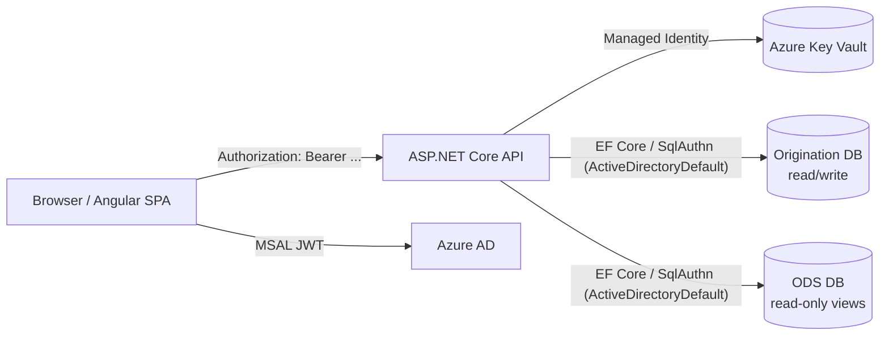

# Shared Infrastructure

> **Read this first.** Every screen-level doc in `Application Context/` references services, DbContexts, route guards, and auth setup defined here. Skim it once and use it as a reference when reading the screen docs.

## TL;DR

- Angular 21 SPA + ASP.NET Core (.NET 10) Web API.
- **Two databases**: `OriginationDbContext` reads ODS views (read-only), `ApplicationDbContext` owns the application's tables (read/write).
- **Auth**: Azure AD via MSAL (frontend) and Microsoft.Identity.Web (backend). Tokens are JWT bearer; cache is `sessionStorage` per security review.
- **State**: Angular signals via `AppStateService` (single global service). No NgRx.
- **Authorization model**: trade-unit entitlements are a *UX filter*, not an access boundary. See [SECURITY-MODEL.md](./SECURITY-MODEL.md).

## Architecture at a glance

## Frontend services

### `ApiService`

`client/src/app/core/services/api.service.ts`

- ~68 public methods. Every API call in the app goes through here.
- **Base URL** comes from `environment.apiBaseUrl` (`client/src/environments/environment.ts`).
- **Request deduplication** for expensive ODS endpoints — see `_dedupe<T>(key, request)`. Used by `getCustomers`, `getContracts`, `getTickets`, `getNotes`, `getStoredGrain`, `getCommodities`, `getElevators`, `getBidSheetLocations`, `getAllProducerDetails`, `getSavedLists`, etc. If two callers ask for the same key in flight, they share one HTTP request.
- **Error handling** is centralized: 403 messages are toasted to the user; all other errors are logged in dev mode and re-thrown.

### `AppStateService`

`client/src/app/core/services/app-state.service.ts`

The app's global state container, built on Angular signals. No NgRx, no Redux — every screen reads and writes signals here directly.

**Signals exposed (commonly read across screens):**

| Signal | Type | Notes |
| --- | --- | --- |
| `customers` | `Customer[]` | Filtered to selected trade units |
| `contracts` | `Contract[]` | Open-or-recent purchase contracts for the selected trade units. From CTRM via GraphQL when `Ctrm:Source` is `ctrm` (a cached date-window snapshot), else `vw_CurrentContracts`. See [CTRM GraphQL Data Source](./CTRM%20GraphQL%20Data%20Source.md). |
| `tickets` | `Ticket[]` | Settled tickets (last N days, depends on screen) |
| `todaysTickets` | `Ticket[]` | Last 30 days specifically — used by Insights |
| `notes` | `Note[]` | All notes for selected TUs |
| `plantingIntentions` | `PlantingIntention[]` | App-DB rows |
| `storedGrain` | `StoredGrain[]` | Computed in service from `ctrm.vw_GNTA39D1` |
| `savedLists` | `SavedList[]` | User's saved Build-a-List queries |
| `commodities`, `commodityConversions`, `harvestWindows` | reference | Crop catalog and lb-per-bushel conversions |
| `producerDetails` | `ProducerDetails[]` | App-DB enrichment (acres, bin capacity, etc.) |
| `pricingLines` | `ContractPricingLine[]` | Pricing lines for the selected producer — CTRM (live, inline on the contract) or ODS `vw_ContractPricing` per `Ctrm:Source` |
| `selectedTradeUnits`, `selectedGroupNames` | `string[]` | The TU selector's current state |
| `allProducersMode` | `boolean` | Session-only "All Producers" selector mode — clears TU scope so the customer list searches every producer (incl. ODS producers with no contract/ticket) for onboarding. Never persisted. |
| `selectedCustomer` | `Customer \| null` | Driven by Home page navigation |
| `dataLoading` | `boolean` | Global flag — true while the core preload (customers + contracts + today's tickets) is in flight. Both Insights and the Dashboard gate their spinners on this. |
| `ticketsLoading` | `boolean` | True while the background bulk `/api/tickets` set is still arriving (separate from the fast today's-tickets fetch). |
| `dashboardCache`, `preloadedDashboardSummary` | dashboard-specific cache | See Planting Intentions Dashboard doc |
| `mapGeocodeCache` | `Map<string, {lat, lng}>` | Used by Bid Sheet's Leaflet map |

**localStorage persistence:** key `origination_user_prefs` stores `{ groups?, units? }` — the trade-unit selection. Restored on construction.

**Setters** mirror the signals (`setCustomers`, `setContracts`, ...). There is also `clearBuildListState`, `clearSelection`, `clearAll`.

### `DataPreloadService`

`client/src/app/core/services/data-preload.service.ts` (search by name if path moves).

Coordinates the bulk fetch of customer/contract/ticket/note data when trade units change. Screens like Insights call `forceReload()` on it to reset and re-fetch from scratch. Without this service, every screen would have to manage its own cache invalidation on TU change.

**Loading model (important for "why is this screen slow").** On a TU change the service fires several requests and streams each into AppState as it lands:

- **Core group** = `getCustomers` + `getContracts` + `getTodaysTickets`. `dataLoading` flips false only when **all three** arrive. Both **Actionable Insights** and the **Planting Intentions Dashboard** gate their spinner on `dataLoading`, so they render together — and a slow ODS query (contracts, or today's tickets) holds both screens.
- **Background group** (non-blocking, streamed via `merge`): bulk `getTickets`, notes, planting intentions, stored grain, saved lists, commodities, harvest windows, producer details, and a pre-fetched dashboard summary.

> **Known perf cost:** `getTodaysTickets` runs the customer-storage gate (a scan of `ctrm.vw_GNTA39D1`, see the Ticket note below), so it isn't as fast as the "core group" comment assumes — and since it's in the blocking group, it can delay both screens. There's an in-flight change to drop the storage scan from that path and let each screen/category load on its own data; if you're reading this after that merges, the model above will have per-dataset loading flags.

### `NlqFilterService`

`client/src/app/core/services/nlq-filter.service.ts`

Natural-language query parser used by Build a List (and a few other places). Public methods include:

- `parseAndFilter(query, context)` — returns `{ customers, matched: matchedPatterns }`
- `applyRefinementFilters(customers, filters, contracts, notes)` — applies a `RefinementFilters` object
- `resolveUserReferences(query, displayName, username)` — converts "by me", "I haven't contacted" into the user's name so saved lists work for everyone
- Helpers: `queryInvolvesTickets`, `queryInvolvesStorage`, `queryInvolvesContact`, `queryInvolvesPlanting`

### `UsageTrackingService`

`client/src/app/core/services/usage-tracking.service.ts`

Posts click-event telemetry to `/api/usage-dashboard/click-event`. Methods like `trackProfileOpened`, `trackCallClick`, `trackPlantingTabClick`, `trackDashboardTabClick` are sprinkled throughout components. The data lands in `dbo.UserClickEvent` and is rolled up nightly into `FeatureUsageDaily` for the Usage Dashboard.

## Backend services and contexts

### `OriginationDbContext` (read-only ODS)

`api/GrainOriginatorPortal.Api/Data/OriginationDbContext.cs`

| `DbSet` | Backing view | Schema |
| --- | --- | --- |
| `CustomerTradeUnits` (`CustomerTradeUnitView`) | `vw_CustomerTradeUnits` | `originations` (no key — view only; drives the dbo.Customer / dbo.CustomerTradeUnit sync) |
| `Contracts` | `vw_CurrentContracts` | `base` |
| `Tickets` | `vw_CurrentTickets` | `base` |
| `TicketQualities` | `vw_TicketQuality` | `base` |
| `ContractPricingLines` | `vw_ContractPricing` | `base` |
| `Elevators` | `vw_GNP026` | `ctrm` |
| `CommodityConversions` | `vw_GNP024` | `ctrm` |

**Customer data is no longer in `OriginationDbContext`.** The previous `Customers` DbSet on `vw_CurrentCustomers` was removed when `dbo.CustomerSnapshot` was dropped (migration `20260513185441`). Customers and their TU mappings are now app-owned (`dbo.Customer` + `dbo.CustomerTradeUnit` on `ApplicationDbContext`), populated by `CustomerSyncBackgroundService`. The remaining ODS-side `vw_CustomerTradeUnits` view is still consulted for per-request access checks in `UserEntitlementService.ValidateCustomerAccessAsync`.

**Storage data** (`StoredGrain`) is **not** a DbSet — it's queried as raw SQL against `ctrm.vw_GNTA39D1` from `SqlDataService.GetStoredGrainAsync` (see Customer Home Page doc).

CHAR-padded columns (`CustomerCode`, `ContractNumber`) are auto-trimmed via `.HasConversion(...)` in the model builder.

### `ApplicationDbContext` (read/write Origination DB)

`api/GrainOriginatorPortal.Api/Data/ApplicationDbContext.cs`

All app-owned tables, all in `dbo`:

| Table | Purpose |
| --- | --- |
| `Customer` | App-owned customer master (one row per customer, synced from ODS `vw_CustomerTradeUnits` by `CustomerSyncBackgroundService`). Replaces the old read-from-ODS pattern + `CustomerSnapshot` cache. `IsManual` flags producers onboarded by hand (no contract/ticket) so the nightly sync's soft-delete pass won't deactivate them. |
| `CustomerTradeUnit` | Customer ↔ trade-unit junction (multi-TU producers get multiple rows). Synced alongside `Customer`. `IsManual` marks TU assignments made by a user in the Edit Producer dialog (vs sync-sourced from a contract/ticket) — manual ones are user-removable; sync ones are locked. |
| `CustomerLink` | Linked-producer edges (formerly `ProducerDetails.LinkedProducerIds` CSV; now a proper relationship table). |
| `CustomerCommodity` | Per-customer commodity list (formerly `ProducerDetails.Commodities` CSV). |
| `Notes` | Producer notes (with pin, soft-delete). Joined to `Customer` via FK; `CustomerName`/`CustomerCode` resolved on read. |
| `ProducerDetails` | Enrichment fields (acres, bin capacity, etc. — linked producers / commodities / contacts are separate tables). `PrimaryContact`/`PrimaryPhone` are legacy columns dual-written from the primary `ProducerContact` row for search/lookup compat. |
| `ProducerContact` | User-entered contacts per producer (name, phone, email; exactly one `IsPrimary`). Replaced as a set on producer-details upsert; searched by customer search (name + digits-only phone). |
| `ProducerPlantingIntentions` | Per-producer planting intentions (note: table named "Producer..." but EF model is `PlantingIntention`) |
| `Commodities` | Crop catalog (synced additively from ODS contract/ticket codes). `ShowInPlantingIntentions` (bit) flags the curated subset shown in the Planting Intentions crop dropdown — served by `GET /commodities/planting`; the full list is still `GET /commodities`. |
| `DashboardPlantingEstimates`, `DashboardMarketShares`, `DashboardActualHarvests` | Planting Intentions Dashboard persistence |
| `SavedLists` | User-saved Build-a-List queries |
| `ESignEnrollment` | eSign integration data |
| `UserPreferences` | Per-user UI preferences |
| `BidSheetLocations`, `BidSheetLocationBids`, `BidSheetLocationOrders`, `BidSheetPreferences` | Bid Sheet feature |
| `ElevatorCache` | Cached elevator data |
| `HarvestWindows` | Crop-specific harvest windows |
| `UserActivity`, `UserClickEvent`, `UserSession`, `UserActivityDaily`, `FeatureUsageDaily`, `WeeklyLoginAggregate`, `UserTradeUnitSnapshot` | Usage analytics |
| `QueryLibrary`, `QuerySearchLog` | Build a List prompt library and search-gap log |

### `IDataService` / `SqlDataService`

`api/GrainOriginatorPortal.Api/Interfaces/IDataService.cs` (interface) 
`api/GrainOriginatorPortal.Api/Services/SqlDataService.cs` (implementation)

All controllers depend on `IDataService` (DI'd as `SqlDataService` today, with `ApimDataService` stub reserved for a future API Management migration). Methods are grouped by domain:

- **Customer / Trade Unit / Farm**: `GetCustomersAsync`, `SearchCustomersAsync`, `GetCustomerByIdAsync`, `GetCustomerByScoularIdAsync`, `GetCustomersLinkedToAsync`, `UpdateCustomerAsync`, `GetTradeUnitsAsync`, `GetTradeUnitGroupsAsync`, `GetFarmsAsync`.
- **Contract**: `GetContractsAsync`, `GetContractsByCustomerAsync`, `GetHistoricalContractsForPacingAsync`, `GetContractsByCropYearAsync`, `GetPricingLinesAsync`, `GetPricingLinesByCustomerAsync`.
- **Ticket**: `GetTicketsAsync`, `GetTodaysTicketsAsync`, `GetTicketsByCustomerAsync`, `GetTicketsByFarmAsync`. Tickets are "applied" (P-prefix contract) or "unapplied" (contract number starts with **U/L/C** — Unload / Loadout / Customer-storage). **Customer-storage gate:** a C-prefix ticket only counts as unapplied while the producer still holds that commodity in active storage (`GetActiveStorageCommoditiesAsync` over `ctrm.vw_GNTA39D1`, applied by `GateCustomerStorageTickets`) — priced-out storage drops off. The gate runs on every unapplied path that includes C-prefix, including `GetTodaysTicketsAsync` (Spot Loads) — which is why that call hits the storage view (see the perf note under DataPreloadService).
- **Note**: `GetNotesAsync`, `GetNotesByCustomerAsync`, `GetNoteByIdAsync`, `AddNoteAsync`, `ToggleNotePinAsync`, `UpdateNoteAsync`, `DeleteNoteAsync`.
- **Planting Intention**: `GetPlantingIntentionsAsync`, `GetPlantingIntentionsByCustomerAsync`, `AddPlantingIntentionAsync`, `UpdatePlantingIntentionAsync`, `DeletePlantingIntentionAsync`.
- **Stored Grain**: `GetStoredGrainAsync`, `GetStoredGrainByCustomerAsync`.
- **Producer Details**: `GetProducerDetailsAsync`, `GetAllProducerDetailsAsync`, `UpsertProducerDetailsAsync`, `DeleteProducerDetailsAsync`.
- **Commodity**: `GetCommoditiesAsync` (full catalog), `GetPlantingCommoditiesAsync` (curated subset where `ShowInPlantingIntentions = 1`, for the planting crop dropdown), `GetCommodityConversionsAsync`, `GetHarvestWindowsAsync`.
- **Saved List**: `GetSavedListsAsync`, `SaveListAsync`, `UpdateListAsync`, `DeleteListAsync`.
- **Dashboard**: `GetDashboardSummaryAsync`, `GetDashboardPlantingEstimatesAsync`, `UpsertDashboardPlantingEstimatesAsync`, `GetDashboardMarketSharesAsync`, `UpsertDashboardMarketSharesAsync`, `GetDashboardActualHarvestAsync`, `UpsertDashboardActualHarvestAsync`, `DeleteDashboardActualHarvestAsync`.
- **Bid Sheet**: `GetElevatorsAsync`, `GetBidSheetLocationsAsync`, `GetAllBidSheetLocationsAsync`, `CreateBidSheetLocationAsync`, `UpdateBidSheetLocationAsync`, `DeleteBidSheetLocationAsync`, `BulkUpsertBidSheetBidsAsync`, `GetBidCropYearsAsync`, `GetBidCommoditiesAsync`, `GetBidMonthsAsync`, `GetBidSheetLocationOrderAsync`, `SetBidSheetLocationOrderAsync`, `GetBidSheetPreferenceAsync`, `SetBidSheetPreferenceAsync`.
- **Query Library**: `GetQueryLibraryAsync`, `LogQuerySearchAsync`.

**User identity inside the service:** `SqlDataService` extracts the caller's UPN from the `HttpContext.User` claims (priority: `preferred_username` > `upn` > `oid` > `Identity.Name` > `"system"`). Display names are resolved via `UserTradeUnitSnapshot` for user-facing text.

### `UserEntitlementService`

`api/GrainOriginatorPortal.Api/Services/UserEntitlementService.cs`

| Method | Purpose |
| --- | --- |
| `GetAllowedTradeUnitCodesAsync()` | Returns the set of trade-unit codes the user is entitled to. Loads from `UserTradeUnitAccess` once per request and caches. **Fails open** on entitlement-DB outage (returns empty set, sets `EntitlementsAvailable = false`). |
| `ValidateTradeUnitsOrThrowAsync(codes)` | Throws `ForbiddenException` if any requested code isn't entitled. Used by controllers that take a `tradeUnits` query param. |
| `ValidateCustomerAccessAsync(customerId)` | Looks up the customer's TUs from `originations.vw_CustomerTradeUnits` and checks against the user's entitled set. |

**Important:** Most customer-bound *read* and *write* endpoints **deliberately do not call `ValidateCustomerAccessAsync`**. See [SECURITY-MODEL.md](./SECURITY-MODEL.md) — trade units are a UX filter, not an access boundary.

## Auth and route guards

### MSAL (frontend)

`client/src/main.ts`

- Tenant: `1521f999-f722-4a4f-9747-166f93e9b0d1` (Scoular AAD).
- Dev SPA client: `e0f25943-ae8b-4c2d-8060-c9ffbd448aff`.
- Dev API scope: `api://00078a10-3f3f-4d17-9350-fe90401125ae/Origination.Application.Dev`.
- **Cache mode**: `sessionStorage`. Tokens die when the tab closes — see security comments at the top of `main.ts` for the threat-model rationale.
- Deep-link preservation: `auth.guard.ts` saves the target URL to `sessionStorage["deepLinkUrl"]` before redirecting to AAD; `main.ts` restores it after `loginRedirect` returns.

### Route guards

`client/src/app/guards/auth.guard.ts` — wraps `MsalGuard.canActivate()` and adds the deep-link save behavior.

`client/src/app/guards/admin.guard.ts` — checks for `"Admin"` in the user's role claims (sourced from `/api/me`). Used only on `/usage-dashboard`.

### Backend authentication

`api/GrainOriginatorPortal.Api/Program.cs`

- JWT bearer auth via `Microsoft.Identity.Web.AddMicrosoftIdentityWebApi()`.
- Policy `AdminOnly` (configured in Program.cs) requires the `Admin` role claim. Applied to `UsageDashboardController`'s read endpoints.
- **Trade-unit filter**: `[EnforceTradeUnitAccess]` (`api/GrainOriginatorPortal.Api/Filters/EnforceTradeUnitAccessAttribute.cs`) intersects the requested TUs with the user's entitled set. **Fails open on entitlement-DB outage for GET/HEAD**, again per the documented security model.

## Database connections

`api/GrainOriginatorPortal.Api/Program.cs`

- **Key Vault URI** read from configuration; secrets pulled via `ManagedIdentityCredential` in App Service or `DefaultAzureCredential` (CLI / VS) locally.
- **SQL auth** uses `SqlAuthenticationMethod.ActiveDirectoryDefault`; in dev a custom `AzureCliSqlAuthProvider` is registered to skip IMDS probing.
- Connection strings come from app config (Key Vault references in deployed envs, `appsettings.Development.json` locally).

Two contexts are registered:

- `OriginationDbContext` → ODS connection string (read-only views).
- `ApplicationDbContext` → Origination app-DB connection string (read/write).

## Key conventions

- **Cross-DB joins are not possible** in Azure SQL across these two contexts. Whenever an endpoint needs both ODS and app data, the service does the join in C# (e.g., looking up `CustomerId` in `dbo.Customer` after pulling raw rows from a CTRM view).
- **String matching** between domains: `Contract.CtrmCustomerId` ↔ `Customer.ScoularId`, `Ticket.CustomerCode` ↔ `Customer.ScoularId`, `Ticket.CtrmContractNumber` ↔ `Contract.SourceContractId`. (`ScoularId` is the column formerly called `SourceCustomerId`, renamed in migration `20260430164629`.) There are no FK relationships across ODS and app DB.
- **Customer load strategy**: `GetCustomersAsync` returns customers in the selected trade units, plus any manually-onboarded (`IsManual`) producers. "All Producers" mode bypasses TU scope and falls back to the ODS customer master so users can find producers with no contract/ticket yet.
  - **The trade-unit map is a UNION of contracts *or* tickets — not an intersection** (`originations.vw_CustomerTradeUnits`; see `docs/performance/customer-trade-unit-map.md`). A producer who has only delivered, or only contracted, is included.
  - The read itself applies **no contract/ticket predicate at all**: `CustomerRepository.GetAsync` queries `dbo.Customer` filtered by `IsActive` + (optionally) `CustomerTradeUnit` membership. Contracts are then fetched *for* that customer set, so **producers with zero contracts stay in the list** — which is what makes absence filters ("no contracts", "deliveries but no contracts") meaningful.
- **Date quirks**: `Ticket.Date` (BL date) is stored as a **string** in ODS and parsed in C# (`Ticket.ParsedDate` computed property). `AppliedNetQuantity` on tickets is `bigint`, not `decimal`.
- **Date-only JSON serialization**: a global converter stamps every `DateTime` as UTC (`...Z`) so real timestamps don't shift in the browser. But ODS **calendar-date** fields (contract `ContractDate`/`DeliveryStart`/`DeliveryEnd`/`ClosedDate`) have no time/zone — they use `[JsonConverter(typeof(DateOnlyJsonConverter))]` to serialize **without** the `Z`, so they render the same calendar date in any timezone (fixes the "shows a day early" bug). If you add a new date-only ODS field, apply that attribute.

## When something breaks

| Symptom | First place to look |
| --- | --- |
| 403 from any endpoint | Check `UserEntitlementService` — likely the user has no entitled TUs, or the requested TU isn't in their set. |
| Empty result from a customer-bound endpoint | Verify `appState.selectedTradeUnits()` is non-empty; many service methods early-return for empty TU lists. |
| Dashboards stale after TU change | `appState.clearDashboardCache()` should fire on TU change — check `AppStateService` constructor and the TU selector. |
| Login loop / "deep link lost" | `auth.guard.ts` and `main.ts` deep-link sessionStorage handshake — make sure both halves are still in place. |
| "Cross-database query not supported" SQL error | You introduced a join across `OriginationDbContext` and `ApplicationDbContext`. Move the join to C# (pull rows from each context, match in memory via `dbo.Customer`). |
| Actionable Insights / Dashboard slow, and they load at the same time | Both gate on the single `dataLoading` flag, which waits on the whole core group (customers + contracts + today's tickets). The long pole is usually the ODS ticket/contract scan — and `getTodaysTickets` additionally scans the storage view via the customer-storage gate. See the loading model + perf note under DataPreloadService. |
| Notes appear, then disappear | The StoredGrain merge race fix lives in `home.component.ts:335-352`. The same pattern is used for tickets and other per-customer fetches. See Customer Home Page doc → Troubleshooting. |

## See also

- [`SECURITY-MODEL.md`](./SECURITY-MODEL.md) — why most endpoints don't enforce per-customer access.
- [`CLAUDE.md`](../../developer-docs/CLAUDE.md) — Claude-specific notes on this repo.
- [`NETWORK-DIAGRAM.md`](../../developer-docs/NETWORK-DIAGRAM.md) — Azure infrastructure topology.
