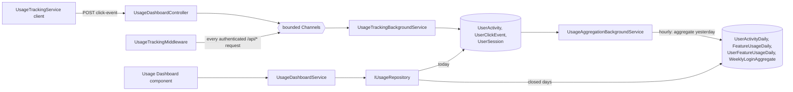

# Usage Dashboard

## At a Glance

- **Route**: `/usage-dashboard` (admin-only, env-gated by `environment.usageDashboardEnabled`)
- **Component**: [`client/src/app/features/usage-dashboard/pages/usage-dashboard/usage-dashboard.component.ts`](../../client/src/app/features/usage-dashboard/pages/usage-dashboard/usage-dashboard.component.ts)
- **Template**: [`usage-dashboard.component.html`](../../client/src/app/features/usage-dashboard/pages/usage-dashboard/usage-dashboard.component.html)
- **Access**: `authGuard` + `adminGuard` (must have `Admin` role claim).
- **Primary user goal**: monitor adoption, spot inactive originators, identify underused features, and find gaps in the query library — feed product / management decisions.

This is the only screen in the app gated by an actual role (vs. just "authenticated"). Backend reads are
gated server-side too, via the `UsageDashboardViewer` policy (equivalent to `AdminOnly` today, but named
separately so the read surface stays distinct from exclusion administration).

Two different questions decide what a person sees here, and they are deliberately kept apart —
see [Who sees how much](#who-sees-how-much).


## Who sees how much

Two independent questions, answered by two different sources. Confusing them is the easiest way to
get this wrong.

| Question | Answered by | Changed how |
| --- | --- | --- |
| May you open the dashboard at all? | `Admin` app role, granted by the **"Origination App {Env} Super Users"** Entra group | Entra group membership |
| How much of the org do you see? | the **`dbo.UsageDashboardViewAllUsers`** table | a SQL `INSERT` / `DELETE` |

Everyone in the Super Users group who is **not** in that table is auto-scoped to themselves plus
everyone reporting to them — the manager dropdown is hidden and they can only drill into users inside
their own subtree. The subtree is resolved from TradeUnitPreferences `vw_UserManagerLookup` by
materialized-path prefix, then intersected with the Entra app-access set so only people who can
actually sign in are counted.

`ViewAll` is deliberately **not** derived from the `Admin` role. That role only says "may open this".
It also could not work: every name in the table already holds `Admin` in QA and PROD through the
Super Users groups, so an Admin-implies-view-all rule would leave nobody scoped in the only
environments that matter.

### Changing who sees the whole org

Run `scripts/Manage-UsageDashboardViewAll.sql` against the environment's Origination database.

- Takes effect within **~60 seconds** (the API caches the list for a minute). No redeploy, no
  App Service restart.
- The person whose access changed then needs a **browser refresh** — the SPA decides whether to draw
  the manager dropdown from the synthetic `UsageDashboardViewAll` role in `/api/me`, which it only
  calls at page load.
- Fill in `Reason` and `CreatedBy`. They are the only audit trail for a row that widens what someone
  can see.

This list used to be the `UsageDashboard:ViewAll` array in `appsettings.json`, which meant a deploy
and a restart per change. The migration `AddUsageDashboardViewAllUsers` seeds the five names that
were in that array.

**Fail-closed by construction.** An empty table means everyone is scoped, never that everyone sees
everything — so if the table cannot be read, `UsageDashboardViewAllProvider` degrades to an empty
list and logs, rather than throwing or widening anyone's view. Enforcement is server-side at a single
funnel, `UsageDashboardService.ResolveEffectiveManagerIdAsync`; every read passes through it, so
scoping cannot be forgotten on a future endpoint.

| Piece | Path |
| --- | --- |
| Table entity | `api/GrainOriginatorPortal.Infrastructure/Data/Entities/UsageDashboardViewAllUser.cs` |
| Cached reader | `api/GrainOriginatorPortal.Api/Services/UsageDashboardViewAllProvider.cs` |
| Access rules | `api/GrainOriginatorPortal.Api/Authorization/UsageDashboardAccess.cs` |
| Manager subtree | `api/GrainOriginatorPortal.Api/Services/ManagerDirectoryService.cs` |
| Admin SQL | `scripts/Manage-UsageDashboardViewAll.sql` |
## How users reach it

- "Usage Dashboard" item in the profile menu — only rendered when (a) the user has the `Admin` role and (b) `environment.usageDashboardEnabled === true`.

## Vocabulary

Three different numbers used to all be called "sessions". They are now distinct, and the names are consistent across the API, the DTOs and the UI:

| Term | Meaning |
| --- | --- |
| **Session** | A real visit burst, from `dbo.UserSession`. A new one starts after 30+ minutes of inactivity. |
| **Screen minutes** | Time on a screen, inferred from the `screen_enter` sequence. |
| **Interaction count** | A count of explicit click events. |
| **Unique users** | Distinct users who touched something. |

## Date windows

`from`/`to` are **calendar dates in UTC** (`yyyy-MM-dd`, bound as `DateOnly`). The window is
`[from 00:00Z, to+1day 00:00Z)`, so `from == to` is one full day. The client builds these from the
*local* date (`toLocalIsoDate`) — using `toISOString()` would report tomorrow's date for anyone
working after ~18:00 US Central.

Both range buttons are inclusive of today, so "30 Days" spans `today-29 … today`.

One endpoint deliberately ignores the window:

- **`/weekly-trend`** is a whole-calendar-week trend (`?weeks=8`), not a window view.

User **status** also ignores the window: it is a current snapshot off each user's *all-time* last
activity (raw tables unioned with the long-retention daily rollup), so changing the date range never
moves anyone between tiers. Tiers: `Active` (used today, UTC) · `Light Usage` (within the last
7 days) · `Dormant` (longer than a week) · `Never` (no recorded activity, ever). Adoption Rate =
(Active + Light Usage) / total — "used within the last week" — because today-only Active would be
too twitchy for an adoption measure. All of this comes from one shared classifier
(`ClassifyUsersAsync`), so the summary KPIs, the donut, the user list and the per-user drill-down
cannot disagree.

## What it shows

| Section | Description |
| --- | --- |
| **Header** | Title, Trade Unit Selector, **Excluded Users** gear, date range buttons ("7 Days", "30 Days", "Custom"). |
| **4 KPI cards** | Adoption Rate (%), Avg Logins / Week (or / Month), Avg Session Duration, Needs Attention. |
| **Tab pills** | `Who's Using It` · `What They're Doing` · `Who Isn't Using It` |

`Avg Logins / Week` is a **per-active-user** average (users with at least one session), not the org's
total session count. `Avg Session Duration` is weighted by login count.

### `Who's Using It` tab

- User status donut — `Active` / `Light Usage` / `Dormant` / `Never`. These are the same values the
  API returns and the status filter offers, so the donut, the pills and the dropdown agree.
- Daily Active bar chart (last 15 days of the window).
- Originator table (sortable, searchable, filterable by status — all client-side).

### `What They're Doing` tab

- Time Spent by Screen (minutes). Selecting a specific screen switches the bars to that screen's
  **interaction counts** per sub-feature, and reveals the Query Library panels for Build a List.
- Weekly Login Trend (whole calendar weeks — not affected by the date filter).
- Activity breakdown table (per user: profiles viewed, contracts viewed, notes, calls/emails, lists
  built, planting intentions, producer details).

### `Who Isn't Using It` tab

- Inactive Originators list — `Dormant` + `Never`, most-stale first. No tunable threshold; it reads
  the same statuses as the donut.
- Low Usage Originators — the `Light Usage` tier (used within the last week, but not today),
  most-stale first.
- Underused Features, ranked by **distinct users**, honoring the trade-unit filter and exclusions.

## Data flow



### Reads are split between rollups and raw tables

`UsageDashboardService.BuildWindow` splits every request: **closed days come from the daily rollups**,
**today comes from the raw tables**. That keeps a 30-day view off the high-volume raw tables, and it
is also the only way to report on history older than the 90-day raw retention.

Endpoints on the split: `summary`, `users`, `daily-active`, `weekly-trend`, `feature-sessions`,
`underused-features`. Staying on raw for the whole window: `activity-breakdown` (its
profiles/contracts columns are distinct-by-producer *across* the range, which per-day rollups can't
reconstruct), `query-library-usage`, `query-search-gaps`, and `users/{id}/detail`.

> Screen-minute totals for historical days include one trailing minute per user per active day,
> because the rollup necessarily treats a day boundary as the end of a screen visit. See
> `ScreenTimeCalculator`.

## Files

| Layer | Path |
| --- | --- |
| Component | `client/src/app/features/usage-dashboard/pages/usage-dashboard/usage-dashboard.component.ts` |
| Drill-down | `client/src/app/features/usage-dashboard/pages/user-usage-detail/user-usage-detail.component.ts` |
| Shared formatting / sorting | `client/src/app/features/usage-dashboard/utils/` (`usage-format.ts`, `table-sort.ts`, `trade-unit-key.ts`) |
| Sort icon, exclusions panel | `client/src/app/features/usage-dashboard/components/` |
| Frontend tracking service | `client/src/app/core/services/usage-tracking.service.ts` |
| Admin guard | `client/src/app/guards/admin.guard.ts` |
| Controller | `api/GrainOriginatorPortal.Api/Controllers/UsageDashboardController.cs` |
| Service | `api/GrainOriginatorPortal.Api/Services/UsageDashboardService.cs` |
| Repository | `api/GrainOriginatorPortal.Infrastructure/Repositories/UsageRepository.cs` |
| Request → feature mapping | `api/GrainOriginatorPortal.Api/Services/FeatureNameMapper.cs` |
| Request logging middleware | `api/GrainOriginatorPortal.Api/Middleware/UsageTrackingMiddleware.cs` |
| Ingest worker | `api/GrainOriginatorPortal.Api/Services/UsageTrackingBackgroundService.cs` |
| Rollup / retention worker | `api/GrainOriginatorPortal.Api/Services/UsageAggregationBackgroundService.cs` |
| Screen-time inference | `api/GrainOriginatorPortal.Infrastructure/Abstractions/ScreenTimeCalculator.cs` |
| PII redaction | `api/GrainOriginatorPortal.Api/Services/TelemetrySanitizer.cs` |
| Entra app-access set | `api/GrainOriginatorPortal.Api/Services/AppAccessService.cs` |

### Controller endpoints

All read endpoints require `[Authorize(Policy = UsageDashboardAccess.PolicyName)]` (`"UsageDashboardViewer"`,
equivalent to `AdminOnly` today). Every panel endpoint also accepts `?managerId=` to narrow the view to
that manager's whole org subtree — but the value is only honoured for callers in
`dbo.UsageDashboardViewAllUsers`; everyone else is silently pinned to their own subtree. The exclusion endpoints
(`access-users`, `excluded-users` CRUD) are additionally restricted to the
`UsageDashboard:ExclusionManagers` allowlist in appsettings (the named IT users) — other admins get
403 and never see the gear.

| Verb / route | Returns |
| --- | --- |
| `GET /summary` | adoption rate, active users, avg logins/week (per user), avg session duration |
| `GET /users` | per-user status, logins, last active, avg session, customers contacted, notes |
| `GET /daily-active` | daily unique-user counts, gap-filled across the window |
| `GET /feature-sessions` | screen minutes per feature; with `?screen=` also that screen's sub-feature interaction counts |
| `GET /weekly-trend?weeks=8` | active users + sessions per calendar week |
| `GET /activity-breakdown` | per-user counts: profiles, contracts, notes, calls/emails, lists, planting intentions, producer details |
| `GET /underused-features` | features ranked ascending by distinct users |
| `GET /query-library-usage` | most-clicked library prompts, names resolved |
| `GET /query-search-gaps` | top 20 library searches that matched nothing |
| `GET /managers` | roster for the manager dropdown, from TradeUnitPreferences `vw_UserManagerLookup`; empty for a scoped caller, 503 if that DB is unreachable |
| `GET /users/{userId}/detail` | full per-user profile — drives the drill-down page |
| `GET /excluded-users/can-manage` | whether the caller is on the `UsageDashboard:ExclusionManagers` allowlist — the client hides the exclusion gear when false |
| `GET /access-users` | app-access roster (Entra group) for the exclusion picker; `available=false` ⇒ client falls back to free text |
| `GET /excluded-users` | current exclusion list with reason / who added it / when |
| `POST /excluded-users` | add an exclusion (409 if already excluded) |
| `DELETE /excluded-users/{id}` | remove an exclusion |
| `POST /click-event` | telemetry — accepts events from any authenticated user (**not** admin-only) |

### App-DB tables

| Table | Purpose |
| --- | --- |
| `UserActivity` | One row per authenticated `/api/*` call — `UserId`, `HttpMethod`, `Path`, `StatusCode`, `DurationMs`, `FeatureCode`, `SubFeatureCode`, `Timestamp`. Captured by middleware. `Path` is retained so feature codes can be re-derived after a mapping change. |
| `UserClickEvent` | Frontend-emitted click telemetry — `UserId`, `EventType`, `FeatureCode`, `SubFeatureCode`, `TargetId`, `Timestamp`. |
| `UserSession` | One row per visit burst; `DurationMinutes` is a persisted computed column. |
| `UserActivityDaily` | Per-user daily rollup — requests, sessions, session minutes, and per-feature counters. |
| `FeatureUsageDaily` | Per-feature daily rollup (no user dimension). `SessionCount` is **no longer written** — it used to hold unique-users as a stand-in for sessions. |
| `UserFeatureUsageDaily` | Per-user-per-feature daily rollup: `RequestCount`, `InteractionCount`, `ScreenMinutes`. The user dimension is what lets the feature panels honor trade-unit filters and exclusions. |
| `WeeklyLoginAggregate` | Per-user weekly rollup — `LoginCount` is distinct active days, `SessionCount` is sessions. Read by `/weekly-trend`. |
| `UserTradeUnitSnapshot` | Cached user → trade-unit mapping from the TradeUnitPreferences DB (`vw_UserTradeUnitPreferences`; was the Entitlements DB until 2026-08-18). Rebuilt every 6 hours inside one transaction. |
| `UsageDashboardExcludedUsers` | Accounts hidden from every dashboard view. Managed from the UI (gear icon) or by SQL. |
| `QueryLibrary` | Library prompt names, for resolving `TargetId`s. |

**Retention:** raw tables 90 days, rollups 400 days. Both are pruned with batched
`DELETE TOP (5000)` loops so a backlog drains as several short transactions.

## Who the dashboard reports on (the "user universe")

`UsageDashboardService.GetUserIdSetAsync`:

1. If **no** trade-unit filter and the Entra app-access set is available → the universe is the access
   group itself (everyone who can actually sign in), so someone with access but no entitlements row
   is still visible.
2. Otherwise → `UserTradeUnitSnapshot` for the selected trade units, intersected with the access set.
3. If Graph is unavailable, this **fails open** to the full entitlements snapshot rather than
   breaking the dashboard.
4. Finally, `UsageDashboardExcludedUsers` is subtracted (case-insensitive).

Resolving this costs a snapshot query plus an exclusion read, and a page load hits ~a dozen
endpoints — so it is cached for 60 seconds per normalized trade-unit key. Adding or removing an
exclusion bumps `UsageUniverseCacheState.Generation`, which makes every cached entry unreachable so
the change lands on the next request.

## How usage gets recorded

Two independent channels, both drained by `UsageTrackingBackgroundService` (5-second / 50-row batches,
bounded channels that drop writes rather than block a request):

1. **Middleware** logs every authenticated `/api/*` request. `FeatureNameMapper` turns the method +
   path into `(featureCode, subFeatureCode)`. **Anything the user does that hits an endpoint is
   captured here without client-side code** — including note create/edit/delete/pin, recap-group
   CRUD, and trade-unit selection changes (a `PUT /api/userpreferences`).
2. **Explicit click events** from `UsageTrackingService`, for things that leave no request behind:
   route changes (`screen_enter`), producer/contract/ticket interactions, call/email clicks, and:

| Action | featureCode | subFeatureCode |
| --- | --- | --- |
| Calculator opened | `calculators` | `profitability-opened` / `check-opened` / `cancel-roll-opened` |
| Calculator PDF exported | `calculators` | `profitability-pdf` / `check-pdf` / `cancel-roll-pdf` |
| @mention chosen in a note | `customers` | `notes-mention` |
| Unshipped Bushels search | `unshipped-bushels` | `search-customer` / `search-commodity` / `search-contract` |
| Unshipped Bushels producer expanded | `unshipped-bushels` | `group-expanded` |

The calculators are the notable case: they run entirely in the browser and call no API, so these
click events are the *only* record they exist. Because they have no `screen_enter` (they open as an
overlay) they never appear in the screen-time chart — they show up in the per-screen interaction
drill-down, in Underused Features, and on the drill-down's Calculators tab.

Free-text `TargetId`s (library searches, NLQ requests, unshipped searches) pass through
`TelemetrySanitizer`, which strips emails, formatted phone numbers, and bare long digit runs.

## Per-user drill-down

Click any row on the Originator table → `/usage-dashboard/users/:userId?from=…&to=…&tradeUnitKey=…`.
Shows an identity card, 4 KPIs, a daily-activity chart, time per screen, and seven per-feature tabs:
Producer Page · Build a List · Actionable Insights (incl. the Unshipped Bushels page) · Bid Sheet ·
Planting Dashboard · Calculators · Daily Recap. Each tab ends with that feature's recent activity.

`userId` is validated against the user universe — an out-of-scope id returns 404. One query each for
the user's clicks and activities feeds ~40 counters via a single bucketing pass (`ClickTally`).

`TargetId` names are resolved **by the row's own feature/sub-feature**, not by trying each lookup in
turn — a customer id and a query-library id can be the same number.

## Background jobs

`UsageAggregationBackgroundService` ticks hourly, but each job tracks its own last run:

- **Daily rollups** (`UserActivityDaily`, `FeatureUsageDaily`, `UserFeatureUsageDaily`) — once per
  day for yesterday, plus one re-run on the following tick to catch late-flushed rows. Aggregation
  is a full recompute, so re-running is safe.
- **Weekly rollup** — on the Monday tick, for the week that just closed.
- **Trade-unit snapshot** — every 6 hours (and at startup).
- **Retention cleanup** — daily.

### Backfilling rollups

The hourly job only ever processes yesterday, so after deploying — or after changing a feature-code
mapping — run:

```
POST /api/diagnostics/usage-rollups/backfill?days=90
```

(admin-only). Without this, the historical half of every chart reads empty rollup tables.

## Admin gating

- **Frontend**: `adminGuard` reads roles from `/api/me` and rejects unless `roles.includes('Admin')`.
- **Backend**: `[Authorize(Policy = "AdminOnly")]` on every read endpoint, configured in `Program.cs`.
- **`POST /click-event` is not admin-gated** — every authenticated user posts telemetry there.

## Feature flag

`environment.usageDashboardEnabled`. Route registered conditionally; menu item conditionally rendered.

## Troubleshooting

| Symptom | Likely cause | First place to look |
| --- | --- | --- |
| Menu item missing for an admin user | flag off, or `roles` lacks `'Admin'` | `/api/me` response; environment file |
| 403 on a `/api/usage-dashboard/...` GET | user lacks the `Admin` role claim | AAD app role assignment |
| Historical charts empty, today's data fine | rollups were never backfilled for those days | run the backfill endpoint above; check `dbo.UserFeatureUsageDaily` |
| Yesterday missing from a chart | the aggregation job hasn't run since midnight UTC | service logs; `dbo.UserActivityDaily` for yesterday |
| A feature shows 0 despite obvious use | its requests fall into `other`, or its events aren't fired | `FeatureNameMapperTests`; spot-check `dbo.UserActivity` `FeatureCode`/`Path` for the route |
| A calculator shows 0 | it hits no API, so a missing click event means no data at all | `calculator-launcher.component.ts`, the `*-report.service.ts` files |
| Numbers include an IT/dev account | that account isn't excluded | gear icon → Excluded Users |
| Excluding someone changed nothing | should take effect on the next request | confirm the POST returned 201; the panel re-triggers a reload on success |
| Everyone shows as "Never Logged In" | `UserTradeUnitSnapshot` is empty or the middleware isn't recording | check the snapshot table; `dbo.UserActivity` for recent rows |
| Query Search Gaps empty | no one has searched, or the events aren't posted | Build a List → search box |

## References

- [`Shared Infrastructure.md`](./Shared%20Infrastructure.md) — `Admin` policy registration, `adminGuard`, `UsageTrackingService`.
- [`Build a List.md`](./Build%20a%20List.md) — `dbo.QueryLibrary` and the search-gap events.
- `scripts/_VerifySchema.sql` — authoritative shape assertions for the usage tables.
