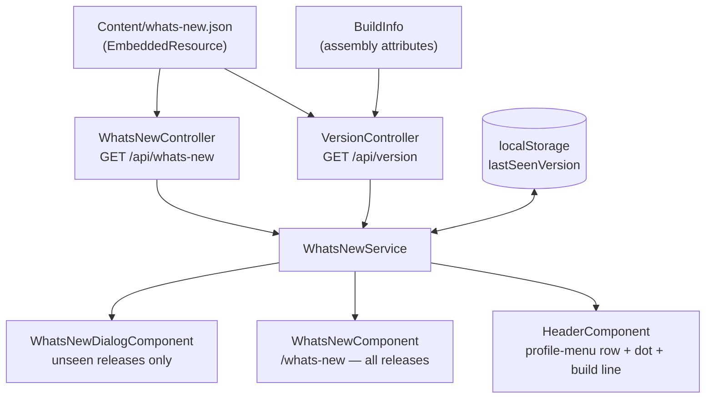

# What's New

## At a Glance

| | |
| --- | --- |
| **Route** | `/whats-new` (plus a dialog that fires once per deploy) |
| **Who sees it** | Every authenticated user. No role gating, no environment flag. |
| **Content source** | `api/GrainOriginatorPortal.Api/Content/whats-new.json`, hand-curated, newest release first |
| **Seen state** | `localStorage`, key `origination.whatsNew.lastSeenVersion` |
| **API** | `GET /api/whats-new`, `GET /api/version` — both `[Authorize]` |

Users used to hear what shipped only from the release email. This screen says it inside the app:
a dialog once after a deploy that carried notes, then a permanent page listing every release.

**If you change one thing about this feature, change the JSON.** Everything else is machinery.

## How users reach it

- **The dialog** opens by itself on the first load after a deploy that added a release entry. It
  closes on "Got it", the X, the backdrop, or Escape — all four record the acknowledgment.
- **The "What's New" row** in the profile menu, directly under Light/Dark Mode. This is the only
  way in — there is deliberately no header icon. It carries a red dot while something is unread.
- **The build line** at the foot of the profile menu (`Release 2026.09.1 · Build a1b2c3d`) and at the
  foot of the page, where it also names the workflow run and environment.

## The history starts at the first production release

The file deliberately carries no entries from before this feature shipped. Earlier releases
were announced by email only, and reconstructing them after the fact from merge history
produced descriptions nobody had verified — a page telling originators about a feature that
does not quite exist is worse than a short history. The list grows from the first production
release forward.

## The one rule that matters: one deploy, one entry

A release usually ships several feature branches, and ten undifferentiated bullets read badly.
**Group the items — do not split the release.**

The reason is `WhatsNewService.unseenReleases`: a user with nothing in `localStorage` is shown
**`all[0]` only**. A release's first production audience always has nothing stored, so four
same-day entries would announce the newest feature and silently bury the other three behind
"See all updates". `version` and `releasedOn` describe a *deploy*, which is exactly what the
seen/unseen check keys on, so the deploy stays the entry and the feature becomes the `group`.

## Updating it before a PROD deploy

**Do this before dispatching `deploy-prod.yml`.** Nothing stamps the release notes automatically: the
first entry in `api/GrainOriginatorPortal.Api/Content/whats-new.json` at the moment of the deploy is
what every user is shown once afterwards. The build stamp (commit and run number, `GET /api/version`)
*is* automatic, see [Version tracking](#version-tracking), so no workflow step is needed for that.

> This page is the canonical home of the pre-PROD step. It used to be repeated as a "Before a PROD
> Deploy" section in `developer-docs/GITHUB-ACTIONS-CICD.md`, but `developer-docs/` is synced from
> `IT/infrastructure-as-code` and the 2026-10-01 sync (PR #677) removed it. Keep app-specific
> process here, never in `developer-docs/`, or the next sync will delete it.

1. **Did this release change something a user would notice?** If not, **change nothing**. The
   version does not move, so no dialog fires. That is how a dependency bump, a refactor, or a
   security fix deploys silently.
2. If it did, prepend one entry:

```json
{
  "version": "YYYY.MM.N",
  "releasedOn": "YYYY-MM-DD",
  "title": "Short, plain-language headline",
  "summary": "Optional one-sentence framing.",
  "items": [
    { "group": "Optional heading", "kind": "added", "text": "What the user can now do." }
  ]
}
```

- `version` — `YYYY.MM.N`, N increments per release within the month. **Opaque to the code**, so it
  can go past 9. Never parsed, never ordered — only compared for equality.
- `releasedOn` — `YYYY-MM-DD`, deserialized as `DateOnly`.
- `kind` — `added`, `changed`, or `fixed`. Displayed as **New**, **Improved**, **Fixed**.
- `group` — optional heading. Items are grouped by **consecutive runs**, so file order is display
  order. A name that stops and restarts renders as two blocks, and the test suite fails on it.
- Write for originators, not engineers. Major and important changes only. Skip dependency bumps,
  refactors, migrations, and internal cleanups.

3. Run `dotnet test`. `WhatsNewControllerTests` validates the real embedded file — kinds, required
   fields, version format and uniqueness, newest-first ordering, contiguous and non-blank groups —
   so a typo fails the build instead of 500ing for every user on the first request after deploy.

## Replaying the dialog while developing

In the browser console:

```js
localStorage.removeItem('origination.whatsNew.lastSeenVersion');   // show the current release
localStorage.setItem('origination.whatsNew.lastSeenVersion', '<an older version>');  // show everything since
```

Then reload. No stored version means "show the current release", so `removeItem` is enough.

## Data flow



## Deciding what is unseen

`unseenReleases` uses **position in the list**, never date or version arithmetic:

| Stored value | Result |
| --- | --- |
| list empty | `[]` |
| `null` — first visit, cleared storage, private browsing | `[all[0]]`, the current release only |
| equals `all[0].version` | `[]` |
| found at index *i* | `all.slice(0, i)` — every release since, newest first |
| not found (pruned or renamed entry) | `[all[0]]` — fall back, do not dump the history |

A rollback therefore re-announces once, which is the honest answer.

The key is written **only on an explicit acknowledgment** — dismissing the dialog or opening the
page — never on load. Otherwise someone who closed the tab before reading would never see the notes.

## Why the notes are embedded, not a wwwroot asset

`app.UseStaticFiles()` runs **before** `app.UseAuthentication()`, so anything under `wwwroot` is
reachable without a token. The notes name internal work, so they are compiled into the assembly as
an `<EmbeddedResource>` and streamed by a controller behind `[Authorize]`.

The `<Content Remove="Content\whats-new.json" />` beside it is load-bearing: the Web SDK globs
`**\*.json` as Content by default and would otherwise publish a second, public copy.

## Version tracking

Two different notions of version, deliberately kept separate:

- **Release version** — the human number in the notes file. What users see. Moves only when there
  is something to announce.
- **Build stamp** — the commit and workflow run. `Directory.Build.props` sets `SourceRevisionId`
  from `GITHUB_SHA` and adds an `AssemblyMetadata` item from `GITHUB_RUN_NUMBER`. MSBuild reads
  environment variables as properties, so **CI stamps every build with no workflow changes**. The
  SDK appends the SHA to `InformationalVersion` as `+<sha>`; `BuildInfo` reads it back.

A developer build has neither variable, but the SDK fills `SourceRevisionId` from the local git
checkout anyway, so a local run still names the exact commit it was built from. Only the run
number falls back to `local`, because it has no local equivalent — a dev box prints something
like `Release 2026.09.1 · Build 09bc3fb (#local) · Development`.

The same values are logged once at startup, so App Insights shows which build is serving.

## Files

| Path | Role |
| --- | --- |
| `api/GrainOriginatorPortal.Api/Content/whats-new.json` | Content source of truth |
| `api/GrainOriginatorPortal.Api/GrainOriginatorPortal.Api.csproj` | `<Content Remove>` + `<EmbeddedResource>` |
| `api/GrainOriginatorPortal.Api/Controllers/WhatsNewController.cs` | `GET /api/whats-new`, `Lazy<>` cached |
| `api/GrainOriginatorPortal.Api/Controllers/VersionController.cs` | `GET /api/version` |
| `api/GrainOriginatorPortal.Api/Services/BuildInfo.cs` | Reads the CI build stamp from assembly attributes |
| `api/GrainOriginatorPortal.Api/Models/Responses/WhatsNewReleaseResponse.cs` | Release + item DTOs |
| `api/GrainOriginatorPortal.Api/Models/Responses/VersionResponse.cs` | Version DTO |
| `Directory.Build.props` | Stamps `SourceRevisionId` / `BuildNumber` in CI |
| `client/src/app/core/services/whats-new.service.ts` | Signals, localStorage, the unseen decision |
| `client/src/app/features/whats-new/whats-new-groups.ts` | Consecutive-run grouping |
| `client/src/app/features/whats-new/whats-new-kind.ts` | New / Improved / Fixed labels and pills |
| `client/src/app/features/whats-new/components/whats-new-release-list/` | Shared markup for dialog and page |
| `client/src/app/features/whats-new/components/whats-new-dialog/` | The once-per-deploy dialog |
| `client/src/app/features/whats-new/pages/whats-new/` | The `/whats-new` page |
| `client/src/app/app.component.ts` / `.html` | Loads once authenticated, owns the open state, `@defer`s the dialog |
| `client/src/app/shared/components/header/header.component.*` | Profile-menu row, dot, build line |

## Troubleshooting

**The dialog never appears after a deploy.** The notes file was probably not updated, which is the
designed-silent case. Otherwise check `localStorage` — if the stored version already equals the
newest entry, the user acknowledged it on an earlier load. Confirm `GET /api/whats-new` returns the
new entry first; the SPA bundle is cached but the API response is not, so a stale tab can lag a
deploy until it reloads.

**The endpoint 500s on the first request after a deploy.** The embedded resource name changed, or
the JSON no longer deserializes. The resource name is root namespace plus path with `/` → `.`
(`GrainOriginatorPortal.Api.Content.whats-new.json`). `dotnet test` catches both before deploy.

**The build line shows `#local` in a deployed environment.** The run number is missing, so the
build was not produced by GitHub Actions or `Directory.Build.props` lost its `AssemblyMetadata`
item. A commit reading `local` as well means the build ran outside a git checkout entirely.

**The unread dot will not clear.** The browser is refusing `localStorage` writes (private browsing).
The dialog is suppressed for the session but the state cannot survive a reload; this is expected
and deliberately not treated as an error.
