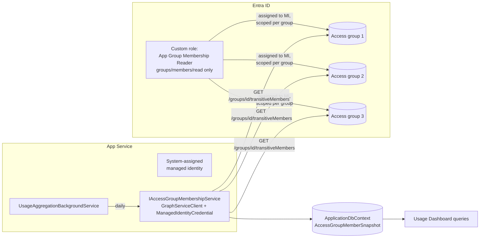

# Access-Group Membership Read for Usage Auditing

Implementation plan for granting `UsageAggregationBackgroundService` a **narrowly scoped**,
secretless way to read the membership of the Entra ID groups that grant access to Origination,
so the Usage Dashboard can compare **who has access** against **who actually uses the app**.

**Status:** Part 1 (Entra ID) is **implemented and its acceptance check has passed** (2026-07-14).
Full status, the role/assignment details, and the acceptance-check results live in
[`APP-GROUP-MEMBERSHIP-READER.md`](APP-GROUP-MEMBERSHIP-READER.md#current-status) — that doc is
the canonical record for "is Part 1 done and does it work"; this doc won't restate it. Part 3's
**Configuration** sub-step is also done — `UsageAccessAudit:*` app settings are deployed to
Dev/QA (Prod defined-but-dormant, see [Configuration](#configuration)) — but that's config-only
prep; no other application code exists yet.

**The load-bearing open item is [Step 5](#step-5-graph-permission-for-basic-profile-properties)**
— the acceptance check surfaced that member profile properties (UPN, display name) aren't
readable under Part 1's role and need a second, separate Graph permission. That's a design
decision affecting Part 3's code, so it's documented here rather than in the role's own status
doc.

---

## Table of Contents

- [Goal](#goal)
- [Design Decision](#design-decision)
  - [Chosen approach](#chosen-approach)
  - [Alternatives considered and rejected](#alternatives-considered-and-rejected)
- [Architecture](#architecture)
- [Part 1 — Entra ID Configuration](#part-1--entra-id-configuration)
  - [Prerequisites](#prerequisites)
  - [Step 1: Create the custom directory role](#step-1-create-the-custom-directory-role)
  - [Step 2: Collect the principal and scope IDs](#step-2-collect-the-principal-and-scope-ids)
  - [Step 3: Assign the role, scoped per group](#step-3-assign-the-role-scoped-per-group)
  - [Step 4: Smoke-test before writing any code](#step-4-smoke-test-before-writing-any-code)
  - [Step 5: Graph permission for basic profile properties](#step-5-graph-permission-for-basic-profile-properties)
- [Part 2 — Networking](#part-2--networking)
- [Part 3 — Application Changes](#part-3--application-changes)
  - [Configuration](#configuration)
  - [NuGet dependency and SBOM](#nuget-dependency-and-sbom)
  - [Snapshot entity and migration](#snapshot-entity-and-migration)
  - [Membership service](#membership-service)
  - [Aggregation service integration](#aggregation-service-integration)
  - [Identity join semantics](#identity-join-semantics)
  - [Local development](#local-development)
- [Security Considerations](#security-considerations)
- [Handoff — What's Actually Left To Do](#handoff--whats-actually-left-to-do)
- [Rollout Plan](#rollout-plan)
- [Backout Plan](#backout-plan)
- [Open Questions / Approvals](#open-questions--approvals)

---

## Goal

The usage-tracking subsystem (see `UsageTrackingBackgroundService`,
`UsageAggregationBackgroundService`) records which users exercise which features. It can answer
*"who used the app"* but not *"who could have"*. To surface entitled-but-inactive users, the
aggregation service needs the member list of the application access groups documented in
[`developer-docs/ENTRA-ID-GROUPS-GUIDE.md`](../../developer-docs/ENTRA-ID-GROUPS-GUIDE.md):

| Env | Group | App Role |
|-----|-------|----------|
| Dev | Origination App Dev Users | `User` |
| Dev | Origination App Dev Super Users | `Admin` |
| Dev/QA | Azure - Origination App - Developer Admins | `Admin` |
| QA | Origination App QA Users | `User` |
| QA | Origination App QA Super Users | `Admin` |
| Prod | Origination App Users | `User` |
| Prod | Origination App Super Users | `Admin` |
| Prod | Azure - Origination App - Production Support | `Admin` |

The constraint: Microsoft Graph **application** permissions for group membership
(`GroupMember.Read.All`, `Directory.Read.All`) are tenant-wide. This design avoids them
entirely.

## Design Decision

### Chosen approach

**A custom Entra ID directory role containing only `microsoft.directory/groups/members/read`,
assigned to the App Service's system-assigned managed identity, scoped to each access group
object individually.**

Why this shape:

- **Narrow by construction.** The identity can enumerate members of exactly the scoped groups.
  Graph returns `403` for every other group in the tenant. There is no tenant-wide grant
  anywhere in the design.
- **Secretless.** Directory roles can be assigned to service principals, and a managed identity
  *is* a service principal. Tokens for the MI can only be minted from inside the App Service —
  there is no credential to store, rotate, leak, or use off-box. (Same pattern as assigning
  *Directory Readers* to an Azure SQL server identity.)
- **The MI, not the API app registration's SP.** The `Origination API - *` app registration is
  a purely *inbound* identity today — the runtime validates tokens issued *to* it and never
  authenticates *as* it. Using its SP for outbound Graph calls would force its Key Vault client
  secret into runtime code: a portable bearer credential carrying directory rights. The MI keeps
  the grant compute-bound. If a self-documenting identity is preferred, a dedicated
  user-assigned MI works identically (see [Open Questions](#open-questions--approvals)).
- **Dormant without config.** Like the `FieldTags:*` pattern, the app feature activates only
  when the `UsageAccessAudit:*` configuration section is present.

### Alternatives considered and rejected

| Alternative | Why rejected |
|-------------|--------------|
| `GroupMember.Read.All` application permission | Tenant-wide read of every group membership; exactly the blast radius this design avoids. Fallback if custom roles are vetoed. |
| Enumerate Enterprise App assignments (`servicePrincipals/{id}/appRoleAssignedTo`) | Requires `Application.Read.All` (tenant-wide) *and* returns group assignments, not flattened users — member expansion is still needed. Strictly worse. |
| Entitlement Management API (access packages) | `EntitlementManagement.Read.All` is tenant-wide, and only the admin groups flow through access packages; the `appManaged` Users groups are owner-managed directly. |
| Harvest identities from sign-in tokens | Only sees users who *do* sign in — cannot find entitled-but-inactive users, which is the point. |
| Resource-specific consent | Only exists for Teams/chat resources, not security groups. |
| External exporter pushes a snapshot table (Logic App / runbook / pipeline) | Viable "option 2" that keeps all directory rights off the app. Rejected for now as a second deployable moving part; revisit if the custom-role approach is vetoed. |

## Architecture



Once per aggregation cycle (daily granularity), the aggregation service snapshots the
transitive membership of each configured group into an app table. Dashboard queries join the
snapshot against `UserActivityDaily` / `WeeklyLoginAggregate` to report access-vs-usage.

## Part 1 — Entra ID Configuration

### Prerequisites

- **Entra ID P1** — required for custom directory roles (Scoular has this).
- **Privileged Role Administrator** — normally held by IT Security for steps 1 and 3; in
  practice these were executed 2026-07-14 by khague under active Global Administrator. See
  [`APP-GROUP-MEMBERSHIP-READER.md`](APP-GROUP-MEMBERSHIP-READER.md) for the implemented role,
  assignments, and current status.
- Scoped assignments to a service principal must be made via Graph / Microsoft.Graph
  PowerShell; the portal UX does not cover this combination.

All scripts below follow the standing rule: always pass the Scoular tenant ID
(`1521f999-f722-4a4f-9747-166f93e9b0d1`) to `Connect-MgGraph`.

### Step 1: Create the custom directory role

One role definition serves all three environments (assignments differ per env).

```powershell
Connect-MgGraph -TenantId "1521f999-f722-4a4f-9747-166f93e9b0d1" `
    -Scopes "RoleManagement.ReadWrite.Directory" -NoWelcome

$role = New-MgRoleManagementDirectoryRoleDefinition -BodyParameter @{
    displayName     = "App Group Membership Reader"
    description     = 'Read-only membership enumeration of specific Entra groups. Grants nothing at definition level - assign scoped to individual group objects. Owned by IT Security; assignments granted per application request.'
    isEnabled       = $true
    rolePermissions = @(
        @{ allowedResourceActions = @("microsoft.directory/groups/members/read") }
    )
}
$role.Id   # record this — used in Step 3
```

### Step 2: Collect the principal and scope IDs

**Managed identity object IDs** (the *service principal* object ID, i.e. `principalId`):

```powershell
# Repeat per environment / subscription context
(Get-AzWebApp -ResourceGroupName rg-origination-dev-eus -Name app-origination-dev-eus).Identity.PrincipalId
```

**Access-group object IDs** — authoritative source is `appGroups[]` in the infrastructure
repo's `app-config.json` (the same source that generates `ENTRA-ID-GROUPS-GUIDE.md`), or:

```powershell
Get-MgGroup -Filter "displayName eq 'Origination App Dev Users'" | Select-Object Id, DisplayName
```

| Env | App Service (MI principal) | Groups to scope |
|-----|---------------------------|-----------------|
| Dev | `app-origination-dev-eus` | Origination App Dev Users; Origination App Dev Super Users; Azure - Origination App - Developer Admins |
| QA | `app-origination-qa-eus` | Origination App QA Users; Origination App QA Super Users; Azure - Origination App - Developer Admins |
| Prod | `app-origination-eus` | Origination App Users; Origination App Super Users; Azure - Origination App - Production Support |

### Step 3: Assign the role, scoped per group

One assignment per (environment MI × group). `directoryScopeId` of `"/<groupObjectId>"`
restricts the role to that single group object.

```powershell
$roleId      = "<role definition id from Step 1>"
$miPrincipal = "<MI service principal object id for this env>"
$groupIds    = @("<users-group-id>", "<superusers-group-id>", "<admins-group-id>")

foreach ($groupId in $groupIds) {
    New-MgRoleManagementDirectoryRoleAssignment -BodyParameter @{
        roleDefinitionId = $roleId
        principalId      = $miPrincipal
        directoryScopeId = "/$groupId"
    }
}
```

> **Note:** assignments to service principals must be permanent/active — PIM eligibility does
> not apply to workload identities.

An **administrative unit** containing the groups (scope `"/administrativeUnits/<auId>"`) is an
equivalent alternative that reduces assignment count and auto-covers future groups added to the
AU. Per-group scoping is preferred here because the group set is small and static, and the
per-object assignment is self-evidently minimal in an access review.

### Step 4: Smoke-test before writing any code

The load-bearing assumption is that Graph honors a *custom* directory role carried in an
app-only token's `wids` claim. **Verify this in Dev before building anything on it.**

Directory role activation for a service principal can take a few minutes to propagate.

> **Do not run this via the Kudu `/azure-exec` skill / `/api/command` endpoint.** That endpoint
> executes in a separate sidecar container which does **not** carry `IDENTITY_ENDPOINT` /
> `IDENTITY_HEADER` (confirmed empirically 2026-07-14: `env | grep -c IDENTITY` → `0` inside
> that container). A token-fetch curl run there silently fails on empty variables — it does not
> test what this step claims to test. Use one of:
> - **Browser-based SSH** into the Dev App Service (Portal → SSH, or
>   `https://app-origination-dev-eus.scm.azurewebsites.net/webssh/host`) — this execs into the
>   real app container, which does have the identity env vars. Run the commands below there.
> - A **temporary diagnostic route** added to the .NET app that calls `ManagedIdentityCredential`
>   directly and hits the same two Graph URLs, deployed to Dev, hit once, then removed.

From inside the real app container (via browser SSH, **not** `/api/command`):

```bash
# 1. Get an MI token for Graph (App Service token endpoint)
# Uses sed instead of python3/jq — neither is guaranteed present in the app container;
# sed is. If jq happens to be available, `| jq -r .access_token` is equivalent and clearer.
TOKEN=$(curl -s "$IDENTITY_ENDPOINT?resource=https://graph.microsoft.com&api-version=2019-08-01" \
  -H "X-IDENTITY-HEADER: $IDENTITY_HEADER" | sed -n 's/.*"access_token":"\([^"]*\)".*/\1/p')

# 2. MUST succeed (200, member list) — a scoped access group.
# Use the real group IDs from the UsageAccessAudit__Groups__*__ObjectId app settings IaC
# deployed to Dev (index 0 = Origination App Dev Users, 1 = Dev Super Users,
# 2 = Azure - Origination App - Developer Admins) — these are real env vars in the
# container now, not placeholders. Drop -o /dev/null while diagnosing to see the response body.
curl -s -H "Authorization: Bearer $TOKEN" \
  "https://graph.microsoft.com/v1.0/groups/$UsageAccessAudit__Groups__0__ObjectId/transitiveMembers?\$select=id,userPrincipalName"

# 3. MUST fail (403) — any group NOT scoped to the role. No env var exists for this on
# purpose (it must be a group the role was never assigned to) — substitute a real, unrelated
# group's object ID here.
curl -s -o /dev/null -w "%{http_code}\n" \
  -H "Authorization: Bearer $TOKEN" \
  "https://graph.microsoft.com/v1.0/groups/<unrelated-group-id>/members"
```

If step 2 returns `403` after propagation time, custom-role authorization for app-only Graph
membership reads is not honored as designed — stop, and fall back to the exporter model
(option 2 in [Alternatives](#alternatives-considered-and-rejected)) with this same scoped role
on the exporter's identity, or escalate to the identity team.

**Result: passed, 2026-07-14 (Dev)** — full results recorded in
[`APP-GROUP-MEMBERSHIP-READER.md`](APP-GROUP-MEMBERSHIP-READER.md#acceptance-check), not
restated here. Short version relevant to what comes next: step 2 succeeded but every returned
member had `"userPrincipalName":null` — expected, documented Graph behavior, not a
propagation issue — which is what drove [Step 5](#step-5-graph-permission-for-basic-profile-properties)
below.

### Step 5: Graph permission for basic profile properties

**Finding (2026-07-14):** the custom role's `microsoft.directory/groups/members/read` grants
reading the *membership relationship* — which IDs belong to the group — but not the *member
objects' own properties*. When a caller lacks permission to read a returned object's type, Graph
still returns the object but nulls every property except `id`/`@odata.type`. This matches
`APP-GROUP-MEMBERSHIP-READER.md`'s own description of the role ("confers nothing over the users
listed... does not extend to a group's members as directory objects") — we'd documented this as
a security property without tracing that it also blocks the UPN/display-name read the dashboard
needs.

**Why this needs a different mechanism than Part 1's custom role:** object-scoped role
assignments don't cascade onto a group's members as their own directory objects, for the same
reason above — so a second custom role for user-property reads would need to be assigned at
`directoryScopeId: "/"` (tenant-wide) to reach arbitrary members of arbitrary groups. That
removes the one advantage (per-object scoping) that justified using Entra RBAC over a Graph
permission in the first place. Since the blast radius converges to tenant-wide either way, this
step uses a plain Graph API permission instead of extending the RBAC approach — no scoping
benefit is being given up by doing so, and it's Microsoft's own purpose-built least-privilege
answer for this exact scenario.

**Decision: request `User.ReadBasic.All`, Application permission**, granted directly to the
managed identity's service principal (`New-MgServicePrincipalAppRoleAssignment` against the
Microsoft Graph service principal — no client secret, same secretless pattern as Part 1).
Confirmed property set: `displayName`, `givenName`, `id`, `mail`, `photo`, `securityIdentifier`,
`surname`, `userPrincipalName`. This covers everything the identity-join design needs.

**Known limitation — `accountEnabled` is not in the basic set.** `User.ReadBasic.All` does not
expose it; only the fuller `User.Read.All` does. **Decision: drop `AccountEnabled` from
`AccessGroupMemberSnapshot` and the Usage Dashboard for now** rather than request the broader
permission for one field — see [Snapshot entity and migration](#snapshot-entity-and-migration).
Revisit if there's a real product need for surfacing disabled-account status later.

**Not yet executed** — this is a decision, not a completed step. Someone with the appropriate
Entra permissions needs to grant `User.ReadBasic.All` (Application) to each environment's MI
service principal, the same way the Part 1 role assignments were made.

## Part 2 — Networking

Per [`developer-docs/CLAUDE.md`](../../developer-docs/CLAUDE.md), the App Service's VNet
egress is NSG-restricted and external API calls need a custom outbound rule.

- **Token acquisition** uses the App Service-local identity endpoint — no NSG change.
- **`graph.microsoft.com:443`** is a new outbound dependency. Verify whether the existing
  `AzureActiveDirectory` service-tag rule (used for token validation metadata) already covers
  Microsoft Graph IPs; if not, add an outbound allow rule for Graph before rollout. Test with the
  Step 4 smoke-test above (from browser SSH, not `/api/command`) — a hang/timeout on step 2
  indicates NSG, not authorization.

## Part 3 — Application Changes

### Configuration

New optional section; the feature is **dormant when absent** (mirrors the `FieldTags` POC
pattern). Group IDs are per-environment App Service app settings, not committed JSON.

```jsonc
"UsageAccessAudit": {
  "Groups": [
    { "objectId": "<guid>", "name": "Origination App Dev Users",       "appRole": "User"  },
    { "objectId": "<guid>", "name": "Origination App Dev Super Users", "appRole": "Admin" },
    { "objectId": "<guid>", "name": "Azure - Origination App - Developer Admins", "appRole": "Admin" }
  ]
}
```

App Service setting form: `UsageAccessAudit__Groups__0__ObjectId`, etc. Group **object IDs are
not secrets** — plain app settings are fine; Key Vault is not required.

**Status (2026-07-14): deployed to Dev and QA, defined-but-dormant in Prod.** IaC added
`overrides.appSettings.{dev,qa,prod}` in `infrastructure-as-code/origination/app-config.json`
and ran `deploy.ps1 -Component appservice` for Dev and QA — confirmed live via
`az webapp config appsettings list` on both. **Prod is intentionally not applied** — the
setting block exists in config but has not been deployed to `app-origination-eus` (confirmed
empty). It will not reach the live Prod App Service until a future `-Component appservice`/`all`
deploy runs for Prod, which could happen for an unrelated reason before this feature's code and
acceptance check are ready — harmless today (no code reads `UsageAccessAudit:*` yet), but don't
mistake its presence in `app-config.json` for a signal the feature is live in Prod. This was
config-only prep, unblocking application-side work; no application code exists yet
(`IAccessGroupMembershipService` is still unwritten — see [Handoff](#handoff--whats-actually-left-to-do)).

### NuGet dependency and SBOM

- Add `Microsoft.Graph` (latest 5.x) to `GrainOriginatorPortal.Api`. `Azure.Identity` 1.18.0
  is already referenced.
- **Update the SBOM tables in `README.md` per org policy** in the same PR that adds the
  package (name, version, MIT license, purpose: "Graph client for access-group membership
  snapshots").

### Snapshot entity and migration

New `ApplicationDbContext` entity + EF migration (read/write context — correct home per the
Data Sources rules):

```csharp
public class AccessGroupMemberSnapshot
{
    public int Id { get; set; }
    public DateOnly SnapshotDate { get; set; }
    public string GroupObjectId { get; set; } = string.Empty;
    public string GroupName { get; set; } = string.Empty;
    public string AppRole { get; set; } = string.Empty;        // "User" | "Admin"
    public string UserObjectId { get; set; } = string.Empty;   // Entra oid
    public string UserPrincipalName { get; set; } = string.Empty;
    public string UserId { get; set; } = string.Empty;         // normalized join key — see below
    public string? DisplayName { get; set; }
}
```

`AccountEnabled` intentionally omitted — see
[Step 5](#step-5-graph-permission-for-basic-profile-properties): `User.ReadBasic.All` doesn't
expose it, and requesting the fuller `User.Read.All` for one field wasn't judged worth it.
Revisit if a real product need for disabled-account status shows up later.

Suggested indexes: `(SnapshotDate, GroupObjectId)` and `(SnapshotDate, UserId)`. Retention:
delete snapshots older than the existing usage-retention window (90 days,
`CleanupUsageRetentionAsync`) so access history and usage history cover the same span.

### Membership service

`IAccessGroupMembershipService` in `GrainOriginatorPortal.Api/Services`, registered only when
`UsageAccessAudit:Groups` is non-empty:

- `GraphServiceClient` built on `ManagedIdentityCredential` (per the cold-start guidance in
  `developer-docs/CLAUDE.md` — do not use `DefaultAzureCredential` on App Service).
- **Two Graph calls per group, not one** — see
  [Step 5](#step-5-graph-permission-for-basic-profile-properties) for why a single `$select`
  can't get both membership and profile data under the current permission model:
  1. `GET /groups/{id}/transitiveMembers/microsoft.graph.user` with `$select=id` (this is all
     the custom role authorizes — requesting `userPrincipalName`/`displayName` here comes back
     null, not an error), following `@odata.nextLink` pages. **Transitive** so nested-group
     members are captured.
  2. Resolve profile properties for the returned IDs via `User.ReadBasic.All`, e.g.
     `GET /users?$filter=id in ({ids})&$select=id,userPrincipalName,displayName` (batch by ID, or
     use `/$batch` — id list per group is small). This call needs `User.ReadBasic.All` granted
     to the MI service principal; step 1 alone does not authorize it.
- Writes one snapshot per day (idempotent: delete-and-rewrite the current date's rows, so an
  intra-day rerun self-heals).
- **Failure isolation:** wrap in the same pattern as `RefreshTradeUnitSnapshotAsync` — log a
  warning and continue. A Graph outage must never fail the aggregation cycle; dashboard
  queries fall back to the most recent successful snapshot.

### Aggregation service integration

Add a `SnapshotAccessGroupMembershipAsync` step to the `UsageAggregationBackgroundService`
hourly loop, guarded to run once per UTC day (alongside the existing daily aggregations), plus
the retention delete in `CleanupRetentionAsync`. No other changes to the service's shape — it
stays a scheduler that delegates to injected services.

### Identity join semantics

`UsageTrackingMiddleware` keys usage rows on the **UPN prefix**:
`preferred_username` truncated before `@`, falling back to the raw `oid` when
`preferred_username` is absent (`UsageTrackingMiddleware.cs`). Therefore:

- `AccessGroupMemberSnapshot.UserId` = `UserPrincipalName` truncated before `@`, lowercased to
  match comparison behavior in dashboard queries.
- Because usage rows can occasionally carry an `oid` fallback, dashboard comparison queries
  should join on `UserId` **or** `UserObjectId`.
- Guest accounts (`#EXT#` UPNs) won't match the prefix convention; none are expected in these
  groups, but the snapshot preserves the full UPN so they remain identifiable.

### Local development

`ManagedIdentityCredential` does not exist locally. Two acceptable options:

1. Leave `UsageAccessAudit` unconfigured locally — feature stays dormant (default).
2. For testing the service itself, use `AzureCliCredential` behind an `IsDevelopment()` branch;
   a signed-in developer's *delegated* token can read group membership under default user
   permissions.

Never work around it by putting a client secret in local config.

## Security Considerations

- **Blast radius if the App Service is fully compromised:** *membership* enumeration is confined
  to the configured access groups only — no tenant-wide reach there. But `User.ReadBasic.All`
  (Step 5) is unavoidably tenant-wide by construction (object-scoped role assignments can't reach
  arbitrary member users, so this had to be a Graph permission instead of a further-scoped Entra
  role — see Step 5's reasoning). Net effect: a compromised App Service could read basic profile
  properties (`displayName`, `userPrincipalName`, `mail`, `photo`, etc.) for *any* user in the
  tenant, not just members of the three access groups — narrower than `User.Read.All` (no
  extended profile, no manager chain, no licenses), but broader than the group-membership grant
  alone. No write path either way.
- **Grant visibility:** the custom role and its assignments appear in Entra role assignments
  and audit logs; assignment/removal events are logged. Include the role in periodic access
  reviews alongside the existing quarterly group reviews.
- **Data classification:** the snapshot stores employee UPNs/display names (internal PII —
  Confidential). It lives in the same Azure SQL database as the usage data it joins against,
  behind private endpoints. Do not log member lists; log counts only.
- **In-process scope:** anything running in the API process can use the MI, not just the
  aggregation service. Accepted: the MI already holds Key Vault read and SQL access; this adds
  a strictly-scoped directory read. A dedicated user-assigned MI is the alternative if the
  grant should be self-documenting (see below).
- **Change management:** the Prod role assignment was applied without a ServiceNow CHG,
  treated as non-disruptive (read-only Graph directory-role grant, no deployment/downtime
  risk); IT Security's approval of the Global Administrator activation used to make it serves
  as the change record. The Part 2 NSG change has not happened yet and will need its own CHG
  before Prod rollout.

## Handoff — What's Actually Left To Do

Read this before touching Part 2 or Part 3. In priority order:

1. ~~Close the acceptance check (Step 4).~~ **Done, 2026-07-14** — `200`/`403` both confirmed as
   designed in Dev.
2. **Grant `User.ReadBasic.All` (Application) to each environment's MI** — see
   [Step 5](#step-5-graph-permission-for-basic-profile-properties). Needed before the membership
   service can resolve UPN/display name for the IDs Step 4 already proved it can enumerate.
3. Proceed with Part 2 (Networking) and the rest of Part 3 (Application Changes). Part 3's
   **Configuration** sub-step is already done (Dev/QA app settings deployed, Prod
   defined-but-dormant — see [Configuration](#configuration)); everything else in Part 3 (NuGet
   dependency, snapshot entity/migration — now without `AccountEnabled` — membership service
   using the two-call model, aggregation integration) is still unwritten. (Part 2's NSG change
   still needs its own CHG when it happens — see Security Considerations.)

## Rollout Plan

1. **Dev:** ~~create role → assign to Dev MI (3 groups)~~ done. ~~set config~~ done
   (`UsageAccessAudit:*` app settings live). ~~smoke-test (Step 4)~~ **passed 2026-07-14.**
   **Remaining:** grant `User.ReadBasic.All` (Step 5) → NSG verification → write the application
   code (Part 3) → verify snapshot rows and dashboard join.
2. **QA:** ~~assign to QA MI~~ done. ~~set config~~ done. **Remaining:** verify once app code
   exists. Exercise the Graph-outage path (temporarily remove one assignment; confirm warning
   log + stale-snapshot fallback).
3. **Prod:** role assignment done (see [Open Questions](#open-questions--approvals) item 1);
   app settings defined but **not yet applied** (see [Configuration](#configuration)). CHG
   ticket still needed covering the app-settings deploy + (if needed) NSG rule. Deploy config
   after Dev/QA validation; verify first snapshot next cycle.

Each step is independently reversible; the app ships dormant until its config is set.

## Backout Plan

- **App level:** remove the `UsageAccessAudit` app settings — feature returns to dormant on
  next restart. Snapshot table is inert data; drop via migration at leisure.
- **Entra level:** request IT Security remove assignments
  (`Remove-MgRoleManagementDirectoryRoleAssignment`) — each removal instantly revokes that
  reach. The shared role definition stays (Security-owned); no credentials to clean up.

## Open Questions / Approvals

1. ~~Role/assignments approval and creation~~ / ~~smoke-test outcome (Step 4)~~ — both **done and
   passed**; see [`APP-GROUP-MEMBERSHIP-READER.md`](APP-GROUP-MEMBERSHIP-READER.md) for the
   canonical record (role definition, assignments, ownership, acceptance-check results) rather
   than restating it here.
2. **System-assigned vs dedicated user-assigned MI.** This doc specifies the system-assigned
   MI (pragmatic; no new identity). A user-assigned MI dedicated to usage auditing is
   self-documenting in access reviews and portable if the usage services move to their own
   host — but within one process the separation is cosmetic. Decide at Dev rollout; the
   scripts differ only in `principalId`.
3. **`User.ReadBasic.All` grant (Step 5), not yet executed.** Needed to resolve UPN/display name
   for the member IDs the acceptance check proved enumerable; discovered as a gap only once that
   check actually ran (member objects came back with every property null except `id`).
   Tenant-wide by construction — see
   [Step 5](#step-5-graph-permission-for-basic-profile-properties) for why that's unavoidable
   here and what it does/doesn't expose.
